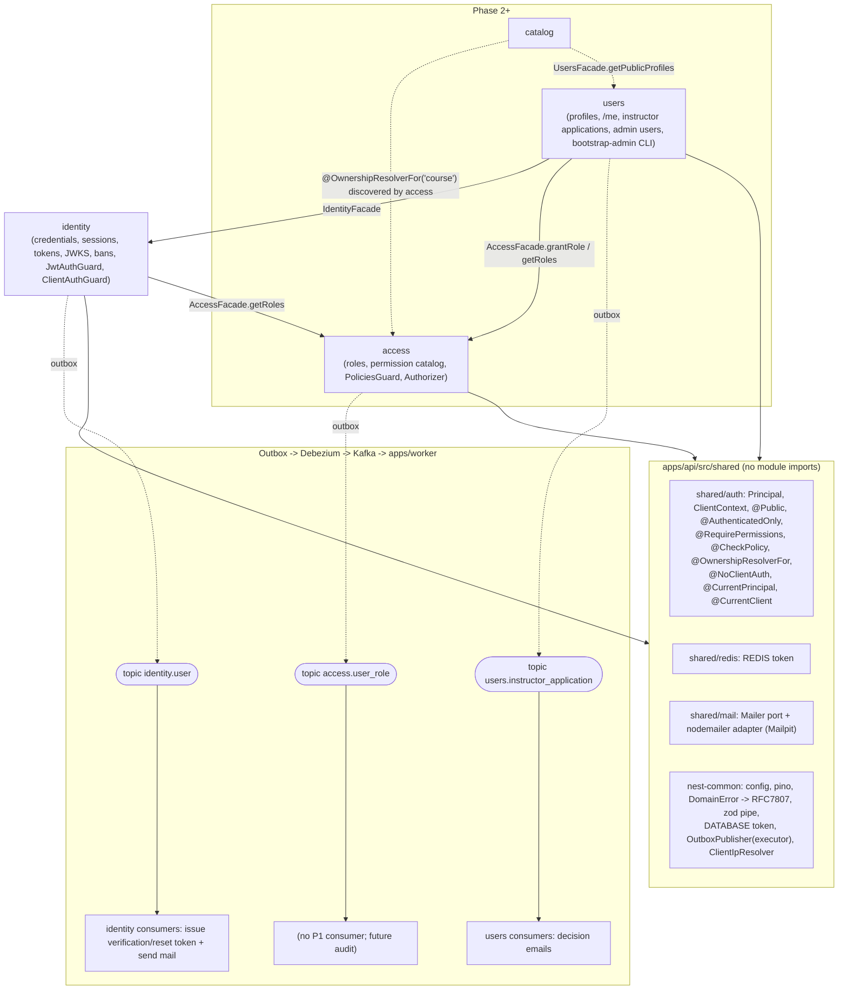
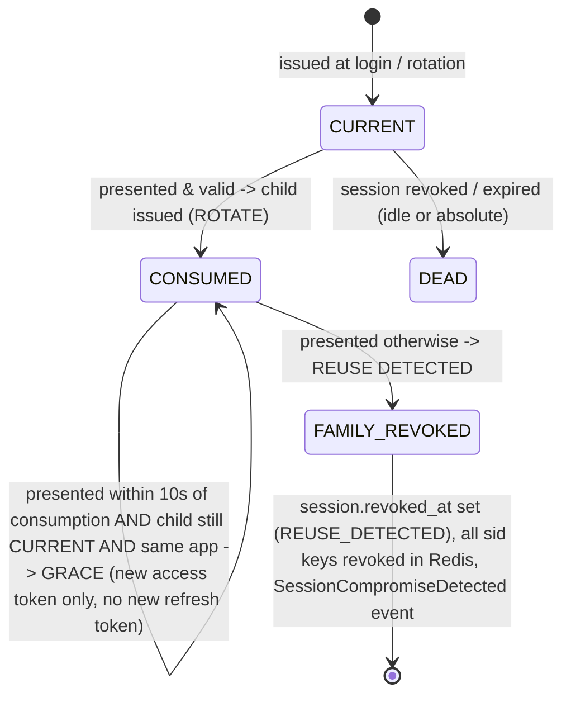

# Phase 1 Design: Identity & Access (Udemy clone v2)

## What I read, and the constraints it puts on this design

- `/Users/hamidovraxmatjon/coding/learnigProjects/udemy/docs/architecture-plan.md`
- `/Users/hamidovraxmatjon/coding/learnigProjects/udemy/packages/db/src/{database,transaction,outbox,index}.ts`, `migrations/2026_10_09_0001_init.ts`, `generated/db.ts`
- `/Users/hamidovraxmatjon/coding/learnigProjects/udemy/packages/eslint-config/nest.js`
- `/Users/hamidovraxmatjon/coding/learnigProjects/udemy/packages/contracts/src/events/*`, `http/problem-details.ts`
- `/Users/hamidovraxmatjon/coding/learnigProjects/udemy/infra/docker/docker-compose.dev.yml`, `infra/debezium/outbox-connector.json`
- `/Users/hamidovraxmatjon/coding/learnigProjects/udemy/apps/web-*/src/lib/env.ts`, `.env.example`

`apps/api/src`, `apps/worker/src` and `packages/nest-common` have no source files yet (only Dockerfiles), so `apps/api/src/modules/README.md` does not exist. I designed against the Phase 0 concepts you described.

What I found in the code, and how each finding affects this design:

1. **No `users` schema yet.** Migration 0001 creates `identity`, `access`, `audit`, ... but not `users`. Phase 1 migration 0002 must run `CREATE SCHEMA users`.
2. **Event types carry their version.** `outbox.events` has no version column. Event types are written as `<Name>.v<N>` through `defineEvent`/`qualifyEventType`. The aggregate type is also the Kafka topic (EventRouter `route.by.field=aggregate_type`), and `aggregate_id` is the Kafka key. So every `identity.user` event is keyed by `userId` and stays ordered per user.
3. **ESLint boundaries.** `application` may import other modules' `index.ts` (`module-facade`). `infrastructure` and `presentation` may not. `shared` may import only `shared`. Consequences:
   - Cross-module calls happen only in application services.
   - Auth primitives that every module's controllers use (decorators, the `Principal` type) must live in `src/shared/auth`, not inside `access` or `identity`.
   - Guards are registered globally in `AppModule`, so controllers never import them.
4. **The frontends currently expose `NEXT_PUBLIC_API_URL` to the browser.** The BFF decision below removes that. The browser never talks to the API.
5. **Cookies on localhost are not isolated by port.** Apps on :3000, :3001 and :3002 share one cookie jar. Cookie names must therefore be unique per app, and refresh tokens must be bound to an app (see Security).
6. **Kysely conventions.** `CamelCasePlugin` camel-cases jsonb keys on read, `int8` comes back as a string, and transactions are `Executor = Kysely<DB> | Transaction<DB>`. Facade methods that write take an `Executor`, so the calling module owns the transaction (a UnitOfWork spanning modules).

---

## 1. Module dependency diagram



The dependency graph has no cycles: `access` depends on nothing, `identity` depends on `access`, and `users` depends on both.

**Global guard order.** All guards are registered explicitly in `AppModule` as `APP_GUARD`, in this order:

1. `ClientAuthGuard` (identity): authenticates the calling BFF.
2. `ThrottlerGuard`: Redis storage, keyed by the trusted client IP.
3. `JwtAuthGuard` (identity).
4. `PoliciesGuard` (access).

Routes are secure by default. At boot, `RouteSecurityAuditor` (access) scans every route. If a route has none of `@Public`, `@AuthenticatedOnly`, `@RequirePermissions` or `@CheckPolicy`, startup fails and the offending handlers are listed.

---

## 2. Key decisions

| #   | Decision                | Choice                                                                                                                                                                                         | Why                                                                                                                                                                                                                                                                                                                                                                                                                                                       |
| --- | ----------------------- | ---------------------------------------------------------------------------------------------------------------------------------------------------------------------------------------------- | --------------------------------------------------------------------------------------------------------------------------------------------------------------------------------------------------------------------------------------------------------------------------------------------------------------------------------------------------------------------------------------------------------------------------------------------------------- |
| D1  | JWT algorithm           | **EdDSA (Ed25519)** via the `jose` library, used directly. No `@nestjs/jwt`/`jsonwebtoken`, no Passport.                                                                                       | Small keys and signatures, fast, and a deterministic signature (no RNG failure mode). `jose` runs in Nest, in the Next `proxy.ts` and in any future service. Header `alg: "EdDSA"` with `crv: "Ed25519"` for widest compatibility.                                                                                                                                                                                                                        |
| D2  | Argon2 library          | **`@node-rs/argon2`**                                                                                                                                                                          | Prebuilt N-API binaries including linux-musl (our alpine images), no node-gyp, works on Node 22. Argon2id, m=19456 KiB, t=2, p=1 (OWASP baseline), set through config. `needsRehash` runs at login.                                                                                                                                                                                                                                                       |
| D3  | Refresh token           | Opaque 32 random bytes, base64url. The DB stores `HMAC-SHA256(REFRESH_TOKEN_PEPPER, token)`.                                                                                                   | Argon2 is pointless for high-entropy secrets. The HMAC pepper means a DB dump alone cannot be used to look up tokens.                                                                                                                                                                                                                                                                                                                                     |
| D4  | Permissions             | **Defined in code**: a permission catalog in `packages/contracts` and the role-to-permission map in `access/domain`. Roles and role assignments live in tables.                                | A permission is meaningless unless code checks it, so the catalog must be versioned and reviewed with that code. With only 3 fixed roles and no custom-role requirement, a table only adds sync and cache-invalidation problems. Upgrade path: if custom roles are ever needed, add `access.permissions`/`access.role_permissions`, validated against the code catalog. **This deviates from the plan's "permissions table"; flagged in Open Questions.** |
| D5  | STUDENT role            | **Implicit**: every active user holds STUDENT by construction. `access.user_roles` stores only INSTRUCTOR/ADMIN.                                                                               | The invariant "every user is a STUDENT" can never be broken, and signup does not have to write to `access`.                                                                                                                                                                                                                                                                                                                                               |
| D6  | App-scoped authority    | A token carries `app` (student, instructor or admin). Effective permissions = baseline ∪ perms(roles allowed in that app). Allowed roles: student→STUDENT, instructor→INSTRUCTOR, admin→ADMIN. | XSS in the large student app cannot use an admin's ADMIN powers. Granting INSTRUCTOR needs no token refresh in the student app. Logging into the instructor or admin app requires the matching role.                                                                                                                                                                                                                                                      |
| D7  | BFF                     | **The BFF proxies every API call.** The browser only ever talks to its own Next origin. The API is reachable only from the BFFs, which authenticate with per-app client credentials.           | See section 9.                                                                                                                                                                                                                                                                                                                                                                                                                                            |
| D8  | Display name storage    | `identity.users.display_name`. The `users` module owns the profile _use cases_; the rich profile lives in `users.profiles`.                                                                    | Signup collects it atomically with no `identity → users` cycle. Emails and the admin search (both identity-side) need it. Avoids eventually-consistent profile creation.                                                                                                                                                                                                                                                                                  |
| D9  | Ban state               | `identity.user_bans` (authentication-blocking state belongs to identity). The admin use case lives in `users` and calls the identity facade.                                                   | Login and refresh must check bans without calling into `users`.                                                                                                                                                                                                                                                                                                                                                                                           |
| D10 | Email/reset tokens      | **Issued by the worker**, deterministically: `raw = base64url(HMAC-SHA256(EMAIL_TOKEN_SECRET, eventId ‖ purpose))`. Only the SHA-256 hash is stored.                                           | The raw token never goes through the outbox or Kafka. A redelivered event produces the same token, so the consumer is idempotent and a re-sent email still holds a valid link.                                                                                                                                                                                                                                                                            |
| D11 | Access-token revocation | Redis key `auth:revoked:sid:{sid}` with TTL = access TTL + skew. `JwtAuthGuard` does one `GET` per request. Logout-all, ban and password change write one key per active session.              | Bans and logouts take effect immediately instead of after up to 15 min. Per-session keys avoid the `iat`-in-seconds race of a user-level "revoked-before" timestamp. Redis down means fail-closed (503).                                                                                                                                                                                                                                                  |
| D12 | Cross-schema FKs        | Allowed **only** to `identity.users(id)`.                                                                                                                                                      | `identity.users.id` is the shared-kernel identity. Every other cross-context reference is a soft reference.                                                                                                                                                                                                                                                                                                                                               |

---

## 3. Module public facades (`index.ts`)

All write methods take `executor: Executor` as their first argument, and the caller owns the transaction. Read methods accept an optional executor.

### `modules/identity/index.ts`

```ts
export { IdentityModule } from './identity.module';
export { IdentityFacade } from './application/identity.facade';
export { JwtAuthGuard } from './presentation/guards/jwt-auth.guard';     // for AppModule only
export { ClientAuthGuard } from './presentation/guards/client-auth.guard'; // for AppModule only
export type { UserSummary, UserSearchParams, UserSearchPage, BanRecord, AccountStatus } from './application/dto';

class IdentityFacade {
  getUserSummary(userId, ex?): Promise<UserSummary | null>          // id,email,displayName,emailVerified,status,createdAt
  getUserSummaries(userIds, ex?): Promise<UserSummary[]>
  searchUsers(p: { q?, status?: 'ACTIVE'|'BANNED', idIn?: string[], cursor?, limit }): Promise<UserSearchPage>
  isEmailVerified(userId, ex?): Promise<boolean>
  getAccountStatus(userId, ex?): Promise<{ status: 'ACTIVE'|'BANNED', activeBan?: BanRecord }>
  changeDisplayName(ex, { userId, displayName }): Promise<void>      // emits DisplayNameChanged
  banUser(ex, { userId, actorId, reason }): Promise<BanRecord>       // revokes all sessions, emits UserBanned
  unbanUser(ex, { userId, actorId, reason? }): Promise<void>         // emits UserUnbanned
  listBans(userId): Promise<BanRecord[]>
  provisionAccount(ex, { email, displayName, password, emailVerified: true }): Promise<{ userId, created: boolean }> // CLI only
  revokeAllSessions(ex, { userId, reason }): Promise<{ revokedSessionIds: string[] }>
}
```

### `modules/access/index.ts`

```ts
export { AccessModule } from './access.module';
export { AccessFacade } from './application/access.facade';
export { Authorizer } from './application/authorizer';             // non-HTTP authorization (worker, CLI, use cases)
export { PoliciesGuard } from './presentation/policies.guard';      // for AppModule only
export { Role } from './domain/role';                               // 'STUDENT'|'INSTRUCTOR'|'ADMIN'

class AccessFacade {
  getRoles(userId, ex?): Promise<Role[]>                 // always includes STUDENT
  getRolesForUsers(userIds): Promise<Map<string, Role[]>>
  listUserIdsWithRole(role: 'INSTRUCTOR'|'ADMIN'): Promise<string[]>
  hasRole(userId, role, ex?): Promise<boolean>
  grantRole(ex, { userId, role, actorId|null, reason, source: { type, id? } }): Promise<{ changed: boolean }> // idempotent
  revokeRole(ex, { userId, role, actorId, reason }): Promise<{ changed: boolean }>
  effectivePermissions(roles: Role[], app: ClientApp): ReadonlySet<Permission>
  canLoginToApp(roles: Role[], app: ClientApp): boolean
}
class Authorizer {
  can(principal, permission): boolean
  canOnResource(principal, action, resourceType, resourceId): Promise<'ALLOW'|'DENY'|'NOT_FOUND'>
}
```

### `modules/users/index.ts`

```ts
export { UsersModule } from './users.module';
export { UsersFacade } from './application/users.facade';
class UsersFacade {
  getPublicProfile(userId): Promise<PublicProfile | null>; // Phase 2: course instructor card, reviews
  getPublicProfiles(userIds): Promise<PublicProfile[]>;
}
```

### `src/shared/auth` (used by every module's presentation layer)

- `Principal { userId; sessionId; app: ClientApp; roles: Role[]; permissions: ReadonlySet<Permission>; tokenId }`
- `ClientContext { clientId; app: ClientApp; ip; userAgent }`
- Decorators (metadata only; no guard logic): `@Public()`, `@AuthenticatedOnly()`, `@RequirePermissions(...p)`, `@CheckPolicy({ action, resource, id: (req) => string })`, `@OwnershipResolverFor(resourceType)`, `@NoClientAuth()`, `@AllowClients(...apps)`, `@CurrentPrincipal()`, `@CurrentClient()`.
- Interface `OwnershipResolver { ownerOf(resourceId: string): Promise<string | null> }`. It returns the owner userId, or `null` when the resource does not exist.

---

## 4. Domain model

### identity

**Aggregate `User` (account)**

- Fields: `id`, `email: Email`, `displayName: DisplayName`, `passwordHash: PasswordHash`, `passwordChangedAt`, `emailVerifiedAt?`.
- Invariants:
  - The email is unique; this is enforced by the DB, and the domain normalises the value.
  - The email is verified only by a token issued for the _current_ email.
  - A password change sets `passwordChangedAt` and revokes sessions (all of them, or all except the current one for the change-password flow).

**Entity `UserBan`** (managed through the User aggregate)

- At most one active ban per user.
- `reason` is 10–1000 chars.
- An admin cannot ban themselves. The rule "cannot ban an ADMIN holder" is enforced in the users use case.

**Aggregate `Session`** (= refresh-token family)

- Fields: `id`, `userId`, `clientApp`, `createdIp`, `userAgent`, `createdAt`, `lastUsedAt`, `absoluteExpiresAt`, `revokedAt?`, `revokeReason?`, `currentToken`.
- Invariants:
  - Exactly one unconsumed token per session.
  - A token's `expiresAt = min(issuedAt + idleTtl(app), absoluteExpiresAt)`.
  - A revoked session never becomes active again.

**Value objects**

| VO                    | Rules                                                                                                                               |
| --------------------- | ----------------------------------------------------------------------------------------------------------------------------------- |
| `Email`               | trim, NFKC, lowercase; ≤254 chars, local part ≤64; no provider-specific dot stripping                                               |
| `PlainPassword`       | 10–128 chars; not equal to the email or its local part; not in the bundled top-10k common list; no composition rules (NIST 800-63B) |
| `PasswordHash`        | Argon2id encoded string                                                                                                             |
| `DisplayName`         | trimmed; 1–60 chars; no control characters                                                                                          |
| `ClientApp`           | `student`, `instructor` or `admin`                                                                                                  |
| `RefreshTokenSecret`  | 32 random bytes                                                                                                                     |
| `TokenHash`           | 32 bytes                                                                                                                            |
| `OneTimeTokenPurpose` | `EMAIL_VERIFICATION` or `PASSWORD_RESET`                                                                                            |

**Refresh-token state machine**



**Session (family) state machine**

`ACTIVE` moves to `REVOKED` on any of: `LOGOUT`, `LOGOUT_ALL`, `USER_REVOKED`, `REUSE_DETECTED`, `PASSWORD_CHANGED`, `PASSWORD_RESET`, `BANNED`, `ROLE_LOST`. `ACTIVE` moves to `EXPIRED` when idle or absolute expiry passes. `EXPIRED` is derived from timestamps and not stored.

**Refresh algorithm** (one transaction, `SELECT … FOR UPDATE` on the token row and then the session row)

1. Look up the token by hash. If missing, return `InvalidRefreshToken`. Do not revoke anything, because the token cannot be attributed to a family.
2. If the session is revoked or expired, or `session.clientApp ≠ client.app`, return `InvalidRefreshToken`.
3. If the token is consumed:
   - If it is in the grace window (see the state machine), mint an access token only.
   - Otherwise:
     - Revoke the session (`REUSE_DETECTED`).
     - Write a security event and emit `SessionCompromiseDetected`.
     - Set the Redis sid key.
     - Return `InvalidRefreshToken`.
4. If the token has expired, return `InvalidRefreshToken`.
5. Load the user. If they have an active ban, revoke the session (`BANNED`) and return invalid. If they lost the app's role (`canLoginToApp` is false), revoke the session (`ROLE_LOST`) and return invalid.
6. Mark the token consumed, insert the child token (`parent_id`), and set `session.lastUsedAt` and `lastIp`.
7. Mint an access token with fresh roles.

### access

- `Role` (enum + `access.roles` reference data).
- `Permission`: the string literal union from contracts, format `resource:action[:own|:any]`.
- `RolePermissionMap` (pure, code).
- `AppRoleScope`: `{ student: [STUDENT], instructor: [INSTRUCTOR], admin: [ADMIN] }`.
- `BASELINE` permissions, granted to every authenticated principal in any app: `profile:read:own`, `profile:update:own`, `session:manage:own`.

Phase 1 catalog:

| Role       | Permissions                                                                                                                                                                            |
| ---------- | -------------------------------------------------------------------------------------------------------------------------------------------------------------------------------------- |
| STUDENT    | `instructor_application:create:own`, `instructor_application:read:own`, `instructor_application:withdraw:own`                                                                          |
| INSTRUCTOR | P1: none beyond baseline. P2 adds `course:create`, `course:read:own`, `course:update:own`, `course:delete:own`, `course:submit:own` (shown here for the policy demo, added in Phase 2) |
| ADMIN      | `user:read:any`, `user:ban:any`, `instructor_application:read:any`, `instructor_application:review:any`, `role:grant:any` (plus P2 `course:read:any`, `course:moderate:any`)           |

**Policy semantics for `@CheckPolicy({ action: 'instructor_application:read', resource: 'instructor_application', id: r => r.params.id })`**

- `<action>:any` present: allow. The guard does not need to load the resource; the use case loads it and returns 404 if it is missing.
- Else `<action>:own` present: the resolver for that resource type (discovered via `DiscoveryService` from `@OwnershipResolverFor`) returns the owner.
  - `null`: 404.
  - Owner ≠ principal: **404, not 403**, so IDs cannot be probed.
  - Owner = principal: allow.
- Else: 403 `forbidden`.

Phase 1 demo: `users` registers `@OwnershipResolverFor('instructor_application')`. In Phase 2, catalog registers `'course'` the same way and never imports access internals.

### users

**Aggregate `InstructorApplication`**

- Fields: `id`, `applicantId`, `status`, `motivation` (100–3000), `expertise` (3–200), `experienceLevel` (`NONE`, `INFORMAL`, `PROFESSIONAL` or `ONLINE`), `portfolioUrl?` (https only, ≤2048), `submittedAt`, `version`, `transitions[]`.
- Invariants:
  - At most one PENDING application per applicant.
  - The applicant must have a verified email (checked fresh through the facade), must not be banned, and must not already hold INSTRUCTOR.
  - Only PENDING can transition, and terminal states are final.
  - REJECTED requires a reason (10–1000 chars).
  - The approver ≠ the applicant.
  - Only the applicant can withdraw.
  - Re-applying after REJECTED or WITHDRAWN is allowed (a new aggregate). Whether to add a cooldown is an open question.

```mermaid
stateDiagram-v2
  [*] --> PENDING: Submit (applicant; email verified; not instructor; no other PENDING)
  PENDING --> APPROVED: Approve (ADMIN, actor != applicant) / grant INSTRUCTOR in same tx
  PENDING --> REJECTED: Reject (ADMIN, reason required)
  PENDING --> WITHDRAWN: Withdraw (applicant)
  APPROVED --> [*]
  REJECTED --> [*]
  WITHDRAWN --> [*]
```



**Entity `Profile`**: `userId`, `headline?` (≤60), `bio?` (≤4000, plain text), `avatarMediaId?` (stub until Phase 2). Profiles are created lazily on the first PATCH. GET returns defaults until then.

---

## 5. Use cases (commands and queries)

Errors are `DomainError` subclasses, each mapped to RFC 7807 with a stable `code`.

### identity

| Use case                           | Input                                                                          | Output                                                                                                                            | Errors                                                                                                                                                                                                                                                                                                                                                         |
| ---------------------------------- | ------------------------------------------------------------------------------ | --------------------------------------------------------------------------------------------------------------------------------- | -------------------------------------------------------------------------------------------------------------------------------------------------------------------------------------------------------------------------------------------------------------------------------------------------------------------------------------------------------------- |
| `RegisterUser` (cmd)               | email, password, displayName, ClientContext (student only)                     | `{ accepted: true }`                                                                                                              | `ValidationError` 400, `WeakPassword` 422 `weak_password`, `RateLimited` 429. **An existing email returns the same 202.** It hashes the password anyway (timing) and emits `SignupAttemptedForExistingEmail`, at most once per 24h per user. The new-user path emits `UserRegistered` and `EmailVerificationRequested{reason:SIGNUP}` in the same transaction. |
| `Login` (cmd)                      | email, password, ClientContext                                                 | `AuthResult { accessToken, accessTokenExpiresAt, refreshToken, refreshTokenExpiresAt, sessionId, user: UserSummary & { roles } }` | `InvalidCredentials` 401, `TooManyAttempts` 429 + Retry-After, `AccountBanned` 403 `account_banned` (only after a correct password), `AppAccessDenied` 403 `app_access_denied` (only after a correct password). Unknown email still runs Argon2 verify against a dummy hash computed at boot.                                                                  |
| `RefreshSession` (cmd)             | refreshToken, ClientContext                                                    | `{ accessToken, accessTokenExpiresAt, refreshToken?, refreshTokenExpiresAt? }`; the refresh fields are absent on the grace path   | `InvalidRefreshToken` 401 `invalid_refresh_token` (a single code for unknown, expired, revoked, reused, banned and wrong-app; the exact cause is logged and written to `security_events`)                                                                                                                                                                      |
| `Logout` (cmd)                     | refreshToken                                                                   | void (always succeeds, idempotent)                                                                                                | none                                                                                                                                                                                                                                                                                                                                                           |
| `LogoutAllSessions` (cmd)          | principal                                                                      | `{ revokedCount }`                                                                                                                | none                                                                                                                                                                                                                                                                                                                                                           |
| `RevokeSession` (cmd)              | principal, sessionId                                                           | void                                                                                                                              | `SessionNotFound` 404 (also returned for other users' sessions)                                                                                                                                                                                                                                                                                                |
| `ListMySessions` (query)           | principal                                                                      | `SessionView[] { id, app, device (parsed from UA at read time), ip, createdAt, lastUsedAt, current }`                             | none                                                                                                                                                                                                                                                                                                                                                           |
| `RequestEmailVerification` (cmd)   | principal                                                                      | void                                                                                                                              | `EmailAlreadyVerified` 409, `RateLimited` 429 (3/h/user)                                                                                                                                                                                                                                                                                                       |
| `VerifyEmail` (cmd)                | token                                                                          | void                                                                                                                              | `InvalidOrExpiredToken` 400 `invalid_token`. Idempotent: a consumed token whose email is already verified returns 204.                                                                                                                                                                                                                                         |
| `RequestPasswordReset` (cmd)       | email, ClientContext                                                           | void (always 202)                                                                                                                 | none. Over the limit, it silently drops.                                                                                                                                                                                                                                                                                                                       |
| `ResetPassword` (cmd)              | token, newPassword                                                             | void                                                                                                                              | `InvalidOrExpiredToken` 400, `WeakPassword` 422. On success:<br>- sets the hash<br>- marks the email verified if the token's email = the current email<br>- invalidates other reset tokens<br>- revokes all sessions (`PASSWORD_RESET`)<br>- emits `PasswordChanged{via:RESET}`                                                                                |
| `ChangePassword` (cmd, P1 stretch) | principal, currentPassword, newPassword                                        | void                                                                                                                              | `InvalidCurrentPassword` 400, `WeakPassword` 422. Revokes all _other_ sessions.                                                                                                                                                                                                                                                                                |
| `GetJwks` (query)                  | none                                                                           | JWKS                                                                                                                              | none                                                                                                                                                                                                                                                                                                                                                           |
| `IssueOneTimeToken` (worker cmd)   | eventId, userId, purpose, email, requestedAt                                   | `{ rawToken } \| { skipped }`                                                                                                     | Skips if the user's email ≠ the event email, or if a token for the same purpose with a later `requested_at` exists (out-of-order redelivery). Otherwise it invalidates the live token of that purpose and inserts with `ON CONFLICT (source_event_id) DO NOTHING`.                                                                                             |
| Facade-only                        | `ChangeDisplayName`, `BanUser`, `UnbanUser`, `ProvisionAccount`, `SearchUsers` | see facade                                                                                                                        | `UserNotFound` 404, `AlreadyBanned` 409 `already_banned`, `NotBanned` 409 `not_banned`                                                                                                                                                                                                                                                                         |

### access

| Use case                                    | Input                                                       | Output                                                                                                                                            | Errors                                                              |
| ------------------------------------------- | ----------------------------------------------------------- | ------------------------------------------------------------------------------------------------------------------------------------------------- | ------------------------------------------------------------------- |
| `GrantRole` (facade cmd)                    | userId, role ∈ {INSTRUCTOR, ADMIN}, actorId, reason, source | `{ changed }`                                                                                                                                     | `UserNotFound` (FK violation mapped), `RoleNotAssignable` (STUDENT) |
| `RevokeRole` (facade cmd)                   | userId, role, actorId, reason                               | `{ changed }`. The caller must also call `IdentityFacade.revokeAllSessions` for sessions of apps that need that role. Not exposed via HTTP in P1. | `RoleNotAssignable`                                                 |
| `GetRoles` / `EffectivePermissions` (query) | userId / roles+app                                          | Role[] / Set                                                                                                                                      | none                                                                |

### users

| Use case                               | Input                                          | Output                                                                          | Errors                                                                                                                                                                                                                                                                                                                                                                                                    |
| -------------------------------------- | ---------------------------------------------- | ------------------------------------------------------------------------------- | --------------------------------------------------------------------------------------------------------------------------------------------------------------------------------------------------------------------------------------------------------------------------------------------------------------------------------------------------------------------------------------------------------- |
| `GetMe` (query)                        | principal                                      | `{ id, email, displayName, emailVerified, roles, permissions[], app, profile }` | none                                                                                                                                                                                                                                                                                                                                                                                                      |
| `GetMyProfile` / `UpdateMyProfile`     | principal, `{ displayName?, headline?, bio? }` | Profile                                                                         | `ValidationError` 400. The display name goes through `IdentityFacade.changeDisplayName`; the profile row is upserted, all in one transaction.                                                                                                                                                                                                                                                             |
| `GetPublicProfile` (query)             | userId                                         | `{ id, displayName, headline, bio, avatarUrl: null, isInstructor }`             | `UserNotFound` 404 (also for banned users)                                                                                                                                                                                                                                                                                                                                                                |
| `SubmitInstructorApplication`          | principal, form                                | Application                                                                     | `EmailNotVerified` 403 `email_not_verified`, `AlreadyInstructor` 409, `ApplicationAlreadyPending` 409 (mapped from the partial unique violation as well), `AccountBanned` 403                                                                                                                                                                                                                             |
| `WithdrawInstructorApplication`        | principal, id                                  | Application                                                                     | 404, `InvalidStateTransition` 409 `invalid_state_transition`                                                                                                                                                                                                                                                                                                                                              |
| `ListMyInstructorApplications`         | principal                                      | Application[] (with transitions)                                                | none                                                                                                                                                                                                                                                                                                                                                                                                      |
| `GetInstructorApplication`             | principal, id (`@CheckPolicy` own/any)         | Application + transitions + applicant summary                                   | 404                                                                                                                                                                                                                                                                                                                                                                                                       |
| `ListInstructorApplications` (admin)   | status (default PENDING), cursor, limit ≤100   | keyset page, oldest first                                                       | none                                                                                                                                                                                                                                                                                                                                                                                                      |
| `ApproveInstructorApplication` (admin) | id, actorId, expectedVersion?, note?           | Application                                                                     | 404, `InvalidStateTransition` 409, `VersionConflict` 409 `version_conflict`, `SelfDecisionForbidden` 403. One transaction:<br>1. `UPDATE … SET status='APPROVED', version=version+1 WHERE id=? AND status='PENDING' [AND version=?]`<br>2. insert the transition<br>3. `AccessFacade.grantRole(trx, INSTRUCTOR, source={type:'instructor_application', id})`<br>4. outbox `InstructorApplicationApproved` |
| `RejectInstructorApplication` (admin)  | id, actorId, reason, expectedVersion?          | Application                                                                     | as above + `ValidationError`                                                                                                                                                                                                                                                                                                                                                                              |
| `AdminSearchUsers`                     | q?, status?, role?, cursor, limit              | page of `{ id, email, displayName, emailVerified, roles, status, createdAt }`   | none. A role filter is resolved via `AccessFacade.listUserIdsWithRole`, then `idIn` is passed to `IdentityFacade.searchUsers`.                                                                                                                                                                                                                                                                            |
| `AdminGetUser`                         | userId                                         | summary + roles + ban history + active session count                            | 404                                                                                                                                                                                                                                                                                                                                                                                                       |
| `BanUser` (admin)                      | userId, actorId, reason                        | BanRecord                                                                       | 404, `CannotBanSelf` 409, `TargetIsAdmin` 409 `target_is_admin`, `AlreadyBanned` 409                                                                                                                                                                                                                                                                                                                      |
| `UnbanUser` (admin)                    | userId, actorId, reason?                       | void                                                                            | 404, `NotBanned` 409                                                                                                                                                                                                                                                                                                                                                                                      |
| `BootstrapAdmin` (CLI)                 | email, displayName, `--password-stdin`         | `{ userId, created, granted }`                                                  | Idempotent ensure-admin: provision the account if missing (email verified), then grant ADMIN with `actorId=null`, `source={type:'cli_bootstrap'}`.                                                                                                                                                                                                                                                        |

**Ban ordering.** Inside the transaction: insert the ban, revoke the sessions in the DB, write the outbox event, write the Redis sid keys, then **commit**. Redis is written before commit on purpose. If Redis fails, the transaction aborts (503). If the commit fails after Redis succeeded, the only damage is sessions revoked without a ban, which is the safe direction.

**CLI location.** `users/presentation/cli/bootstrap-admin.command.ts` (nest-commander or `NestFactory.createApplicationContext`), run as `pnpm --filter @udemy/api cli admin:bootstrap --email … --display-name … --password-stdin`. The first admin never comes from a seed with credentials in git, and never from signup.

---

## 6. Conceptual data model (for db-architect)

Conventions: uuidv7 PKs, `created_at`/`updated_at` with the `public.set_updated_at()` trigger, CHECK constraints instead of PG enums (easier to evolve), and only one exception for cross-schema FKs: references to `identity.users(id)`. **Migration 0002 must `CREATE SCHEMA users`.**

### identity

**`identity.users`**

- Columns:
  - `id`
  - `email citext NOT NULL UNIQUE`, CHECK `length ≤ 254`
  - `display_name text NOT NULL`, CHECK `char_length BETWEEN 1 AND 60`
  - `password_hash text NOT NULL`
  - `password_changed_at timestamptz NOT NULL`
  - `email_verified_at timestamptz NULL`
  - `created_at`, `updated_at`
- Indexes:
  - unique(email)
  - `(created_at DESC, id DESC)` for the admin keyset
  - GIN trigram on `display_name` and on `(email::text)` for admin `q` search
- No `status` column: status is derived from `user_bans` (3NF).

**`identity.user_bans`**

- Columns: `id`, `user_id → users`, `reason text NOT NULL (10..1000)`, `banned_by → users`, `banned_at`, `lifted_at NULL`, `lifted_by NULL → users`, `lift_reason NULL`.
- CHECKs:
  - `(lifted_at IS NULL) = (lifted_by IS NULL)`
  - `banned_by <> user_id`
- Indexes:
  - **Partial UNIQUE `(user_id) WHERE lifted_at IS NULL`** (one active ban)
  - `(user_id, banned_at DESC)`

**`identity.sessions`** (the refresh family)

- Columns:
  - `id`, `user_id → users`
  - `client_app text CHECK IN ('student','instructor','admin')`
  - `user_agent text` (truncated to 512), `created_ip inet`, `last_ip inet`
  - `created_at`, `last_used_at`, `absolute_expires_at`
  - `revoked_at NULL`, `revoke_reason NULL CHECK IN (LOGOUT, LOGOUT_ALL, USER_REVOKED, REUSE_DETECTED, PASSWORD_CHANGED, PASSWORD_RESET, BANNED, ROLE_LOST)`
- CHECKs:
  - `(revoked_at IS NULL) = (revoke_reason IS NULL)`
  - `absolute_expires_at > created_at`
- Indexes:
  - `(user_id) WHERE revoked_at IS NULL` (sessions list, revoke-all)
  - `(absolute_expires_at)` (cleanup)

**`identity.refresh_tokens`**

- Columns:
  - `id`, `session_id → sessions ON DELETE CASCADE`
  - `token_hash bytea NOT NULL UNIQUE`, CHECK `octet_length = 32`
  - `parent_id NULL → refresh_tokens`, **UNIQUE** (a token has at most one child)
  - `issued_at`, `expires_at`, `consumed_at NULL`
- Indexes:
  - **Partial UNIQUE `(session_id) WHERE consumed_at IS NULL`** (exactly one current token per family)
  - `(session_id, issued_at)`

**`identity.one_time_tokens`**

- Columns:
  - `id`, `user_id → users`
  - `purpose text CHECK IN ('EMAIL_VERIFICATION','PASSWORD_RESET')`
  - `token_hash bytea NOT NULL UNIQUE`
  - `email citext NOT NULL` (the address the token was issued to)
  - `source_event_id uuid NOT NULL UNIQUE` (worker idempotency)
  - `requested_at`, `expires_at`, `consumed_at NULL`, `invalidated_at NULL`
- CHECK: `NOT (consumed_at IS NOT NULL AND invalidated_at IS NOT NULL)`.
- Index: **partial UNIQUE `(user_id, purpose) WHERE consumed_at IS NULL AND invalidated_at IS NULL`** (one live token per purpose).

**`identity.security_events`** (append-only)

- Columns:
  - `id`
  - `user_id NULL → users`, `session_id NULL` (soft reference, so history survives cleanup)
  - `type text CHECK IN (LOGIN_SUCCEEDED, LOGIN_FAILED, LOGIN_THROTTLED, REFRESH_REUSE_DETECTED, LOGOUT, LOGOUT_ALL, SESSION_REVOKED, PASSWORD_RESET_REQUESTED, PASSWORD_CHANGED, EMAIL_VERIFIED, USER_BANNED, USER_UNBANNED)`
  - `client_app NULL`, `ip inet NULL`, `user_agent NULL`
  - `email_hash bytea NULL` (HMAC of the attempted email for unknown-account failures; never the raw email)
  - `metadata jsonb NOT NULL DEFAULT '{}'`
  - `occurred_at`
- Indexes: `(user_id, occurred_at DESC)`, BRIN `(occurred_at)`.
- Retention: 180 days.
- Recommend `REVOKE UPDATE, DELETE` from the app role.

### access

**`access.roles`** (reference data, seeded by the migration)

- Columns: `code text PK` (`STUDENT`, `INSTRUCTOR`, `ADMIN`), `is_implicit boolean NOT NULL`, `description`.
- Constraint: `UNIQUE (code, is_implicit)` as the target of the composite FK below.

**`access.user_roles`** (current state)

- Columns:
  - `user_id → identity.users`
  - `role_code`
  - `role_is_implicit boolean NOT NULL DEFAULT false CHECK (role_is_implicit = false)`
  - `granted_at`, `granted_by NULL → identity.users`, `grant_reason text NOT NULL`
- Keys:
  - **PK `(user_id, role_code)`**
  - **FK `(role_code, role_is_implicit) → roles(code, is_implicit)`**. Together with the CHECK, this makes assigning STUDENT impossible declaratively.
- Index: `(role_code, user_id)`.

**`access.role_changes`** (append-only history)

- Columns:
  - `id`, `user_id → identity.users`, `role_code → roles`
  - `change text CHECK IN ('GRANTED','REVOKED')`
  - `actor_id NULL`, `reason text NOT NULL`
  - `source_type text NULL CHECK IN ('instructor_application','cli_bootstrap','admin')`, `source_id uuid NULL`
  - `occurred_at`
- Index: `(user_id, occurred_at DESC)`.
- A history row is written **only when `changed = true`**.

### users

**`users.profiles`**

- Columns:
  - `user_id PK → identity.users`
  - `headline text NULL` (≤60), `bio text NULL` (≤4000)
  - `avatar_media_id uuid NULL` (no FK until Phase 2 `media`)
  - `created_at`, `updated_at`

**`users.instructor_applications`**

- Columns:
  - `id`, `applicant_id → identity.users`
  - `status text CHECK IN (PENDING, APPROVED, REJECTED, WITHDRAWN)`
  - `motivation text (100..3000)`, `expertise text (3..200)`
  - `experience_level text CHECK IN (...)`
  - `portfolio_url text NULL` (CHECK `^https://`)
  - `submitted_at`, `version int NOT NULL DEFAULT 1`, `updated_at`
- Indexes:
  - **Partial UNIQUE `(applicant_id) WHERE status='PENDING'`**
  - `(status, submitted_at, id)` (admin queue keyset)
  - `(applicant_id, submitted_at DESC)`
- `status` is a deliberate, guarded materialisation of the latest transition. It is needed for the partial unique index and queue filtering, and it is always written in the same transaction as the transition row. Who decided, when and why live **only** in the transitions table, so they are not duplicated.

**`users.instructor_application_transitions`** (append-only)

- Columns:
  - `id`, `application_id → instructor_applications`
  - `from_status NULL` (NULL = submission), `to_status`
  - `actor_id → identity.users`, `reason text NULL`, `occurred_at`
- CHECKs:
  - `to_status <> 'REJECTED' OR reason IS NOT NULL`
  - `from_status IS DISTINCT FROM to_status`
- Indexes:
  - **UNIQUE `(application_id, to_status)`**: each state is reached at most once, so a double approve is impossible at the DB level
  - `(application_id, occurred_at)`

### Redis keys (not SQL; for nestjs-coder)

| Key                                             | Purpose                 | TTL           |
| ----------------------------------------------- | ----------------------- | ------------- |
| `auth:revoked:sid:{sid}`                        | access-token revocation | 15 min + 60 s |
| `rl:login:ip:{ip}`                              | 30 attempts             | 10 min window |
| `rl:login:eip:{emailHmac}:{ip}`                 | 5 failures              | 15 min window |
| `rl:login:e:{emailHmac}`                        | 50 failures             | 1 h window    |
| `rl:signup:ip:{ip}`                             | 10                      | 1 h           |
| `rl:forgot:e:{emailHmac}` / `rl:forgot:ip:{ip}` | 3 / 10                  | 1 h           |
| `rl:verify-resend:u:{uid}`                      | 3                       | 1 h           |
| `rl:signup-existing-notice:u:{uid}`             | 1                       | 24 h          |

Counters are atomic (Lua `INCR` + `PEXPIRE`). Counting always happens **whether or not the account exists**.

---

## 7. Events

All events are defined with `defineEvent(name, version, zodSchema, { aggregateType })` in `packages/contracts/src/events/{identity,users,access}.ts`. The outbox `type` is `<Name>.v1`, and Kafka key = `aggregate_id`. Payloads never contain secrets or hashes. Email addresses are PII, so the recommended retention for the `identity.*` topics is 7 days.

| Event (v1)                        | aggregateType / topic          | aggregateId   | Payload                                                         | Consumers (P1)                                                                                                           |
| --------------------------------- | ------------------------------ | ------------- | --------------------------------------------------------------- | ------------------------------------------------------------------------------------------------------------------------ |
| `UserRegistered`                  | `identity.user`                | userId        | userId, email, displayName, registeredAt                        | none in P1 (analytics/search later)                                                                                      |
| `EmailVerificationRequested`      | `identity.user`                | userId        | userId, email, displayName, reason: SIGNUP\|RESEND, requestedAt | worker `identity.email-verification-mailer`: IssueOneTimeToken + send. The SIGNUP template doubles as the welcome email. |
| `EmailVerified`                   | `identity.user`                | userId        | userId, email, verifiedAt                                       | none (future: welcome series)                                                                                            |
| `SignupAttemptedForExistingEmail` | `identity.user`                | userId        | userId, email, displayName, attemptedAt                         | worker mailer: "you already have an account, reset your password?"                                                       |
| `PasswordResetRequested`          | `identity.user`                | userId        | userId, email, displayName, requestedAt                         | worker `identity.password-reset-mailer`: IssueOneTimeToken + send                                                        |
| `PasswordChanged`                 | `identity.user`                | userId        | userId, via: RESET\|CHANGE, changedAt                           | worker mailer: security notice                                                                                           |
| `SessionCompromiseDetected`       | `identity.user`                | userId        | userId, sessionId, clientApp, detectedAt                        | worker mailer: security notice                                                                                           |
| `DisplayNameChanged`              | `identity.user`                | userId        | userId, displayName, changedAt                                  | none (Phase 2 catalog denormalisation)                                                                                   |
| `UserBanned`                      | `identity.user`                | userId        | userId, banId, reason, bannedBy, bannedAt                       | worker mailer: notify user; future audit/catalog                                                                         |
| `UserUnbanned`                    | `identity.user`                | userId        | userId, banId, liftedBy, liftedAt                               | worker mailer                                                                                                            |
| `RoleGranted`                     | `access.user_role`             | userId        | userId, role, grantedBy\|null, source{type,id?}, grantedAt      | none (future audit)                                                                                                      |
| `RoleRevoked`                     | `access.user_role`             | userId        | userId, role, revokedBy, reason, revokedAt                      | none                                                                                                                     |
| `InstructorApplicationSubmitted`  | `users.instructor_application` | applicationId | applicationId, applicantId, submittedAt                         | optional: admin digest email                                                                                             |
| `InstructorApplicationApproved`   | `users.instructor_application` | applicationId | applicationId, applicantId, decidedBy, decidedAt                | worker mailer: "you're an instructor", with a link to the instructor app                                                 |
| `InstructorApplicationRejected`   | `users.instructor_application` | applicationId | applicationId, applicantId, decidedBy, reason, decidedAt        | worker mailer (includes the reason)                                                                                      |
| `InstructorApplicationWithdrawn`  | `users.instructor_application` | applicationId | applicationId, applicantId, withdrawnAt                         | none                                                                                                                     |

**Worker idempotency.**

- Each consumer uses the Phase 0 `processed_events(consumer, event_id)` guard.
- Tokens are deterministic from `eventId` (D10). A redelivery after "mail sent, commit failed" re-sends the _same_ valid link.
- Mail is sent with header `Message-ID: <eventId@udemy.local>`, so downstream deduplication is possible.
- The email links use the URL **fragment**: `http://localhost:3000/reset-password#token=…` and `/verify-email#token=…`. Tokens therefore never reach server logs, proxies or Referer headers.

---

## 8. REST API (`/api/v1`, JSON, errors are `application/problem+json`)

Legend for Auth:

- **C** = client credentials required (`X-Client-Id` + `X-Client-Secret`, from the BFF). Global and on by default. Opt out with `@NoClientAuth`.
- **B** = Bearer access token.
- **P** = permission.

### identity

| Method & path                                                  | Auth                         | Request                                                      | Success                                                                                            | Errors                                                                                                              |
| -------------------------------------------------------------- | ---------------------------- | ------------------------------------------------------------ | -------------------------------------------------------------------------------------------------- | ------------------------------------------------------------------------------------------------------------------- |
| `GET /.well-known/jwks.json` (excluded from the global prefix) | none                         | none                                                         | 200 `{ keys: [OKP Ed25519 JWK{kid,use:'sig',alg:'EdDSA'}] }`, `Cache-Control: public, max-age=300` | none                                                                                                                |
| `POST /auth/signup`                                            | C (student only), `@Public`  | `{ email, password, displayName }`                           | **202** `{ status: 'accepted' }`                                                                   | 400, 403 `client_not_allowed`, 422 `weak_password`, 429                                                             |
| `POST /auth/login`                                             | C, `@Public`                 | `{ email, password }` + `X-Client-IP`, `X-Client-User-Agent` | 200 `AuthResult` (refresh token in the body, **only for the BFF**)                                 | 400, 401 `invalid_credentials`, 403 `account_banned` / `app_access_denied`, 429 `too_many_attempts` + `Retry-After` |
| `POST /auth/refresh`                                           | C, `@Public`                 | `{ refreshToken }`                                           | 200 `{ accessToken, accessTokenExpiresAt, refreshToken?, refreshTokenExpiresAt? }`                 | 401 `invalid_refresh_token`                                                                                         |
| `POST /auth/logout`                                            | C, `@Public`                 | `{ refreshToken }`                                           | 204 always                                                                                         | none                                                                                                                |
| `POST /auth/logout-all`                                        | C, B, `@AuthenticatedOnly`   | none                                                         | 204                                                                                                | 401                                                                                                                 |
| `GET /auth/sessions`                                           | C, B, P `session:manage:own` | none                                                         | 200 `{ items: SessionView[] }`                                                                     | 401                                                                                                                 |
| `DELETE /auth/sessions/:sessionId`                             | C, B, P `session:manage:own` | none                                                         | 204                                                                                                | 404 `session_not_found`                                                                                             |
| `POST /auth/email/verification-requests`                       | C, B, `@AuthenticatedOnly`   | none                                                         | 202                                                                                                | 409 `email_already_verified`, 429                                                                                   |
| `POST /auth/email/verify`                                      | C, `@Public`                 | `{ token }`                                                  | 204                                                                                                | 400 `invalid_token`                                                                                                 |
| `POST /auth/password/forgot`                                   | C, `@Public`                 | `{ email }`                                                  | **202 always** (response time padded to a 400 ms floor)                                            | 400 (shape only)                                                                                                    |
| `POST /auth/password/reset`                                    | C, `@Public`                 | `{ token, newPassword }`                                     | 204                                                                                                | 400 `invalid_token`, 422 `weak_password`                                                                            |
| `POST /auth/password/change` (stretch)                         | C, B, `@AuthenticatedOnly`   | `{ currentPassword, newPassword }`                           | 204                                                                                                | 400 `invalid_current_password`, 422                                                                                 |

`AuthResult` = `{ accessToken, accessTokenExpiresAt, refreshToken, refreshTokenExpiresAt, sessionId, user: { id, email, displayName, emailVerified, roles } }`.

### users (including /me and admin)

| Method & path                                                      | Auth                                                                                                         | Request                                                     | Success                                                                                                    | Errors                                                                                  |
| ------------------------------------------------------------------ | ------------------------------------------------------------------------------------------------------------ | ----------------------------------------------------------- | ---------------------------------------------------------------------------------------------------------- | --------------------------------------------------------------------------------------- |
| `GET /me`                                                          | C, B, `@AuthenticatedOnly`                                                                                   | none                                                        | 200 `{ id, email, displayName, emailVerified, roles, permissions, app, profile:{headline,bio,avatarUrl} }` | 401                                                                                     |
| `GET /me/profile`                                                  | C, B, P `profile:read:own`                                                                                   | none                                                        | 200 Profile                                                                                                | none                                                                                    |
| `PATCH /me/profile`                                                | C, B, P `profile:update:own`                                                                                 | `{ displayName?, headline?, bio? }` (at least one)          | 200 Profile                                                                                                | 400                                                                                     |
| `GET /users/:userId/profile`                                       | C, `@Public`                                                                                                 | none                                                        | 200 PublicProfile                                                                                          | 404 `user_not_found`                                                                    |
| `POST /me/instructor-applications`                                 | C, B, P `instructor_application:create:own`                                                                  | `{ motivation, expertise, experienceLevel, portfolioUrl? }` | 201 Application, `Location` header                                                                         | 403 `email_not_verified`, 409 `application_already_pending` / `already_instructor`      |
| `GET /me/instructor-applications`                                  | C, B, P `instructor_application:read:own`                                                                    | none                                                        | 200 `{ items }`                                                                                            | none                                                                                    |
| `POST /me/instructor-applications/:id/withdraw`                    | C, B, `@CheckPolicy(withdraw, own)`                                                                          | none                                                        | 200 Application                                                                                            | 404, 409 `invalid_state_transition`                                                     |
| `GET /instructor-applications/:id`                                 | C, B, `@CheckPolicy({action:'instructor_application:read', resource:'instructor_application'})` (own or any) | none                                                        | 200 Application + transitions[]                                                                            | 404                                                                                     |
| `GET /admin/instructor-applications?status=PENDING&cursor=&limit=` | C, B, P `instructor_application:read:any`                                                                    | none                                                        | 200 `{ items, nextCursor }`                                                                                | none                                                                                    |
| `POST /admin/instructor-applications/:id/approve`                  | C, B, P `instructor_application:review:any`                                                                  | `{ note?, expectedVersion? }`                               | 200 Application                                                                                            | 403 `self_decision_forbidden`, 404, 409 `invalid_state_transition` / `version_conflict` |
| `POST /admin/instructor-applications/:id/reject`                   | same                                                                                                         | `{ reason, expectedVersion? }`                              | 200 Application                                                                                            | 400, 404, 409                                                                           |
| `GET /admin/users?q=&status=&role=&cursor=&limit=`                 | C, B, P `user:read:any`                                                                                      | none                                                        | 200 `{ items: AdminUserRow[], nextCursor }`                                                                | none                                                                                    |
| `GET /admin/users/:userId`                                         | C, B, P `user:read:any`                                                                                      | none                                                        | 200 `{ user, roles, bans[], activeSessionCount }`                                                          | 404                                                                                     |
| `POST /admin/users/:userId/ban`                                    | C, B, P `user:ban:any`                                                                                       | `{ reason }`                                                | 200 BanRecord                                                                                              | 404, 409 `already_banned` / `cannot_ban_self` / `target_is_admin`                       |
| `POST /admin/users/:userId/unban`                                  | C, B, P `user:ban:any`                                                                                       | `{ reason? }`                                               | 200                                                                                                        | 404, 409 `not_banned`                                                                   |

Notes on the API:

- Cursors are opaque base64url of `{createdAt, id}`. `limit` defaults to 20, maximum 100.
- **Idempotency.** Every mutating admin and auth operation is state-guarded: conditional `UPDATE … WHERE status='PENDING'`, partial unique indexes, single-use tokens, and `ON CONFLICT DO NOTHING` grants. A repeat returns a deterministic 409 or 204 and never a duplicate effect. A generic `Idempotency-Key` store is deferred to Phase 4 (payments), where it is really needed.
- All DTOs are zod schemas in `packages/contracts/src/http/{auth,users,admin}.ts`, consumed via nestjs-zod and the OpenAPI → orval `api-client`. The api-client's base URL is the BFF proxy path, not the API.

---

## 9. Security design

### Token lifetimes

| Item                    | student | instructor | admin               |
| ----------------------- | ------- | ---------- | ------------------- |
| Access JWT              | 15 min  | 15 min     | 15 min (consider 5) |
| Refresh idle expiry     | 14 d    | 7 d        | 1 h                 |
| Refresh absolute expiry | 60 d    | 30 d       | 12 h                |

Other lifetimes and windows:

- Refresh reuse grace: 10 s, access-token-only (no new refresh token).
- Email verification token: 24 h.
- Password reset token: 30 min. All reset tokens are invalidated on any password change.

### JWT

- Header `{ alg:'EdDSA', kid }`.
- Claims: `iss` (`API_PUBLIC_URL`), `aud` (`udemy-api`), `sub`, `sid`, `app`, `roles` (all held, incl. STUDENT), `iat`, `exp`, `jti` (uuidv7).
- **No email, no permissions, no `email_verified`** in the token. Those are stale-prone; use cases check fresh state.
- `JwtAuthGuard` verifies with **local** keys (no JWKS fetch), 30 s clock tolerance. It requires `token.app === client.app`, so a token is confined to the BFF it was issued to. Then it checks the Redis sid key.

### Key management

- Keys are files in `JWT_KEYS_DIR` (`<kid>.pem`, PKCS8 Ed25519), and `JWT_ACTIVE_KID` selects the signing key. JWKS publishes the public half of every key in the directory.
- Dev: `pnpm --filter @udemy/api keys:generate` writes to `apps/api/.secrets/jwt/` (gitignored). Prod: a K8s Secret via ESO or sealed-secrets (Phase 7). The `kid` format is `ed25519-2026-10`.
- **Rotation:**
  1. Add the new key file. It is published but not active.
  2. Wait ≥ the JWKS cache TTL (5 min) + BFF cache.
  3. Set `JWT_ACTIVE_KID` to the new key and do a rolling restart.
  4. After ≥ 15 min + skew, remove the old file.
- **Emergency (compromised key):** delete the file and restart. Every token signed with it fails, the BFFs transparently refresh, and since refresh tokens are opaque DB rows they are unaffected. That is why access tokens must stay short.

### Other secrets

- `REFRESH_TOKEN_PEPPER` (API): rotating it logs everyone out. Document this.
- `EMAIL_TOKEN_SECRET`: worker only.
- `LOGIN_EMAIL_HMAC_KEY`: API, for rate-limit keys and `security_events.email_hash`.
- Per-BFF client secrets: the API stores `sha256(secret)` and compares in constant time.

### Cookies (set only by the Next BFF; the API never sets cookies)

| Cookie                            | Attributes                                                                                                                 |
| --------------------------------- | -------------------------------------------------------------------------------------------------------------------------- |
| `__Host-udemy-{app}-rt` (refresh) | `HttpOnly; Secure; Path=/; SameSite=Lax` (student, instructor) / `Strict` (admin); `Max-Age` = refreshTokenExpiresAt − now |
| `__Host-udemy-{app}-at` (access)  | `HttpOnly; Secure; Path=/; SameSite=Lax` / `Strict` (admin); `Max-Age` = 870 s                                             |

- Unique per-app names are required, because localhost ports share a cookie jar.
- In production each app is on its own host, and `__Host-` gives host-only isolation.
- Dev: Chrome and Firefox accept `Secure` on `http://localhost`. Safari does not, so set `COOKIE_SECURE=false` there, which drops the `__Host-` prefix and the `Secure` flag (dev only, asserted at boot to be non-production).
- Why Lax for student and instructor: users arriving from an email link (a cross-site top-level GET) stay logged in. CSRF is covered by Origin checks, below.
- The access token sits in an httpOnly cookie, not JS memory. This is the "token handler" pattern. It meets "held server-side": JS can never read it. It is a plain signed JWT with no PII, so no encryption is needed.

### BFF decision: the BFF proxies every API call

Why:

- **No token is ever readable by JS**, so XSS cannot exfiltrate even a 15-min token. In the direct-call alternative, the access token lives in JS memory and XSS can steal it.
- **No CORS.** The API needs no public ingress for browsers; only the Phase 4 Stripe webhook needs public ingress, path-limited.
- RSC/SSR and client components use the same auth path.
- App confinement (`app` claim + client credentials) becomes enforceable.

Costs:

- An extra network hop.
- The Next servers carry the API traffic.
- WebSockets (Phase 5) need a short-lived WS ticket endpoint instead of proxying.
- Uploads are not affected, because Phase 2 uses presigned direct-to-MinIO uploads.

These costs are acceptable for a monolith at learning scale.

BFF route handlers in each app:

- `POST /api/auth/login`, `POST /api/auth/logout`, `POST /api/auth/logout-all`, `POST /api/auth/refresh`: the only code that ever sees refresh tokens.
- `ALL /api/proxy/[...path]` forwards to `API_INTERNAL_URL/api/v1/...` with Bearer, client credentials, `X-Client-IP` and `X-Client-User-Agent`. It **denies** `auth/login`, `auth/refresh` and `auth/logout`, because the API returns refresh tokens in those bodies. It also strips `set-cookie` from upstream responses and forwards only an allowlist of response headers.

### CSRF

- SameSite Lax/Strict on both cookies.
- **Every unsafe method** (POST/PUT/PATCH/DELETE) on `/api/auth/*` and `/api/proxy/*` requires `Origin === APP_ORIGIN`, falling back to `Sec-Fetch-Site: same-origin`. A missing Origin header is rejected with 403.
- The proxy additionally requires `Content-Type: application/json`, which forces a CORS preflight that the BFF never answers.
- GET routes must stay side-effect-free. API GETs are safe by contract, and the BFF's refresh is never done via GET.
- Login CSRF (being logged into the attacker's account) is covered by the same Origin check.
- Next Server Actions, if used, have their own Origin check. Keep `serverActions.allowedOrigins` empty.

### Client authentication and IP trust

- Global `ClientAuthGuard`: `X-Client-Id` (`student-bff`, `instructor-bff`, `admin-bff`) plus secret. It sets `ClientContext.app`.
- `X-Client-IP` is trusted **only** on client-authenticated requests. That address is what the BFF saw (and the BFF trusts its own ingress in prod). Without this, every rate limit would key on the BFF's IP.

### Rate limits and brute force

- Login limits are listed in the Redis table above.
- A 429 carries the same generic body for existing and missing accounts. There is no hard account lockout (it would let anyone deny service to a victim); limits are per email+IP, with a looser per-email ceiling.
- `@nestjs/throttler` with Redis storage provides a default of 300 req/min per client IP on everything else.
- CAPTCHA is a Phase 6 option.

### Enumeration and timing

- Signup, forgot-password and resend-verification are generic.
- Login runs Argon2 verify on the unknown-email path against a dummy hash.
- Login reveals `account_banned` and `app_access_denied` only after a correct password.
- Forgot-password and signup have a fixed response-time floor.
- Session and application IDs belonging to other users return 404, not 403.

### Audit

- `identity.security_events` covers authentication telemetry: high volume, never on Kafka.
- Domain-significant changes (registrations, bans, role grants, application transitions) go through the outbox events, which feed the Phase 6 `audit` module. Their durable history is already in `user_bans`, `role_changes` and `instructor_application_transitions`.
- Pino redact paths: `req.headers.authorization`, `req.headers.cookie`, `req.headers["x-client-secret"]`, `*.password`, `*.newPassword`, `*.currentPassword`, `*.token`, `*.refreshToken`, `*.accessToken`.

### Response headers (the Next apps)

- A strict CSP with nonces.
- `Referrer-Policy: no-referrer` on `/verify-email` and `/reset-password` (`strict-origin-when-cross-origin` elsewhere).
- `X-Frame-Options: DENY` (admin) or `frame-ancestors 'none'`.
- The `next` redirect parameter is validated to be a relative path starting with a single `/`. This prevents open redirects.

---

## 10. Frontend auth flows

New shared package **`packages/web-auth`** (`@udemy/web-auth`). It contains:

- cookie helpers
- `createAuthRouteHandlers(config)` for login, logout, logout-all and refresh
- `createApiProxyHandler(config)`
- `createAuthProxy(config)` for `proxy.ts`
- JWKS verification (jose `createRemoteJWKSet`, cached)
- Origin/CSRF checks
- in-process single-flight refresh, keyed by `sha256(rt)`
- the safe `next` validator

Each app supplies `{ app, cookiePrefix, requiredRole, clientId, clientSecret, apiInternalUrl, appOrigin, publicPaths, sameSite }`.

**Server-only env per app** replaces `NEXT_PUBLIC_API_URL`: `API_INTERNAL_URL`, `API_CLIENT_ID`, `API_CLIENT_SECRET`, `APP_ORIGIN`, `JWT_ISSUER`, `JWT_AUDIENCE`, `JWKS_URL`, `COOKIE_SECURE`.

```mermaid
sequenceDiagram
  autonumber
  participant B as Browser
  participant N as Next BFF (route handler)
  participant A as API
  participant R as Redis
  participant DB as Postgres
  Note over B,DB: Login
  B->>N: POST /api/auth/login {email,password} (Origin checked)
  N->>A: POST /auth/login + client creds + X-Client-IP/UA
  A->>R: rate-limit counters
  A->>DB: load user, argon2 verify, ban/role-for-app check
  A->>DB: tx: insert session + refresh_token(hash) + security_event
  A-->>N: 200 AuthResult (rt in body)
  N-->>B: 200 {user} + Set-Cookie rt, at (HttpOnly)
  Note over B,DB: Silent refresh on navigation (proxy.ts)
  B->>N: GET /account (cookies at expired, rt)
  N->>N: proxy.ts: verify at via JWKS -> expired
  N->>A: POST /auth/refresh {rt} (single-flight per instance)
  A->>DB: tx FOR UPDATE: rotate (or grace / reuse->revoke family)
  A-->>N: 200 {at, rt'}
  N-->>B: NextResponse.next with request cookie header rewritten (RSC sees new at) + Set-Cookie at, rt'
  Note over B,DB: API call from a client component
  B->>N: POST /api/proxy/me/instructor-applications (JSON, Origin)
  N->>A: forward with Bearer at (refresh first if at exp < 30s; on 401 token_expired refresh once and retry)
  A->>R: GET auth:revoked:sid:{sid}
  A-->>N: 201
  N-->>B: 201
  Note over B,DB: Logout
  B->>N: POST /api/auth/logout
  N->>A: POST /auth/logout {rt}
  A->>DB: revoke session; A->>R: SET revoked sid
  A-->>N: 204
  N-->>B: 204 + clear both cookies (Max-Age=0)
```

**`proxy.ts` rules** (Next 16, Node runtime). The matcher excludes `_next/*`, static assets and `/api/health`.

- Public auth pages (`/login`, `/signup`, `/forgot-password`, `/reset-password`, `/verify-email`): if there is a valid session, redirect to the app home. Exception: `/verify-email` and `/reset-password` always render.
- Protected routes:
  - Valid `at` with `app` = this app and `roles` ⊇ requiredRole: continue.
  - `at` missing or expiring and `rt` present: refresh inline. On failure, clear the cookies and redirect to `/login?next=<safe path>`.
  - Wrong role: instructor app redirects to `/not-instructor`, which links to student `/become-instructor`; admin app redirects to `/login?error=forbidden`.
- The proxy is a UX gate only. **The API is the authority.**

**Client side.**

- TanStack Query fetches `/api/proxy/...`.
- A 401 from the BFF (refresh failed) triggers the global handler, which redirects to `/login?next=`.
- `BroadcastChannel('auth')` broadcasts logout so other tabs redirect.
- Parallel refreshes across BFF instances are made safe by the API's 10 s grace path.

**Pages**

| App        | Pages                                                                                                                                                                                                                                                                                                                                                       |
| ---------- | ----------------------------------------------------------------------------------------------------------------------------------------------------------------------------------------------------------------------------------------------------------------------------------------------------------------------------------------------------------- |
| student    | `/signup`, `/login`, `/verify-email` (reads `#token`, auto-POSTs, then `history.replaceState`), `/verify-email/pending` (resend), `/forgot-password`, `/reset-password` (reads `#token`, form), `/account/profile`, `/account/sessions` (list, revoke, logout-all), `/become-instructor` (status + history; form when eligible; "verify email first" state) |
| instructor | `/login`, `/` (placeholder dashboard), `/not-instructor`. All routes except login are gated to INSTRUCTOR (enforced by the API at login via `app_access_denied`, and by `proxy.ts`).                                                                                                                                                                        |
| admin      | `/login`, `/instructor-applications` (queue, PENDING default, keyset "load more"), `/instructor-applications/[id]` (detail, transitions, approve, reject with required reason modal), `/users` (search q/status/role), `/users/[id]` (roles, ban history, ban/unban with reason). Gated to ADMIN; SameSite=Strict.                                          |

---

## 11. Implementation task breakdown

The prerequisite is Phase 0 complete: `nest-common` (config, pino, DomainError → problem+json, zod pipe, `DATABASE` token, `OutboxPublisher`) and the worker with idempotent handlers. Tasks without a dependency between them can run in parallel.

| ID  | Owner                                     | Task                                                                                                                                                                                                                                                                                                                                                                        | Depends on                                 |
| --- | ----------------------------------------- | --------------------------------------------------------------------------------------------------------------------------------------------------------------------------------------------------------------------------------------------------------------------------------------------------------------------------------------------------------------------------- | ------------------------------------------ |
| T1  | db-architect                              | Turn §6 into the final 3NF DDL for the `identity`, `access` and `users` schemas. Must include:<br>- the composite FK trick for implicit roles<br>- all partial unique indexes<br>- the trigram indexes<br>- `set_updated_at` triggers<br>- role grants (append-only tables: no UPDATE/DELETE for the app role)<br>- retention notes<br>Confirm the `users` schema creation. | none                                       |
| T2  | quick task for nestjs-coder (or frontend) | `packages/contracts`:<br>- permission catalog + `Role`/`ClientApp` types<br>- event definitions (§7)<br>- HTTP zod DTOs (§8)<br>- problem `code` constants                                                                                                                                                                                                                  | none (parallel with T1)                    |
| T3  | devops-config                             | Env templates for api, worker and the 3 web apps (§9/§10 vars; remove `NEXT_PUBLIC_API_URL`). `.gitignore` for `.secrets/`. Kafka topic pre-creation with `retention.ms` = 7 d for `identity.user`, `users.instructor_application`, `access.user_role`. CI service containers for Postgres 18 + Redis for integration tests. Optional dev https (Caddy/mkcert) for Safari.  | none                                       |
| T4  | sql-ops                                   | Kysely migration `0002_identity_access_users` from T1, plus the `access.roles` seed rows. Run kysely-codegen to regenerate `packages/db/src/generated/db.ts`. Write a cleanup SQL spec (expired tokens/sessions, security_events > 180 d) for the worker job.                                                                                                               | T1                                         |
| T5  | nestjs-coder                              | `shared/auth` decorators/types, the `shared/redis` provider, the `shared/mail` Mailer port + nodemailer (Mailpit) adapter, and `ClientIpResolver`.                                                                                                                                                                                                                          | T2                                         |
| T6  | nestjs-coder                              | **access module**:<br>- domain (role map, app scope, baseline)<br>- `AccessFacade`, `Authorizer`<br>- Kysely repo<br>- `PoliciesGuard` with `OwnershipRegistry` via `DiscoveryService`<br>- `RouteSecurityAuditor` boot check<br>- `RoleGranted`/`RoleRevoked` outbox<br>- unit tests for the permission matrix                                                             | T4, T5                                     |
| T7  | nestjs-coder                              | **identity crypto core**:<br>- `@node-rs/argon2` hasher with rehash + dummy hash<br>- password policy + common-password list<br>- `KeyStore` (dir + active kid)<br>- `TokenIssuer`/`TokenVerifier` (jose EdDSA)<br>- JWKS controller (excluded from the prefix)<br>- `keys:generate` script<br>- `JwtAuthGuard` + Redis sid check (fail-closed)<br>- `ClientAuthGuard`      | T5 (parallel with T6)                      |
| T8  | nestjs-coder                              | **identity session use cases**:<br>- signup, login (limiter, enumeration rules)<br>- refresh rotation (FOR UPDATE, grace, reuse → revoke family)<br>- logout, logout-all, sessions list/revoke<br>- `security_events`<br>- facade read methods + `searchUsers`<br>- register guards in `AppModule` in order<br>- Testcontainers tests for concurrent refresh and reuse      | T4, T6, T7                                 |
| T9  | nestjs-coder                              | **identity email flows**:<br>- request/verify email, forgot/reset password, change password<br>- worker consumers (`IssueOneTimeToken` deterministic, Mailer, templates, fragment links)<br>- the cleanup scheduled job (advisory lock)<br>- tests for redelivery idempotency                                                                                               | T8 (and Phase 0 worker)                    |
| T10 | nestjs-coder                              | **users module**:<br>- profiles + `/me` + public profile<br>- `InstructorApplication` aggregate + transitions + ownership resolver + admin queue + approve/reject (grantRole in the same tx)<br>- admin users search/detail/ban/unban (Redis-before-commit)<br>- `UsersFacade`<br>- `admin:bootstrap` CLI<br>- unit tests for the state machine                             | T6, T8                                     |
| T11 | nestjs-coder                              | Worker consumers for `users.instructor_application` and `UserBanned`/`UserUnbanned`/`PasswordChanged`/`SessionCompromiseDetected` emails                                                                                                                                                                                                                                    | T9, T10                                    |
| T12 | frontend                                  | `packages/web-auth`:<br>- cookie helpers<br>- auth route handlers<br>- the proxy handler (denylist, Origin/CSRF, header allowlist, single-flight refresh, retry-once on 401)<br>- `createAuthProxy` for `proxy.ts` (JWKS verify, request-cookie rewrite, safe `next`)<br>- unit tests                                                                                       | T2. Contract-mocked; integration needs T8. |
| T13 | frontend                                  | web-student pages + `proxy.ts` + orval api-client base URL `/api/proxy`                                                                                                                                                                                                                                                                                                     | T12. Integration with T9, T10.             |
| T14 | frontend                                  | web-instructor login + gate + `/not-instructor`                                                                                                                                                                                                                                                                                                                             | T12                                        |
| T15 | frontend                                  | web-admin login, applications queue/detail, users list/detail with ban                                                                                                                                                                                                                                                                                                      | T12. Integration with T10.                 |
| T16 | nestjs-coder                              | API e2e (supertest) covering the §8 table, including:<br>- the enumeration-equivalence assertions (same status/body/approx latency)<br>- the app-confinement test (a student-app token through the admin client returns 401)                                                                                                                                                | T8–T10                                     |
| T17 | frontend                                  | Playwright journey against the compose stack: signup → read the Mailpit API → verify → login → apply → admin login (bootstrap via CLI in global setup) → approve → instructor app login succeeds. Also reuse-detection and logout-all journeys.                                                                                                                             | T11, T13–T15                               |
| T18 | devops-config                             | CI wiring: generate ephemeral JWT keys in the pipeline, run the migration + CLI bootstrap in the e2e stage, Playwright job with compose services                                                                                                                                                                                                                            | T3, T7, T17                                |

**Critical path:** T1 → T4 → T6/T7 → T8 → T10 → T15 → T17. T2, T3, T5 and T12 run in parallel early.

---

## 12. Open questions and risks

1. **Permissions are code-defined, not table-driven.** This deviates from the "permissions table" line in `architecture-plan.md` §2. I recommend updating the plan. If you prefer tables, keep the code catalog authoritative and sync it into tables at deploy time.
2. **Display name is stored in `identity.users`**, not `users.profiles`. This is a deliberate trade to avoid a module cycle and eventual consistency at signup. Confirm.
3. **Unverified users can log in**, with verification gating sensitive actions (instructor application now; purchases in Phase 4). Squatting on someone else's email is resolved because a password reset verifies the email and revokes all of the squatter's sessions. The alternative is "verify before login". Decide before T8.
4. **Redis fail-closed** makes Redis a hard dependency for every authenticated request. Acceptable for this project? The alternative is fail-open with an alert, at the cost of up to 15 minutes of revocation lag during an outage.
5. **Admin MFA (TOTP/WebAuthn)** is strongly recommended before any non-local deployment. I propose Phase 6, with the admin session lifetimes kept short until then.
6. **Breached-password check** (HIBP k-anonymity) adds an outbound network dependency. Phase 1 uses a bundled common-password list only.
7. **Banning an instructor:** what happens to their published courses and Q&A in Phase 2+? Also, should a ban auto-withdraw a PENDING instructor application? Currently it does not; admins see the ban flag in the queue.
8. **Re-application cooldown** after REJECTED: currently none. A config value of 0 is suggested.
9. **Safari plus `Secure` cookies on http://localhost** forces the dev-only `COOKIE_SECURE=false` path. Consider HTTPS dev via Caddy to keep dev and prod cookie behaviour identical.
10. **Cross-schema FKs to `identity.users`** are an explicit boundary exception. They block a future physical split of identity, which is acceptable for a monolith.
11. **NestJS 12 and Next 16 specifics:**
    - Verify that `proxy.ts` runs on the Node runtime by default and supports request-header overrides on `NextResponse.next`.
    - Verify that `jose`'s current major supports `EdDSA` key import from PEM in both runtimes.
    - Verify the `@node-rs/argon2` musl binary in the alpine image.
12. **PII on Kafka:** email addresses go to `identity.*` topics. Retention is set to 7 days, and erasure (GDPR-style) is out of scope for Phase 1.
13. **WebSocket auth in Phase 5:** with no tokens in JS, sockets need a BFF-minted single-use WS ticket (`POST /auth/ws-ticket`, 30 s TTL). Note this now so Phase 5 doesn't reintroduce JS-visible tokens.
14. **Debezium topic names** come straight from `aggregate_type` (`users.instructor_application`). Lock in the naming convention (`<context>.<aggregate>`, snake_case aggregate) in contracts before T2.

---

## 13. Decisions confirmed (2026-10-10)

| Question                        | Decision                                                                                              |
| ------------------------------- | ----------------------------------------------------------------------------------------------------- |
| Permissions storage (D4)        | **Code-defined** permission catalog in `@udemy/contracts`; only roles and role grants are tables.     |
| Login before email verification | **Allowed.** Verification gates sensitive actions (instructor application now, purchases in Phase 4). |
| Redis outage behaviour (D11)    | **Fail closed**: authenticated requests return 503 while Redis is unavailable.                        |
| Display name location (D8)      | **`identity.users.display_name`**; the rest of the profile lives in `users.profiles`.                 |

Other open questions in §12 keep their stated defaults.
