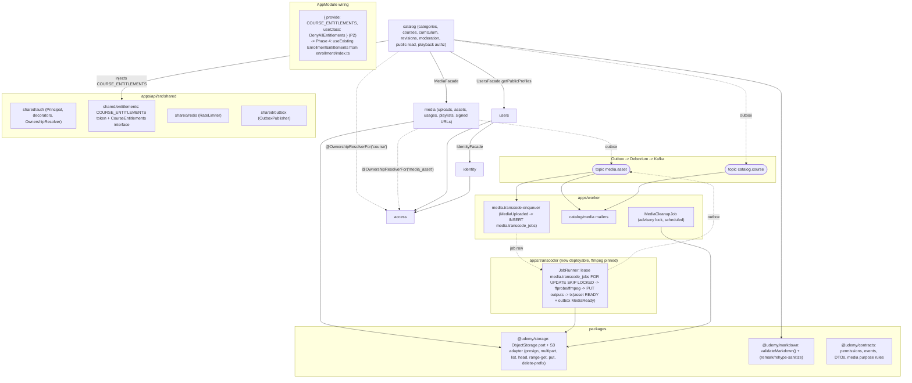
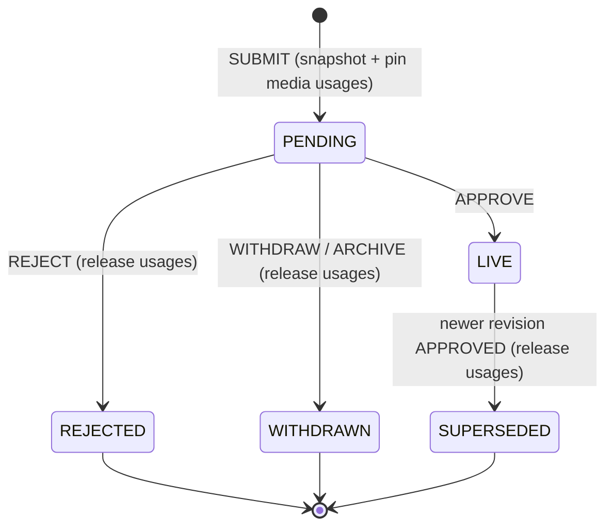
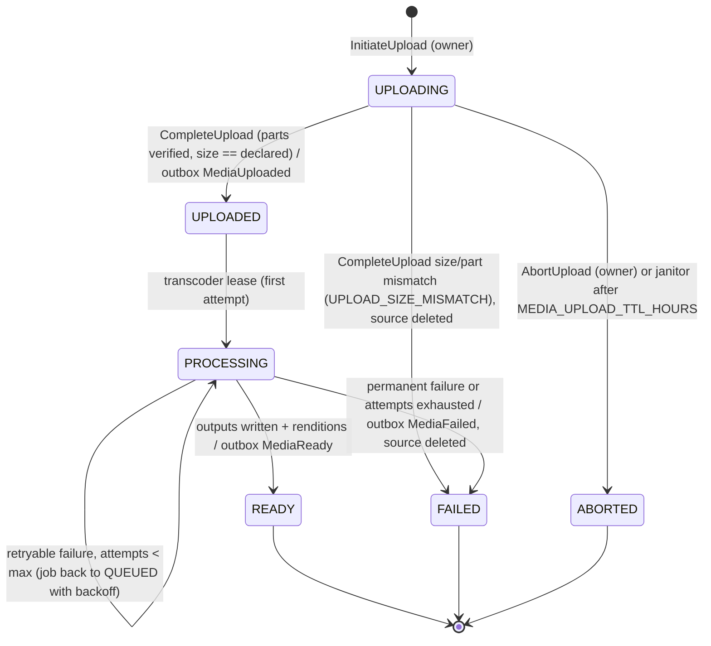
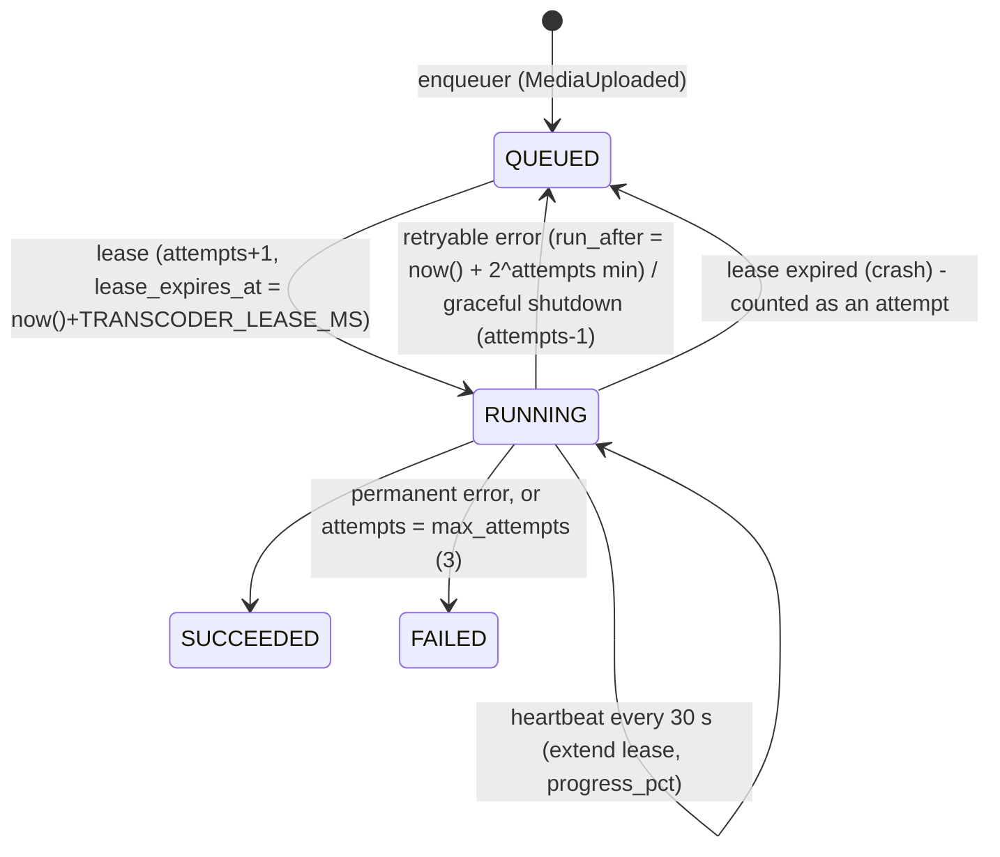

# Phase 2 Design: Catalog & Media (Udemy clone v2)

## What I read, and the constraints it puts on this design

Read:

- `docs/architecture-plan.md` (§2–5, §7), `docs/phase-1-identity-access-design.md`, `docs/phase-1-schema-design.md`
- `apps/api/src/app.module.ts`, `apps/api/src/shared/{auth,outbox,redis,config}/**`, `apps/api/src/modules/access/{application/{authorizer,ownership.registry}.ts,domain/permission-policy.ts,presentation/policies.guard.ts}`, `modules/identity/presentation/guards/jwt-auth.guard.ts`, `modules/users/{index.ts,domain/instructor-application.ts,application/users.facade.ts}` (plus the file layout of all three modules)
- `apps/worker/src/{worker.module.ts,messaging/{message-dispatcher,event-handler.decorator,idempotency/idempotent-event-processor,kafka/kafka-topics,kafka/kafka-consumer.service}.ts,maintenance/identity-cleanup.job.ts,shared/mail/user-contact.reader.ts,shared/config/worker-env.schema.ts}`, `apps/worker/Dockerfile`
- `packages/contracts/src/{auth/permissions.ts,events/{define-event,users}.ts,errors/error-code.ts}`, `packages/db/src/{outbox.ts,migrations/2026_10_09_0001_init.ts}`, `packages/eslint-config/nest.js`, `packages/web-auth/src/api-proxy.ts`
- `infra/docker/docker-compose.dev.yml`, `infra/kafka/create-topics.sh`, `infra/ci/e2e-local.sh`, `.gitlab-ci.yml` (e2e job), `.env.example`, `apps/web-student/next.config.ts`

What I found, and how each finding shapes the design:

1. **The `catalog` and `media` schemas already exist** (migration 0001). Migration 0003 creates only tables, functions and triggers.
2. **`PolicyResource` is derived from the permission strings, and `PolicySpec` carries one id.** For `@CheckPolicy({resource:'section'})` to work, a `section:*:own` permission would have to exist. I therefore register ownership resolvers only for `course` and `media_asset`. Sections and lectures are reachable only through nested routes (`/courses/:courseId/sections/:sectionId`). The guard checks the course, and every use case loads the child with `WHERE id=$child AND course_id=$course`, so a mismatch is a 404. The result is the same 404-not-403 guarantee without adding `section:*` and `lecture:*` to the catalog. This is flagged in Open Questions (Q7).
3. **Worker handlers run inside the `processed_events` claim transaction, sequentially per partition.** A multi-minute FFmpeg run inside a handler would hold a DB connection and transaction open, block the partition, and exceed `max.poll.interval.ms`. So transcoding never runs in a Kafka handler. The handler only enqueues a row in a DB job table, and a separate process leases and runs the job.
4. **The worker already writes and reads other contexts' tables** (`identity.one_time_tokens`, and `UserContactReader` on `identity.users`). Worker-side code is organised per context folder. I follow the same precedent for `apps/worker/src/{catalog,media}`.
5. **`JwtAuthGuard` already does optional authentication on `@Public` routes.** Public playback endpoints can still see a principal (Phase 4 enrolled students).
6. **BFF proxy behaviour:**
   - It streams any content type and forwards `content-type` and `cache-control`, so HLS playlists can go through `/api/proxy`.
   - It drops any `Location` that is not an API path, so a 302 to MinIO cannot pass through it. Stable image URLs therefore need a small dedicated Next route handler (§10).
   - Unsafe methods require JSON plus a matching Origin. That is fine, because part uploads never touch the BFF.
7. **Env and cookies:**
   - `.env.example` already has `S3_*`, but neither env schema validates them. Apps run on the host, so `S3_ENDPOINT=http://localhost:9000`.
   - Host-only cookies on `localhost` are sent to every port. A browser request to `localhost:9000` (for example an ``) would carry the session cookies.
   - **Fix:** the dev public S3 endpoint is `http://127.0.0.1:9000`, which is a different site, so no cookies are sent.
8. **MinIO and CI:**
   - MinIO is the frozen `bitnamilegacy` image. Both buckets are private and there is no CORS configuration.
   - MinIO has no per-bucket CORS API; it uses the server-wide `MINIO_API_CORS_ALLOW_ORIGIN`.
   - The CI e2e job has no MinIO service and no ffmpeg.
9. **Topics:** `create-topics.sh` is the single source of pre-created topics. `catalog.course` and `media.asset` go there.
10. **The worker image is `node:22-alpine` with no ffmpeg.** A pinned ffmpeg belongs in its own image (D5).
11. **`OutboxPublisher.publish` requires a `Transaction`.** The transcoder is not a Nest API module, so it uses `insertOutboxEvent` from `@udemy/db` plus the contract's `safeParsePayload`.
12. **Cross-schema FKs are allowed only to `identity.users` (D12).** So `lectures.media_asset_id` and `courses.thumbnail_asset_id` are soft references. Consistency between catalog and media comes from **usage rows written through `MediaFacade` in the caller's transaction** (§3, §6).
13. **`users.profiles.avatar_media_id` is waiting for media.** The `purpose` CHECK is designed to add `USER_AVATAR` later. That is not in scope for Phase 2.
14. **Reusable error codes:** `ErrorCode` already has `invalid_state_transition`, `version_conflict` and `self_decision_forbidden`. I reuse them.
15. **No CSP is set yet.** The comment in `next.config.ts` says it is waiting for "the video player", which lands now, so Phase 2 adds CSP (§9).

---

## 1. Module dependency diagram



There are no cycles. `media` depends on nothing but shared and packages. `catalog` depends on `media` and `users`. Phase 4 `enrollment` will depend on `catalog`. The reverse edge (catalog asking "is this user enrolled?") is inverted through the `COURSE_ENTITLEMENTS` token, which AppModule binds, so `catalog` never imports `enrollment`.

---

## 2. Key decisions

| #   | Decision                    | Choice                                                                                                                                                                                                                                                                                                                                                                                                              | Why                                                                                                                                                                                                                                                                                                                                                                                                                                                                                                                                                                                                                                               |
| --- | --------------------------- | ------------------------------------------------------------------------------------------------------------------------------------------------------------------------------------------------------------------------------------------------------------------------------------------------------------------------------------------------------------------------------------------------------------------- | ------------------------------------------------------------------------------------------------------------------------------------------------------------------------------------------------------------------------------------------------------------------------------------------------------------------------------------------------------------------------------------------------------------------------------------------------------------------------------------------------------------------------------------------------------------------------------------------------------------------------------------------------- |
| D1  | Editing published courses   | **Working copy plus immutable reviewed revisions.**<br>- The tables `courses`/`sections`/`lectures` are always the instructor's working copy.<br>- Submit snapshots it into append-only `course_revisions` + `revision_sections` + `revision_lectures`.<br>- Approve flips `courses.published_revision_id`.<br>- Public and student reads serve **only** the live revision.<br>- Every change is re-reviewed.       | **Edit-live** makes moderation meaningless: approve a clean course, then swap in spam. **"Significant change" classification** (Udemy's approach) is fuzzy and hard to make correct.<br><br>With snapshots:<br>- Every public byte was seen by a reviewer.<br>- The reviewer sees exactly what will go live; edits after submission cannot leak in.<br>- Rollback and history come for free.<br>- Approval is a pointer flip, so it is idempotent and conditional.<br><br>Lecture IDs are stable across revisions, which matters for Phase 5 progress. **Cost:** admins review typo fixes. The seam for later is an auto-approve classifier (Q1). |
| D2  | Working copy during review  | **Locked** while `pending_revision_id IS NOT NULL` (409 `course_in_review`). The instructor can **withdraw** to edit again.                                                                                                                                                                                                                                                                                         | "What you see is what's in review." The snapshot already makes concurrent edits _safe_; the lock makes them _unsurprising_.                                                                                                                                                                                                                                                                                                                                                                                                                                                                                                                       |
| D3  | Curriculum ordering         | **Integer `position` with whole-curriculum reorder**: `PUT /courses/:id/curriculum/order` carries the full `[{sectionId, lectureIds[]}]`.<br>- The server checks that it is exactly a permutation of the current ids, otherwise 409 `order_mismatch`.<br>- `UNIQUE(container, position) DEFERRABLE INITIALLY DEFERRED`.<br>- Every curriculum write takes a per-course row lock.                                    | Fractional indexing is built for high-concurrency single-item moves in huge lists, and costs key growth, rebalancing and loose contiguity. Here there is one editor, at most 500 items, and the DnD UI already holds the full list.<br>A full-list reorder is:<br>- atomic, and moves across sections in the same call<br>- idempotent<br>- self-validating: a stale tab gets 409 instead of silent corruption<br>Positions stay contiguous `0..n-1`, which revisions copy verbatim.                                                                                                                                                              |
| D4  | Price                       | **Deferred.** There is no price in `catalog`. Phase 4 `commerce` owns `commerce.course_prices(course_id, amount numeric(12,2), currency)`.                                                                                                                                                                                                                                                                          | The architecture plan puts pricing in commerce. A placeholder column would create a cross-context ownership question and a migration to move it. The landing page shows "Enrollment opens soon" until Phase 4.                                                                                                                                                                                                                                                                                                                                                                                                                                    |
| D5  | Where FFmpeg runs           | **New deployable `apps/transcoder`.** It is a Nest application context with no HTTP besides a health port. It polls `media.transcode_jobs`.                                                                                                                                                                                                                                                                         | It is CPU- and memory-heavy, with different scaling (k8s Jobs or KEDA on queue depth later). An ffmpeg OOM must not kill mail and event consumers. ffmpeg stays out of the worker image. A separate read-only, non-root, egress-restricted runtime is a security boundary for hostile input.                                                                                                                                                                                                                                                                                                                                                      |
| D6  | Transcode trigger           | **Outbox `MediaUploaded`** (written in the CompleteUpload transaction) → worker `media.transcode-enqueuer` inserts the job row (`ON CONFLICT (asset_id) DO NOTHING`) → the transcoder leases it. **No MinIO bucket notifications.**                                                                                                                                                                                 | Bucket notifications:<br>- fire on S3 completion even if the API's DB transaction rolls back<br>- carry no event envelope or ID<br>- need MinIO→Kafka/webhook configuration on a frozen image<br>The API must validate size and owner at completion anyway. The outbox gives atomicity with the asset state, and the DB job table gives leases, retries, progress and visibility that Kafka offsets cannot.                                                                                                                                                                                                                                       |
| D7  | Playback authorization      | **Playlist rewrite.**<br>- The API builds `master.m3u8` from DB rendition rows; variant URIs are relative, so they resolve back through the BFF proxy.<br>- The API serves `{rendition}.m3u8` with each segment line replaced by a **presigned GET** (TTL 1 h).<br>- Segments go browser → MinIO directly.<br>- Every playlist request is authorized by catalog (preview / owner / admin / `CourseEntitlements`).   | Per-segment presigning without a rewrite cannot work, because static playlists cannot contain signatures. A signing proxy would stream bytes through API/BFF, which is forbidden and expensive. The rewrite costs one small text read per variant (cached in process, since the content is immutable per output version) plus local HMAC presigning. Expiry is handled by the player re-loading the playlist on a 403 (§10).                                                                                                                                                                                                                      |
| D8  | Asset ↔ catalog consistency | **`media.asset_usages(asset_id, consumer_type, consumer_id)`**, written and deleted by catalog through `MediaFacade` **in catalog's transaction**. Assets with no usages are purged after a grace period.                                                                                                                                                                                                           | There is no cross-schema FK (D12). Reference rows make "do not delete media in use" (lecture, thumbnail, live revision, archived-but-restorable revision) and "do not orphan media" both decidable by one query. Purge uses a row lock against the attach lock (§6).                                                                                                                                                                                                                                                                                                                                                                              |
| D9  | Ownership resolvers         | `course` (catalog) and `media_asset` (media). Sections and lectures are scoped by nested routes (see finding 2).                                                                                                                                                                                                                                                                                                    | Fits the existing `Authorizer` without changing `shared/auth`.                                                                                                                                                                                                                                                                                                                                                                                                                                                                                                                                                                                    |
| D10 | Upload validation           | The **server sizes the parts and signs `Content-Length` into each part URL**. On complete it runs `ListParts` (client ETags are never trusted), then `CompleteMultipartUpload` and `HeadObject` (size must equal the declared size). **Real type detection happens in the transcoder** (ffprobe with format and protocol allowlists, plus magic bytes).                                                             | A presigned UploadPart without a signed length lets a client push 5 GiB into each part. Size and type headers from the browser are advisory; only decoding proves the content.                                                                                                                                                                                                                                                                                                                                                                                                                                                                    |
| D11 | Served bytes                | **User bytes are never served inline.** Videos and images are always re-encoded by our ffmpeg into `udemy-media` with a Content-Type we set. RESOURCE files are copied and served only as `attachment` + `application/octet-stream`. `udemy-uploads` (quarantine) is never presigned for GET.                                                                                                                       | This closes polyglot, SVG and HTML-in-image XSS, and drive-by downloads.                                                                                                                                                                                                                                                                                                                                                                                                                                                                                                                                                                          |
| D12 | Slugs                       | Course slug is generated from the title (ASCII-fold, `[a-z0-9-]`, ≤ 60, `-2`, `-3` on conflict), unique among non-deleted courses, editable until first publication, then **frozen**. Category slugs are globally unique and admin-editable.                                                                                                                                                                        | Stable SEO URLs without a redirect table.                                                                                                                                                                                                                                                                                                                                                                                                                                                                                                                                                                                                         |
| D13 | Delete vs archive           | A never-published course can be **soft-deleted** (`deleted_at`; history is kept). A once-published course can only be **archived**: hidden from the catalog, and the live revision and its media are kept for Phase 4 enrolled students. Sections and lectures in the working copy are hard-deleted (published versions survive in revisions). Categories are hard-deleted only when unused, otherwise deactivated. | Orders and enrollments (Phase 4) will reference published courses.                                                                                                                                                                                                                                                                                                                                                                                                                                                                                                                                                                                |
| D14 | Markdown                    | Store markdown source only. **API write path:** `validateMarkdown` rejects raw HTML, images and non-`http(s)`/`mailto` links (422 `markdown_not_allowed`). **Render path:** `react-markdown` + `rehype-sanitize` (strict schema), server-rendered in Next. The same package is used for the instructor's live preview.                                                                                              | Two independent layers. Rejecting HTML is clearer to authors than silently stripping it.                                                                                                                                                                                                                                                                                                                                                                                                                                                                                                                                                          |
| D15 | Segment format              | HLS v3, **MPEG-TS** segments of 6 s, H.264 High/Main + AAC-LC 128k. Ladder 360p/720p/1080p, limited to source height (`TRANSCODER_MAX_HEIGHT` caps it; 720 in dev).                                                                                                                                                                                                                                                 | Universal (hls.js plus native Safari). The rewriter only has to handle plain URI lines. fMP4 needs an `EXT-X-MAP` rewrite; that is a later improvement.                                                                                                                                                                                                                                                                                                                                                                                                                                                                                           |

---

## 3. Module public facades (`index.ts`)

As in Phase 1, write methods take `ex: Executor` first and the caller owns the transaction. Read methods take an optional `ex`.

### `modules/media/index.ts`

```ts
export { MediaModule } from './media.module';
export { MediaFacade } from './application/media.facade';
export type { AssetView, AssetConsumer, SignedUrl, MediaPurpose } from './application/dto';

type AssetConsumer = {
  type: 'catalog.lecture' | 'catalog.course_thumbnail' | 'catalog.course_revision';
  id: string;
};

class MediaFacade {
  getAssets(ids: readonly string[], ex?): Promise<AssetView[]>;
  // id, ownerId, purpose, status, progressPct|null, failureCode|null, durationSeconds|null,
  // width|null, height|null, renditions: string[], purged: boolean, originalFilename
  useAsset(ex, { assetId, ownerId, purpose, consumer }): Promise<AssetView>;
  // SELECT ... FOR SHARE; owner mismatch or missing -> MediaAssetNotFound (404, never 403);
  // purpose mismatch -> MediaPurposeMismatch; purged/ABORTED/FAILED -> MediaAssetUnusable (409);
  // INSERT usage ON CONFLICT DO NOTHING; unused_since = NULL
  pinAssets(ex, { assetIds, consumer }): Promise<void>; // revision snapshot pinning (already validated)
  releaseAsset(ex, { assetId, consumer }): Promise<void>; // delete usage; unused_since = now() if none left
  releaseConsumer(ex, consumer): Promise<void>; // all usages of one consumer (revision superseded/rejected/withdrawn)
  renderMasterPlaylist(assetId): Promise<string>; // MediaNotReady (409) unless READY video
  renderVariantPlaylist(assetId, rendition: string): Promise<string>; // rendition validated against DB rows
  presignImage(assetId, variant: 'w750' | 'w480' | 'poster'): Promise<SignedUrl>;
  presignDownload(assetId, downloadName: string): Promise<SignedUrl>; // attachment + octet-stream
}
```

Media also registers `@OwnershipResolverFor('media_asset') MediaAssetOwnership`, which returns `owner_id WHERE purged_at IS NULL`.

### `modules/catalog/index.ts`

```ts
export { CatalogModule } from './catalog.module';
export { CatalogFacade } from './application/catalog.facade';
export type { CourseSummary } from './application/dto';

class CatalogFacade {
  // Phase 2 has no in-process consumer; these are the Phase 4/5 seams, implemented when first used.
  getCourseSummaries(courseIds, ex?): Promise<CourseSummary[]>; // id, slug, ownerId, status, liveRevisionId, title (live)
  isPubliclyAvailable(courseId, ex?): Promise<boolean>; // PUBLISHED && !deleted (commerce: can sell)
  getLiveLectureIds(courseId, ex?): Promise<string[]>; // learning: progress denominator
}
```

Catalog registers `@OwnershipResolverFor('course') CourseOwnership` (in `application/`, like `instructor-application.ownership.ts`). It returns `owner_id WHERE deleted_at IS NULL`.

### `src/shared/entitlements` (new, shared, no module imports)

```ts
export const COURSE_ENTITLEMENTS = Symbol('COURSE_ENTITLEMENTS');
export interface CourseEntitlements {
  hasCourseAccess(userId: string, courseId: string): Promise<boolean>;
}
export class DenyAllEntitlements implements CourseEntitlements {
  async hasCourseAccess() {
    return false;
  }
}
```

AppModule binds the token. Phase 4 swaps in the enrollment-backed adapter there, and catalog code does not change.

### `@udemy/storage` (new package; used by api/media, transcoder and worker)

`ObjectStorage`:

- `createMultipart(bucket, key, contentType)`
- `presignUploadPart(bucket, key, uploadId, partNumber, contentLength, ttl)` (signs `content-length`)
- `listParts`, `completeMultipart(parts)`, `abortMultipart`, `listMultipartUploads(prefix)`
- `head`, `getRange`, `getStream`, `getText`
- `putFile(bucket, key, path, contentType, cacheControl)`
- `presignGet(bucket, key, ttl, {responseContentType?, responseContentDisposition?})`
- `deletePrefix`

It wraps two clients:

- **internal**, using `S3_ENDPOINT`, for all network calls
- **public**, using `S3_PUBLIC_ENDPOINT`, for presigning only (the signature binds the host)

Uses `@aws-sdk/client-s3` and `s3-request-presigner` with `forcePathStyle`.

---

## 4. Domain model

### catalog

**Aggregate `Category`** (admin-managed tree)

- `depth ∈ {1,2}`. Children of depth-1 nodes are depth 2; deeper nesting is rejected (`category_depth_exceeded`).
- Courses must reference an **active depth-2** category.
- Sibling order uses contiguous positions (same strategy as D3).
- Deactivating a category hides it from browse and blocks new assignments and submissions (`category_inactive`). Existing live revisions keep it.
- Delete only if it has no children and no reference from any course or revision; otherwise 409 `category_in_use`.

**Aggregate `Course`** (working copy + lifecycle). The root holds details, bullets, curriculum and pointers.

- **Fields:**
  - `id`, `ownerId` (immutable)
  - `slug`, `title` (5–60), `subtitle?` (10–120), `descriptionMd?` (≤ 20 000)
  - `language?` (allowlist in contracts, BCP-47), `level?` (`BEGINNER | INTERMEDIATE | EXPERT | ALL_LEVELS`), `categoryId?`
  - `thumbnailAssetId?`
  - `outcomes[]` (≤ 10 × 1–160), `requirements[]` (≤ 10 × 1–160)
  - `status`, `version`, `publishedRevisionId?`, `pendingRevisionId?`, `firstPublishedAt?`, `deletedAt?`
- **Curriculum limits:** `Section { id, title 1–80, objective? ≤ 200, position }`, at most 50 per course. `Lecture { id, sectionId, type: VIDEO|ARTICLE|RESOURCE (immutable), title 1–80, descriptionMd? ≤ 2000, isPreview, position, mediaAssetId? }`, at most 100 per section and 500 per course. `Article { bodyMd ≤ 100 000 }` applies to ARTICLE lectures only.
- **Invariants:**
  1. The working copy is mutable only when `deletedAt = null`, `status ∈ {DRAFT, REJECTED, PUBLISHED}` and `pendingRevisionId = null`. Otherwise `course_in_review` or `course_not_editable` (409).
  2. The slug is mutable only while `firstPublishedAt = null` (`slug_frozen`).
  3. Media type must match lecture type: VIDEO needs `LECTURE_VIDEO`, RESOURCE needs `LECTURE_RESOURCE`, ARTICLE has none. The thumbnail needs `COURSE_THUMBNAIL`. All assets must be owned by the course owner.
  4. `isPreview` is allowed only for VIDEO and ARTICLE, with at most 10 preview lectures (`preview_not_allowed`).
  5. A reorder must be an exact permutation of the current ids (`order_mismatch`).
  6. **Readiness to submit** (`CourseReadiness`, returns every issue at once, 422 `course_not_ready` with `issues[]`):
     - title, subtitle, description ≥ 200 plain chars, language, level, active depth-2 category
     - thumbnail READY
     - ≥ 4 outcomes
     - ≥ 1 section, every section non-empty
     - ≥ `CATALOG_SUBMIT_MIN_LECTURES` lectures (default 5)
     - total video ≥ `CATALOG_SUBMIT_MIN_VIDEO_SECONDS` (default 1800)
     - every VIDEO/RESOURCE lecture has a READY asset; every ARTICLE has ≥ 50 chars
  7. An update submission whose snapshot `content_hash` equals the live revision's is rejected (`nothing_to_review`).
  8. The approver or rejecter is never the owner (`self_decision_forbidden`, also enforced by a DB trigger). A reject reason is 10–2000 chars, and so is an admin takedown reason.
  9. At most one pending revision. Approve and reject name the **revisionId**, so an admin can never approve a resubmission they have not seen.
  10. Restore: the owner may restore only if the latest ARCHIVE was by the owner. An admin may always restore (`restore_forbidden`).
  11. Delete: only if `firstPublishedAt = null` and there is no pending revision. Otherwise `course_published_cannot_delete` or `course_in_review`.

**Course status machine.** `status` is materialized; history lives in `course_transitions`.

```mermaid
stateDiagram-v2
  [*] --> DRAFT: CREATE (instructor)
  DRAFT --> IN_REVIEW: SUBMIT (owner, ready) creates revision r1
  REJECTED --> IN_REVIEW: SUBMIT (owner, ready)
  IN_REVIEW --> DRAFT: WITHDRAW (owner)
  IN_REVIEW --> PUBLISHED: APPROVE r (admin, not owner) / published_revision_id = r
  IN_REVIEW --> REJECTED: REJECT r (admin, reason)
  PUBLISHED --> PUBLISHED: update cycle - SUBMIT / WITHDRAW / APPROVE (pointer flip, old revision superseded) / REJECT
  PUBLISHED --> ARCHIVED: ARCHIVE (owner) or TAKEDOWN (admin, reason) - auto-WITHDRAW of a pending update
  ARCHIVED --> PUBLISHED: RESTORE (owner if self-archived; admin always)
  DRAFT --> [*]: DELETE (owner, soft)
  REJECTED --> [*]: DELETE (owner, soft)
```



**Revision lifecycle.** It is derived and has no status column: `pending_revision_id` / `published_revision_id` plus the decision transition.



`content_hash` = SHA-256 of the canonical JSON snapshot (details, bullets, ordered sections and lectures, asset ids, article bodies). The builder computes the working-copy hash on read to show "Unpublished changes".

### media

**Aggregate `MediaAsset`**

- **Fields:**
  - `id`, `ownerId`, `purpose: LECTURE_VIDEO | LECTURE_RESOURCE | COURSE_THUMBNAIL`, `status`
  - `originalFilename` (display only, sanitized, ≤ 255), `declaredContentType`, `declaredSizeBytes`, `partSizeBytes`, `partCount`
  - `sourceKey = uploads/{ownerId}/{assetId}/source` (never derived from user input), `s3UploadId?`
  - `outputPrefix?`, `durationMs?`, `width?`, `height?`, `failureCode?`, `renditions[]`
  - `unusedSince?`, `purgedAt?`
- **Purpose policy** (contracts, so the UI can pre-validate):

| Purpose          | Allowed declared types                                           | Max size                                   | Processing                            |
| ---------------- | ---------------------------------------------------------------- | ------------------------------------------ | ------------------------------------- |
| LECTURE_VIDEO    | `video/mp4`, `video/quicktime`, `video/webm`, `video/x-matroska` | `MEDIA_MAX_VIDEO_BYTES` (4 GiB; dev 1 GiB) | HLS ladder + poster + sprite          |
| COURSE_THUMBNAIL | `image/jpeg`, `image/png`, `image/webp` (no SVG/GIF)             | 5 MiB, ≤ 40 MP                             | re-encode to `w750`, `w480` JPEG 16:9 |
| LECTURE_RESOURCE | `application/pdf`, `application/zip`                             | 100 MiB                                    | magic-byte check + copy               |

- **Part plan:** `partSize = max(8 MiB, ceilMiB(size / 1000))`, so there are at most about 1000 parts.
- **Quota:** Σ `declaredSizeBytes` over the owner's non-purged assets in {UPLOADING, UPLOADED, PROCESSING, READY} must be ≤ `MEDIA_QUOTA_BYTES_PER_OWNER`. At most `MEDIA_MAX_CONCURRENT_UPLOADS` (5) are UPLOADING. Both are checked under `pg_advisory_xact_lock(hashtext('media:quota:' || ownerId))`.



Purge is orthogonal to status. `purged_at` is set by the janitor when there are no usages and the grace period has passed.

**Transcode job machine** (`media.transcode_jobs`):



**Failure classes:**

| Class                                                                                                                                                                                                  | failure_code                                                             | Retry?                         |
| ------------------------------------------------------------------------------------------------------------------------------------------------------------------------------------------------------ | ------------------------------------------------------------------------ | ------------------------------ |
| Not media, disallowed container (ffprobe `format_name` outside the allowlist), no video stream, 0 duration, > `TRANSCODER_MAX_SOURCE_SECONDS` (4 h), > 4096×2160, image > 40 MP, magic bytes ≠ purpose | `INVALID_MEDIA`, `UNSUPPORTED_MEDIA`, `TOO_LONG`, `TOO_LARGE_DIMENSIONS` | No (poison; fails immediately) |
| ffmpeg non-zero exit                                                                                                                                                                                   | `TRANSCODE_ERROR`                                                        | once                           |
| Wall-clock timeout `max(300 s, duration × TRANSCODER_TIMEOUT_FACTOR)`, or no progress for 120 s (SIGKILL)                                                                                              | `TIMEOUT`                                                                | once                           |
| S3/DB/disk errors                                                                                                                                                                                      | `INTERNAL`                                                               | up to `max_attempts`           |
| Lease expiry, max attempts reached (repeated crash or OOM)                                                                                                                                             | `CRASHED`                                                                | terminal                       |

---

## 5. Use cases

All errors are `DomainError` subclasses mapped to RFC 7807 with a stable `code`. Every mutating course use case runs in one transaction that starts with `SELECT … FROM catalog.courses WHERE id=$1 AND deleted_at IS NULL FOR NO KEY UPDATE` (a per-course mutex) and bumps `courses.version`. Timestamps use SQL `now()`.

### catalog: categories (admin)

| Use case                          | Input                                                                     | Output                                           | Errors                                                                                                         |
| --------------------------------- | ------------------------------------------------------------------------- | ------------------------------------------------ | -------------------------------------------------------------------------------------------------------------- |
| `ListCategoryTree` (public query) | none                                                                      | active tree (depth 1 → children, ordered)        | none                                                                                                           |
| `AdminListCategories`             | none                                                                      | full tree including inactive, with `courseCount` | none                                                                                                           |
| `CreateCategory`                  | name 2–60, slug?, parentId?                                               | Category                                         | `category_not_found` 404 (parent), `category_depth_exceeded` 422, `slug_taken` 409 (from `categories_slug_uq`) |
| `UpdateCategory`                  | id, name?, slug?, isActive?, parentId? (depth-2 only, to another depth-1) | Category                                         | 404, 409 `slug_taken`, 422 `category_depth_exceeded`                                                           |
| `ReorderCategories`               | parentId \| null, orderedIds                                              | void                                             | `order_mismatch` 409                                                                                           |
| `DeleteCategory`                  | id                                                                        | void                                             | 404, `category_in_use` 409                                                                                     |

### catalog: instructor working copy

| Use case                                      | Input                                                   | Output                                                                                                                               | Errors                                                                                                                                                                                             |
| --------------------------------------------- | ------------------------------------------------------- | ------------------------------------------------------------------------------------------------------------------------------------ | -------------------------------------------------------------------------------------------------------------------------------------------------------------------------------------------------- |
| `CreateCourse`                                | principal, title, categoryId?                           | CourseDetail (DRAFT, generated slug) + `CREATE` transition + `CourseCreated`                                                         | 422 field errors, `category_inactive` / `category_not_leaf` 422                                                                                                                                    |
| `ListMyCourses`                               | principal, status?, cursor, limit ≤ 50                  | page `(updated_at DESC, id DESC)` with derived badge (draft / in review / live / live + update pending / update rejected / archived) | none                                                                                                                                                                                               |
| `GetCourse` (owner or admin)                  | courseId                                                | details, bullets, status, version, pending/live revision summary, latest decision (reason), readiness, `hasUnpublishedChanges`       | 404                                                                                                                                                                                                |
| `UpdateCourseDetails`                         | courseId, partial fields, `expectedVersion?`            | CourseDetail                                                                                                                         | 404, `version_conflict` 409, `course_in_review` 409, `course_not_editable` 409, `slug_frozen` 409, `slug_taken` 409, `markdown_not_allowed` 422, field 422                                         |
| `SetCourseThumbnail` / `ClearCourseThumbnail` | courseId, assetId                                       | CourseDetail                                                                                                                         | 404, `media_asset_not_found` 404, `media_purpose_mismatch` 422, `media_asset_unusable` 409. Releases the previous usage and uses the new one (consumer `catalog.course_thumbnail`, id = courseId). |
| `GetCurriculum`                               | courseId                                                | sections + lectures + per-asset status, progress and duration (one `MediaFacade.getAssets` call)                                     | 404                                                                                                                                                                                                |
| `AddSection` / `UpdateSection`                | courseId, sectionId?, title, objective?                 | Section (appended at the end)                                                                                                        | 404 `section_not_found`, `curriculum_limit_exceeded` 422                                                                                                                                           |
| `DeleteSection`                               | courseId, sectionId                                     | void. Deletes its lectures (releasing each media usage) and the section, then compacts positions.                                    | 404                                                                                                                                                                                                |
| `AddLecture`                                  | courseId, sectionId, type, title                        | Lecture (appended)                                                                                                                   | 404, 422                                                                                                                                                                                           |
| `UpdateLecture`                               | courseId, lectureId, title?, descriptionMd?, isPreview? | Lecture                                                                                                                              | 404 `lecture_not_found`, `preview_not_allowed` 422, `markdown_not_allowed` 422                                                                                                                     |
| `SaveArticle` / `GetArticle`                  | courseId, lectureId, bodyMd                             | Article                                                                                                                              | 404, `lecture_type_mismatch` 422, `markdown_not_allowed` 422                                                                                                                                       |
| `AttachLectureMedia`                          | courseId, lectureId, assetId                            | Lecture + asset view. `useAsset` (consumer `catalog.lecture`, id = lectureId), release the previous asset, set `media_asset_id`.     | 404, `media_asset_not_found` 404 (also for foreign assets), `lecture_type_mismatch` 422, `media_purpose_mismatch` 422, `media_asset_unusable` 409                                                  |
| `DetachLectureMedia`                          | courseId, lectureId                                     | Lecture                                                                                                                              | 404                                                                                                                                                                                                |
| `DeleteLecture`                               | courseId, lectureId                                     | void (release usage, delete, compact)                                                                                                | 404                                                                                                                                                                                                |
| `ReorderCurriculum`                           | courseId, `[{sectionId, lectureIds[]}]`                 | Curriculum                                                                                                                           | `order_mismatch` 409. The same sets are required; lectures may change section.                                                                                                                     |
| `DeleteCourse`                                | courseId                                                | void. Sets `deleted_at`, `DELETE` transition, releases all lecture and thumbnail usages, emits `CourseDeleted`.                      | 404, `course_published_cannot_delete` 409, `course_in_review` 409                                                                                                                                  |

### catalog: lifecycle and moderation

**`SubmitCourse`** (input: courseId, `note?` ≤ 1000 for the reviewer; output: `{revisionId, revisionNo}`; rate limit 20/day/user). In one transaction:

1. Lock the course.
2. Check editability and readiness. Asset states and durations come fresh from `MediaFacade.getAssets(…, trx)`.
3. Insert the revision with its sections, lectures and bullets (`INSERT … SELECT`).
4. `pinAssets` with consumer `catalog.course_revision` = revisionId.
5. `UPDATE courses SET pending_revision_id=$rev, status=CASE WHEN status IN ('DRAFT','REJECTED') THEN 'IN_REVIEW' ELSE status END WHERE id=$c AND pending_revision_id IS NULL`.
6. Write the `SUBMIT` transition and the outbox event `CourseSubmittedForReview`.

Errors: 404, `course_not_ready` 422 (`issues[]`), `review_already_pending` 409, `nothing_to_review` 409, `course_not_editable` 409, 429.

**`WithdrawSubmission`** (input: courseId): conditional on `pending_revision_id = $rev`. Releases the revision's usages and moves IN_REVIEW → DRAFT (a published course stays PUBLISHED). Errors: 404, `invalid_state_transition` 409.

**`ApproveRevision`** (admin; input: courseId, revisionId, note?, `expectedVersion?`):

1. Check actor ≠ owner.
2. `UPDATE courses SET published_revision_id=$rev, pending_revision_id=NULL, status='PUBLISHED', first_published_at=COALESCE(first_published_at, now()) WHERE id=$c AND pending_revision_id=$rev`.
3. Release the usages of the **previous** live revision (superseded).
4. Write the `APPROVE` transition and emit `CoursePublished{kind}`.

Errors: 404, `invalid_state_transition` 409 (not the pending revision: already decided, withdrawn or superseded), `self_decision_forbidden` 403, `version_conflict` 409.

**`RejectRevision`** (admin; input: courseId, revisionId, reason 10–2000): same guard. Status IN_REVIEW → REJECTED, or PUBLISHED stays. Releases the revision's usages and emits `CourseRejected`. Errors: as approve, plus 422.

**`ArchiveCourse`** (input: courseId, `reason?` from the owner, required from an admin; `byAdmin` derives from the route): only from PUBLISHED. Auto-withdraws a pending revision (`WITHDRAW` transition with reason `ARCHIVED`), then writes the `ARCHIVE` transition and `CourseArchived`. Live usages are kept. Errors: 404, `invalid_state_transition` 409.

**`RestoreCourse`** (input: courseId): ARCHIVED → PUBLISHED, `CourseRestored`. Errors: 404, `restore_forbidden` 403, 409.

**Queries:**

- `GetCourseHistory` (owner or admin): returns transitions with actor display names (via `UsersFacade`; admins appear as "Moderator" to instructors).
- `ListReviewQueue` (admin; cursor, limit): pending revisions **oldest first**, keyset on `(submitted_at, revision_id)`, with `{courseId, revisionId, revisionNo, kind: INITIAL|UPDATE, title, owner {id, displayName}, submittedAt}`.
- `GetRevisionForReview` (admin; revisionId): the full snapshot, plus a **diff against the live revision** (changed header fields; lectures added, removed, changed and reordered, by `lecture_id`), plus asset views. Errors: 404.
- `AdminSearchCourses` (admin; status?, q?, ownerId?, cursor): returns a page.

### catalog: public read and playback

| Use case                                                        | Input                                                                                                                                                 | Output                                                                                                                                                                                       | Errors                                            |
| --------------------------------------------------------------- | ----------------------------------------------------------------------------------------------------------------------------------------------------- | -------------------------------------------------------------------------------------------------------------------------------------------------------------------------------------------- | ------------------------------------------------- |
| `BrowseCourses` (public)                                        | `category` (slug; a depth-1 slug includes its children), `level?`, `language?`, `q?` (≥ 3 chars, trigram ILIKE on the live title), cursor, limit ≤ 48 | page of course cards from the live revision, keyset `(first_published_at DESC, id DESC)`                                                                                                     | 400                                               |
| `GetCourseLanding` (public)                                     | slug                                                                                                                                                  | live revision: header, bullets, category path, instructor `PublicProfile` (null if banned or unknown), outline (sections → lectures `{id, title, type, durationSeconds, isPreview}`), totals | 404 for unknown, unpublished, archived or deleted |
| `AuthorizeLecturePlayback` (internal to the playlist endpoints) | principal?, courseId, lectureId, source: `live` \| `working` \| `revision:{id}`                                                                       | assetId                                                                                                                                                                                      | See the rules below                               |
| `GetPublicLectureArticle`                                       | courseId, lectureId                                                                                                                                   | sanitized-renderable markdown                                                                                                                                                                | same rules as playback                            |
| `GetCourseImage` (public)                                       | courseId, variant                                                                                                                                     | `SignedUrl` for the live revision's thumbnail                                                                                                                                                | 404                                               |
| `GetLectureDownload`                                            | courseId, lectureId                                                                                                                                   | `SignedUrl` (attachment)                                                                                                                                                                     | owner/admin, or entitled; preview does not apply  |

**Playback rules:**

- `live`: allowed if the lecture is in the live revision **and** one of: `isPreview`, principal = owner, principal holds `course:read:any`, or `entitlements.hasCourseAccess`. Otherwise 403 `lecture_locked`, because existence is public for live courses.
- `working`: owner or admin only, else 404.
- `revision`: admin only, else 404.
- An asset that is not READY returns `media_not_ready` 409.

### media

| Use case          | Input                                                | Output                                                                                                                                                                                                                                                                                                                                                                                                                                        | Errors                                                                                                                                        |
| ----------------- | ---------------------------------------------------- | --------------------------------------------------------------------------------------------------------------------------------------------------------------------------------------------------------------------------------------------------------------------------------------------------------------------------------------------------------------------------------------------------------------------------------------------- | --------------------------------------------------------------------------------------------------------------------------------------------- |
| `InitiateUpload`  | principal, purpose, filename, contentType, sizeBytes | `{assetId, partSize, partCount}`. S3 `CreateMultipart` first, then insert the asset. If the insert fails, abort the multipart upload.                                                                                                                                                                                                                                                                                                         | `unsupported_media_type` 422, `upload_too_large` 422, `quota_exceeded` 422, `too_many_uploads` 429 (concurrency) or 429 `rate_limited` (30/h) |
| `GetUploadStatus` | assetId                                              | `{status, partSize, partCount, uploadedParts:[{partNumber,size}]}` from `ListParts` (resume)                                                                                                                                                                                                                                                                                                                                                  | 404                                                                                                                                           |
| `PresignParts`    | assetId, partNumbers (1–50, each ≤ partCount)        | `{urls:[{partNumber,url}], expiresAt}`, TTL 15 min, `content-length` signed to the exact part size                                                                                                                                                                                                                                                                                                                                            | 404, `upload_not_in_progress` 409, 422, 429 (1200/h)                                                                                          |
| `CompleteUpload`  | assetId                                              | AssetView (UPLOADED).<br>1. `ListParts`: the parts must be exactly 1..partCount with the expected sizes.<br>2. `Complete` → `Head` (size == declared).<br>3. Transaction: `UPDATE … SET status='UPLOADED', s3_upload_id=NULL WHERE status='UPLOADING'`, then outbox `MediaUploaded`.<br>**Idempotent:** if already past UPLOADING, return the current state. If S3 says `NoSuchUpload` but `Head` shows a correct object, finish the DB step. | 404, `upload_incomplete` 409 (lists missing parts), `upload_size_mismatch` 422 (the asset becomes FAILED and the object is deleted)           |
| `AbortUpload`     | assetId                                              | void. Transaction: UPLOADING → ABORTED, then S3 abort (idempotent).                                                                                                                                                                                                                                                                                                                                                                           | 404, `upload_not_in_progress` 409                                                                                                             |
| `GetAssets`       | ids ≤ 50 (owner or admin)                            | AssetView[] (status, `progressPct` from the job)                                                                                                                                                                                                                                                                                                                                                                                              | none (foreign ids are omitted)                                                                                                                |
| Facade            | see §3                                               |                                                                                                                                                                                                                                                                                                                                                                                                                                               |                                                                                                                                               |

### worker and transcoder (non-HTTP)

| Use case           | Where                                                                    | Behaviour                                                                                                                                                                                                                                                                                                                                                                                                                                                                                                                                                                                                                                                                                                                                           |
| ------------------ | ------------------------------------------------------------------------ | --------------------------------------------------------------------------------------------------------------------------------------------------------------------------------------------------------------------------------------------------------------------------------------------------------------------------------------------------------------------------------------------------------------------------------------------------------------------------------------------------------------------------------------------------------------------------------------------------------------------------------------------------------------------------------------------------------------------------------------------------- |
| `EnqueueTranscode` | worker `media.transcode-enqueuer` on `MediaUploaded`                     | Inside the claim tx: `INSERT INTO media.transcode_jobs(asset_id, kind) SELECT … WHERE asset.status='UPLOADED' ON CONFLICT (asset_id) DO NOTHING` (fires `pg_notify('media_transcode')`).                                                                                                                                                                                                                                                                                                                                                                                                                                                                                                                                                            |
| `RunTranscodeJob`  | `apps/transcoder`                                                        | 1. Lease the job.<br>2. Transaction: asset → PROCESSING, insert a `transcode_attempts` row.<br>3. Download the source to `TRANSCODER_TMP_DIR` (requires free space ≥ 3× size).<br>4. ffprobe.<br>5. Choose the ladder and run ffmpeg (`-progress pipe:1`), with a 30 s heartbeat.<br>6. Generate the poster (frame at 10%) and sprite (1 frame / 10 s, 10×10 tiles + WebVTT).<br>7. Upload to `udemy-media/assets/{assetId}/a{attempt}/…`.<br>8. Transaction: renditions, asset READY (duration, dims, output_prefix), job SUCCEEDED, attempt row, outbox `MediaReady`.<br>On failure, classify (§4); when terminal, set the asset FAILED, emit `MediaFailed` and delete the source. On SIGTERM: kill ffmpeg and release the lease without penalty. |
| `MediaCleanupJob`  | worker, advisory lock `0x75646d79_02`, every `MEDIA_CLEANUP_INTERVAL_MS` | See the steps below.                                                                                                                                                                                                                                                                                                                                                                                                                                                                                                                                                                                                                                                                                                                                |

**`MediaCleanupJob` steps:**

- **A.** UPLOADING older than `MEDIA_UPLOAD_TTL_HOURS` → ABORTED, then S3 abort.
- **B.** `ListMultipartUploads(uploads/)` initiated more than 24 h ago that match no UPLOADING asset → abort.
- **C.** Purge: assets with no usages whose `COALESCE(unused_since, created_at)` is older than the grace period (`MEDIA_UNATTACHED_GRACE_HOURS` = 24 for never-used assets, `MEDIA_UNUSED_GRACE_DAYS` = 7 after release). Status must be one of READY/FAILED/ABORTED/UPLOADED. The transaction takes `FOR UPDATE`, re-checks `NOT EXISTS usages` and sets `purged_at`. Objects are deleted afterwards, and `objects_deleted_at` is retried until it is set. Emits `MediaPurged`.
- **D.** READY sources older than `MEDIA_SOURCE_RETENTION_DAYS` → delete the source and set `source_deleted_at`.

Each batch runs in its own transaction with `FOR UPDATE SKIP LOCKED`.

---

## 6. Conceptual data model (for db-architect)

Conventions follow Phase 1:

- uuidv7 PKs, SQL `now()`, `set_updated_at` triggers
- CHECK constraints instead of enums
- `<table>_<cols>_<pk|fk|uq|ck>` names, watching the 63-character limit
- append-only tables guarded by `public.forbid_append_only_mutation()`
- the only cross-schema FK target is `identity.users`; every catalog ↔ media reference is soft
- **Migration `0003_catalog_media`** (both schemas already exist)

### catalog

**`catalog.categories`**

- Columns: `id`, `parent_id NULL`, `depth smallint CHECK IN (1,2)`, `slug text` (CHECK `^[a-z0-9]+(-[a-z0-9]+)*$`, ≤ 60) **UNIQUE**, `name` (2–60, trimmed), `position int ≥ 0`, `is_active bool DEFAULT true`, timestamps.
- Depth consistency must be declarative. Suggested: a composite FK `(parent_id, parent_depth) → (id, depth)`, a stored generated `parent_depth = depth-1`, and `CHECK ((depth=1) = (parent_id IS NULL))`. db-architect should verify the generated-column FK on PG 18, or fall back to a trigger.
- `UNIQUE NULLS NOT DISTINCT (parent_id, position) DEFERRABLE INITIALLY DEFERRED`.
- `UNIQUE (id, depth)` as the target for courses.

**`catalog.courses`** (working copy and lifecycle)

- Columns:
  - `id`, `owner_id → identity.users`, `slug`
  - `title` (5–60), `subtitle NULL` (10–120), `description_md NULL` (≤ 20 000)
  - `language NULL` (CHECK `^[a-z]{2,3}(-[A-Z]{2})?$`; allowlist in the app), `level NULL CHECK IN (...)`
  - `category_id NULL`, `category_depth smallint NOT NULL DEFAULT 2 CHECK (=2)` with FK `(category_id, category_depth) → categories(id, depth)`
  - `thumbnail_asset_id NULL` (soft reference)
  - `status CHECK IN ('DRAFT','IN_REVIEW','PUBLISHED','REJECTED','ARCHIVED')`, `version int DEFAULT 1`
  - `published_revision_id NULL`, `pending_revision_id NULL` (FKs to `course_revisions`, composite with `course_id` so a revision must belong to its course)
  - `first_published_at NULL`, `created_at`, `updated_at`, `deleted_at NULL`
- CHECKs:
  - `status='PUBLISHED' → published_revision_id NOT NULL`
  - `status='IN_REVIEW' ⇔ (pending_revision_id NOT NULL AND published_revision_id IS NULL)`
  - `deleted_at NULL OR first_published_at NULL`
  - `deleted_at NULL OR pending_revision_id NULL`
  - `published_revision_id IS DISTINCT FROM pending_revision_id`
- Indexes:
  - partial UNIQUE `(slug) WHERE deleted_at IS NULL`
  - `(owner_id, updated_at DESC, id DESC) WHERE deleted_at IS NULL`
  - `(first_published_at DESC, id DESC) WHERE status='PUBLISHED'`
  - partial `(pending_revision_id) WHERE pending_revision_id IS NOT NULL`
- Documented 3NF exceptions (same pattern as `instructor_applications.status`): `status` and `first_published_at` are materializations of `course_transitions`. Recommend the deferred status ↔ log constraint trigger as in Phase 1.

**`catalog.course_bullets`**

- Columns: `course_id → courses`, `kind CHECK IN ('OUTCOME','REQUIREMENT')`, `position`, `text` (1–160).
- PK `(course_id, kind, position)` DEFERRABLE.
- CHECK position < 10.

**`catalog.sections`**

- Columns: `id`, `course_id → courses`, `title` (1–80), `objective NULL` (≤ 200), `position`, timestamps.
- `UNIQUE (course_id, position) DEFERRABLE INITIALLY DEFERRED`, `UNIQUE (course_id, id)` (composite FK target).

**`catalog.lectures`**

- Columns: `id`, `course_id`, `section_id`, `type CHECK IN ('VIDEO','ARTICLE','RESOURCE')`, `title` (1–80), `description_md NULL` (≤ 2000), `is_preview bool DEFAULT false`, `position`, `media_asset_id NULL` (soft reference), timestamps.
- FK `(course_id, section_id) → sections(course_id, id) ON DELETE RESTRICT`. The use case deletes lectures first so media is released.
- CHECKs: `type <> 'ARTICLE' OR media_asset_id IS NULL`, `NOT is_preview OR type <> 'RESOURCE'`.
- Indexes: `UNIQUE (section_id, position) DEFERRABLE INITIALLY DEFERRED`, `(course_id)`, partial `UNIQUE (media_asset_id) WHERE media_asset_id IS NOT NULL` (one lecture per asset; also used by the worker's "lecture by asset" lookup).
- 3NF note: `course_id` is functionally determined by `section_id`. It is kept for the composite FK and the cheap parentage check, and it cannot drift (the composite FK enforces it). This is the same pattern as Phase 1's composite FK trick.

**`catalog.lecture_articles`**

- Columns: `lecture_id PK → lectures ON DELETE CASCADE`, `body_md` (≤ 100 000), `updated_at`.
- A trigger or composite FK must ensure the lecture's type is ARTICLE. Suggested: add `lecture_type` with CHECK = 'ARTICLE' and FK `(lecture_id, lecture_type) → lectures(id, type)`.

**`catalog.course_revisions`** (append-only, immutable)

- Columns:
  - `id`, `course_id → courses`, `revision_no int` (UNIQUE `(course_id, revision_no)`)
  - `kind CHECK IN ('INITIAL','UPDATE')`, `content_hash bytea` (32 bytes)
  - snapshot header: `title`, `subtitle`, `description_md`, `language`, `level`, `category_id` (FK to categories), `thumbnail_asset_id`
  - `submitted_by → identity.users`, `submitter_note NULL` (≤ 1000), `submitted_at`
- `UNIQUE (course_id, id)` as the composite target. Index `(category_id)`, plus a GIN trigram index on `title` for `q`.
- Guard triggers: no UPDATE, DELETE or TRUNCATE.

**`catalog.revision_bullets`**: `(revision_id, kind, position)` PK, `text`. Append-only.

**`catalog.revision_sections`**: `revision_id → course_revisions`, `section_id` (stable working id; no FK, because the working section may be deleted later), `position`, `title`, `objective`. PK `(revision_id, section_id)`, UNIQUE `(revision_id, position)`. Append-only.

**`catalog.revision_lectures`**

- Columns: `revision_id`, `lecture_id` (stable, no FK), `section_id`, `position`, `type`, `title`, `description_md`, `is_preview`, `media_asset_id NULL`, `duration_seconds int NULL` (snapshot from media), `article_body_md NULL`.
- PK `(revision_id, lecture_id)`. FK `(revision_id, section_id) → revision_sections`. UNIQUE `(revision_id, section_id, position)`.
- Same type CHECKs as `lectures`. Append-only.
- Index `(revision_id, media_asset_id)` for the playback lookup by lecture via the PK.

**`catalog.course_transitions`** (append-only, kept forever)

- Columns: `id`, `course_id → courses`, `revision_id NULL` (composite FK `(course_id, revision_id) → course_revisions`), `action CHECK IN ('CREATE','SUBMIT','WITHDRAW','APPROVE','REJECT','ARCHIVE','RESTORE','DELETE')`, `from_status NULL`, `to_status`, `actor_id → identity.users`, `reason NULL`, `occurred_at`.
- **Edge whitelist CHECK:**
  - CREATE: NULL → DRAFT
  - SUBMIT: DRAFT|REJECTED → IN_REVIEW, PUBLISHED → PUBLISHED
  - WITHDRAW: IN_REVIEW → DRAFT, PUBLISHED → PUBLISHED, PUBLISHED → ARCHIVED is **not** allowed (archive writes WITHDRAW PUBLISHED → PUBLISHED, then ARCHIVE)
  - APPROVE: IN_REVIEW|PUBLISHED → PUBLISHED
  - REJECT: IN_REVIEW → REJECTED, PUBLISHED → PUBLISHED
  - ARCHIVE: PUBLISHED → ARCHIVED
  - RESTORE: ARCHIVED → PUBLISHED
  - DELETE: DRAFT → DRAFT, REJECTED → REJECTED
- Other CHECKs:
  - `revision_id NOT NULL ⇔ action IN ('SUBMIT','WITHDRAW','APPROVE','REJECT')`
  - reason required (10–2000) for REJECT
  - reason allowed only for REJECT, ARCHIVE, APPROVE (note) and WITHDRAW (system `ARCHIVED` marker)
- Uniqueness:
  - partial UNIQUE `(revision_id) WHERE action='SUBMIT'`
  - partial UNIQUE `(revision_id) WHERE action IN ('APPROVE','REJECT','WITHDRAW')`, so each revision is decided once (no approve + reject)
  - partial UNIQUE `(course_id) WHERE action='CREATE'`, and the same for DELETE
- Index `(course_id, occurred_at)`.
- **Actor trigger** (like `ia_transitions_actor_trg`), error constraint `course_transitions_actor_ck`:
  - CREATE, SUBMIT, DELETE: actor = owner
  - APPROVE, REJECT: actor ≠ owner
  - Whether an admin performed ARCHIVE or RESTORE is decided in the app (the DB cannot see roles).

### media

**`media.assets`**

- Columns:
  - `id`, `owner_id → identity.users`
  - `purpose CHECK IN ('LECTURE_VIDEO','LECTURE_RESOURCE','COURSE_THUMBNAIL')`
  - `status CHECK IN ('UPLOADING','UPLOADED','PROCESSING','READY','FAILED','ABORTED')`
  - `original_filename` (1–255, no control characters), `declared_content_type`, `declared_size_bytes bigint > 0`, `part_size_bytes int`, `part_count int` (1–10 000)
  - `source_key text`, `s3_upload_id NULL`, `output_prefix NULL`
  - `duration_ms int NULL`, `width int NULL`, `height int NULL`, `detected_format NULL`
  - `failure_code NULL CHECK IN (UPLOAD_SIZE_MISMATCH, INVALID_MEDIA, UNSUPPORTED_MEDIA, TOO_LONG, TOO_LARGE_DIMENSIONS, TRANSCODE_ERROR, TIMEOUT, INTERNAL, CRASHED)`
  - `uploaded_at`, `ready_at`, `failed_at` (all NULL), `unused_since NULL`, `source_deleted_at NULL`, `purged_at NULL`, `objects_deleted_at NULL`, `created_at`, `updated_at`
- CHECKs:
  - `(status='UPLOADING') = (s3_upload_id IS NOT NULL)`
  - `(status='FAILED') = (failure_code IS NOT NULL)`
  - `status<>'READY' OR output_prefix IS NOT NULL`
  - `status<>'READY' OR purpose<>'LECTURE_VIDEO' OR duration_ms IS NOT NULL`
  - `objects_deleted_at NULL OR purged_at NOT NULL`
  - `purged_at NULL OR status <> 'UPLOADING'`
- Indexes:
  - `(owner_id, created_at DESC)`
  - quota: `(owner_id) INCLUDE (declared_size_bytes) WHERE purged_at IS NULL AND status IN ('UPLOADING','UPLOADED','PROCESSING','READY')`
  - janitor: `(created_at) WHERE status='UPLOADING'`, `(unused_since) WHERE purged_at IS NULL`, `(ready_at) WHERE source_deleted_at IS NULL AND status='READY'`, `(purged_at) WHERE objects_deleted_at IS NULL AND purged_at IS NOT NULL`
- `status` is a guarded state column. Transitions are conditional UPDATEs; audit comes from outbox events and `transcode_attempts`.

**`media.asset_renditions`**

- Columns: `asset_id → assets ON DELETE CASCADE`, `name` (CHECK `^(360p|480p|720p|1080p|src\d{3,4}p|w750|w480|poster|sprite)$`), `kind CHECK IN ('HLS_VARIANT','IMAGE','SPRITE')`, `width`, `height`, `bandwidth_bps NULL` (required for HLS), `object_key`, `codecs NULL`.
- PK `(asset_id, name)`. Written once on READY.

**`media.asset_usages`**

- Columns: `asset_id → assets ON DELETE RESTRICT`, `consumer_type CHECK IN ('catalog.lecture','catalog.course_thumbnail','catalog.course_revision')`, `consumer_id uuid`, `created_at`.
- PK `(asset_id, consumer_type, consumer_id)`.
- Indexes: `(consumer_type, consumer_id)`, partial UNIQUE `(asset_id) WHERE consumer_type IN ('catalog.lecture')` (one live lecture per asset).
- **Race rule:**
  - `useAsset` takes `FOR SHARE` on the asset row and checks `purged_at IS NULL`.
  - Purge takes **`FOR UPDATE`** (not `NO KEY UPDATE`, which would not conflict with the FK's `KEY SHARE`), then re-checks `NOT EXISTS usage`.
  - Lock order everywhere: course row → asset rows (ascending id when there are several).

**`media.transcode_jobs`**

- Columns: `asset_id PK → assets`, `kind CHECK IN ('VIDEO_HLS','IMAGE','RESOURCE')`, `status CHECK IN ('QUEUED','RUNNING','SUCCEEDED','FAILED')`, `attempts int DEFAULT 0`, `max_attempts int DEFAULT 3`, `run_after DEFAULT now()`, `lease_owner NULL`, `lease_expires_at NULL`, `heartbeat_at NULL`, `progress_pct smallint NULL` (0–100), `last_error_code NULL`, `created_at`, `updated_at`.
- CHECKs: `(status='RUNNING') = (lease_expires_at IS NOT NULL AND lease_owner IS NOT NULL)`, `attempts <= max_attempts`.
- Indexes: `(run_after) WHERE status='QUEUED'`, `(lease_expires_at) WHERE status='RUNNING'`.
- AFTER INSERT trigger: `pg_notify('media_transcode', asset_id::text)`.
- Lease query: `UPDATE … SET status='RUNNING', attempts=attempts+1, lease_owner=$me, lease_expires_at=now()+$lease WHERE asset_id = (SELECT asset_id FROM media.transcode_jobs WHERE (status='QUEUED' AND run_after<=now()) OR (status='RUNNING' AND lease_expires_at<now()) ORDER BY run_after LIMIT 1 FOR UPDATE SKIP LOCKED) RETURNING *`.

**`media.transcode_attempts`** (append-only)

- Columns: `asset_id`, `attempt_no`, `worker_id`, `started_at`, `finished_at NULL`, `outcome NULL CHECK IN ('SUCCEEDED','RETRY','FAILED','LEASE_LOST')`, `error_code NULL`, `error_detail NULL` (≤ 2000, never user-visible).
- PK `(asset_id, attempt_no)`.
- The guard allows only the single "finish" UPDATE (`finished_at`/`outcome` from NULL to a value). db-architect should choose either a dedicated guard trigger or writing the attempt row only at the end.

**Privileges block** (conditional `udemy_app`, as in Phase 1): append-only on `course_transitions`, `course_revisions`, `revision_*` and `transcode_attempts`. Prod gets a separate `udemy_transcoder` role limited to SELECT/UPDATE on `media.assets`, `transcode_jobs` and `asset_renditions`, INSERT on `transcode_attempts` and `outbox.events`. That role belongs in `infra/postgres/roles.sql` (devops-config).

**Constraint → domain error mapping** (for nestjs-coder):

| Constraint                                                     | Domain error                                                                           |
| -------------------------------------------------------------- | -------------------------------------------------------------------------------------- |
| `courses_slug_active_uq`, `categories_slug_uq`                 | `slug_taken`                                                                           |
| `sections/lectures_*_position_uq` (deferred, raised at COMMIT) | `order_mismatch` (a concurrent edit slipped past the lock, which should be impossible) |
| `course_transitions_revision_id_decision_uq` / `_submit_uq`    | `invalid_state_transition`                                                             |
| `course_transitions_actor_ck`                                  | `self_decision_forbidden`                                                              |
| `lectures_media_asset_id_uq`, `asset_usages_lecture_uq`        | `media_asset_unusable`                                                                 |
| `courses_category_fk` (depth mismatch)                         | `category_not_leaf`                                                                    |
| `categories_*_fk` on delete                                    | `category_in_use`                                                                      |
| 42501 from guard triggers                                      | 500                                                                                    |

**Kysely notes:**

- `bigint` comes back as a string, so declared sizes must be parsed with `BigInt` or `Number` (≤ 2^53 is safe).
- Deferrable constraints raise their errors at `transaction().execute()` commit.
- `ON CONFLICT` for usages targets the PK.

---

## 7. Events

All events use `defineEvent` in `packages/contracts/src/events/{catalog,media}.ts`. Topic = `aggregateType`, key = `aggregateId`, so events are ordered per course and per asset. There is no PII (only ids, titles and reasons), so these topics use broker-default retention. Pre-create `catalog.course`, `catalog.course.dlq`, `media.asset` and `media.asset.dlq` (3 partitions, `-`) in `create-topics.sh`.

| Event (v1)                  | Topic            | aggregateId | Payload                                                                             | Consumers (P2)                                                                                                                                                              |
| --------------------------- | ---------------- | ----------- | ----------------------------------------------------------------------------------- | --------------------------------------------------------------------------------------------------------------------------------------------------------------------------- |
| `CourseCreated`             | `catalog.course` | courseId    | courseId, ownerId, title, createdAt                                                 | none (P6 audit)                                                                                                                                                             |
| `CourseSubmittedForReview`  | `catalog.course` | courseId    | courseId, revisionId, revisionNo, ownerId, kind INITIAL\|UPDATE, title, submittedAt | worker `catalog.review-requested-mailer`: mails every ADMIN (reads `access.user_roles` + `identity.users`) with a link to `${ADMIN_APP_ORIGIN}/course-reviews/{revisionId}` |
| `CourseSubmissionWithdrawn` | `catalog.course` | courseId    | courseId, revisionId, ownerId, actorId, cause OWNER\|ARCHIVED, withdrawnAt          | none                                                                                                                                                                        |
| `CoursePublished`           | `catalog.course` | courseId    | courseId, revisionId, revisionNo, ownerId, slug, kind, decidedBy, publishedAt       | worker `catalog.course-decision-mailer` (instructor). P6: search reindex and on-demand ISR revalidation. P4: commerce read model.                                           |
| `CourseRejected`            | `catalog.course` | courseId    | courseId, revisionId, ownerId, kind, decidedBy, reason, rejectedAt                  | `catalog.course-decision-mailer` (includes the reason)                                                                                                                      |
| `CourseArchived`            | `catalog.course` | courseId    | courseId, ownerId, actorId, byAdmin, reason\|null, archivedAt                       | `catalog.takedown-mailer` (only when `byAdmin`). P4: commerce stops selling.                                                                                                |
| `CourseRestored`            | `catalog.course` | courseId    | courseId, ownerId, actorId, restoredAt                                              | none                                                                                                                                                                        |
| `CourseDeleted`             | `catalog.course` | courseId    | courseId, ownerId, deletedAt                                                        | none                                                                                                                                                                        |
| `MediaUploaded`             | `media.asset`    | assetId     | assetId, ownerId, purpose, declaredContentType, sizeBytes, uploadedAt               | worker `media.transcode-enqueuer`                                                                                                                                           |
| `MediaReady`                | `media.asset`    | assetId     | assetId, ownerId, purpose, durationMs\|null, width, height, renditions[], readyAt   | none in P2 (the UI polls; P5 WebSocket push)                                                                                                                                |
| `MediaFailed`               | `media.asset`    | assetId     | assetId, ownerId, purpose, failureCode, attempts, failedAt                          | worker `media.processing-failed-mailer`: looks up the lecture or course title by `media_asset_id` / `thumbnail_asset_id` and mails the owner with a builder link            |
| `MediaPurged`               | `media.asset`    | assetId     | assetId, ownerId, purgedAt                                                          | none (audit)                                                                                                                                                                |

**Deliberate deviations:**

- The plan's `LectureVideoUploaded` / `LectureVideoReady` become media-generic names, because media does not know about lectures.
- "MediaReady → update lecture" is **not** a write-back. The builder reads asset state fresh through `MediaFacade`, and the duration is snapshotted into `revision_lectures` at submit, so no denormalized copy can drift.

Consumer names are pinned with `consumerName`. Mail `Message-ID` is `<eventId@udemy.local>`, as in Phase 1.

---

## 8. REST API (`/api/v1`)

Legend: **C** = client credentials (BFF), **B** = Bearer, **P** = permission, **Pol** = `@CheckPolicy`. Every route has a security marker, so `RouteSecurityAuditor` passes. Cursors are opaque base64url.

### Permission catalog additions (`packages/contracts/src/auth/permissions.ts`, `access/domain/permission-policy.ts`)

| Role       | Added permissions                                                                                                                                                                               |
| ---------- | ----------------------------------------------------------------------------------------------------------------------------------------------------------------------------------------------- |
| INSTRUCTOR | `course:create`, `course:read:own`, `course:update:own`, `course:delete:own`, `course:submit:own`, `course:archive:own`, `media_asset:create`, `media_asset:read:own`, `media_asset:upload:own` |
| ADMIN      | `course:read:any`, `course:moderate:any`, `category:manage`, `media_asset:read:any`                                                                                                             |
| STUDENT    | none (public reads are `@Public` with optional auth)                                                                                                                                            |

### Public catalog (student BFF; `@Public`)

| Method & path                                                            | Request           | Success                                                                 | Errors                                                |
| ------------------------------------------------------------------------ | ----------------- | ----------------------------------------------------------------------- | ----------------------------------------------------- |
| `GET /catalog/categories`                                                | none              | 200 tree, `Cache-Control: public, max-age=300`                          | none                                                  |
| `GET /catalog/courses?category=&level=&language=&q=&cursor=&limit=`      | none              | 200 `{items: CourseCard[], nextCursor}`                                 | 400                                                   |
| `GET /catalog/courses/by-slug/:slug`                                     | none              | 200 `CourseLanding`                                                     | 404 `course_not_found`                                |
| `GET /catalog/courses/:courseId/images/thumbnail?variant=w750\|w480`     | none              | 200 `{url, expiresAt}`                                                  | 404                                                   |
| `GET /catalog/courses/:courseId/lectures/:lectureId/hls/master.m3u8`     | none (optional B) | 200 `application/vnd.apple.mpegurl`, `Cache-Control: private, no-store` | 403 `lecture_locked`, 404, 409 `media_not_ready`, 429 |
| `GET /catalog/courses/:courseId/lectures/:lectureId/hls/:rendition.m3u8` | none              | 200 variant with presigned segment URLs                                 | same                                                  |
| `GET /catalog/courses/:courseId/lectures/:lectureId/article`             | none              | 200 `{bodyMd}`                                                          | 403 `lecture_locked`, 404                             |

### Instructor (instructor BFF)

| Method & path                                                                             | Auth                            | Request                                                                                                                  | Success                                                              | Errors                                                                                               |
| ----------------------------------------------------------------------------------------- | ------------------------------- | ------------------------------------------------------------------------------------------------------------------------ | -------------------------------------------------------------------- | ---------------------------------------------------------------------------------------------------- |
| `GET /instructor/courses?status=&cursor=&limit=`                                          | P `course:read:own`             | none                                                                                                                     | 200 page                                                             | none                                                                                                 |
| `POST /instructor/courses`                                                                | P `course:create`               | `{title, categoryId?}`                                                                                                   | 201 CourseDetail + `Location: /courses/:id`                          | 422                                                                                                  |
| `GET /courses/:courseId`                                                                  | Pol course:read (own\|any)      | none                                                                                                                     | 200 CourseDetail (+readiness, latestDecision, hasUnpublishedChanges) | 404                                                                                                  |
| `PATCH /courses/:courseId`                                                                | Pol course:update               | `{title?, subtitle?, descriptionMd?, language?, level?, categoryId?, slug?, outcomes?, requirements?, expectedVersion?}` | 200                                                                  | 404, 409 `version_conflict`/`course_in_review`/`course_not_editable`/`slug_frozen`/`slug_taken`, 422 |
| `PUT /courses/:courseId/thumbnail` / `DELETE`                                             | Pol course:update               | `{assetId}`                                                                                                              | 200                                                                  | 404, 409, 422                                                                                        |
| `DELETE /courses/:courseId`                                                               | Pol course:delete               | none                                                                                                                     | 204                                                                  | 404, 409 `course_published_cannot_delete`/`course_in_review`                                         |
| `GET /courses/:courseId/curriculum`                                                       | Pol course:read                 | none                                                                                                                     | 200 Curriculum                                                       | 404                                                                                                  |
| `POST /courses/:courseId/sections`                                                        | Pol course:update               | `{title, objective?}`                                                                                                    | 201 Section                                                          | 404, 409, 422                                                                                        |
| `PATCH` / `DELETE /courses/:courseId/sections/:sectionId`                                 | Pol course:update               | `{title?, objective?}`                                                                                                   | 200 / 204                                                            | 404, 409                                                                                             |
| `POST /courses/:courseId/sections/:sectionId/lectures`                                    | Pol course:update               | `{type, title}`                                                                                                          | 201 Lecture                                                          | 404, 409, 422                                                                                        |
| `PATCH` / `DELETE /courses/:courseId/lectures/:lectureId`                                 | Pol course:update               | `{title?, descriptionMd?, isPreview?}`                                                                                   | 200 / 204                                                            | 404, 409, 422 `preview_not_allowed`                                                                  |
| `GET` / `PUT /courses/:courseId/lectures/:lectureId/article`                              | Pol course:read / course:update | `{bodyMd}`                                                                                                               | 200                                                                  | 404, 409, 422 `markdown_not_allowed`/`lecture_type_mismatch`                                         |
| `PUT` / `DELETE /courses/:courseId/lectures/:lectureId/media`                             | Pol course:update               | `{assetId}`                                                                                                              | 200 Lecture + AssetView                                              | 404 (also foreign asset), 409 `media_asset_unusable`, 422 `lecture_type_mismatch`                    |
| `PUT /courses/:courseId/curriculum/order`                                                 | Pol course:update               | `{sections:[{sectionId, lectureIds[]}]}`                                                                                 | 200 Curriculum                                                       | 404, 409 `order_mismatch`/`course_in_review`                                                         |
| `POST /courses/:courseId/submit`                                                          | Pol course:submit               | `{note?}`                                                                                                                | 200 `{revisionId, revisionNo}`                                       | 404, 409 `review_already_pending`/`nothing_to_review`, 422 `course_not_ready` + `issues[]`, 429      |
| `POST /courses/:courseId/withdraw`                                                        | Pol course:submit               | none                                                                                                                     | 200                                                                  | 404, 409                                                                                             |
| `POST /courses/:courseId/archive`                                                         | Pol course:archive              | `{reason?}`                                                                                                              | 200                                                                  | 404, 409                                                                                             |
| `POST /courses/:courseId/restore`                                                         | Pol course:archive              | none                                                                                                                     | 200                                                                  | 403 `restore_forbidden`, 404, 409                                                                    |
| `GET /courses/:courseId/history`                                                          | Pol course:read                 | none                                                                                                                     | 200 transitions[]                                                    | 404                                                                                                  |
| `GET /courses/:courseId/lectures/:lectureId/preview/hls/master.m3u8` + `/:rendition.m3u8` | Pol course:read                 | none                                                                                                                     | 200 (working-copy asset)                                             | 404, 409 `media_not_ready`                                                                           |
| `GET /courses/:courseId/lectures/:lectureId/download`                                     | Pol course:read                 | none                                                                                                                     | 200 `{url, expiresAt}`                                               | 404, 409                                                                                             |

### Media (instructor BFF; admin can read)

| Method & path                            | Auth                                                         | Request                                       | Success                                                                       | Errors                                                                                                  |
| ---------------------------------------- | ------------------------------------------------------------ | --------------------------------------------- | ----------------------------------------------------------------------------- | ------------------------------------------------------------------------------------------------------- |
| `POST /media/uploads`                    | P `media_asset:create`                                       | `{purpose, filename, contentType, sizeBytes}` | 201 `{assetId, partSize, partCount}`                                          | 422 `unsupported_media_type`/`upload_too_large`/`quota_exceeded`, 429 `too_many_uploads`/`rate_limited` |
| `GET /media/uploads/:assetId`            | Pol media_asset:read                                         | none                                          | 200 `{status, partSize, partCount, uploadedParts[]}`                          | 404                                                                                                     |
| `POST /media/uploads/:assetId/part-urls` | Pol media_asset:upload                                       | `{partNumbers: int[1..50]}`                   | 200 `{urls:[{partNumber,url}], expiresAt}`                                    | 404, 409 `upload_not_in_progress`, 422, 429                                                             |
| `POST /media/uploads/:assetId/complete`  | Pol media_asset:upload                                       | `{}`                                          | 200 AssetView                                                                 | 404, 409 `upload_incomplete` (+`missingParts`), 422 `upload_size_mismatch`                              |
| `DELETE /media/uploads/:assetId`         | Pol media_asset:upload                                       | none                                          | 204                                                                           | 404, 409                                                                                                |
| `GET /media/assets/:assetId`             | Pol media_asset:read (own\|any)                              | none                                          | 200 AssetView (status, progressPct, failureCode, durationSeconds, renditions) | 404                                                                                                     |
| `GET /media/assets?ids=a,b,c`            | P `media_asset:read:own` (filtered by owner; admin sees all) | none                                          | 200 `{items}`                                                                 | 400                                                                                                     |

### Admin (admin BFF)

| Method & path                                                                                                   | Auth                    | Request                     | Success                                           | Errors                                                                                |
| --------------------------------------------------------------------------------------------------------------- | ----------------------- | --------------------------- | ------------------------------------------------- | ------------------------------------------------------------------------------------- |
| `GET /admin/course-reviews?cursor=&limit=`                                                                      | P `course:moderate:any` | none                        | 200 queue (oldest first)                          | none                                                                                  |
| `GET /admin/course-revisions/:revisionId`                                                                       | P `course:read:any`     | none                        | 200 snapshot + diff vs live + assets              | 404                                                                                   |
| `GET /admin/course-revisions/:revisionId/lectures/:lectureId/hls/master.m3u8` + `/:rendition.m3u8` + `/article` | P `course:read:any`     | none                        | 200                                               | 404, 409                                                                              |
| `POST /admin/courses/:courseId/revisions/:revisionId/approve`                                                   | P `course:moderate:any` | `{note?, expectedVersion?}` | 200 CourseDetail                                  | 403 `self_decision_forbidden`, 404, 409 `invalid_state_transition`/`version_conflict` |
| `POST /admin/courses/:courseId/revisions/:revisionId/reject`                                                    | P `course:moderate:any` | `{reason}`                  | 200                                               | 400/422, 403, 404, 409                                                                |
| `GET /admin/courses?status=&q=&ownerId=&cursor=`                                                                | P `course:read:any`     | none                        | 200 page (with owner ban flag via IdentityFacade) | none                                                                                  |
| `POST /admin/courses/:courseId/takedown`                                                                        | P `course:moderate:any` | `{reason}`                  | 200                                               | 404, 409, 422                                                                         |
| `POST /admin/courses/:courseId/restore`                                                                         | P `course:moderate:any` | none                        | 200                                               | 404, 409                                                                              |
| `GET` / `POST /admin/categories`, `PATCH` / `DELETE /admin/categories/:id`, `PUT /admin/categories/order`       | P `category:manage`     | see §5                      | 200/201/204                                       | 404, 409 `slug_taken`/`category_in_use`/`order_mismatch`, 422                         |

**New error codes** (`ErrorCode`): `course_not_found`, `section_not_found`, `lecture_not_found`, `category_not_found`, `media_asset_not_found`, `course_in_review`, `course_not_editable`, `course_not_ready`, `review_already_pending`, `nothing_to_review`, `slug_taken`, `slug_frozen`, `category_inactive`, `category_not_leaf`, `category_depth_exceeded`, `category_in_use`, `order_mismatch`, `curriculum_limit_exceeded`, `lecture_type_mismatch`, `preview_not_allowed`, `markdown_not_allowed`, `course_published_cannot_delete`, `restore_forbidden`, `lecture_locked`, `media_not_ready`, `unsupported_media_type`, `upload_too_large`, `quota_exceeded`, `too_many_uploads`, `upload_not_in_progress`, `upload_incomplete`, `upload_size_mismatch`, `media_purpose_mismatch`, `media_asset_unusable`.

**Idempotency:**

- Submit, withdraw, approve, reject, archive, restore and complete are all conditional state updates, and the decision unique indexes back them up. A repeat gets a deterministic 409, or for complete, 200 with the current state.
- Reorder is a full permutation, so it is naturally idempotent.
- `CreateCourse` and `InitiateUpload` are not deduplicated. A duplicate draft can be deleted; a duplicate UPLOADING asset is aborted or purged by the janitor. The generic `Idempotency-Key` store stays in Phase 4 (the BFF already forwards the header).

---

## 9. Security design

**Upload abuse:**

- Purpose allowlists on type and size.
- Server-chosen part plan, with **`Content-Length` signed into every part URL** (verify in the T5 spike; fallback: on complete, ListParts verifies each part size, which bounds abuse to TTL × part count).
- Part URLs only for numbers ≤ `partCount`, TTL 15 min.
- Size must equal the declared size on complete.
- Quota and concurrency checked under an advisory lock.
- Redis rate limits: `rl:media:initiate:u:{uid}` 30/h, `rl:media:parts:u:{uid}` 1200/h, `rl:catalog:submit:u:{uid}` 20/24h, `rl:catalog:playlist:ip:{ip}` 240/min.
- The janitor aborts stale multiparts.
- The quarantine bucket `udemy-uploads` is never presigned for GET.
- Server-side `CreateMultipart` sets `ContentType` from the allowlist and `Content-Disposition: attachment`.

**Content sniffing and hostile media (transcoder):**

- ffprobe and ffmpeg always run with `-protocol_whitelist file` and `-format_whitelist mov,mp4,m4a,3gp,3g2,mj2,matroska,webm` (videos) or `png_pipe,jpeg_pipe,webp_pipe,image2` (images).
- This blocks HLS, concat and AVI-embedded playlist tricks that read local files or fetch URLs (a known ffmpeg SSRF/LFI class).
- PDF and ZIP are checked by magic bytes (`file-type`). ZIPs are never extracted.
- Pixel-count cap before decode.
- The process runs as non-root with a read-only root filesystem and a writable tmp dir. Phase 7 NetworkPolicy allows egress only to Postgres and MinIO.

**XSS:**

- Titles and plain fields are rendered by React (escaped).
- Markdown is validated on write (raw HTML, images and non-`http(s)`/`mailto` links rejected) and rendered through `rehype-sanitize` with a strict schema. Headings are mapped to h3/h4. Links get `rel="nofollow ugc noopener noreferrer"`. `dangerouslySetInnerHTML` is never used.
- No SVG uploads; images are re-encoded.
- The original filename is display-only and emitted with RFC 5987 encoding in `Content-Disposition`.
- **CSP lands in Phase 2** (nonce via `proxy.ts`):
  - `default-src 'self'`
  - `connect-src 'self' ${MEDIA_PUBLIC_ORIGIN}` (hls.js XHR, part PUTs)
  - `img-src 'self' data: ${MEDIA_PUBLIC_ORIGIN}`
  - `media-src 'self' blob:`
  - `worker-src 'self' blob:`
  - `frame-ancestors 'none'`

**SSRF:** Phase 2 has no user-supplied URL that the server fetches. There is no "import video from URL", and promo-video links are not supported. Storage endpoints are config-only. ffmpeg network protocols are disabled.

**Signed URL TTLs:**

| URL                    | TTL                                                                                        |
| ---------------------- | ------------------------------------------------------------------------------------------ |
| Upload part PUT        | 15 min                                                                                     |
| HLS segment GET        | `MEDIA_PLAYBACK_URL_TTL_S` = 3600; the playlist itself is `no-store` and re-fetched on 403 |
| Thumbnail / poster GET | 3600, through the stable redirect route with `max-age=300`                                 |
| Resource download GET  | 300, attachment + octet-stream                                                             |

Raw buckets stay `anonymous none`. Presigned URLs carry the signer's rights, so in prod each service has its own MinIO user and policy:

- **api:** multipart on uploads, GET on media
- **transcoder:** GET/DELETE on uploads, PUT on media
- **worker:** delete, list-multipart and abort

The API key cannot mint write URLs for `udemy-media`.

**Cookie isolation from storage:** dev `S3_PUBLIC_ENDPOINT=http://127.0.0.1:9000` (a different site from `localhost`), so app cookies are never sent to MinIO. Prod uses a separate `media.` host, and `__Host-` cookies are host-only. Clients use `credentials:'omit'`, hls.js uses `withCredentials:false`, and images use `referrerPolicy="no-referrer"`.

**IDOR:**

- `@CheckPolicy` on course and media_asset gives 404 for foreign resources.
- Nested child loads are scoped by `course_id`.
- `MediaFacade.useAsset` returns 404 for a foreign asset (not 403).
- The rendition name is validated against DB rows (no path injection into object keys).
- Revision playback is admin-only.
- e2e matrix: instructor B against A's course, section, lecture, asset and upload part URLs; B's course combined with A's lectureId; B attaching A's asset. All must return 404.

**Moderation integrity:**

- Approve and reject name the revisionId.
- Self-decision is blocked in the app and in a DB trigger.
- Revisions are immutable (guard triggers).
- The working copy is locked during review.

**Audit:**

- `catalog.course_transitions` (append-only, forever)
- immutable revisions (what exactly was approved)
- `media.transcode_attempts`
- outbox events on `catalog.course` and `media.asset`, which feed the P6 audit module
- pino redact gains `*.url` on presign responses (signed URLs are bearer capabilities)

**App confinement:** INSTRUCTOR permissions exist only in the instructor app, and ADMIN permissions only in the admin app (D6). A student-app XSS cannot call course mutation routes.

---

## 10. Frontend flows

**Shared packages:**

- `@udemy/markdown`: `validateMarkdown` and `<MarkdownView>`.
- `@udemy/ui`: adds `<HlsPlayer src posterUrl>`, a client component around hls.js. On a `FRAG_LOAD_ERROR` with HTTP 403 (signed URL expired), it remembers `currentTime`, calls `hls.loadSource(src)` once per minute at most, then `startLoad(currentTime)`. Native HLS is used only when MSE is missing.
- `@udemy/web-auth`: adds `createSignedRedirectHandler({ apiPath, allowedOrigin: MEDIA_PUBLIC_ORIGIN })`. It calls the API server-side, validates that the returned URL's origin equals the allowed origin, and answers `302` with `Cache-Control: public, max-age=300`. This is the stable image URL that ISR HTML can embed.

**Uploads and the BFF model:** all JSON goes through `/api/proxy`. **Only the part PUTs and segment, image and download GETs go browser → MinIO directly**, using presigned capability URLs. No tokens are involved. MinIO CORS is set server-wide with `MINIO_API_CORS_ALLOW_ORIGIN=http://localhost:3000,http://localhost:3001,http://localhost:3002`. ETags are never read from the browser, because completion uses server-side ListParts, so `Expose-Headers` does not matter.

```mermaid
sequenceDiagram
  autonumber
  participant B as Browser (instructor)
  participant N as Next BFF
  participant A as API
  participant S as MinIO
  participant K as Kafka/worker
  participant T as transcoder
  B->>N: POST /api/proxy/media/uploads {purpose, filename, type, size}
  N->>A: forward (Bearer, client creds)
  A->>S: CreateMultipartUpload(uploads/{owner}/{asset}/source)
  A-->>B: 201 {assetId, partSize, partCount}
  B->>N: PUT /api/proxy/courses/{c}/lectures/{l}/media {assetId}
  A-->>B: 200 (usage row; old asset released)
  B->>N: POST /api/proxy/media/uploads/{a}/part-urls {[1..10]}
  A-->>B: urls (signed content-length, 15 min)
  par concurrency 3
    B->>S: PUT part n (credentials omit)
  end
  B->>N: POST /api/proxy/media/uploads/{a}/complete
  A->>S: ListParts, Complete, Head
  A->>A: tx: UPLOADING->UPLOADED + outbox MediaUploaded
  K->>K: media.transcode-enqueuer: INSERT transcode_jobs
  T->>T: lease (SKIP LOCKED), ffprobe, ffmpeg, upload outputs, tx READY + MediaReady
  loop every 3 s while not READY/FAILED
    B->>N: GET /api/proxy/media/assets/{a}
  end
```

**Resume.** The `useResumableUpload` hook stores `{assetId, name, size, lastModified, lectureId}` in IndexedDB. After a reload, the lecture shows "Upload paused – reselect file". If the reselected file matches name, size and lastModified, the hook calls `GET /media/uploads/{a}`, skips uploaded parts, and fetches URLs for the rest. URLs are re-requested on expiry. Each part retries 4× with backoff. Progress = confirmed bytes / size.

**web-instructor:**

- `/courses`: "My courses" with status badges and a "New course" button.
- `/courses/new`: title and category.
- `/courses/[id]` with tabs:
  - **Details:** react-hook-form + contracts zod; outcomes and requirements as list editors; thumbnail upload; slug field disabled after first publish; `expectedVersion`.
  - **Curriculum:** dnd-kit sortable sections and lectures, including cross-section moves. It optimistically reorders and then sends `PUT …/curriculum/order`; on 409 it refetches and shows a toast.
  - **Lecture drawer:**
    - VIDEO: upload with progress and processing %, an owner preview player using `/preview/hls/...`, and failure codes mapped to human messages.
    - ARTICLE: a split markdown editor with `<MarkdownView>` live preview; a 422 shows the offending construct.
    - RESOURCE: upload.
    - Preview toggle.
  - **Review:** readiness checklist (each issue links to the field), Submit (with optional note), Withdraw, status timeline from `/history`, and the latest rejection reason prominently.
- The whole builder is read-only while in review, with a banner.

**web-admin:**

- `/course-reviews`: queue, oldest first, keyset "load more", INITIAL/UPDATE badge.
- `/course-reviews/[revisionId]`: snapshot landing preview, curriculum with diff badges (new / changed / removed / moved), per-lecture `<HlsPlayer>` and article view, Approve (optional note) and Reject (reuses `ReasonDialog`, required 10–2000).
- `/courses`: search, owner-banned flag, Takedown (reason) / Restore.
- `/categories`: two-level tree with per-parent DnD reorder, create/edit, activate/deactivate, delete (with `category_in_use` handling). `SameSite=Strict` as before.

**web-student (minimal):**

- `/courses` and `/courses/c/[categorySlug]`: browse with filters (level, language, q) as server components with `revalidate: 60`, and client "load more" with the cursor.
- `/course/[slug]`: **ISR** (`export const revalidate = 300`, fetched server-side with client credentials and no user). It shows title, subtitle, instructor card, outcomes, requirements, description (`<MarkdownView>`), and the curriculum accordion with durations. Preview lectures have a "Preview" button that opens a modal with `<HlsPlayer src="/api/proxy/catalog/courses/{id}/lectures/{lid}/hls/master.m3u8">`. Article previews render in the modal. The CTA reads "Enrollment opens soon" (Phase 4).
- The image route `app/media/course-thumbnail/[courseId]/route.ts` uses `createSignedRedirectHandler`; `` gets `unoptimized`.
- `generateMetadata` provides SEO (OG image via the stable route).

---

## 11. Implementation task breakdown

| ID     | Owner         | Task                                                                                                                                                                                                                                                                                                                                                                                                                                                                                                                                                                      | Depends on                                                  | Parallel group       |
| ------ | ------------- | ------------------------------------------------------------------------------------------------------------------------------------------------------------------------------------------------------------------------------------------------------------------------------------------------------------------------------------------------------------------------------------------------------------------------------------------------------------------------------------------------------------------------------------------------------------------------- | ----------------------------------------------------------- | -------------------- |
| P2-T1  | db-architect  | Turn §6 into the final DDL for `catalog.*` and `media.*`, including:<br>- the depth composite-FK trick and its PG 18 check<br>- deferrable position uniques<br>- the composite revision FKs on courses<br>- append-only guards and the actor trigger<br>- the deferred status ↔ log trigger<br>- `pg_notify` trigger, partial indexes<br>- the conditional privileges block, and the `udemy_transcoder` role note<br>- constraint → error map, cleanup and lease SQL                                                                                                      | none                                                        | A                    |
| P2-T2  | nestjs-coder  | `packages/contracts`:<br>- permission additions<br>- `ErrorCode` additions<br>- events `catalog.ts`/`media.ts`<br>- HTTP DTOs (catalog, instructor, admin, media)<br>- `COURSE_LANGUAGES`, `COURSE_LEVELS`, `MEDIA_PURPOSE_RULES`, failure-code labels                                                                                                                                                                                                                                                                                                                    | none                                                        | A                    |
| P2-T3  | devops-config | See the item list below.                                                                                                                                                                                                                                                                                                                                                                                                                                                                                                                                                  | none                                                        | A                    |
| P2-T4  | sql-ops       | Migration `2026_10_xx_0003_catalog_media` from T1, `down()`, codegen. Integration tests:<br>- double decision on a revision fails<br>- self-approve fails<br>- UPDATE on a revision fails<br>- out-of-tree category depth fails<br>- position permutation inside one tx succeeds (deferred)<br>- purge vs attach race                                                                                                                                                                                                                                                     | T1                                                          | B                    |
| P2-T5  | nestjs-coder  | `packages/storage` (`@udemy/storage`) with Testcontainers MinIO tests. **Spike:** a signed `content-length` on presigned UploadPart is enforced by MinIO; `MINIO_API_CORS_ALLOW_ORIGIN` works on the bitnamilegacy image.                                                                                                                                                                                                                                                                                                                                                 | T3 (compose), otherwise none                                | B                    |
| P2-T6  | frontend      | `packages/markdown`: `validateMarkdown` (Node-safe, used by the API) and `<MarkdownView>`, with a table-driven XSS test corpus                                                                                                                                                                                                                                                                                                                                                                                                                                            | T2                                                          | B                    |
| P2-T7  | nestjs-coder  | access: role → permission map additions, permission-matrix unit tests, AppModule `COURSE_ENTITLEMENTS` binding plus `shared/entitlements`                                                                                                                                                                                                                                                                                                                                                                                                                                 | T2                                                          | B                    |
| P2-T8  | nestjs-coder  | **media module (API):**<br>- domain (asset, part plan, purpose policy)<br>- upload use cases, quota (advisory lock), rate limits<br>- `MediaFacade` (use/pin/release, playlist render + LRU, presign image/download)<br>- `media_asset` resolver<br>- env schema `S3_*`/`MEDIA_*`<br>- unit and integration tests                                                                                                                                                                                                                                                         | T4, T5, T7                                                  | C                    |
| P2-T9  | nestjs-coder  | **catalog A:** categories, course details, bullets, slug, thumbnail, curriculum CRUD + reorder, attach/detach media, `course` resolver, nested scoping, delete                                                                                                                                                                                                                                                                                                                                                                                                            | T4, T6, T7, T8 (facade interface; can start against a fake) | C                    |
| P2-T10 | nestjs-coder  | **catalog B:** readiness, snapshot/revision builder + content hash, submit/withdraw/approve/reject/archive/restore/takedown, history, admin queue, revision detail + diff, outbox events                                                                                                                                                                                                                                                                                                                                                                                  | T9                                                          | D                    |
| P2-T11 | nestjs-coder  | **catalog C:** public browse/landing/thumbnail, playback authorization (live/working/revision) + playlist endpoints, article and download endpoints, `CatalogFacade` stubs                                                                                                                                                                                                                                                                                                                                                                                                | T9 (T10 for live revisions)                                 | D                    |
| P2-T12 | nestjs-coder  | **apps/transcoder:**<br>- env, lease/heartbeat/complete SQL, LISTEN + poll<br>- probe/ladder/ffmpeg args (whitelists), progress parser, image and resource pipelines<br>- failure classification, graceful shutdown, health port<br>- outbox via `insertOutboxEvent`<br>- ffmpeg version boot check<br>- tests with lavfi-generated fixtures (bad-container and poison fixtures included)                                                                                                                                                                                 | T4, T5, T2                                                  | C (parallel with T8) |
| P2-T13 | nestjs-coder  | **worker:**<br>- `media.transcode-enqueuer`<br>- mailers (`review-requested`, `course-decision`, `takedown`, `processing-failed`) with templates<br>- `MediaCleanupJob` A–D (advisory lock `0x75646d79_02`)<br>- worker env additions<br>- redelivery idempotency tests                                                                                                                                                                                                                                                                                                   | T4, T5, T2                                                  | C                    |
| P2-T14 | frontend      | `@udemy/ui` `<HlsPlayer>` (403 refresh logic), `@udemy/web-auth` `createSignedRedirectHandler`, CSP with nonces in all 3 apps, `MEDIA_PUBLIC_ORIGIN` env                                                                                                                                                                                                                                                                                                                                                                                                                  | T2                                                          | B                    |
| P2-T15 | frontend      | web-instructor: my courses, create, builder (details, curriculum DnD, lecture drawer, `useResumableUpload`, article editor, preview), review tab                                                                                                                                                                                                                                                                                                                                                                                                                          | T6, T14. Integration: T8–T10                                | D                    |
| P2-T16 | frontend      | web-admin: review queue/detail with diff and players, approve/reject, courses list with takedown/restore, categories manager                                                                                                                                                                                                                                                                                                                                                                                                                                              | T14. Integration: T10, T11                                  | D                    |
| P2-T17 | frontend      | web-student: browse, category pages, ISR landing, preview modal, thumbnail route                                                                                                                                                                                                                                                                                                                                                                                                                                                                                          | T6, T14. Integration: T11                                   | D                    |
| P2-T18 | nestjs-coder  | API e2e (supertest): the §8 table, the IDOR matrix (§9), the moderation race (double approve, approve-after-resubmit), upload complete idempotency, `order_mismatch`                                                                                                                                                                                                                                                                                                                                                                                                      | T8–T11                                                      | E                    |
| P2-T19 | frontend      | Playwright journey:<br>1. instructor creates a course and uploads a lavfi-generated 5 s video plus thumbnail, waits for READY<br>2. adds an article lecture and marks a preview, then submits<br>3. admin sees the queue, plays the video, rejects; instructor sees the reason, fixes, resubmits; admin approves<br>4. student opens `/course/{slug}`, plays the preview (asserts that one fragment loads)<br>5. instructor edits; the live landing page is unchanged until re-approval<br>(`CATALOG_SUBMIT_MIN_LECTURES=1`, `CATALOG_SUBMIT_MIN_VIDEO_SECONDS=0` in e2e) | T12, T13, T15–T17                                           | E                    |
| P2-T20 | devops-config | CI wiring: transcoder build and test jobs, `docker-transcoder` image job, e2e job runs the transcoder, Kaniko build of the new Dockerfile                                                                                                                                                                                                                                                                                                                                                                                                                                 | T3, T12, T19                                                | E                    |

**P2-T3 (devops-config) items:**

1. Compose: `MINIO_API_CORS_ALLOW_ORIGIN` on minio. A `transcoder` service under `profiles: [transcoder]`, built from `apps/transcoder/Dockerfile`, with `mem_limit: 768m`, `cpus: 1`, a tmp volume, internal endpoints `minio:9000`/`postgres:5432`, `TRANSCODER_MAX_HEIGHT=720`, `TRANSCODER_THREADS=1`. The default dev path runs it on the host and needs `ffmpeg ≥ 6` in PATH.
2. `create-topics.sh`: `catalog.course`, `media.asset` and their DLQs.
3. `.env.example`:
   - `S3_PUBLIC_ENDPOINT=http://127.0.0.1:9000`, `S3_FORCE_PATH_STYLE=true`
   - `MEDIA_*` (part URL TTL, playback TTL, image TTL, max bytes per purpose, quota, max concurrent uploads)
   - `CATALOG_SUBMIT_MIN_LECTURES`, `CATALOG_SUBMIT_MIN_VIDEO_SECONDS`
   - worker `MEDIA_CLEANUP_*`
   - `TRANSCODER_*` (`FFMPEG_PATH`, `FFPROBE_PATH`, `CONCURRENCY=1`, `POLL_INTERVAL_MS`, `LEASE_MS`, `THREADS`, `MAX_HEIGHT`, `TIMEOUT_FACTOR`, `MAX_SOURCE_SECONDS`, `MAX_ATTEMPTS`, `TMP_DIR`, `HEALTH_PORT=4002`, `SPRITES_ENABLED`)
   - web `MEDIA_PUBLIC_ORIGIN`
4. `apps/transcoder/Dockerfile`: the turbo-prune pattern on `node:22-alpine<pinned>` plus `apk add --no-cache ffmpeg=<exact pinned version>`; non-root, read-only rootfs-ready.
5. CI e2e:
   - a `bitnamilegacy/minio` service (alias `minio`, `MINIO_DEFAULT_BUCKETS=udemy-uploads,udemy-media`, CORS env)
   - `S3_ENDPOINT` and `S3_PUBLIC_ENDPOINT=http://minio:9000`
   - `apt-get install ffmpeg=<noble pinned>` with a version assertion
   - fixtures generated by `ffmpeg -f lavfi` in global setup (no binaries in git)
6. `infra/postgres/roles.sql`: the `udemy_transcoder` role.

**Critical path:** T1 → T4 → T8 → T9 → T10 → T11 → T16/T17 → T19 → T20.

- Group A (T1, T2, T3) runs in parallel immediately.
- T5, T6, T7 and T14 run in parallel once T2 and T3 land.
- T12 and T13 run in parallel with T8–T10.
- Frontend work can start contract-mocked after T2 and T14.

---

## 12. Open questions (each with a recommended default)

1. **Re-review every change to a published course?** Default: **yes** (D1). Later option: auto-approve revisions whose diff touches only "safe" fields (typo-level text edits, reorder), behind a classifier. Admin load is the cost.
2. **Lock the builder while a submission is pending?** Default: **yes**, withdraw to edit (D2). The alternative (edit during review, with a "changes since submitted" badge) is equally safe because of snapshots; it is a UX choice.
3. **Price in Phase 2?** Default: **no column in catalog**. Commerce owns `course_prices` in Phase 4 (D4). Free courses are also deferred to Phase 4.
4. **Banned instructors' courses.** Default for Phase 2: **manual admin takedown**, with a "owner banned" flag in the admin course list. The landing page already hides the instructor card, because `UsersFacade` returns null for banned users. Alternative: a worker consumer on `UserBanned` auto-archives. It would have to replicate the archive logic outside the API, so I would defer it to Phase 6 with the audit module.
5. **Source video retention.** Default: delete originals **7 days after READY** (`MEDIA_SOURCE_RETENTION_DAYS`; 1 in dev). Keeping them forever allows re-transcoding (new ladder, fMP4) at the cost of storage. Pick before prod.
6. **Submission thresholds.** Default: Udemy-like **5 lectures and 30 min of video**, configurable. e2e and dev use 1 and 0.
7. **No `section`/`lecture` ownership resolvers.** Nested routes plus course-scoped child queries give the same 404 semantics without adding `section:*`/`lecture:*` permissions (finding 2). Confirm, or I will specify a `@OwnershipResolverFor('lecture', { via: 'course' })` extension to `shared/auth` instead.
8. **Segment URL TTL.** Default: **1 h with player-side playlist refresh on 403**. Longer TTLs simplify the player but widen the window for sharing paid-content links once Phase 4 lands. DRM and HLS AES-128 are out of scope.

**Risks to verify early (T5 spike):**

- MinIO enforces a signed `content-length` on presigned UploadPart.
- `MINIO_API_CORS_ALLOW_ORIGIN` is honoured by the `bitnamilegacy/minio:2025.7.23` image.
- The generated-column composite FK for category depth on PG 18. Otherwise use a trigger.
- The exact pinned ffmpeg package versions on the chosen Alpine and Ubuntu noble images.

Key files this design builds on:

- `/Users/hamidovraxmatjon/coding/learnigProjects/udemy/apps/api/src/app.module.ts`
- `/Users/hamidovraxmatjon/coding/learnigProjects/udemy/apps/api/src/shared/auth/{policy.ts,ownership-resolver.ts,auth.decorators.ts}`
- `/Users/hamidovraxmatjon/coding/learnigProjects/udemy/apps/api/src/modules/access/{application/authorizer.ts,domain/permission-policy.ts}`
- `/Users/hamidovraxmatjon/coding/learnigProjects/udemy/apps/worker/src/messaging/idempotency/idempotent-event-processor.ts`
- `/Users/hamidovraxmatjon/coding/learnigProjects/udemy/apps/worker/src/maintenance/identity-cleanup.job.ts`
- `/Users/hamidovraxmatjon/coding/learnigProjects/udemy/packages/web-auth/src/api-proxy.ts`
- `/Users/hamidovraxmatjon/coding/learnigProjects/udemy/packages/contracts/src/auth/permissions.ts`
- `/Users/hamidovraxmatjon/coding/learnigProjects/udemy/packages/db/src/migrations/2026_10_09_0001_init.ts`
- `/Users/hamidovraxmatjon/coding/learnigProjects/udemy/infra/docker/docker-compose.dev.yml`
- `/Users/hamidovraxmatjon/coding/learnigProjects/udemy/infra/kafka/create-topics.sh`
- `/Users/hamidovraxmatjon/coding/learnigProjects/udemy/.gitlab-ci.yml`
- `/Users/hamidovraxmatjon/coding/learnigProjects/udemy/.env.example`

No files were written.
---

## 13. Decisions confirmed (2026-10-10)

| Question                               | Decision                                                                                                 |
| -------------------------------------- | -------------------------------------------------------------------------------------------------------- |
| Q1 Re-review of published-course edits | **Every change is re-reviewed** (snapshot revisions, D1). Auto-approve classifier deferred.              |
| Q2 Builder lock while in review        | Default kept: **locked**, withdraw to edit (D2).                                                         |
| Q3 Price in Phase 2                    | Default kept: **none in catalog**; commerce owns prices in Phase 4 (D4).                                 |
| Q4 Banned instructors' courses         | **Manual admin takedown** with an "owner banned" flag in the admin list; automation deferred to Phase 6. |
| Q5 Source video retention              | **Delete originals 7 days after READY** (`MEDIA_SOURCE_RETENTION_DAYS`, 1 in dev).                       |
| Q6 Submission thresholds               | **5 lectures and 30 min of video**, configurable; dev/e2e use 1 lecture / 0 min.                         |
| Q7 Section/lecture resolvers           | Default kept: **nested routes + course-scoped queries**, no extra resolvers.                             |
| Q8 Segment URL TTL                     | Default kept: **1 h** with player playlist refresh on 403.                                               |

**CI note:** CI moved to GitHub Actions after this design was written (`.github/workflows/{ci,e2e,images}.yml`). Wherever this document says GitLab CI, `.gitlab-ci.yml` or Kaniko (T3 item 5, T20), apply the change to the GitHub Actions workflows instead: e2e uses the dev compose stack, images are built with Buildx to GHCR.

## 14. Amendments during implementation

- **Admin media listing (from P2-T7):** `GET /media/assets` must accept `media_asset:read:own` (instructor, own assets) OR `media_asset:read:any` (admin, all assets). Admins are not granted `:own`, so P2-T8 must check either permission (e.g. a `RequireAnyPermission` marker or two routes), not `:own` alone.
- **Entitlements port (P2-T7):** the method is `hasCourseAccess(userId, courseId)` on `COURSE_ENTITLEMENTS`, bound globally through `CourseEntitlementsModule.forRoot(...)` in AppModule (default `DenyAllCourseEntitlements`).
- **e2e S3 endpoint (P2-T3):** e2e uses `S3_PUBLIC_ENDPOINT=http://127.0.0.1:9000` (the browser runs on the runner host, where `minio` does not resolve).
