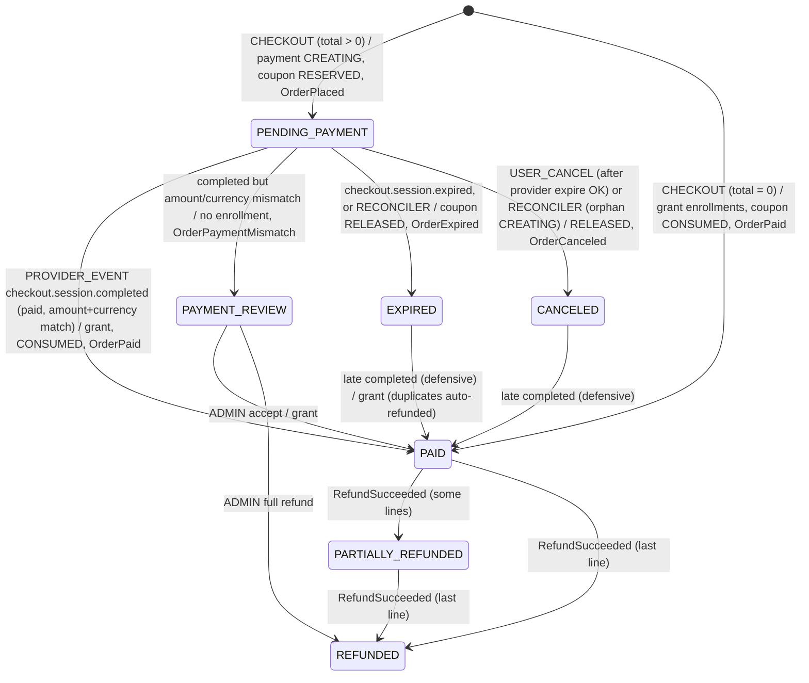
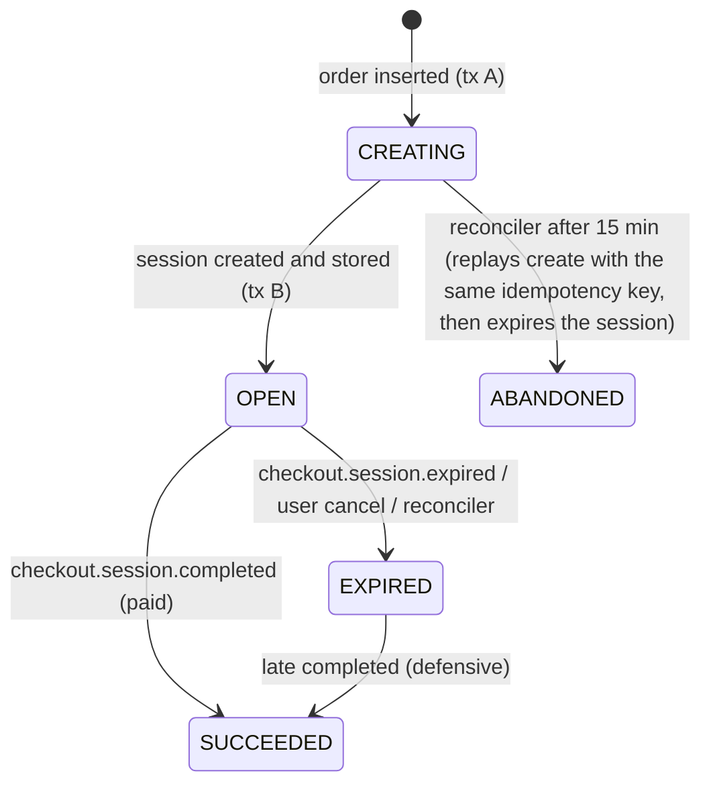
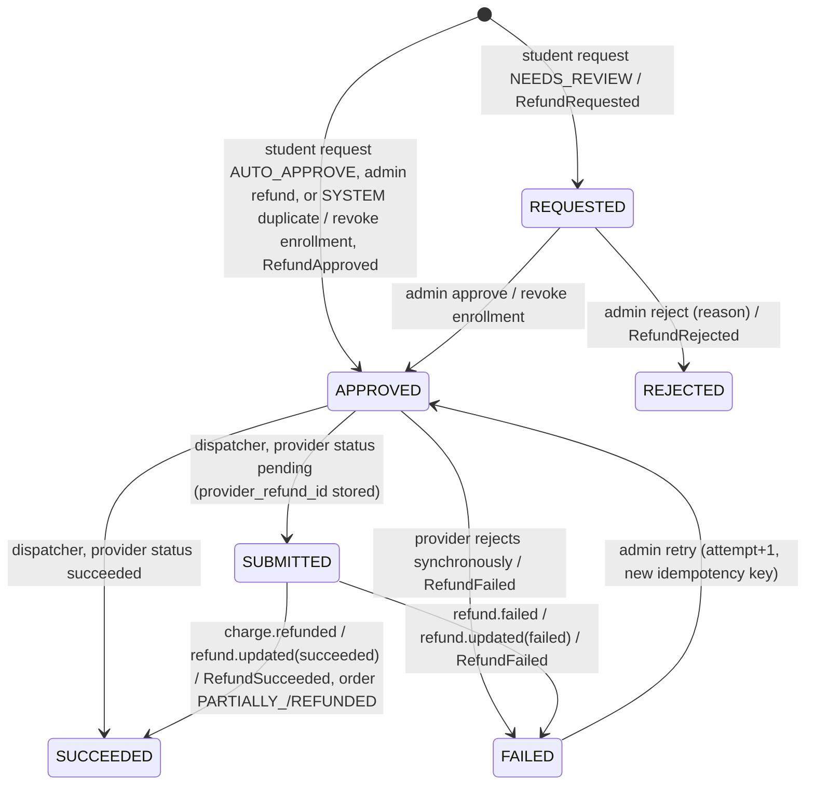
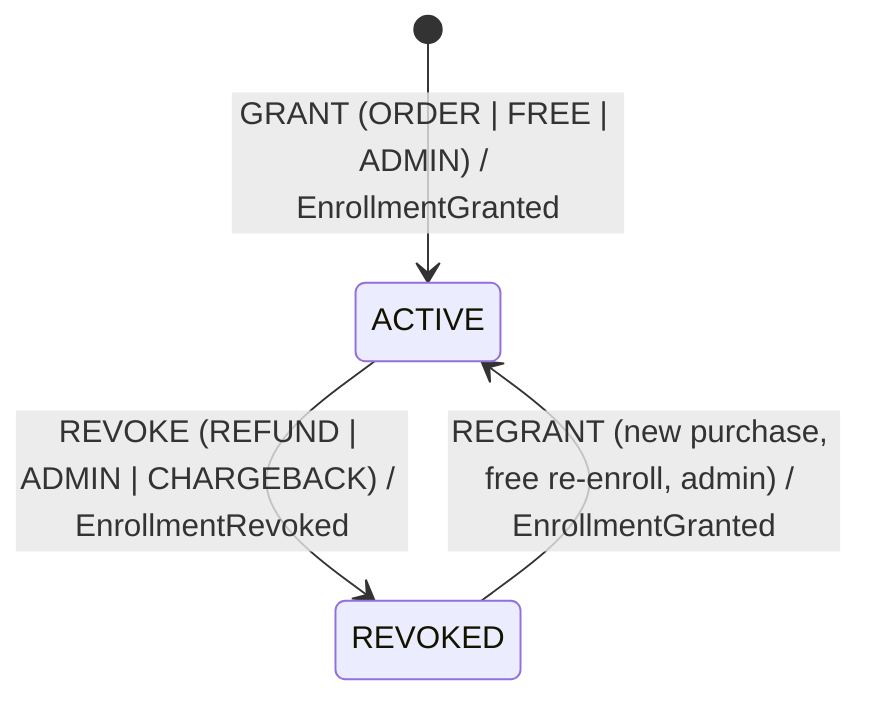
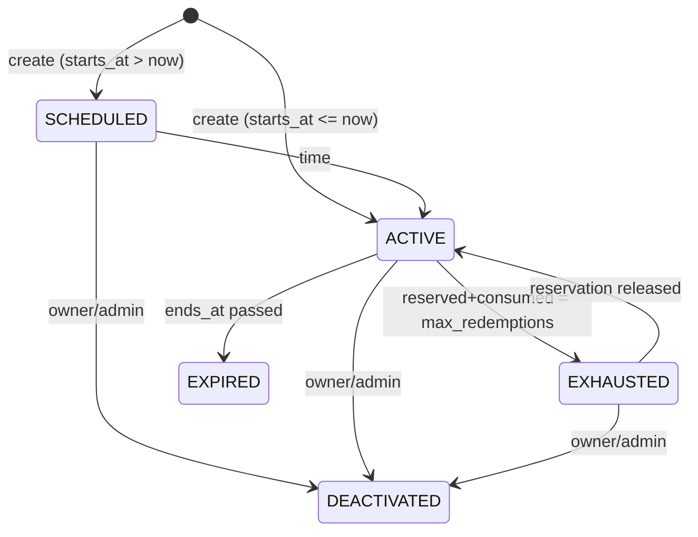
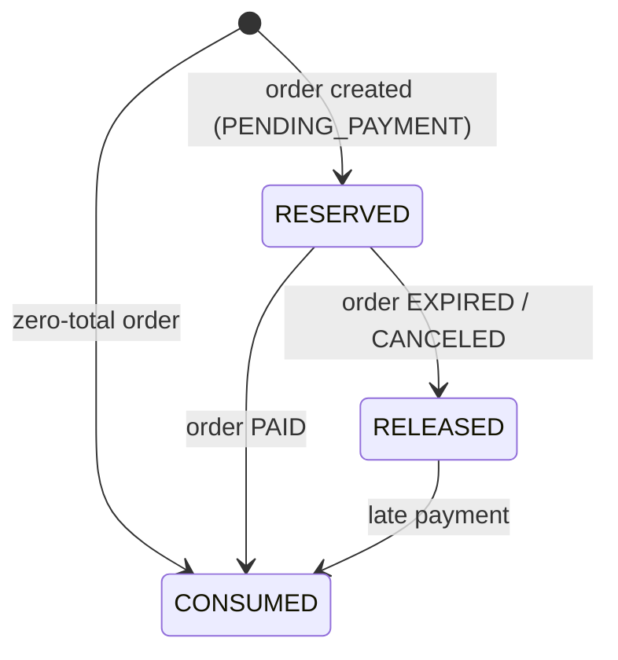
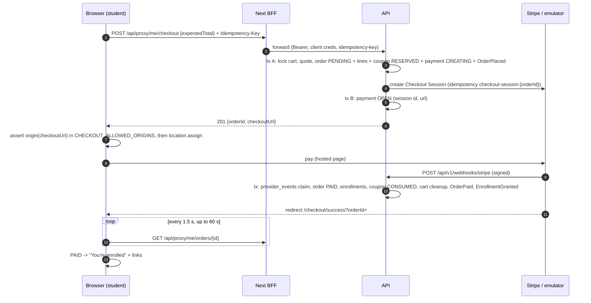

# Phase 4 Design: Commerce & Enrollment (Udemy clone v2)

## What I read, and the constraints it puts on this design

I read these documents:

- `docs/architecture-plan.md`: §2, §4, §7 and §9 (the Phase 4 verification line).
- `docs/phase-1-identity-access-design.md`: §1–§3 and §8–§10.
- `docs/phase-2-catalog-media-design.md`: all of it, including §13 and §14.
- `docs/phase-2-schema-design.md`: header, §4 and §5.

I read this code:

- **API:** `apps/api/src/{main.ts,setup-app.ts,app.module.ts}`
- **API shared:**
  - `shared/auth/{auth.decorators,auth-metadata.reader}.ts`
  - `shared/entitlements/*`
  - `shared/redis/rate-limiter.ts`
  - `shared/outbox/outbox.publisher.ts`
  - `shared/throttler/throttling.module.ts`
  - `shared/config/api-env.schema.ts`
- **API modules:**
  - `access/{presentation/route-security.auditor.ts, application/ownership.registry.ts, domain/permission-policy.ts}`
  - `identity/{index.ts, presentation/guards/client-auth.guard.ts}` and the `IdentityFacade` method list
  - `catalog/{index.ts, catalog.module.ts}`
  - `catalog/application/{catalog.facade, lecture-access.authorizer, use-cases/archive-course.command}.ts`
  - `catalog/infrastructure/{catalog-constraint-errors, kysely-transaction-runner}.ts`
  - `catalog/presentation/public-catalog.controller.ts`
  - the `UsersFacade` method list
  - `testing/e2e/e2e-harness.ts`
- **Worker:** `messaging/idempotency/idempotent-event-processor.ts`, `media/handlers/transcode-enqueuer.handler.ts`, `maintenance/media-cleanup.job.ts`, and the file layout.
- **Packages:**
  - `packages/contracts/src/{auth/permissions.ts, events/{define-event,payload-fields}.ts}` and the file layout
  - the `packages/db` layout and `migrations/0001_init.ts`
  - `packages/web-auth/src/{api-proxy,csp}.ts`
- **web-student:** `components/catalog/course-landing.tsx`, `components/site-header.tsx`, `lib/auth/config.ts`, and the file layout.
- **Infra and config:** `infra/docker/docker-compose.dev.yml`, `infra/kafka/create-topics.sh`, `infra/debezium/outbox-connector.json` (routing), `.github/workflows/e2e.yml`, `.env.example`, and the `package.json` files.

What I found, and how each finding shapes the design:

1. **The schemas already exist.** Migration 0001 created `commerce`, `enrollment` and `payouts`. Migration `0004_commerce_enrollment_payouts` creates only tables, functions and triggers.
2. **`@NoClientAuth` exists, and its doc already mentions "future webhooks".** `describeRoute` already rejects `@NoClientAuth` on any non-`@Public` route. Nothing yet says "an unauthenticated POST must prove where it came from". I add a `@WebhookIngress` marker and an auditor rule (§9).
3. **`main.ts` creates the app without `rawBody`, and the e2e harness creates its own app.** It uses `Test.createTestingModule` plus `setupApp`. `rawBody` is a `NestFactory.create` option, so `setupApp` cannot switch it on. Both paths must share one `API_APP_OPTIONS = { rawBody: true, bufferLogs: true }`. Otherwise signature verification passes in prod and fails in tests, or the reverse.
4. **The throttler falls back to `req.ip` when no BFF authenticated the request.** Its `getTracker` uses `ClientIpResolver`, and the storage is in-memory per pod. All Stripe deliveries would share one 300/min bucket, so the webhook gets `@SkipThrottle()`. The signature check is the gate.
5. **`COURSE_ENTITLEMENTS` already has its Phase 4 hook in `AppModule`.** The comment there gives the exact rebinding: `forRoot({ imports: [EnrollmentModule], useExisting: EnrollmentEntitlements })`.
   - `LectureAccessAuthorizer` calls it only for non-preview lectures and viewers who are not the owner. That path still runs on every playlist fetch, so it must be one indexed lookup.
   - After a refund, a revocation becomes visible within 60 s (the master playlist is `private, max-age=60`). Already-issued segment URLs keep working for up to 1 h (P2 Q8). I accept both.
6. **`CatalogFacade` returns one course with no title.** It has only `getPublishedCourse`, `lectureBelongsToLiveRevision` and `getLiveLectureIds`. Cart, order and "My learning" need a batch read with the live title, so I add `getCourseSummaries(ids)`. That seam was already planned in P2 §3.
7. **Permissions are code-defined and app-scoped (D6).** STUDENT permissions exist only in the student app, so an instructor buys through the student app. New student permissions confine checkout to the student BFF without extra `@AllowClients`.
8. **The BFF already forwards `idempotency-key`.** Unsafe methods need JSON and a matching Origin. The CSP has `form-action 'self'`, and Chrome applies it to redirects after a form POST, so a "form POST → 303 to Stripe" would be blocked. The checkout redirect must be `window.location.assign(url)` from JS. Then hosted Checkout needs **no CSP change** at all.
9. **Worker handlers run inside the `processed_events` claim transaction, sequentially per partition.** A Stripe call inside a handler would hold a DB transaction across network I/O. Keeping all Stripe calls in the API process also keeps the Stripe secret in one deployable (D9).
10. **The worker already reads other contexts' tables** (`UserContactReader`, `AdminRecipientsReader`, `CourseTitleReader`). Mailers use event payloads plus those readers, and the payouts ledger writer follows the same per-context folder precedent.
11. **`OutboxPublisher.publish` requires a `Transaction`.** Debezium routes by `aggregate_type`, so the topic name equals the aggregate type. Topics are pre-created only in `create-topics.sh`.
12. **Kysely and pg return `numeric` and `bigint` as strings.** Money must never pass through `parseFloat`. The §14 "timestamp keyset cursors keep the exact SQL text" amendment applies to every order and enrollment list.
13. **The patterns to reuse:**
    - `RateLimiter` is fail-closed (Redis down → 503).
    - Each module has a constraint→error map, and the `TransactionRunner` maps commit-time (deferred) errors.
    - Batch jobs take `pg_try_advisory_xact_lock(0x75646d79_NN)`. Media uses `_02`.
14. **CI e2e runs with ephemeral, per-run secrets and no repo secrets.** So checkout e2e must work without a Stripe account and still verify real signatures (D12).
15. **The landing page shows a disabled "Enrollment opens soon" placeholder.** `PUBLIC_PATHS` does not include `/cart`. Pages render per request because of the nonce CSP (§14), so a per-request price fetch costs nothing extra.
16. **Identity helpers exist:** `IdentityFacade.isEmailVerified` and `getUserSummary` (the email for Stripe's `customer_email`).
17. **The API has no `@nestjs/schedule`; only the worker does.** Commerce jobs that call Stripe live in the API (D9), so the API adds it.

---

## 1. Module dependency diagram

```mermaid
flowchart TB
  subgraph shared["apps/api/src/shared"]
    SA["shared/auth (+ @WebhookIngress marker, WebhookSignatureVerifier guard tag)"]
    SE["shared/entitlements: COURSE_ENTITLEMENTS + CourseEntitlementsModule.forRoot"]
    SR["shared/redis (RateLimiter)"]
    SO["shared/outbox (OutboxPublisher)"]
  end
  subgraph pkgs["packages"]
    PP["@udemy/payments: PaymentProvider port, StripePaymentProvider (stripe-node, pinned apiVersion),<br/>webhook verify+normalize, InMemoryPaymentProvider (unit), signTestWebhook (tests)"]
    PC["@udemy/contracts: permissions, errors, events, DTOs, PRICE_TIERS, MoneyAmount"]
    PD["@udemy/db: commerce/enrollment/payouts operational SQL"]
  end

  IDENTITY["identity"]
  CATALOG["catalog"]
  ENROLL["enrollment (enrollments, entitlements adapter, my learning, admin grant/revoke)"]
  COMMERCE["commerce (pricing, cart, coupons, checkout, orders, payments, webhook, refunds,<br/>instructor sales, admin, CommerceJobs: refund dispatcher + reconciler)"]
  ACCESS["access"]

  COMMERCE -->|CatalogFacade.getCourseSummaries| CATALOG
  COMMERCE -->|EnrollmentFacade.grant/revoke/activeCourseIds (caller's trx)| ENROLL
  COMMERCE -->|IdentityFacade.isEmailVerified/getUserSummary| IDENTITY
  ENROLL -->|CatalogFacade.getCourseSummaries| CATALOG
  COMMERCE --> PP
  CATALOG -->|injects COURSE_ENTITLEMENTS| SE
  COMMERCE -. "@OwnershipResolverFor('order')" .-> ACCESS
  COMMERCE -. "@CheckPolicy(course) for pricing/coupons (existing resolver)" .-> ACCESS

  subgraph appmod["AppModule"]
    W["CourseEntitlementsModule.forRoot({ imports:[EnrollmentModule], useExisting: EnrollmentEntitlements })"]
  end
  W --> ENROLL

  STRIPE(["Stripe (test mode) / apps/stripe-emulator (dev, CI)"])
  COMMERCE -->|Checkout Session, expire, refunds| STRIPE
  STRIPE -->|"POST /api/v1/webhooks/stripe (signed, no BFF)"| COMMERCE

  subgraph async["Outbox -> Debezium -> Kafka"]
    TO(["commerce.order (orders, payments, refunds)"])
    TP(["commerce.course_price"])
    TCP(["commerce.coupon"])
    TE(["enrollment.enrollment"])
  end
  COMMERCE -. outbox .-> TO & TP & TCP
  ENROLL -. outbox .-> TE

  subgraph worker["apps/worker"]
    WM["commerce mailers: receipt, refund-succeeded, refund-rejected, refund-under-review, admin alerts"]
    WL["payouts.ledger-writer (double-entry postings)"]
    WN["enrollment.instructor-new-enrollment-mailer (flagged off by default)"]
  end
  TO --> WM
  TO --> WL
  TE --> WN
```

The graph has no cycles:

- **enrollment** depends on catalog.
- **commerce** depends on catalog, enrollment and identity.
- **catalog** learns "is this user enrolled?" only through the global `COURSE_ENTITLEMENTS` token, as designed in P2.
- `EnrollmentEntitlements` depends only on its own repository, never on `CatalogFacade`. So the provider graph `LectureAccessAuthorizer → COURSE_ENTITLEMENTS → EnrollmentEntitlements → repo` has no cycle, even though `EnrollmentModule` imports `CatalogModule`. Verify this early with a boot test (T10).

---

## 2. Key decisions

| #   | Decision                       | Choice                                                                                                                                                                                                                                                                                                                                                                                                                                                                                                                                                                                                                                                                                                                                                                                                                                                                            | Why                                                                                                                                                                                                                                                                                                                                                                                                                                                 |
| --- | ------------------------------ | --------------------------------------------------------------------------------------------------------------------------------------------------------------------------------------------------------------------------------------------------------------------------------------------------------------------------------------------------------------------------------------------------------------------------------------------------------------------------------------------------------------------------------------------------------------------------------------------------------------------------------------------------------------------------------------------------------------------------------------------------------------------------------------------------------------------------------------------------------------------------------- | --------------------------------------------------------------------------------------------------------------------------------------------------------------------------------------------------------------------------------------------------------------------------------------------------------------------------------------------------------------------------------------------------------------------------------------------------- |
| D1  | Payment UI                     | **Stripe Checkout (hosted), redirect.** No Stripe.js or Elements on our pages.                                                                                                                                                                                                                                                                                                                                                                                                                                                                                                                                                                                                                                                                                                                                                                                                    | **PCI scope:** SAQ A, and no card data ever touches our origin.<br>**CSP:** unchanged (finding 8). Elements would need `js.stripe.com` in `script-src` next to `'strict-dynamic'`, `frame-src js.stripe.com hooks.stripe.com` and `connect-src api.stripe.com` in all the nonce plumbing.<br>**BFF:** unchanged; the browser only follows a URL the API returned.<br>**Cost:** less checkout styling control, which is fine for a learning project. |
| D2  | Pricing model                  | **Code-defined price tiers** (`PRICE_TIERS` in contracts): FREE (0.00), plus USD 19.99, 24.99 … 99.99 in 5.00 steps, 109.99 … 149.99 in 10.00 steps, 174.99 and 199.99.<br>The DB stores only `amount` and `currency` (the tier is derived, so no 3NF duplication).<br>**Effective immediately**, including while the course is a draft or in review. Pricing is commerce data, not part of the moderated revision.<br>Every change is recorded by trigger in append-only `course_price_changes`.<br>Rate limit: 10 changes per course per day.                                                                                                                                                                                                                                                                                                                                   | Tiers stop "$13.37" prices, keep the minimum (19.99) and maximum (199.99) declarative, and make a later multi-currency table a pure lookup.<br>Re-reviewing a price change would block sales for no moderation value.<br>Orders snapshot the price, so changes never affect an open checkout.                                                                                                                                                       |
| D3  | Currency and rounding          | **One platform currency (`COMMERCE_CURRENCY=USD`)**, a 2-decimal allowlist in contracts.<br>Arithmetic happens only in **integer minor units** in a `Money` value object, parsed from the decimal string Kysely returns; no floats anywhere.<br>Percent discount = `round_half_up(list_minor × pct / 100)`.<br>Instructor share = `round(final × bps / 10000, 2)`, computed **by the DB** in a generated column. Platform share = final − instructor share.<br>An order total in (0, 0.50) is rejected (`amount_below_minimum`, Stripe's minimum). Taxes are out of scope; prices are tax-inclusive.                                                                                                                                                                                                                                                                              | A single rounding authority (SQL) for shares means the ledger and sales totals always add up exactly.                                                                                                                                                                                                                                                                                                                                               |
| D4  | Cart                           | The **server cart is for signed-in users only** (`commerce.carts`, `cart_items`).<br>Anonymous visitors get a **guest cart in `localStorage`** (course ids only). After login it is merged via `POST /me/cart/merge`, best effort: ineligible ids are skipped and reported.<br>At most 20 items, single currency, at most one coupon code per cart.                                                                                                                                                                                                                                                                                                                                                                                                                                                                                                                               | No anonymous server state, no extra cookies, no anonymous-id abuse surface. Udemy-like UX.<br>Prices in the guest cart come from the public price endpoint and are informational; the server always recomputes.                                                                                                                                                                                                                                     |
| D5  | Coupons                        | **Course coupons** (by the instructor, one course each) and **platform coupons** (by an admin, all courses).<br>`PERCENT` (1–100) or `AMOUNT` (off the list price, floored at 0).<br>Validity window, optional `max_redemptions`, **one redemption per user per coupon**.<br>Codes match `^[A-Z0-9_-]{4,20}$` and are unique per course (`UNIQUE NULLS NOT DISTINCT (course_id, code)`), so two instructors can both use "LAUNCH".<br>Per cart line, the best of {that course's coupon with this code, the platform coupon with this code} wins; a tie goes to the course coupon. No stacking.<br>Coupons are immutable after creation except deactivation; at most 10 active per course.                                                                                                                                                                                         | Redemption counting is the race-prone part, so it is reserved under a row lock at order creation (D7). Immutable coupons make every redemption auditable against the terms in force.                                                                                                                                                                                                                                                                |
| D6  | Order and payment split        | `orders` is the commercial fact (status, total, idempotency).<br>`order_lines` is an immutable snapshot: course title, instructor, list, discount, coupon, share bps, plus generated final and share amounts.<br>`payments` has one Checkout Session per order (session id, payment intent, provider status).<br>A new checkout always creates a new order; sessions are never reused across carts.                                                                                                                                                                                                                                                                                                                                                                                                                                                                               | Each table has one lifecycle. 1:1 order↔session keeps the webhook mapping trivial. The snapshot is what was sold, forever (D13 safe).                                                                                                                                                                                                                                                                                                               |
| D7  | Coupon redemption counting     | At checkout, lock the coupon row `FOR UPDATE` (ascending id), count `coupon_redemptions` with status RESERVED or CONSUMED, then insert a RESERVED row.<br>PAID → CONSUMED. EXPIRED or CANCELED → RELEASED.<br>A late payment re-consumes even past the limit; the overshoot is logged and accepted.                                                                                                                                                                                                                                                                                                                                                                                                                                                                                                                                                                               | No denormalized counter (3NF). The coupon row lock serializes exactly the contended case. Reservation (not counting at PAID) means a "max 100" coupon cannot sell 130 during a burst. Abandoned reservations return when the session expires (≤ 30 min).                                                                                                                                                                                            |
| D8  | Enrollment creation            | **In the same transaction** that moves the order to PAID: commerce calls `EnrollmentFacade.grant(trx, …)` (a facade write on the caller's executor, P1 convention).<br>`EnrollmentGranted` still goes to the outbox for downstream consumers.<br>Refunds revoke the same way.<br>**This deviates from the plan's "OrderPaid → create enrollment" consumer; flagged in Q1.**                                                                                                                                                                                                                                                                                                                                                                                                                                                                                                       | PAID ⇔ enrolled, atomically: no "paid but no access" window while Debezium and Kafka catch up. The success page can redirect to the course the moment it sees PAID.<br>Refund revocation is equally atomic. It is one database in a monolith, so the event path buys nothing here and adds a failure mode.<br>Side effects that tolerate lag (mail, ledger, P5 learning init) stay on events.                                                       |
| D9  | Where Stripe is called         | **Only the API process holds `STRIPE_SECRET_KEY`.**<br>Checkout Session create and expire run in the request path.<br>Refunds run in an API-side `CommerceJobs` dispatcher: it polls `refunds WHERE status='APPROVED'` with `SKIP LOCKED` and an advisory lock `0x75646d79_03`, and gets an immediate post-commit kick.<br>A reconciler retrieves stale sessions and cancels orphan orders.                                                                                                                                                                                                                                                                                                                                                                                                                                                                                       | A worker handler would call Stripe inside the claim transaction (finding 9). It would also need the secret and duplicate the webhook logic. Polling plus the Stripe idempotency key `refund:{id}:{attempt}` gives at-least-once with an exactly-once effect.                                                                                                                                                                                        |
| D10 | Webhook processing             | `POST /api/v1/webhooks/stripe`. Raw bytes are verified by a `StripeSignatureGuard` (`constructEvent`, tolerance 300 s).<br>One transaction does all of this:<br>1. `INSERT commerce.provider_events … ON CONFLICT DO NOTHING`. A concurrent duplicate blocks on the PK and then sees a conflict, which means "duplicate → 200".<br>2. Apply the state transition.<br>3. Write the outbox events.<br>4. Set the outcome.<br>Transitions are **monotonic and state-guarded**, so out-of-order and replayed events are no-ops.<br>An unexpected error rolls back and returns 500, and Stripe retries for up to 3 days.<br>The payment amount and currency are checked against the order.                                                                                                                                                                                             | The same claim-in-transaction model as the worker's `processed_events`. Dedupe by event id handles replays; state guards handle reordering. The event's state is never trusted beyond what it is allowed to advance.                                                                                                                                                                                                                                |
| D11 | Refund policy (Phase 4)        | Per order line (full line amount only), within **`COMMERCE_REFUND_WINDOW_DAYS=30`** of `paid_at`.<br>**Auto-approved** unless the user had at least 3 refunds in 90 days, which sends it to admin review.<br>Lines with a 0.00 price are not refundable.<br>**Enrollment is revoked at approval**, not when the provider succeeds.<br>A provider failure leaves the refund FAILED; an admin retries or re-grants.<br>The Phase 5 consumption rule plugs into a `RefundEligibilityPolicy` port, bound now to `NoConsumptionData`.                                                                                                                                                                                                                                                                                                                                                  | Revoking at approval stops "refund, then keep watching while it processes". Abuse is routed to a human rather than blocked.                                                                                                                                                                                                                                                                                                                         |
| D12 | Testing without Stripe secrets | Five layers:<br>1. **`@udemy/payments` contract tests against `stripe/stripe-mock`** (a CI service container, no secrets). They validate every request shape against Stripe's OpenAPI.<br>2. **Signature tests** with `signTestWebhook()`, real HMAC, no network.<br>3. **`apps/stripe-emulator`:** a small Node server implementing the subset we use (`/v1/checkout/sessions` create, retrieve and expire; `/v1/refunds`), a hosted checkout page (Pay, Decline, Cancel), and **signed webhook delivery with retries**. The real `StripePaymentProvider` points at it via `STRIPE_API_BASE_URL`, so API e2e and Playwright exercise the real adapter and real signature verification.<br>4. In CI, an **ephemeral random `whsec_`** per run.<br>5. An optional `stripe-live.yml` workflow (`workflow_dispatch` or nightly) that runs only when `STRIPE_TEST_SECRET_KEY` is set. | CI stays green with no secrets, yet the signature, raw-body, dedupe and adapter paths are all real. stripe-mock keeps the emulator honest about request shapes; the emulator supplies the behaviour stripe-mock lacks (it is stateless).                                                                                                                                                                                                            |
| D13 | Payouts seam                   | Commerce snapshots `revenue_share_bps` per line (default `COMMERCE_INSTRUCTOR_SHARE_BPS=7000`) and the generated share amounts.<br>The worker `payouts.ledger-writer` posts **double-entry journal entries** into `payouts.{accounts,journal_entries,postings}` from `OrderPaid` and `RefundSucceeded`. It is idempotent on `(kind, order_line_id, refund_id)` and append-only, with Σ postings = 0 per entry enforced at commit.<br>No payouts API module yet.                                                                                                                                                                                                                                                                                                                                                                                                                   | Phase 6 only adds hold periods, payout runs and reports on top of a ledger that is already correct. The facts can be rebuilt from commerce snapshots if the consumer ever has to be replayed.                                                                                                                                                                                                                                                       |
| D14 | Free courses                   | `amount = 0.00` means free. `POST /me/free-enrollments {courseId}` grants directly (source FREE, **no order**).<br>A 100%-coupon paid course creates a **zero-total order** that becomes PAID immediately (provider NONE), so the coupon audit holds.                                                                                                                                                                                                                                                                                                                                                                                                                                                                                                                                                                                                                             | Free enrolments are not commerce; a $0 order for every free course would only add noise. Coupon redemptions must stay traceable, so they always go through an order.                                                                                                                                                                                                                                                                                |
| D15 | Double checkout                | At most **one PENDING_PAYMENT order per user** (partial unique index).<br>A new checkout while one is open returns 409 `checkout_in_progress {orderId, checkoutUrl}`; the UI offers "Resume payment" or "Cancel and start over". Cancel expires the Stripe session first.<br>If two orders ever both get paid, the second grant finds an ACTIVE enrollment, and the system auto-creates a `DUPLICATE_PURCHASE` refund for that line.                                                                                                                                                                                                                                                                                                                                                                                                                                              | The race is closed declaratively, and the impossible-but-possible double payment self-heals with an audit trail.                                                                                                                                                                                                                                                                                                                                    |
| D16 | Missing price                  | A published course with **no `course_prices` row is not for sale**. The landing page shows "Not available for enrollment yet"; the builder and admin review show a "Set a price" warning. Catalog readiness is **not** coupled to commerce.                                                                                                                                                                                                                                                                                                                                                                                                                                                                                                                                                                                                                                       | Avoids a new catalog→commerce port and contract change for a UX nicety. Existing P2 courses simply start unsellable.                                                                                                                                                                                                                                                                                                                                |
| D17 | Email verification             | **A paid checkout requires a verified email** (403 `email_not_verified`). Free enrolment does not.                                                                                                                                                                                                                                                                                                                                                                                                                                                                                                                                                                                                                                                                                                                                                                                | Receipts and refund mails must reach the buyer; it is also cheap fraud friction.                                                                                                                                                                                                                                                                                                                                                                    |

---

## 3. Module public facades

Following the P1 and P2 conventions: write methods take a `Transaction<DB>` first, and the caller owns the transaction. Reads take an optional `ex`.

### `modules/catalog/index.ts` (addition)

```ts
getCourseSummaries(courseIds: readonly string[], ex?): Promise<CourseSummary[]>;
// { id, slug, ownerId, status: 'PUBLISHED'|'ARCHIVED', liveRevisionId, title (live), hasThumbnail }
// unknown / never-published / deleted ids are omitted; max 100 ids
```

### `modules/enrollment/index.ts`

```ts
export { EnrollmentModule } from './enrollment.module';
export { EnrollmentFacade } from './application/enrollment.facade';
export { EnrollmentEntitlements } from './application/enrollment-entitlements'; // AppModule only

class EnrollmentFacade {
  grant(trx, { userId, courseId, source: 'ORDER'|'FREE'|'ADMIN', orderLineId?: string, actorId: string|null })
    : Promise<{ enrollmentId: string; outcome: 'GRANTED' | 'REGRANTED' | 'ALREADY_ACTIVE' }>;
  // INSERT … ON CONFLICT (user_id, course_id) DO UPDATE … WHERE status='REVOKED'; transition row;
  // outbox EnrollmentGranted (not on ALREADY_ACTIVE)
  revoke(trx, { userId, courseId, reason: 'REFUND'|'ADMIN'|'CHARGEBACK', refundId?: string, actorId: string|null })
    : Promise<{ outcome: 'REVOKED' | 'NOT_ACTIVE' }>;
  activeCourseIds(userId, courseIds: readonly string[], ex?): Promise<ReadonlySet<string>>;
}

class EnrollmentEntitlements implements CourseEntitlements {
  hasCourseAccess(userId, courseId) // SELECT 1 … WHERE user_id=$1 AND course_id=$2 AND status='ACTIVE'
}
```

`AppModule` binding: `CourseEntitlementsModule.forRoot({ imports: [EnrollmentModule], useExisting: EnrollmentEntitlements })`.

### `modules/commerce/index.ts`

It exports only `CommerceModule`. No other module calls commerce in Phase 4; Phase 6 analytics will consume events. It registers `@OwnershipResolverFor('order') OrderOwnership`, which returns `orders.user_id`.

### `@udemy/payments` (new package)

```ts
interface PaymentProvider {
  createCheckoutSession(i: { orderId; currency; lines: { name; unitAmountMinor }[]; customerEmail;
    successUrl; cancelUrl; expiresAt: Date }, o: { idempotencyKey })
    : Promise<{ sessionId; url; expiresAt: Date }>;
  expireCheckoutSession(sessionId): Promise<'EXPIRED' | 'ALREADY_EXPIRED' | 'ALREADY_COMPLETE'>;
  retrieveCheckoutSession(sessionId): Promise<ProviderCheckoutSession>;
  createRefund(i: { paymentIntentId; amountMinor; refundId }, o: { idempotencyKey })
    : Promise<{ providerRefundId; status: 'PENDING' | 'SUCCEEDED' | 'FAILED' }>;
  verifyWebhook(rawBody: Buffer, signatureHeader: string, now?: Date): ProviderEvent; // throws WebhookSignatureInvalid
}
type ProviderEvent = { id; type; createdAt; livemode; data:
  | { kind: 'CHECKOUT_COMPLETED'; sessionId; orderId|null; paymentStatus; paymentIntentId|null; amountTotalMinor; currency }
  | { kind: 'CHECKOUT_EXPIRED'; sessionId; orderId|null }
  | { kind: 'REFUND_UPDATED'; providerRefundId; refundId|null; status; failureReason|null }   // charge.refunded, refund.updated, refund.failed
  | { kind: 'DISPUTE_OPENED'; paymentIntentId }
  | { kind: 'IGNORED' } };
```

The Stripe adapter:

- **Client settings:** `stripe-node` with a pinned `apiVersion`, `maxNetworkRetries: 2`, `timeout: 10_000`, `telemetry: false`. `host`, `port` and `protocol` come from `STRIPE_API_BASE_URL` (the emulator or stripe-mock).
- **Session parameters:** `mode: 'payment'`, `payment_method_types: ['card']` (synchronous methods only, so `completed` implies paid), `client_reference_id = orderId`, `metadata.orderId`, `payment_intent_data.metadata.orderId`, `expires_at`.
- **Line items:** inline `price_data`, so there is no Stripe Product sync.
- **Refunds:** created with `metadata.refundId`.

---

## 4. Domain model and state machines

### Value objects (`commerce/domain`)

- **`Money`:** `{ minor: number (safe int), currency }`. `fromDecimal('19.99','USD')`, `toDecimal()`, `add`, `percentOff(p)` (half-up), `minus` floored at 0. Mixing currencies throws.
- **`PriceTier`:** validates an amount against `PRICE_TIERS[currency]`.
- **`CouponTerms`:** discount type, value, window, max redemptions, scope. `discountFor(list: Money)`.
- **`Quote`:** cart lines plus the resolved coupon. It holds per-line `{list, discount, final, couponId}`, the totals, `unavailable[]` with a reason per line, and a `fingerprint` (SHA-256 of the sorted `courseId:final` pairs, the coupon id and the currency).
- **`RefundEligibility`:** `(line, order, now, recentRefundCount, consumption?)` returns `AUTO_APPROVE`, `NEEDS_REVIEW` or `INELIGIBLE(reason)`.

**Purchase eligibility of a course for a user.** Each check, in order, with its error:

1. The course status is PUBLISHED: `course_not_for_sale`.
2. A price row exists: `course_not_for_sale`.
3. The price is not 0: `course_is_free`, and the UI uses the free path instead.
4. The user is not the owner: `cannot_purchase_own_course`.
5. The user is not ACTIVE-enrolled: `already_enrolled`.

### Order



`status`, `paid_at` and `closed_at` are materializations of `order_transitions`, checked at COMMIT (the P2 pattern).

### Payment (Checkout Session)



`checkout_url` is a bearer capability. It is set to NULL when the payment leaves OPEN, and it is never logged.

### Refund



Webhooks are matched by `provider_refund_id`, falling back to `metadata.refundId`, which covers a dispatcher crash after the Stripe call. Refunds made in the Stripe dashboard are not supported: the webhook outcome is `ORPHAN` and an admin alert goes out.

### Enrollment



Enrollments survive course archive and instructor bans (D13): `hasCourseAccess` ignores course status, and catalog already lets entitled viewers play ARCHIVED courses. A course that later switches from free to paid keeps its free enrollments.

### Coupon (derived state; nothing stored except `deactivated_at`) and redemption





**Lock order** (everywhere, to avoid deadlocks): cart row (user) → order row → coupon rows (ascending id) → enrollment rows. The webhook PAID path reads the order without a lock, then locks the cart, then the order.

---

## 5. Use cases (errors are `DomainError` → RFC 7807 with a stable `code`)

### Pricing (commerce)

| Use case           | Input                                                             | Behaviour / output                                                                                                                                                                                                | Errors                            |
| ------------------ | ----------------------------------------------------------------- | ----------------------------------------------------------------------------------------------------------------------------------------------------------------------------------------------------------------- | --------------------------------- |
| `SetCoursePrice`   | principal (owner via policy), courseId, `amount` (decimal string) | Validates the tier and the platform currency; upserts `course_prices` (the trigger writes history); outbox `CoursePriceChanged`. A no-op if unchanged. The course must exist and not be deleted (via the policy). | 404, 422 `price_not_allowed`, 429 |
| `GetCoursePricing` | courseId                                                          | `{ price: Money \| null, isFree, history[] (last 20) }`                                                                                                                                                           | 404                               |
| `GetPublicPrices`  | courseIds ≤ 48                                                    | `[{courseId, amount, currency, isFree}]` for PUBLISHED courses with a price; other ids are omitted                                                                                                                | 400                               |

### Cart

| Use case            | Input          | Behaviour                                                                                                                                                                  | Errors                                                                                                                                                                 |
| ------------------- | -------------- | -------------------------------------------------------------------------------------------------------------------------------------------------------------------------- | ---------------------------------------------------------------------------------------------------------------------------------------------------------------------- |
| `GetCart` (= quote) | principal      | Lines with current price, the best coupon per line, totals, `unavailable[]` (each with its reason), `fingerprint`. A code that no longer applies is reported, not dropped. | none                                                                                                                                                                   |
| `AddToCart`         | courseId       | Lock the cart, check purchase eligibility, insert ON CONFLICT DO NOTHING (adding twice returns 200).                                                                       | 404 `course_not_found`, 409 `course_not_for_sale` / `course_is_free` / `cannot_purchase_own_course` / `already_enrolled`, 422 `cart_full`, 429                         |
| `RemoveFromCart`    | courseId       | Idempotent delete                                                                                                                                                          | none                                                                                                                                                                   |
| `MergeGuestCart`    | courseIds ≤ 20 | Adds each eligible id; returns `{added[], skipped[{courseId, reason}]}`                                                                                                    | 422 `cart_full` (partial merge is reported, not an error)                                                                                                              |
| `ApplyCoupon`       | code           | Rate-limited. Resolves the code against the cart lines (D5) and stores `carts.coupon_code`. Returns the quote.                                                             | 422 `coupon_invalid` (unknown or not applicable to any line: one generic code), `coupon_expired`, `coupon_not_started`, `coupon_exhausted`, `coupon_already_used`, 429 |
| `RemoveCoupon`      | none           | Clears the code                                                                                                                                                            | none                                                                                                                                                                   |

### Checkout, orders, payments

**`Checkout`.** Input: principal, `Idempotency-Key` (UUID, required) and `expectedTotal`.

1. Rate limit, then `isEmailVerified` (403 `email_not_verified`).
2. **Tx A:**
   1. Lock the cart.
   2. Look up the order by `(user_id, idempotency_key)`:
      - If found with the same fingerprint, resume: return its state, or continue at step 3 if the payment is still CREATING.
      - If found with a different fingerprint: 422 `idempotency_key_reused`.
   3. If the user has an open PENDING_PAYMENT order: 409 `checkout_in_progress {orderId, checkoutUrl}`.
   4. Build the quote:
      - Batch `CatalogFacade.getCourseSummaries(trx)` and `EnrollmentFacade.activeCourseIds(trx)`.
      - Lock the coupons, count redemptions, and recompute everything server-side.
      - Any unavailable line: 409 `cart_changed` plus the quote.
      - Total ≠ `expectedTotal`: 409 `price_changed` plus the quote.
      - Total in (0, 0.50): 422 `amount_below_minimum`.
      - Empty cart: 422 `cart_empty`.
   5. Insert the order, its lines and the redemption (RESERVED), a CREATING payment, the transition, and `OrderPlaced`.
   6. **If the total is 0:** the order goes straight to PAID; grant every line, set the redemption CONSUMED, delete the purchased cart items, emit `OrderPaid`, and return 201 `{orderId, status:'PAID', checkoutUrl:null}`.
3. **Stripe:** `createCheckoutSession`, outside any transaction, with idempotency key `checkout-session:{orderId}`.
4. **Tx B:** conditional `CREATING → OPEN`, storing the session id, url and `expires_at`. Return 201 `{orderId, status:'PENDING_PAYMENT', checkoutUrl}`.
5. **If Stripe fails:** return 503 `payment_provider_unavailable`. The order stays CREATING; a retry with the same key resumes at step 3.

**`CancelPendingOrder`** (orderId, own):

1. Provider `expireCheckoutSession`.
   - If the result is `ALREADY_COMPLETE`, return 409 `order_not_cancelable`; the webhook will mark the order PAID.
   - If the payment is still CREATING, use the reconciler's replay-then-expire instead (see `CommerceJobs.reconcile`).
2. Tx: CANCELED, redemption RELEASED, payment EXPIRED, `OrderCanceled`.
3. A repeat returns 200 with the current state.

Errors: 404, 409 `order_not_cancelable`.

**`HandleProviderEvent`** (webhook; D10). The handlers, by event:

- **`CHECKOUT_COMPLETED`:**
  1. Map the order: `metadata.orderId`, then `client_reference_id`, then `checkout_session_id`.
  2. If `payment_status ≠ 'paid'`: outcome IGNORED.
  3. If the amount or currency differs from the order: PAYMENT_REVIEW and `OrderPaymentMismatch`.
  4. Otherwise:
     - Order → PAID; payment → SUCCEEDED with `payment_intent_id`.
     - Redemption → CONSUMED.
     - Per line, `EnrollmentFacade.grant`. On `ALREADY_ACTIVE`, insert a SYSTEM refund (APPROVED, `DUPLICATE_PURCHASE`).
     - Delete the purchased cart items, and clear the coupon code if it was consumed.
     - Emit `OrderPaid`.
  5. If the order is already PAID or refunded: outcome `DUPLICATE_EFFECT`.
- **`CHECKOUT_EXPIRED`:** a PENDING_PAYMENT order → EXPIRED. Any other state: no-op.
- **`REFUND_UPDATED`:** SUBMITTED or APPROVED → SUCCEEDED (order status recomputed, `RefundSucceeded`) or → FAILED (`RefundFailed`). Terminal states: no-op.
- **`DISPUTE_OPENED`:** record it and send an admin alert event (no automatic revoke in P4).

Unknown order or refund: outcome ORPHAN, 200, and an error log. A livemode mismatch: IGNORED and an error log.

Errors: 400 `webhook_signature_invalid` (from the guard). Unexpected failures: 500, and Stripe retries.

**Read use cases:**

- `ListMyOrders`: keyset `(placed_at DESC, id DESC)`.
- `GetMyOrder`: lines with a per-line `refund {status, refundableUntil, eligible, reason}`, plus payment status.
- `GetReceipt`: order number, date, lines, discounts, total and buyer name. Card details are not stored.

All three return 404 for foreign orders (policy).

**`EnrollFree`** (courseId): the course is PUBLISHED, priced at 0.00, and not the user's own. Then `grant` with source FREE. Returns 201, or 200 if already active. Errors: 404, 409 `course_not_free` / `cannot_purchase_own_course` / `course_not_for_sale`, 429.

### Refunds

| Use case                       | Input                                                        | Behaviour                                                                                                                                                                                                                                                                                                                                                                                              | Errors                                                                                                         |
| ------------------------------ | ------------------------------------------------------------ | ------------------------------------------------------------------------------------------------------------------------------------------------------------------------------------------------------------------------------------------------------------------------------------------------------------------------------------------------------------------------------------------------------ | -------------------------------------------------------------------------------------------------------------- |
| `RequestRefund` (student)      | orderId (own), orderLineId, reasonCode, comment? ≤ 1000      | Lock the order; check eligibility (D11). AUTO_APPROVE → APPROVED + `revoke` + `RefundApproved` + post-commit dispatcher kick. NEEDS_REVIEW → REQUESTED + `RefundRequested`.                                                                                                                                                                                                                            | 404 (order or line), 409 `refund_already_requested`, 422 `refund_window_closed` / `refund_not_applicable`, 429 |
| `AdminRefund`                  | orderId, orderLineIds[], reason 10–2000                      | APPROVED (initiated_by ADMIN; ignores the window) per line                                                                                                                                                                                                                                                                                                                                             | 404, 409 `refund_already_requested`, 422                                                                       |
| `ReviewRefund`                 | refundId, decision, reason (required for reject)             | Conditional on `status='REQUESTED'`                                                                                                                                                                                                                                                                                                                                                                    | 404, 409 `invalid_state_transition`                                                                            |
| `RetryRefund`                  | refundId                                                     | FAILED → APPROVED, attempt+1                                                                                                                                                                                                                                                                                                                                                                           | 404, 409                                                                                                       |
| `CommerceJobs.dispatchRefunds` | none (API, scheduled every 10 s + kick, advisory lock `_03`) | Lease APPROVED rows with `SKIP LOCKED`. Zero-amount lines (PAYMENT_REVIEW edge): SUCCEEDED directly. Otherwise `createRefund(idempotency key refund:{id}:{attempt})`, then tx: SUBMITTED / SUCCEEDED / FAILED. Never hold a tx across the call: claim with `dispatch_started_at`, release on error.                                                                                                    | none (retried; terminal FAILED after a provider error code)                                                    |
| `CommerceJobs.reconcile`       | none (every 5 min)                                           | (a) payments CREATING older than 15 min: replay create with the same key (returns the same session, or creates one that nobody holds), expire it, ABANDONED, order CANCELED. (b) OPEN sessions with `expires_at` more than 10 min in the past: retrieve, then apply COMPLETED or EXPIRED through the **same** `HandleProviderEvent` domain path (synthetic event id `reconcile:{sessionId}:{status}`). | none                                                                                                           |

### Coupons

- **`CreateCourseCoupon`** (owner via course policy):
  - Code: normalized to uppercase.
  - Discount: PERCENT 1–100, or AMOUNT up to the current list price (must be > 0 when there is a price).
  - Window: 1–31 days; `starts_at` no more than 90 days ahead.
  - Optional max redemptions, up to 100,000.
  - At most 10 active coupons per course.
  - Errors: 404, 409 `coupon_code_taken`, 422 `coupon_limit_exceeded` / `course_is_free` / field errors.
- **`CreatePlatformCoupon`** (admin): PERCENT only, a window of up to 90 days. Errors: 409 `coupon_code_taken`, 422.
- **`DeactivateCoupon`:** idempotent.
- **`ListCoupons`:** returns terms, derived state and `{reserved, consumed}` counts.

### Enrollment

| Use case                   | Input                    | Output                                                                                                                            | Errors                              |
| -------------------------- | ------------------------ | --------------------------------------------------------------------------------------------------------------------------------- | ----------------------------------- |
| `ListMyLearning`           | cursor, limit ≤ 24       | Keyset `(granted_at DESC, id DESC)` over ACTIVE rows; cards from `getCourseSummaries` (archived badge; `progress: null` until P5) | none                                |
| `GetPurchaseStates`        | courseIds ≤ 48           | `[{courseId, enrolled, inCart, isOwner}]` (commerce composes enrollment + cart + catalog)                                         | 400                                 |
| `AdminListUserEnrollments` | userId                   | all rows, with source and transitions                                                                                             | 404                                 |
| `AdminGrantEnrollment`     | userId, courseId, reason | `grant(ADMIN)`                                                                                                                    | 404, 409 `already_enrolled`         |
| `AdminRevokeEnrollment`    | enrollmentId, reason     | `revoke(ADMIN)`                                                                                                                   | 404, 409 `invalid_state_transition` |

### Instructor sales (commerce)

- **`GetSalesSummary`** (principal = instructor; `from`/`to` range ≤ 366 days): per course and in total `{salesCount, gross, discounts, refunded, net, instructorShare}`. Data comes from `order_lines` joined to orders (PAID, PARTIALLY_REFUNDED, REFUNDED) and SUCCEEDED refunds.
- **`ListRecentSales`:** keyset over the instructor's lines `{paidAt, courseTitle, final, couponCode, instructorShare, refunded}`. It contains **no buyer PII**.

### New error codes

`price_not_allowed`, `course_not_for_sale`, `course_is_free`, `course_not_free`, `cannot_purchase_own_course`, `already_enrolled`, `cart_full`, `cart_empty`, `cart_changed`, `price_changed`, `coupon_invalid`, `coupon_expired`, `coupon_not_started`, `coupon_exhausted`, `coupon_already_used`, `coupon_code_taken`, `coupon_limit_exceeded`, `checkout_in_progress`, `idempotency_key_required` (400), `idempotency_key_reused` (422), `amount_below_minimum`, `email_not_verified` (403), `payment_provider_unavailable` (503), `order_not_found`, `order_not_cancelable`, `refund_window_closed`, `refund_not_applicable`, `refund_already_requested`, `refund_not_found`, `enrollment_not_found`, `webhook_signature_invalid` (400).

Reused codes: `invalid_state_transition`, `rate_limited`, `validation_failed`.

---

## 6. Conceptual data model (for db-architect), migration `0004_commerce_enrollment_payouts`

**Conventions** (as in P1 and P2):

- uuidv7 PKs, `now()`, `set_updated_at` triggers.
- CHECK constraints instead of enums; `<table>_<cols>_<sfx>` names.
- Append-only tables are guarded by `forbid_append_only_mutation()`.
- **Cross-schema FKs go only to `identity.users` (D12).** Every `course_id` and every enrollment→commerce reference is soft.
- **Money columns** are `numeric(12,2)` with `CHECK (x >= 0)` (signed only in `postings`). A `currency char(3) CHECK (currency ~ '^[A-Z]{3}$')`; the allowlist lives in the app.
- **Generated columns must say `STORED`** (PG 18 defaults to VIRTUAL, and they are FK targets here).

### commerce

**`course_prices`**

- Columns: `course_id` PK (soft), `amount`, `currency`, `updated_by → identity.users`, `created_at`, `updated_at`.
- CHECK: `amount <= 9999.99`.
- An AFTER INSERT/UPDATE trigger writes `course_price_changes` when the amount or currency changes. History therefore cannot be skipped.

**`course_price_changes`** (append-only)

- Columns: `id`, `course_id`, `previous_amount NULL`, `amount`, `currency`, `changed_by → users`, `changed_at`.
- Index `(course_id, changed_at DESC)`.
- 3NF note: `course_prices` is the materialized latest change, written in the same statement by the trigger.

**`carts`**

- Columns: `user_id` PK `→ users ON DELETE CASCADE`, `coupon_code citext NULL` (CHECK format), `created_at`, `updated_at`.

**`cart_items`**

- Columns: `user_id → carts ON DELETE CASCADE`, `course_id`, `added_at`.
- PK `(user_id, course_id)`.
- The item count is enforced by the app under the cart row lock.

**`coupons`**

- Columns:
  - `id`, `scope CHECK IN ('COURSE','PLATFORM')`, `course_id NULL`, `code citext`
  - `discount_type CHECK IN ('PERCENT','AMOUNT')`, `percent_off smallint NULL` (1–100), `amount_off numeric(12,2) NULL` (> 0), `currency NULL`
  - `starts_at`, `ends_at`, `max_redemptions int NULL` (> 0)
  - `created_by → users`, `created_at`, `deactivated_at NULL`, `deactivated_by NULL → users`
- CHECKs:
  - `(scope='COURSE') = (course_id IS NOT NULL)`
  - exactly one of `percent_off` / `amount_off`, by type
  - `amount_off` requires `currency`
  - `ends_at > starts_at`
  - `(deactivated_at IS NULL) = (deactivated_by IS NULL)`
  - `scope='PLATFORM' → discount_type='PERCENT'`
- Uniqueness and indexes: `UNIQUE NULLS NOT DISTINCT (course_id, code)`; index `(course_id) WHERE deactivated_at IS NULL`.
- Guard trigger: only `deactivated_*` may change, and only from NULL.

**`coupon_redemptions`**

- Columns: `id`, `coupon_id → coupons`, `order_id → orders`, `user_id → users`, `status CHECK IN ('RESERVED','CONSUMED','RELEASED')`, `reserved_at`, `consumed_at NULL`, `released_at NULL`.
- Uniqueness:
  - `UNIQUE (coupon_id, order_id)`
  - partial `UNIQUE (coupon_id, user_id) WHERE status IN ('RESERVED','CONSUMED')` (one per user)
  - index `(coupon_id) WHERE status IN ('RESERVED','CONSUMED')` (the count)
- Transition guard trigger allows only RESERVED→CONSUMED, RESERVED→RELEASED and RELEASED→CONSUMED, and the timestamps must match the status.

**`orders`**

- Columns:
  - `id`, `order_number bigint GENERATED ALWAYS AS IDENTITY UNIQUE`, `user_id → users`
  - `status CHECK IN ('PENDING_PAYMENT','PAID','PAYMENT_REVIEW','EXPIRED','CANCELED','PARTIALLY_REFUNDED','REFUNDED')`
  - `currency`, `total_amount`
  - `idempotency_key uuid NOT NULL`, `request_fingerprint bytea` (32 bytes)
  - `placed_at`, `paid_at NULL`, `closed_at NULL`, `created_at`, `updated_at`
- Uniqueness:
  - `UNIQUE (user_id, idempotency_key)`
  - **partial `UNIQUE (user_id) WHERE status='PENDING_PAYMENT'`** (D15)
  - `UNIQUE (id, total_amount, currency)` (the target for payments)
- Indexes: `(user_id, placed_at DESC, id DESC)`, `(status, placed_at DESC)`, `(placed_at) WHERE status='PENDING_PAYMENT'`.
- CHECKs:
  - `paid_at IS NOT NULL ⇔ status IN ('PAID','PAYMENT_REVIEW','PARTIALLY_REFUNDED','REFUNDED')`
  - `closed_at IS NOT NULL ⇔ status IN ('EXPIRED','CANCELED')`, except after a late PAID, when both may be set: relax this to `status IN (EXPIRED, CANCELED) → closed_at NOT NULL`.
- **Deferred constraint triggers:**
  - `orders_total_ck`: `total_amount = Σ order_lines.final_amount`.
  - `orders_status_log_ck`: the status equals the last transition's `to_status`.
- Immutable columns (guard): `user_id`, `currency`, `total_amount`, `idempotency_key`, `request_fingerprint`.

**`order_lines`** (append-only, immutable)

- Columns:
  - `id`, `order_id → orders`, `line_no smallint`, `course_id` (soft), `instructor_id → users`, `course_title` (1–60)
  - `list_amount`, `discount_amount` (0 ≤ discount ≤ list), `coupon_id NULL → coupons`
  - `final_amount GENERATED ALWAYS AS (list_amount - discount_amount) STORED`
  - `revenue_share_bps int` (0–10000)
  - `instructor_share_amount GENERATED ALWAYS AS (round(final_amount * revenue_share_bps / 10000.0, 2)) STORED`
  - `platform_share_amount GENERATED ALWAYS AS (final_amount - round(final_amount * revenue_share_bps / 10000.0, 2)) STORED`. It repeats the expression, because a generated column cannot reference another one.
- CHECK: `(coupon_id IS NULL) = (discount_amount = 0)`.
- Uniqueness: `UNIQUE (order_id, course_id)`, `UNIQUE (order_id, line_no)`, `UNIQUE (order_id, id)`, `UNIQUE (id, final_amount)`.
- Indexes: `(instructor_id, order_id)`, `(course_id)`.
- 3NF: `course_title` and `instructor_id` are point-in-time snapshots (D6), not copies of live data.

**`order_transitions`** (append-only)

- Columns: `id`, `order_id`, `from_status NULL`, `to_status`, `cause CHECK IN ('CHECKOUT','ZERO_TOTAL','PROVIDER_EVENT','USER_CANCEL','RECONCILER','REFUND','ADMIN')`, `provider_event_id NULL`, `actor_id NULL → users`, `reason NULL`, `occurred_at`.
- **Edge whitelist CHECK** from §4. `reason` is required for ADMIN.
- Index `(order_id, occurred_at)`.
- Optional, as in P2: a `prev_transition_id` chain.

**`payments`**

- Columns:
  - `id`, `order_id UNIQUE`, `provider CHECK IN ('STRIPE')`, `status CHECK IN ('CREATING','OPEN','SUCCEEDED','EXPIRED','ABANDONED')`
  - `amount`, `currency` with **composite FK `(order_id, amount, currency) → orders(id, total_amount, currency)`**: the payment amount can never differ from the order total
  - `checkout_session_id text UNIQUE NULL`, `checkout_url text NULL`, `session_expires_at NULL`, `payment_intent_id text UNIQUE NULL`
  - `succeeded_at NULL`, `created_at`, `updated_at`
- CHECKs:
  - `status='OPEN' → session_id, url and expires_at are NOT NULL`
  - `status='SUCCEEDED' → payment_intent_id NOT NULL`
  - `status <> 'OPEN' → checkout_url IS NULL`
  - `amount > 0`

**`refunds`**

- Columns:
  - `id`, `order_id`, `order_line_id`, with FK `(order_id, order_line_id) → order_lines(order_id, id)`
  - `amount` with **FK `(order_line_id, amount) → order_lines(id, final_amount)`**: full-line refunds only
  - `user_id → users`
  - `status CHECK IN ('REQUESTED','APPROVED','SUBMITTED','SUCCEEDED','FAILED','REJECTED')`
  - `initiated_by CHECK IN ('STUDENT','ADMIN','SYSTEM')`
  - `reason_code CHECK IN ('NOT_AS_EXPECTED','QUALITY','ACCIDENTAL_PURCHASE','DUPLICATE_PURCHASE','PAYMENT_REVIEW','ADMIN_DISCRETION','OTHER')`
  - `comment NULL` (≤ 1000), `requested_by NULL → users`
  - `attempt smallint DEFAULT 1`, `provider_refund_id text UNIQUE NULL`, `dispatch_started_at NULL`, `failure_code NULL`
  - `approved_at NULL`, `succeeded_at NULL`, `created_at`, `updated_at`
- Uniqueness and indexes:
  - **partial `UNIQUE (order_line_id) WHERE status NOT IN ('REJECTED','FAILED')`** (one live refund per line)
  - partial `UNIQUE (order_line_id) WHERE status='SUCCEEDED'`
  - index `(approved_at) WHERE status='APPROVED'` (dispatcher)
  - index `(status, created_at)` (admin queue)
- CHECK: `amount > 0`.

**`refund_transitions`** (append-only): an edge whitelist as in §4, with actor and reason. A deferred check keeps `status` in line with the log.

**`provider_events`**

- Columns: `provider`, `event_id text`, `type`, `livemode bool`, `object_id text`, `order_id NULL → orders`, `provider_created_at`, `received_at`, `processed_at NULL`, `outcome NULL CHECK IN ('APPLIED','DUPLICATE_EFFECT','IGNORED','ORPHAN','MISMATCH')`, `payload_sha256 bytea`.
- PK `(provider, event_id)`.
- **No payload is stored**: Stripe objects carry customer email and name, which are PII.
- Guard: only `processed_at` and `outcome` may change, and only from NULL to a value, once. This is the P2 `transcode_attempts` pattern.
- Index `(order_id)`.

### enrollment

**`enrollments`**

- Columns: `id`, `user_id → users`, `course_id` (soft), `status CHECK IN ('ACTIVE','REVOKED')`, `source CHECK IN ('ORDER','FREE','ADMIN')`, `order_line_id NULL` (soft), `granted_at`, `revoked_at NULL`, `revoke_reason NULL CHECK IN ('REFUND','ADMIN','CHARGEBACK')`, `created_at`, `updated_at`.
- `UNIQUE (user_id, course_id)`.
- CHECKs: `(source='ORDER') = (order_line_id IS NOT NULL)`; `(status='REVOKED') = (revoked_at IS NOT NULL AND revoke_reason IS NOT NULL)`.
- Indexes: `(user_id, granted_at DESC, id DESC) WHERE status='ACTIVE'` (My learning); `(user_id, course_id) INCLUDE (status)` (the `hasCourseAccess` hot path, served by the unique index); `(course_id) WHERE status='ACTIVE'`.
- Status, source and timestamps are materializations of the transitions log, checked at COMMIT.

**`enrollment_transitions`** (append-only)

- Columns: `id`, `enrollment_id`, `action CHECK IN ('GRANT','REVOKE','REGRANT')`, `source NULL`, `order_line_id NULL`, `refund_id NULL` (soft), `reason NULL`, `actor_id NULL → users`, `occurred_at`.
- CHECKs: `refund_id` is required for a REFUND revoke; an ADMIN action requires both actor and reason.

### payouts (seam; written by the worker only)

**`accounts`**

- Columns: `id`, `type CHECK IN ('PROVIDER_CLEARING','PLATFORM_REVENUE','INSTRUCTOR_PAYABLE')`, `owner_id NULL → users`, `currency`.
- CHECK: `(type='INSTRUCTOR_PAYABLE') = (owner_id IS NOT NULL)`.
- `UNIQUE NULLS NOT DISTINCT (type, owner_id, currency)`.
- Created lazily with `ON CONFLICT DO NOTHING`.

**`journal_entries`** (append-only)

- Columns: `id`, `kind CHECK IN ('SALE','REFUND')`, `order_line_id` (soft), `refund_id NULL` (soft), `source_event_id uuid UNIQUE`, `currency`, `occurred_at`, `created_at`.
- **`UNIQUE NULLS NOT DISTINCT (kind, order_line_id, refund_id)`**: idempotency independent of the event id.
- CHECK: `(kind='REFUND') = (refund_id IS NOT NULL)`.

**`postings`** (append-only)

- Columns: `entry_id → journal_entries`, `line_no smallint`, `account_id → accounts`, `amount numeric(12,2) CHECK (amount <> 0)` (debit +, credit −).
- PK `(entry_id, line_no)`.
- **Deferred constraint trigger `postings_balanced_ck`:** Σ amount per entry = 0, and every account currency = the entry currency.

**The postings:**

- **SALE:** Dr `PROVIDER_CLEARING` +final; Cr `INSTRUCTOR_PAYABLE[instructor]` −instructorShare; Cr `PLATFORM_REVENUE` −platformShare. A zero leg is omitted; a 0.00 line gets no entry.
- **REFUND:** the exact mirror of the line's SALE.
- **View `payouts.account_balances`:** Σ by account.

### Privileges (`udemy_app`, conditional block as in P1/P2)

- **REVOKE UPDATE and DELETE on:** `order_lines`, `order_transitions`, `refund_transitions`, `enrollment_transitions`, `course_price_changes`, `journal_entries`, `postings`.
- **REVOKE DELETE on:** `orders`, `payments`, `refunds`, `coupons`, `coupon_redemptions`, `enrollments`, `provider_events`.
- `carts` and `cart_items` keep full DML.

### Constraint → domain error map (for nestjs-coder)

| Constraint                                                                                     | Error                                                |
| ---------------------------------------------------------------------------------------------- | ---------------------------------------------------- |
| `orders_user_id_idempotency_key_uq`                                                            | resume path (re-read), else `idempotency_key_reused` |
| `orders_user_id_pending_uq`                                                                    | `checkout_in_progress`                               |
| `coupons_course_id_code_uq`                                                                    | `coupon_code_taken`                                  |
| `coupon_redemptions_coupon_id_user_id_active_uq`                                               | `coupon_already_used`                                |
| `refunds_order_line_id_live_uq`                                                                | `refund_already_requested`                           |
| `enrollments_user_id_course_id_uq`                                                             | handled by the upsert (never surfaces)               |
| `orders_total_ck`, `postings_balanced_ck`, `payments_order_fk`, `*_status_log_ck`, edge CHECKs | 500 (programming error; log)                         |
| `*_edge_ck` raised by a conditional-update race                                                | `invalid_state_transition`                           |
| 42501 from guard triggers                                                                      | 500                                                  |

**Operational SQL lives in `@udemy/db`** (`src/commerce/{quote,checkout,webhook,refund-dispatch,reconcile,sales}.ts`, `src/enrollment/*.ts`, `src/payouts/ledger.ts`), as amended in P2 §14. Include a **reconciliation query** for integration tests and ops: Σ SALE entries = Σ final of paid lines, and Σ REFUND entries = Σ SUCCEEDED refunds.

---

## 7. Events

Every event uses `defineEvent` in `packages/contracts/src/events/{commerce,enrollment}.ts`. Money is a decimal string (`MoneyAmount = /^\d{1,10}\.\d{2}$/`). Payloads carry **no PII** (ids, titles, amounts), so these topics use broker-default retention. **Refund events share the order aggregate** (`commerce.order`, key = orderId), which keeps them strictly ordered after the order's `OrderPaid`. That ordering is what the ledger writer relies on.

Topics to pre-create, each with a `.dlq` twin (3 partitions, `-`): `commerce.order`, `commerce.course_price`, `commerce.coupon`, `enrollment.enrollment`.

| Event (v1)                            | Topic                 | Payload                                                                                                                                                                                                                                                                                 | Consumers (P4)                                                                                                     |
| ------------------------------------- | --------------------- | --------------------------------------------------------------------------------------------------------------------------------------------------------------------------------------------------------------------------------------------------------------------------------------- | ------------------------------------------------------------------------------------------------------------------ |
| `OrderPlaced`                         | commerce.order        | orderId, orderNumber, userId, currency, totalAmount, lineCount, placedAt                                                                                                                                                                                                                | none (P6 analytics)                                                                                                |
| `OrderPaid`                           | commerce.order        | orderId, orderNumber, userId, currency, totalAmount, provider `STRIPE\|NONE`, paidAt, lines[{orderLineId, courseId, instructorId, courseTitle, listAmount, discountAmount, finalAmount, couponId\|null, couponCode\|null, revenueShareBps, instructorShareAmount, platformShareAmount}] | `commerce.receipt-mailer`, `payouts.ledger-writer`                                                                 |
| `OrderExpired` / `OrderCanceled`      | commerce.order        | orderId, userId, cause, at                                                                                                                                                                                                                                                              | none                                                                                                               |
| `OrderPaymentMismatch`                | commerce.order        | orderId, expected {amount, currency}, received {amount, currency}, providerEventId                                                                                                                                                                                                      | `commerce.admin-alert-mailer`                                                                                      |
| `RefundRequested`                     | commerce.order        | refundId, orderId, orderLineId, userId, courseId, amount, reasonCode, requestedAt                                                                                                                                                                                                       | `commerce.refund-under-review-mailer` (student acknowledgement) + admin alert                                      |
| `RefundApproved`                      | commerce.order        | refundId, orderId, orderLineId, initiatedBy, approvedBy\|null, approvedAt                                                                                                                                                                                                               | none (the API dispatcher polls)                                                                                    |
| `RefundRejected`                      | commerce.order        | refundId, orderId, userId, reason, rejectedAt                                                                                                                                                                                                                                           | `commerce.refund-rejected-mailer`                                                                                  |
| `RefundSucceeded`                     | commerce.order        | refundId, orderId, orderLineId, userId, courseId, instructorId, currency, amount, instructorShareAmount, platformShareAmount, succeededAt                                                                                                                                               | `commerce.refund-mailer`, `payouts.ledger-writer` (mirror entry; a missing SALE entry is retryable)                |
| `RefundFailed`                        | commerce.order        | refundId, orderId, failureCode, attempt, failedAt                                                                                                                                                                                                                                       | `commerce.admin-alert-mailer`                                                                                      |
| `PaymentDisputed`                     | commerce.order        | orderId, paymentIntentId, openedAt                                                                                                                                                                                                                                                      | `commerce.admin-alert-mailer`                                                                                      |
| `CoursePriceChanged`                  | commerce.course_price | courseId, previousAmount\|null, amount, currency, changedBy, changedAt                                                                                                                                                                                                                  | none (P6 audit; later ISR revalidation)                                                                            |
| `CouponCreated` / `CouponDeactivated` | commerce.coupon       | couponId, scope, courseId\|null, code, terms…, actorId, at                                                                                                                                                                                                                              | none (P6 audit)                                                                                                    |
| `EnrollmentGranted`                   | enrollment.enrollment | enrollmentId, userId, courseId, source, orderLineId\|null, regrant, grantedAt                                                                                                                                                                                                           | `enrollment.instructor-new-enrollment-mailer` (`ENROLLMENT_INSTRUCTOR_MAIL_ENABLED=false` by default); P5 learning |
| `EnrollmentRevoked`                   | enrollment.enrollment | enrollmentId, userId, courseId, reason, refundId\|null, actorId\|null, revokedAt                                                                                                                                                                                                        | none (P5)                                                                                                          |

Mailers read the recipient through `UserContactReader`, and admins through `AdminRecipientsReader`. Move that reader from `catalog/persistence` to `shared/mail`. `Message-ID` is `<eventId@udemy.local>`. Consumer names are pinned.

---

## 8. REST API (`/api/v1`)

Legend: **C** = client credentials (BFF), **P** = permission, **Pol** = `@CheckPolicy`. Every route has a security marker.

### Permission additions

| Role       | Added                                                                                                                                                 |
| ---------- | ----------------------------------------------------------------------------------------------------------------------------------------------------- |
| STUDENT    | `cart:manage`, `order:create`, `order:read:own`, `order:refund:own`, `enrollment:create` (free), `enrollment:read:own`                                |
| INSTRUCTOR | `sales:read:own` (pricing and coupons reuse `course:update:own` / `course:read:own` with the existing `course` resolver; nested routes, P2 finding 2) |
| ADMIN      | `order:read:any`, `order:refund:any`, `refund:review:any`, `platform_coupon:manage`, `enrollment:read:any`, `enrollment:grant:any`                    |

### Public (student BFF, C + `@Public`)

| Method & path                        | Success                                                                                   | Errors |
| ------------------------------------ | ----------------------------------------------------------------------------------------- | ------ |
| `GET /commerce/prices?courseIds=a,b` | 200 `{items:[{courseId, amount, currency, isFree}]}`, `Cache-Control: public, max-age=60` | 400    |

### Student (student BFF)

| Method & path                        | Auth                                        | Request                               | Success                                    | Errors                                                                                                                                                                                                                         |
| ------------------------------------ | ------------------------------------------- | ------------------------------------- | ------------------------------------------ | ------------------------------------------------------------------------------------------------------------------------------------------------------------------------------------------------------------------------------ |
| `GET /me/cart`                       | P `cart:manage`                             | none                                  | 200 `CartQuote`                            | none                                                                                                                                                                                                                           |
| `PUT /me/cart/items/:courseId`       | P `cart:manage`                             | none                                  | 200 `CartQuote`                            | 404, 409, 422 `cart_full`, 429                                                                                                                                                                                                 |
| `DELETE /me/cart/items/:courseId`    | P `cart:manage`                             | none                                  | 200 `CartQuote`                            | none                                                                                                                                                                                                                           |
| `POST /me/cart/merge`                | P `cart:manage`                             | `{courseIds}`                         | 200 `{quote, added, skipped}`              | 422                                                                                                                                                                                                                            |
| `PUT /me/cart/coupon` / `DELETE`     | P `cart:manage`                             | `{code}`                              | 200 `CartQuote`                            | 422 `coupon_*`, 429                                                                                                                                                                                                            |
| `GET /me/purchase-states?courseIds=` | P `enrollment:read:own`                     | none                                  | 200 `{items}`                              | 400                                                                                                                                                                                                                            |
| `POST /me/checkout`                  | P `order:create` + `Idempotency-Key` header | `{expectedTotal}`                     | 201 `{orderId, status, checkoutUrl\|null}` | 400 `idempotency_key_required`, 403 `email_not_verified`, 409 `checkout_in_progress`/`price_changed`/`cart_changed`, 422 `cart_empty`/`idempotency_key_reused`/`amount_below_minimum`, 429, 503 `payment_provider_unavailable` |
| `GET /me/orders?cursor=`             | P `order:read:own`                          | none                                  | 200 page                                   | none                                                                                                                                                                                                                           |
| `GET /me/orders/:orderId`            | Pol order:read                              | none                                  | 200 `OrderDetail`                          | 404                                                                                                                                                                                                                            |
| `GET /me/orders/:orderId/receipt`    | Pol order:read                              | none                                  | 200 `Receipt`                              | 404, 409 (not paid)                                                                                                                                                                                                            |
| `POST /me/orders/:orderId/cancel`    | Pol order:read                              | none                                  | 200 `OrderDetail`                          | 404, 409 `order_not_cancelable`                                                                                                                                                                                                |
| `POST /me/orders/:orderId/refunds`   | Pol order:refund                            | `{orderLineId, reasonCode, comment?}` | 201 `Refund`                               | 404, 409, 422, 429                                                                                                                                                                                                             |
| `POST /me/free-enrollments`          | P `enrollment:create`                       | `{courseId}`                          | 201 / 200 `Enrollment`                     | 404, 409, 429                                                                                                                                                                                                                  |
| `GET /me/enrollments?cursor=`        | P `enrollment:read:own`                     | none                                  | 200 page of `LearningCard`                 | none                                                                                                                                                                                                                           |

### Instructor (instructor BFF)

| Method & path                                          | Auth                     | Request                                   | Success             | Errors        |
| ------------------------------------------------------ | ------------------------ | ----------------------------------------- | ------------------- | ------------- |
| `GET /courses/:courseId/pricing`                       | Pol course:read          | none                                      | 200 `CoursePricing` | 404           |
| `PUT /courses/:courseId/pricing`                       | Pol course:update        | `{amount}` (a tier amount; "0.00" = free) | 200                 | 404, 422, 429 |
| `GET /courses/:courseId/coupons` / `POST`              | Pol course:read / update | `CreateCourseCoupon`                      | 200 / 201           | 404, 409, 422 |
| `POST /courses/:courseId/coupons/:couponId/deactivate` | Pol course:update        | none                                      | 200                 | 404           |
| `GET /instructor/sales/summary?from=&to=`              | P `sales:read:own`       | none                                      | 200                 | 400           |
| `GET /instructor/sales?cursor=`                        | P `sales:read:own`       | none                                      | 200 page            | none          |

### Admin (admin BFF)

| Method & path                                                                           | Auth                       | Request                                   | Success                                                                                  | Errors        |
| --------------------------------------------------------------------------------------- | -------------------------- | ----------------------------------------- | ---------------------------------------------------------------------------------------- | ------------- |
| `GET /admin/orders?q=&status=&userId=&courseId=&from=&to=&cursor=` (`q` = order number) | P `order:read:any`         | none                                      | 200 page                                                                                 | 400           |
| `GET /admin/orders/:orderId`                                                            | P `order:read:any`         | none                                      | 200 (lines, payment, provider ids, transitions, refunds, provider events, buyer summary) | 404           |
| `POST /admin/orders/:orderId/refunds`                                                   | P `order:refund:any`       | `{orderLineIds, reason}`                  | 201 `Refund[]`                                                                           | 404, 409, 422 |
| `POST /admin/orders/:orderId/accept-payment` (PAYMENT_REVIEW)                           | P `order:refund:any`       | `{reason}`                                | 200                                                                                      | 404, 409      |
| `GET /admin/refunds?status=REQUESTED\|FAILED&cursor=`                                   | P `refund:review:any`      | none                                      | 200 page                                                                                 | none          |
| `POST /admin/refunds/:refundId/approve` · `/reject` · `/retry`                          | P `refund:review:any`      | `{reason?}`                               | 200                                                                                      | 404, 409, 422 |
| `GET` / `POST /admin/coupons`, `POST /admin/coupons/:couponId/deactivate`               | P `platform_coupon:manage` | `CreatePlatformCoupon`                    | 200 / 201                                                                                | 409, 422      |
| `GET /admin/users/:userId/enrollments`                                                  | P `enrollment:read:any`    | none                                      | 200                                                                                      | 404           |
| `POST /admin/enrollments` · `POST /admin/enrollments/:id/revoke`                        | P `enrollment:grant:any`   | `{userId, courseId, reason}` / `{reason}` | 201 / 200                                                                                | 404, 409      |

### Webhook (public ingress, never through a BFF)

| Method & path           | Markers                                                                                                                                                                                             | Request                       | Success                                                                | Errors                                                        |
| ----------------------- | --------------------------------------------------------------------------------------------------------------------------------------------------------------------------------------------------- | ----------------------------- | ---------------------------------------------------------------------- | ------------------------------------------------------------- |
| `POST /webhooks/stripe` | `@StripeWebhook()` = `@Public() @NoClientAuth() @WebhookIngress('stripe') @UseGuards(StripeSignatureGuard) @SkipThrottle() @HttpCode(200)`, tagged `webhooks` (excluded from api-client generation) | raw JSON + `Stripe-Signature` | 200 `{received:true}` (also for duplicates, ignored and orphan events) | 400 `webhook_signature_invalid` (no body detail), 500 (retry) |

**Idempotency summary:**

- **Checkout:** the `Idempotency-Key` header plus the stored fingerprint.
- **Stripe calls:** `checkout-session:{orderId}` and `refund:{id}:{attempt}`.
- **Webhook:** the `(provider, event_id)` PK plus monotonic transitions.
- **Enrollment:** the upsert.
- **Ledger:** `UNIQUE (kind, line, refund)`.
- **Everything else:** conditional state updates, so a repeat gets a deterministic 200 or 409.

---

## 9. Security design

**Webhook ingress and `RouteSecurityAuditor`:**

- New `shared/auth` metadata: `@WebhookIngress(provider)`. Guards that verify signatures carry a static tag `verifiesWebhookSignature = true` (a `WebhookSignatureVerifier` interface).
- `AuthMetadataReader.describe` adds `ingress: 'bff' | 'webhook'`.
- New auditor problems:
  1. `@WebhookIngress` without both `@Public` and `@NoClientAuth`.
  2. `@WebhookIngress` on a method other than POST.
  3. `@WebhookIngress` with no `@UseGuards` guard tagged as a signature verifier (read from `GUARDS_METADATA`).
  4. `@NoClientAuth` on an **unsafe method** without `@WebhookIngress`. Today's NoClientAuth routes (health, JWKS) are GET, so nothing breaks.
- The boot log lists every non-BFF route, and an e2e snapshot test of that inventory (next to `SECTION_8`) makes any new public ingress a reviewed diff.
- Prod ingress (Phase 7) exposes only `/api/v1/webhooks/stripe` publicly.

**Raw body:**

- `API_APP_OPTIONS = { rawBody: true }` is used by `main.ts`, the e2e harness and the HTTP integration helpers.
- The guard reads only `req.rawBody` (a Buffer); a missing raw body is a 400. The handler never touches `@Body()`.
- Nothing may re-serialize or transform the body (no compression or body-rewriting middleware before it). The JSON limit stays at the 100 kB default, and Stripe events are far smaller.
- **Test:** re-serialized JSON with identical content must fail verification. This proves we verify bytes, not objects.

**Replay and ordering:**

- Stripe signature tolerance is 300 s, checked against the server clock (NTP).
- Dedupe on `event_id`; monotonic, state-guarded transitions.
- `livemode` must be false in Phase 4.
- The signature secret is `whsec_…`, from the env only.

**Secrets:**

- `STRIPE_SECRET_KEY` lives **only in the API env**. The schema refuses `sk_live_`/`rk_live_`, so Phase 4 is test-mode only. A restricted key (`rk_test_`) is recommended, with write on Checkout Sessions and Refunds only.
- The worker has no Stripe key.
- Pino redacts `req.headers["stripe-signature"]`, `*.checkoutUrl` and `*.url`.
- The emulator and CI keys are throwaway values, generated per run.

**Price tampering:**

- No request ever carries a price. Add-to-cart takes only a courseId.
- `expectedTotal` is only **compared**, never charged.
- Stripe line amounts come from the order-line snapshot.
- The webhook re-checks `amount_total` and currency against `orders.total_amount`, which the payments composite FK pins.

**Coupon brute force:**

- `rl:commerce:coupon:u:{uid}` 20/h and `rl:commerce:coupon:ip:{ip}` 60/h. Every apply is counted.
- One generic `coupon_invalid` for unknown codes and for codes that match no line in the cart. Specific errors are given only for a code that is valid for the cart (expired, exhausted, already used), the same pattern as "reveal only after the password is correct".
- Minimum code length is 4. Coupons are marketing codes, not secrets.

**Other rate limits** (Redis, fail-closed):

- checkout 10 / 10 min / user
- cart writes 120/h
- free enroll 30/h
- refund requests 5 / 24 h
- price changes 10 / 24 h / course
- coupon creation 50 / 24 h / user

**IDOR:**

- `@CheckPolicy({resource:'order'})` with `OrderOwnership` returns 404 for foreign orders.
- Line ids are resolved **within** the order.
- Pricing and coupons are nested under the course policy, and coupon ids are scoped by `course_id`.
- Admin routes carry `:any` permissions, which exist only in the admin app (D6).
- The success page reads the order by id through the policy; the `?orderId` query is never trusted.
- **e2e matrix:**
  - student B on A's order, receipt, cancel and refund, and A's `orderLineId` inside B's order
  - instructor B on A's pricing and coupons, and A's `couponId` under B's course
  - a student token calling admin routes, and an instructor-app token calling `/me/checkout`

**Concurrency** (integration tests):

- N=20 parallel checkouts against `max_redemptions=1`: exactly 1 reserved.
- Two checkouts with different keys: one 201 and one 409.
- The same key twice in parallel: one order.
- Concurrent duplicate webhook delivery: one effect.
- `expired` after `completed`: no-op.
- Late `completed` after cancel: PAID plus a duplicate auto-refund when needed.
- Refund request racing an admin refund: one live refund (partial unique).

**PCI:** hosted Checkout, so SAQ A. No PAN, CVC or card details are stored, and not even last4 in Phase 4.

**Audit (append-only):**

- `order_lines`, `order_transitions`, `refund_transitions`, `course_price_changes`, the immutable coupons, `coupon_redemptions` (guarded transitions), `provider_events`, `enrollment_transitions`, `payouts.journal_entries` and `postings`.
- Every admin money action requires a reason.
- Every money movement has an outbox event for the P6 audit module.

---

## 10. Frontend flows

**Shared:**

- Contracts export `PRICE_TIERS`, `MoneyAmount` and `formatMoney(amount, currency, locale)` (`Intl.NumberFormat`; decimal strings, never floats).
- `packages/contracts/testing` adds fixture factories (`makeCartQuote`, `makeOrderDetail`, …) and MSW handlers, so all three apps can build against contracts before the API lands.

**Checkout sequence:**



**web-student:**

- **Course cards and browse:** the server component fetches `/catalog/courses` and then `/commerce/prices?courseIds=` (one batch) and renders price, "Free" or "Not available".
- **Landing:** the server fetches the price and replaces `EnrollmentCta` with a `<PurchaseBox>` client island. For signed-in users it calls `/me/purchase-states?courseIds={id}`. States:
  - owner: "You're the instructor"
  - enrolled: "Go to course"
  - in cart: "Go to cart"
  - free: "Enroll for free"
  - paid: "Add to cart" and "Buy now" (add, then `/cart`)
  - no price or archived: disabled "Not available for enrollment yet"
  - Anonymous paid flow: add to the guest cart.
- **Header:** a cart icon with a count (server cart, or the guest `localStorage` cart) and a "My learning" link.
- **`/cart`** (added to `PUBLIC_PATHS`): lines with unavailable reasons, remove, coupon field (inline 422 messages, a 429 with retry-after), totals.
  - "Checkout" when anonymous: `/login?next=/cart`. After login, a `useGuestCartMerge` hook runs once per session, then clears `localStorage` and shows skipped reasons.
  - "Checkout" when signed in: a UUID Idempotency-Key is generated per attempt and kept in `sessionStorage` until success or a definitive 4xx.
  - Error handling: 409 `price_changed`/`cart_changed` refetches with a toast; 409 `checkout_in_progress` opens a dialog with "Resume payment" (url) or "Cancel and start over"; 403 `email_not_verified` links to resend.
  - The allowed checkout origins come from the server env, passed as a prop (not `NEXT_PUBLIC`, so e2e builds stay environment-agnostic).
- **`/checkout/success?orderId=`:** polling as above. On timeout: "Payment is processing; we'll email your receipt". On EXPIRED or CANCELED: a link back to the cart.
- **`/checkout/cancel?orderId=`:** calls `POST /me/orders/:id/cancel` (idempotent; it releases the coupon and unblocks a new checkout) and links back to the cart.
- **`/my-learning`:** course grid with an archived badge, keyset load more. The P5 player replaces the "Go to course" target. Until then it links to the landing page, where the playlists are now unlocked.
- **`/account/orders` and `/account/orders/[id]`:** list, detail, a printable receipt (`@media print`), and a per-line "Request refund" dialog (reason select plus comment). It shows `refundableUntil`, the refund status timeline, and "under review" vs "refunded".

**web-instructor:**

- **Builder tab "Pricing":** tier select (Free plus tiers), "applies immediately to new purchases", change history, and a "Set a price" warning badge on the course list and review tab when unset (D16).
- **Tab "Promotions":** coupon table (code, type and value, window, used/max, derived state), a create dialog (react-hook-form + contracts zod, with a live "students pay X" preview), and deactivate.
- **`/sales`:** range picker, summary cards (gross, refunds, net, your share), a per-course table, and recent sales (no buyer PII).

**web-admin:**

- **`/orders`:** search by order number, user (via the existing user search, then `userId`), course, status and date.
- **`/orders/[id]`:** lines, payment (session and payment-intent ids, linked to the Stripe test dashboard when the provider is STRIPE), transitions timeline, refunds, provider events, "Refund lines" (reason dialog), and "Accept payment" for PAYMENT_REVIEW.
- **`/refunds`:** REQUESTED and FAILED queues with approve, reject and retry.
- **`/coupons`:** platform coupons.
- **User detail:** an "Enrollments" tab with grant and revoke (reason).

**CSP:** no change (D1, finding 8). If Elements is ever chosen, it needs `script-src https://js.stripe.com`, `frame-src https://js.stripe.com https://hooks.stripe.com` and `connect-src https://api.stripe.com`.

---

## 11. Implementation task breakdown

| ID     | Owner         | Task                                                                                                                                                                                                                                                                                                                                                                                                                                                       | Depends on                        | Group |
| ------ | ------------- | ---------------------------------------------------------------------------------------------------------------------------------------------------------------------------------------------------------------------------------------------------------------------------------------------------------------------------------------------------------------------------------------------------------------------------------------------------------- | --------------------------------- | ----- |
| P4-T1  | db-architect  | Final DDL for §6:<br>- the composite money FKs (payments→orders, refunds→lines) on STORED generated columns (verify on PG 18)<br>- deferred `orders_total_ck`, `postings_balanced_ck` and the status↔log checks<br>- edge whitelists, guard triggers, the price-history trigger<br>- partial uniques, privileges block, constraint→error map<br>- the operational SQL sketches (quote, lease, reconcile, sales, ledger reconciliation)                     | none                              | A     |
| P4-T2  | nestjs-coder  | `packages/contracts`:<br>- permissions, `ErrorCode` additions<br>- `PRICE_TIERS`, `MoneyAmount`, `formatMoney`<br>- events `commerce.ts` and `enrollment.ts`<br>- HTTP DTOs for every §8 route<br>- `contracts/testing` fixtures + MSW handlers                                                                                                                                                                                                            | none                              | A     |
| P4-T3  | devops-config | Env, compose, topics and CI infra (items below)                                                                                                                                                                                                                                                                                                                                                                                                            | none                              | A     |
| P4-T4  | nestjs-coder  | `@udemy/payments`:<br>- port, Stripe adapter (pinned apiVersion, base-URL override)<br>- `verifyWebhook` + normalization, `signTestWebhook`, `InMemoryPaymentProvider`<br>- contract tests against stripe-mock (Testcontainers locally, a service in CI)<br>- signature tests: tamper a byte, stale timestamp, re-serialized body, wrong secret, multiple `v1` signatures                                                                                  | none                              | A     |
| P4-T5  | nestjs-coder  | `apps/stripe-emulator`:<br>- `/v1/checkout/sessions` (create with idempotency semantics, retrieve, expire), `/v1/refunds`<br>- hosted `/pay/:sessionId` page (Pay / Decline / Cancel)<br>- signed webhook delivery with retry/backoff and redeliver<br>- control API `/_emulator/*` (complete, expire-now, fail-refund, redeliver, sent-events log)<br>- Dockerfile; run its tests with the T4 adapter against it                                          | T4 (adapter for the shared suite) | A→B   |
| P4-T6  | sql-ops       | Migration `2026_10_xx_0004_commerce_enrollment_payouts` from T1, `down()`, codegen. Integration tests:<br>- total check, balanced postings<br>- payment amount FK, full-line refund FK<br>- one open order per user, one live refund per line<br>- redemption transitions, append-only guards, generated share rounding (table-driven)                                                                                                                     | T1                                | B     |
| P4-T7  | nestjs-coder  | shared and access:<br>- `@WebhookIngress` + the auditor rules + the non-BFF route inventory test<br>- `API_APP_OPTIONS { rawBody }` in `main.ts`, the e2e harness and the IT helpers<br>- role→permission map additions + matrix tests<br>- `@nestjs/schedule` in the API<br>- pino redactions                                                                                                                                                             | T2                                | B     |
| P4-T8  | nestjs-coder  | catalog: `CatalogFacade.getCourseSummaries` (+ IT)                                                                                                                                                                                                                                                                                                                                                                                                         | T2                                | B     |
| P4-T9  | frontend      | web-student against MSW: price on cards and landing, `PurchaseBox`, header cart, guest cart + merge hook, `/cart`, checkout redirect (origin check), success/cancel polling, `/my-learning`, orders, receipt, refund dialog, `PUBLIC_PATHS` `/cart`                                                                                                                                                                                                        | T2                                | B     |
| P4-T10 | frontend      | web-instructor against MSW: Pricing tab, Promotions tab, `/sales`                                                                                                                                                                                                                                                                                                                                                                                          | T2                                | B     |
| P4-T11 | frontend      | web-admin against MSW: orders search/detail, refund actions, refunds queue, platform coupons, user enrollments tab                                                                                                                                                                                                                                                                                                                                         | T2                                | B     |
| P4-T12 | nestjs-coder  | **enrollment module:**<br>- domain, Kysely repo, `EnrollmentFacade` (grant, revoke, activeCourseIds)<br>- `EnrollmentEntitlements` + the AppModule rebinding (boot test for the provider graph)<br>- my learning, admin grant/revoke, outbox events, constraint map                                                                                                                                                                                        | T6, T7, T8                        | C     |
| P4-T13 | nestjs-coder  | **commerce A:** `Money`/`PriceTier`/`CouponTerms`/`Quote` domain (+ property tests on rounding), pricing (instructor + public), cart + merge, coupons (instructor + platform), quote, purchase states, `OrderOwnership`, rate limiters. Coded against the `EnrollmentFacade` interface from §3.                                                                                                                                                            | T6, T7, T8                        | C     |
| P4-T14 | nestjs-coder  | **worker:**<br>- `commerce.receipt-mailer`, `refund-mailer`, `refund-rejected-mailer`, `refund-under-review-mailer`, `admin-alert-mailer`<br>- `enrollment.instructor-new-enrollment-mailer` (flagged)<br>- `payouts.ledger-writer` (lazy accounts, entries, postings; a missing SALE for a REFUND is retryable)<br>- move `AdminRecipientsReader` to `shared/mail`; templates; redelivery idempotency ITs                                                 | T2, T6                            | C     |
| P4-T15 | nestjs-coder  | **commerce B:** checkout (tx A / provider / tx B, resume by key), zero-total path, cancel, the webhook controller + `StripeSignatureGuard` + `HandleProviderEvent`, free enroll, orders and receipt reads, `CommerceJobs.reconcile` (advisory lock `_03`), env schema `STRIPE_*`/`COMMERCE_*`                                                                                                                                                              | T4, T12, T13                      | D     |
| P4-T16 | nestjs-coder  | **commerce C:** refunds (eligibility, request, admin refund, review, retry), `CommerceJobs.dispatchRefunds` + post-commit kick, refund webhooks, PAYMENT_REVIEW accept, admin order search/detail, instructor sales summary and list                                                                                                                                                                                                                       | T15                               | D     |
| P4-T17 | nestjs-coder  | API e2e (supertest, emulator as global setup): the §8 table, the IDOR matrix, the concurrency list (§9), the webhook security cases, checkout idempotency, reconcile, refund lifecycle, the ledger reconciliation query                                                                                                                                                                                                                                    | T5, T14, T16                      | E     |
| P4-T18 | frontend      | Integrate T9–T11 with the real API. Playwright journey: instructor sets a price and creates a 50% coupon; student browses (price shown), adds to the guest cart, logs in (merge), applies the coupon, checks out, pays on the emulator page, sees PAID, plays a non-preview lecture, sees the receipt mail in Mailpit; requests a refund; the lecture is locked again; admin sees the refund and the order timeline; a free course gets "Enroll for free". | T9–T11, T15, T16, T14, T5         | E     |
| P4-T19 | devops-config | CI wiring: emulator as a Playwright `webServer` (`node dist/main.js`), the ephemeral `whsec_` + `sk_test_emulator_*` step, the stripe-mock service in `ci.yml` for the T4 contract tests, an emulator image job in `images.yml`, optional `stripe-live.yml` (dispatch or nightly, skipped without secrets)                                                                                                                                                 | T3, T5, T18                       | E     |

**P4-T3 items (devops-config):**

1. **`.env.example`** (API):
   - `PAYMENTS_PROVIDER=stripe`
   - `STRIPE_SECRET_KEY=sk_test_emulator_dev`, `STRIPE_WEBHOOK_SECRET=whsec_dev_emulator_…`, `STRIPE_API_BASE_URL=http://127.0.0.1:12111` (remove it to use real Stripe)
   - `STRIPE_API_VERSION`, `STRIPE_WEBHOOK_TOLERANCE_S=300`, `STUDENT_APP_ORIGIN` (success and cancel URLs)
   - `COMMERCE_CURRENCY=USD`, `COMMERCE_REFUND_WINDOW_DAYS=30`, `COMMERCE_INSTRUCTOR_SHARE_BPS=7000`, `COMMERCE_CHECKOUT_SESSION_TTL_MIN=30`, `COMMERCE_CART_MAX_ITEMS=20`
   - `COMMERCE_JOBS_ENABLED`, `COMMERCE_REFUND_DISPATCH_INTERVAL_MS`, `COMMERCE_RECONCILE_INTERVAL_MS`
   - worker: `ENROLLMENT_INSTRUCTOR_MAIL_ENABLED=false`
   - web-student: `CHECKOUT_ALLOWED_ORIGINS=http://127.0.0.1:12111` (prod: `https://checkout.stripe.com`)
   - Real keys go only in an untracked `.env`.
2. **Compose:**
   - a `stripe-emulator` service (default on, port 12111, with the webhook target `http://host.docker.internal:4000/api/v1/webhooks/stripe` plus `extra_hosts: host-gateway`), or run it on the host with `pnpm dev`
   - an opt-in `profiles: [stripe]` service `stripe/stripe-cli:<pinned>`: `listen --api-key ${STRIPE_API_KEY} --forward-to host.docker.internal:4000/api/v1/webhooks/stripe --events checkout.session.completed,checkout.session.expired,charge.refunded,refund.updated,refund.failed,charge.dispute.created`
   - document `stripe listen --print-secret` → `STRIPE_WEBHOOK_SECRET` in `infra/docker/README.md` (host-tool alternative included)
3. **`create-topics.sh`:** `commerce.order`, `commerce.course_price`, `commerce.coupon`, `enrollment.enrollment`, and their `.dlq` twins.
4. **CI:** a `stripe/stripe-mock:<pinned>` service for the unit/contract job.

**Critical path:** T1 → T6 → T12/T13 → T15 → T16 → T17/T18 → T19.

**Parallelism:**

- Group A (T1–T5) starts immediately.
- All three frontends (T9–T11) start as soon as T2 lands, against MSW, and run alongside the whole backend.
- T7 and T8 run alongside T6.
- T12, T13 and T14 run in parallel. T13 codes against the `EnrollmentFacade` interface, and T14 needs only contracts and the schema.
- T17 and T18 run in parallel.

---

## 12. Open questions (each with a recommended default)

1. **Enrollment in the PAID transaction instead of an `OrderPaid` worker consumer.** This deviates from plan §4. **Default: in-transaction (D8)**, with `EnrollmentGranted` still emitted. The alternative costs a "paid but not yet enrolled" window and a slower success page.
2. **Revenue share.** **Default: one rate, 70% to the instructor** (`COMMERCE_INSTRUCTOR_SHARE_BPS`), computed on the net paid amount (after coupons), with Stripe fees absorbed by the platform. The Udemy-like alternative is 97% when the sale used the instructor's own coupon, which is a small per-line bps rule since bps are snapshotted. Confirm before T13.
3. **Refund rule before progress tracking exists.** **Default: auto-approve within 30 days unless the user has 3 or more refunds in 90 days** (admin review). Phase 5 adds "≤ 30% consumed" through the `RefundEligibilityPolicy` port.
4. **Single currency (USD) for the whole platform in Phase 4.** **Default: yes.** Multi-currency would need per-currency tiers and cart currency selection; the schema already carries `currency` everywhere.
5. **Tiers vs free-form prices.** **Default: tiers (D2), 19.99–199.99 plus Free.** Free-form within [min, max] is a one-line validator change if you prefer it.
6. **Build `apps/stripe-emulator`, roughly 400 lines.** **Default: yes (D12).** It is the only way to run the hosted-page journey and real signature checks in CI with no secrets. The cheaper alternative (an in-process fake provider plus a Playwright route stub) skips the real adapter and the real redirect.

**Risks to verify early:**

- **T1/T6:** a composite FK whose target includes a STORED generated numeric column on PG 18 (`order_lines(id, final_amount)`). Fallback: a trigger.
- **T12:** the Nest provider graph with `CourseEntitlementsModule.forRoot({ imports: [EnrollmentModule] })` while `EnrollmentModule` imports `CatalogModule`, which injects the global token. Boot test.
- **T7:** `rawBody: true` through `Test.createTestingModule().createNestApplication(API_APP_OPTIONS)`.
- **T4:** that stripe-mock accepts the exact Checkout parameters (`expires_at`, `payment_intent_data.metadata`, inline `price_data`) for the pinned API version.

**Key files this design builds on** (no files were written):

- `/Users/hamidovraxmatjon/coding/learnigProjects/udemy/apps/api/src/app.module.ts`
- `/Users/hamidovraxmatjon/coding/learnigProjects/udemy/apps/api/src/main.ts`
- `/Users/hamidovraxmatjon/coding/learnigProjects/udemy/apps/api/src/setup-app.ts`
- `/Users/hamidovraxmatjon/coding/learnigProjects/udemy/apps/api/src/testing/e2e/e2e-harness.ts`
- `/Users/hamidovraxmatjon/coding/learnigProjects/udemy/apps/api/src/shared/auth/{auth.decorators.ts,auth-metadata.reader.ts}`
- `/Users/hamidovraxmatjon/coding/learnigProjects/udemy/apps/api/src/modules/access/presentation/route-security.auditor.ts`
- `/Users/hamidovraxmatjon/coding/learnigProjects/udemy/apps/api/src/modules/access/domain/permission-policy.ts`
- `/Users/hamidovraxmatjon/coding/learnigProjects/udemy/apps/api/src/shared/entitlements/{course-entitlements.ts,course-entitlements.module.ts}`
- `/Users/hamidovraxmatjon/coding/learnigProjects/udemy/apps/api/src/shared/throttler/throttling.module.ts`
- `/Users/hamidovraxmatjon/coding/learnigProjects/udemy/apps/api/src/shared/config/api-env.schema.ts`
- `/Users/hamidovraxmatjon/coding/learnigProjects/udemy/apps/api/src/modules/catalog/application/{catalog.facade.ts,lecture-access.authorizer.ts}`
- `/Users/hamidovraxmatjon/coding/learnigProjects/udemy/apps/worker/src/messaging/idempotency/idempotent-event-processor.ts`
- `/Users/hamidovraxmatjon/coding/learnigProjects/udemy/apps/worker/src/maintenance/media-cleanup.job.ts`
- `/Users/hamidovraxmatjon/coding/learnigProjects/udemy/packages/contracts/src/auth/permissions.ts`
- `/Users/hamidovraxmatjon/coding/learnigProjects/udemy/packages/web-auth/src/{api-proxy.ts,csp.ts}`
- `/Users/hamidovraxmatjon/coding/learnigProjects/udemy/apps/web-student/src/components/catalog/course-landing.tsx`
- `/Users/hamidovraxmatjon/coding/learnigProjects/udemy/apps/web-student/src/lib/auth/config.ts`
- `/Users/hamidovraxmatjon/coding/learnigProjects/udemy/infra/docker/docker-compose.dev.yml`
- `/Users/hamidovraxmatjon/coding/learnigProjects/udemy/infra/kafka/create-topics.sh`
- `/Users/hamidovraxmatjon/coding/learnigProjects/udemy/.github/workflows/e2e.yml`
- `/Users/hamidovraxmatjon/coding/learnigProjects/udemy/.env.example`

---

## 13. Decisions confirmed (2026-10-10)

| Question             | Decision                                                                                                                                                    |
| -------------------- | ----------------------------------------------------------------------------------------------------------------------------------------------------------- |
| Q1 Enrollment timing | **In the PAID transaction** (D8); `EnrollmentGranted` still emitted for mail, ledger and later consumers.                                                   |
| Q2 Revenue share     | **Flat 70% to the instructor** (`COMMERCE_INSTRUCTOR_SHARE_BPS=7000`) on the net paid amount; Stripe fees absorbed by the platform.                         |
| Q3 Refund rule       | **Auto-approve within 30 days** unless the user had ≥ 3 refunds in 90 days (admin review); Phase 5 adds the consumption rule via `RefundEligibilityPolicy`. |
| Q4 Currency          | Default kept: **USD only** in Phase 4.                                                                                                                      |
| Q5 Pricing           | Default kept: **tiers** 19.99–199.99 plus Free.                                                                                                             |
| Q6 Stripe in CI      | **Build `apps/stripe-emulator`** (D12) plus stripe-mock contract tests; optional live workflow when a secret exists.                                        |

**Process rules for implementers (from Phases 1–2):** no wall-clock upper-bound assertions in tests (use CPU time, structural checks or lower bounds); run `pnpm format:check`; never kill processes you did not start; use the shared `pnpm install` lock; build frontends against contracts with mocks in parallel with the API.
