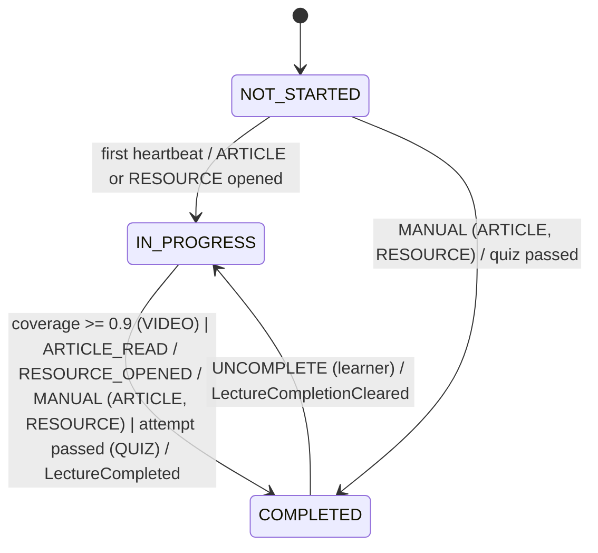
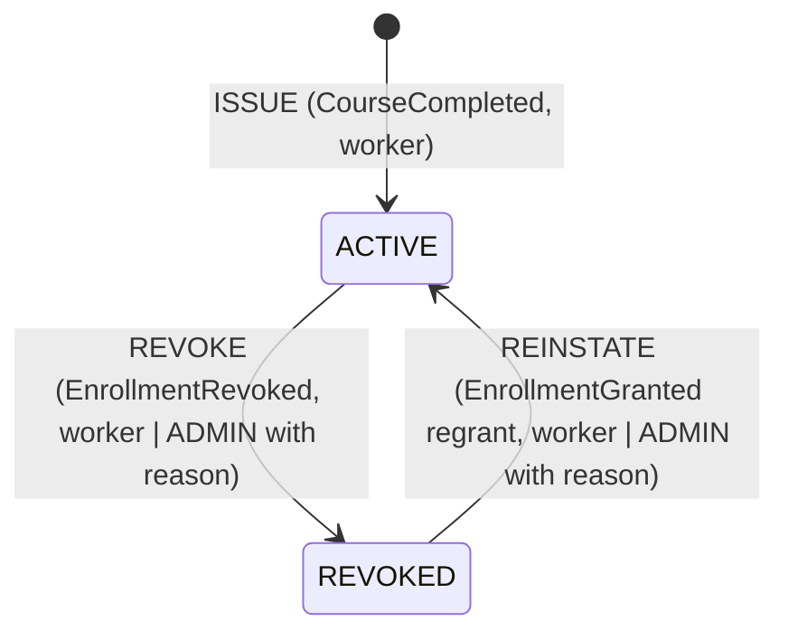
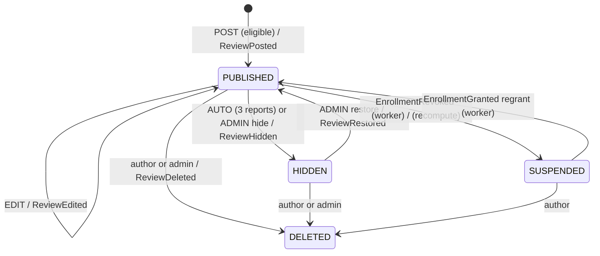

# Phase 5 Design: Learning Experience (Udemy clone v2)

## What I read, and the constraints it puts on this design

I read these documents:

- `docs/architecture-plan.md`: §2 (contexts learning, engagement, notifications, messaging), §3, §4 (`LectureCompleted` → `CourseCompleted` → certificate, `ReviewSubmitted` → aggregate), §5 and §7 (the Phase 5 row).
- `docs/phase-1-identity-access-design.md`: §1–§3, §6 Redis keys, §9 (BFF, CSRF, D11 revocation), §12 Q13 ("WS ticket, 30 s TTL").
- `docs/phase-2-catalog-media-design.md`: §1–§9, §12–§14.
- `docs/phase-4-commerce-enrollment-design.md`: all of it, including §13 and §14.
- `docs/phase-4-api-e2e-coverage.md`.

I read this code:

- **API:**
  - `app.module.ts`
  - `shared/{redis/rate-limiter, entitlements/*, auth/*}`
  - `modules/catalog/{index, application/catalog.facade, application/lecture-access.authorizer, domain/playback-access}`
  - `modules/enrollment/{index, application/enrollment.facade, application/use-cases/list-my-learning.query, application/views}`
  - `modules/commerce/{commerce.module, application/ports/refund-eligibility.policy, application/use-cases/request-refund.command, domain/refund-policy}`
- **Worker:** `messaging/idempotency/idempotent-event-processor`, `maintenance/advisory-lock-keys`, `shared/config/worker-env.schema`, and the per-context folder layout.
- **Packages:**
  - `packages/contracts/src/{auth/permissions, events/enrollment, http/enrollment, http/catalog-public}`
  - `packages/db/src/migrations/0001_init` (the schema list) and the `packages/db` layout
  - `packages/web-auth/src/csp`
  - `packages/markdown/src/react/markdown-view`
- **web-student:** `components/lecture-player`, `app/course/[slug]/page`, `app/my-learning/page`, `lib/auth/config`.

What I found, and how each finding shapes the design:

1. **The schemas `learning`, `engagement`, `notifications` and `messaging` already exist** (migration 0001). Migration `0005` creates only tables, functions and triggers.
2. **`CatalogFacade` already has the Phase 5 seams:**
   - `lectureBelongsToLiveRevision` and `getLiveLectureIds`.
   - Lecture ids are **stable across revisions** (P2 D1), so progress is keyed by `lecture_id`.
   - Revisions are immutable, so anything derived from a revision id (curriculum, quiz answer keys) can be cached forever per revision.
3. **Landing data is public and per slug, and ARCHIVED courses return 404 for non-entitled viewers** (P2 §14). The player needs an id-keyed live curriculum that also works for ARCHIVED courses. That is a new `CatalogFacade.getLiveCurriculum`.
4. **`LectureAccessAuthorizer` is the only playback gate.**
   - It keeps authorizing playlists, articles and downloads.
   - Learning never serves content. It only records what the user consumed and checks entitlement itself, through `EnrollmentFacade.hasAccess`.
5. **The refund hook already exists.** `RefundEligibilityPolicy.objection(input, ex)` is bound to `NoConsumptionData`. An objection turns AUTO_APPROVE into NEEDS_REVIEW and "never blocks". Phase 5 only rebinds it (D8).
6. **`ListMyLearningQuery` hard-codes `progress: null`, and `LearningCard.progress` is `int 0–100 | null`.**
   - Enrollment cannot import learning, because learning imports enrollment.
   - So progress is inverted through a shared token, exactly like `COURSE_ENTITLEMENTS` (D21).
7. **Worker handlers run inside the `processed_events` claim transaction**, sequentially per partition.
   - Pushes and emails are side effects, and a push for a rolled-back row is harmless (the client refetches).
   - Still, pushes go out **after commit** through a new `afterCommit` hook. Long fan-outs use a leased job table (P2 transcode pattern).
8. **The worker has no Redis** (its env has no `REDIS_*`). Phase 5 adds it, for the socket.io Redis emitter.
9. **The BFF proxies everything, the browser never sees a token (P1 D7), and the API has no public ingress** except the Stripe webhook. WebSockets cannot go through Next route handlers, so:
   - the socket endpoint is a second, path-limited public ingress;
   - its only credential is a BFF-minted, single-use ticket (P1 Q13).
10. **The CSP `connect-src` is `'self' <media>`**, so the realtime origin must be added (`packages/web-auth/src/csp.ts`).
11. **`@udemy/markdown`** rejects HTML and images, has a linear complexity guard, and `MarkdownView` already sets `rel="noopener noreferrer nofollow ugc"`. All user-generated markdown (Q&A, notes, announcements) reuses it, unchanged.
12. **`RateLimiter` is a fail-closed fixed window.**
    - Advisory batch-lock keys `_06`–`_0f` are free.
    - The two-int lock space is used for per-entity mutexes (media quota class `'mqta'`).
13. **The permission format is `resource:action[:own|:any]`.** `@CheckPolicy` needs an `@OwnershipResolverFor` only for the resources it is used with.
14. **The timestamp keyset cursor rule (P2 §14)** applies to every new list: carry the exact SQL timestamp text, never a JS `Date`.
15. **The plan's D8 lesson:** if a state change must be visible immediately (PAID ⇔ enrolled), do it in the request transaction and still emit the event. Here it applies to lecture completion and `CourseCompleted`.

---

## 1. Module dependency diagram

```mermaid
flowchart TB
  subgraph shared["apps/api/src/shared"]
    SE["entitlements: COURSE_ENTITLEMENTS (P2)"]
    SP["learning-progress (new): COURSE_PROGRESS token + CourseProgressModule.forRoot"]
    SRT["realtime (new): RedisIoAdapter, @RealtimeGateway marker, WsTicketStore port"]
    SR["redis (RateLimiter)"]
    SO["outbox"]
  end
  subgraph pkgs["packages"]
    PC["@udemy/contracts: permissions, errors, events, DTOs, realtime event schemas, notification kinds"]
    PM["@udemy/markdown (unchanged)"]
    PD["@udemy/db: learning/engagement/notifications operational SQL"]
    PWA["@udemy/web-auth: + createRealtimeTicketHandler, CSP realtime origin"]
  end

  CATALOG["catalog (+ QUIZ lecture type, quiz authoring, live curriculum and quiz reads)"]
  ENROLL["enrollment"]
  USERS["users"]
  LEARNING["learning (player bootstrap, progress, completion, notes, quiz attempts, certificates read/verify)"]
  ENGAGE["engagement (reviews + replies, ratings read, Q&A, votes, wishlist, announcements, reports, moderation)"]
  NOTIF["notifications (inbox, preferences, unsubscribe, WS tickets, socket.io gateway, rooms)"]
  COMMERCE["commerce"]

  LEARNING -->|getLiveCurriculum / getLiveLecture / quiz reads| CATALOG
  LEARNING -->|hasAccess| ENROLL
  ENGAGE -->|getCourseSummaries / getLiveLecture| CATALOG
  ENGAGE -->|hasAccess| ENROLL
  ENGAGE -->|completedLectureCount| LEARNING
  ENGAGE -->|getPublicProfiles| USERS
  NOTIF -->|hasAccess (course rooms)| ENROLL
  NOTIF -->|getPublishedCourse.ownerId| CATALOG
  COMMERCE -->|getConsumption (RefundEligibilityPolicy adapter)| LEARNING
  ENROLL -->|injects COURSE_PROGRESS| SP
  NOTIF --> SRT

  subgraph appmod["AppModule"]
    W1["CourseProgressModule.forRoot({ imports:[LearningModule], useExisting: LearningProgressReader })"]
  end
  W1 --> LEARNING

  subgraph async["Outbox -> Debezium -> Kafka"]
    TLP(["learning.progress (key userId)"])
    TLC(["learning.certificate (key certificateId)"])
    TRV(["engagement.course_review (key courseId)"])
    TQA(["engagement.question (key courseId)"])
    TAN(["engagement.announcement (key courseId)"])
    TEN(["enrollment.enrollment (P4)"])
    TMA(["media.asset (P2)"])
  end
  LEARNING -. outbox .-> TLP
  ENGAGE -. outbox .-> TRV & TQA & TAN

  subgraph worker["apps/worker"]
    WC["learning.certificate-issuer (CourseCompleted -> row + PDF -> S3 + outbox CertificateIssued)"]
    WCR["learning.certificate-revoker (EnrollmentRevoked / regrant)"]
    WRA["engagement.rating-aggregator (recompute under row lock)"]
    WRS["engagement.review-enrollment-sync (suspend / reinstate)"]
    WN["notifications.* notifiers (insert rows, afterCommit: redis-emitter push, email)"]
    WF["notifications.FanoutJob (announcements, leased keyset batches)"]
    WRET["NotificationRetentionJob (_07), LearningMaintenanceJob (_08)"]
  end
  TLP --> WC
  TEN --> WCR & WRS
  TRV --> WRA & WN
  TQA --> WN
  TAN --> WN
  TLC --> WN
  TMA --> WN
  WC -. outbox .-> TLC
  WN -->|"@socket.io/redis-emitter"| REDIS[(Redis)]
  NOTIF <-->|"socket.io Redis adapter"| REDIS
```

The graph has no cycles:

- **learning** depends on catalog and enrollment.
- **engagement** depends on catalog, enrollment, learning and users.
- **notifications** depends on catalog and enrollment.
- **commerce** depends on learning. Learning never depends on commerce.
- **enrollment** learns progress only through the global `COURSE_PROGRESS` token. `LearningProgressReader` depends only on its repository and `CatalogFacade`, never on `EnrollmentFacade`. Verify this with a boot test (T10), as P4-T12 did.

**Messaging** (the `messaging` schema) stays empty in Phase 5 (D20).

---

## 2. Key decisions

| #   | Decision                 | Choice                                                                                                                                                                                                                                                                                                                                                                                                                                                                                                                                                                                                                                                                                                                                          | Why                                                                                                                                                                                                                                                                                                                                                                                                                                                                          |
| --- | ------------------------ | ----------------------------------------------------------------------------------------------------------------------------------------------------------------------------------------------------------------------------------------------------------------------------------------------------------------------------------------------------------------------------------------------------------------------------------------------------------------------------------------------------------------------------------------------------------------------------------------------------------------------------------------------------------------------------------------------------------------------------------------------- | ---------------------------------------------------------------------------------------------------------------------------------------------------------------------------------------------------------------------------------------------------------------------------------------------------------------------------------------------------------------------------------------------------------------------------------------------------------------------------- |
| D1  | Context split            | **learning:** progress, completion, notes, quiz attempts and grading, certificates.<br>**engagement:** reviews, replies, rating read model, Q&A, votes, wishlist, announcements, reports and moderation.<br>**notifications:** inbox, preferences, unsubscribe, WS tickets and the gateway.<br>**Quiz _content_ is authored in catalog** (D6).                                                                                                                                                                                                                                                                                                                                                                                                  | Each context has a single owner of its writes. Authored content stays in the moderated revision model (P2 D1); learner data never does.                                                                                                                                                                                                                                                                                                                                      |
| D2  | Progress write path      | **Redis write-behind** for position and coverage:<br>- the heartbeat updates Redis only;<br>- `ProgressFlushJob` (API, `@nestjs/schedule`, every 15 s, advisory lock `0x75646d79_06`) drains a dirty ZSET in batches of 500 into one multi-row upsert.<br>**State transitions are synchronous:** when a heartbeat crosses the completion threshold, it writes `lecture_completions` (and possibly `course_completions`) plus the outbox in one transaction, right away.<br>Behind a `ProgressStore` port, with `RedisProgressStore` (default) and `DirectProgressStore` (tests, and a fallback flag).                                                                                                                                           | Heartbeats are over 95% of learning writes. They are idempotent (coverage is a bitwise OR, position is last-write-wins) and tolerate loss. Coalescing cuts DB writes to one row per active (user, lecture) per flush, whatever the heartbeat rate. It also keeps WAL volume (which Debezium's slot must decode) low.<br>Completions must be exact and immediate (UI tick, certificate), so they skip the buffer. The worst-case loss on a Redis crash is ≤ 15 s of position. |
| D3  | Measuring "watched"      | The client reports **played ranges** since its last heartbeat. The server merges them into a **coverage bitmap of 5-second buckets** for (user, lecture, media asset).<br>**Plausibility clamp:** new seconds ≤ (now − last heartbeat) × 2.5 + 10 s (60 s on the first heartbeat); excess ranges are dropped, keeping the newest.<br>The bitmap resets if the live revision swaps the lecture's asset (different duration).                                                                                                                                                                                                                                                                                                                     | Seeking to the end does not count. 2× playback still counts. Forging requires real wall-clock time. Bucket granularity bounds storage (4 h = 2880 bits = 360 B).                                                                                                                                                                                                                                                                                                             |
| D4  | Lecture completion rules | - **VIDEO:** coverage ≥ `LEARNING_VIDEO_COMPLETE_PCT` (90) % of buckets, computed by the server.<br>- **ARTICLE:** client signal `ARTICLE_READ` (the UI sends it when the end sentinel scrolls into view) or a manual tick.<br>- **RESOURCE:** client signal `RESOURCE_OPENED` (on download) or a manual tick.<br>- **QUIZ:** a passed attempt, computed by the server.<br>Manual "mark complete" is **refused for VIDEO and QUIZ** (422 `completion_not_allowed`). Un-marking is allowed for every type.                                                                                                                                                                                                                                       | Articles and resources cannot be measured server-side (catalog serves them). The stakes are low. Videos and quizzes are the measurable, gameable part.                                                                                                                                                                                                                                                                                                                       |
| D5  | Course completion and %  | % = ⌊completed ∩ live lecture ids / live lecture count × 100⌋, so 100 means truly complete (count-weighted, like Udemy).<br>**`course_completions` is permanent** (one row, append-only) and is written in the same transaction as the completion that makes completed ⊇ live; the outbox gets `CourseCompleted`.<br>After a new revision:<br>- removed lectures stop counting;<br>- added lectures lower the % ("New content" badge), but the completion and the certificate stand.<br>It is lazily re-evaluated on the player bootstrap and on any completion (a revision that only _removes_ the last missing lecture completes the course on the next visit).                                                                               | Exact and immediate, like D8 in P4. No batch recompute over all enrollees on every approval.                                                                                                                                                                                                                                                                                                                                                                                 |
| D6  | Quizzes                  | **New catalog lecture type `QUIZ`.**<br>- Working copy: `lecture_quizzes` / `quiz_questions` / `quiz_options`, snapshotted into `revision_quiz_*`, covered by `content_hash`, readiness and moderation diff.<br>- Question kinds: `SINGLE_CHOICE` (also used for true/false) and `MULTIPLE_CHOICE` (all-or-nothing), 2–6 options, with an optional explanation.<br>**Learning owns attempts:**<br>- Start snapshots the live `revision_id`.<br>- **Grading is server-side against that revision's key**, through `CatalogFacade.getQuizAnswerKey`, which is never exposed over HTTP.<br>- Unlimited attempts (rate-limited), one IN_PROGRESS per user and quiz.                                                                                 | Answer keys are authored content, so they must be moderated and immutable. Grading against the attempt's revision is consistent even if a new revision goes live mid-attempt.                                                                                                                                                                                                                                                                                                |
| D7  | Certificates             | **Issued by the worker on `CourseCompleted`:**<br>- `INSERT … ON CONFLICT (user_id, course_id) DO NOTHING`, with snapshots of the recipient display name, live course title and instructor name.<br>- PDF via pdfkit (bundled font, QR code to the verification URL), PUT to the media bucket at the deterministic key `certificates/{id}/v1.pdf`.<br>- Outbox `CertificateIssued`.<br>**Public verification** at `/certificates/{code}`, where `code` is 26 random Crockford base32 characters (128 bits), separate from the uuidv7 id.<br>**Revoked** on any `EnrollmentRevoked`; **reinstated** on a regrant when the course completion still exists.                                                                                        | Matches the plan ("generated by the worker"). The deterministic key makes a retry overwrite rather than duplicate. The uuidv7 leaks the issue time and has fewer random bits, so a separate code is used.                                                                                                                                                                                                                                                                    |
| D8  | Refunds and consumption  | `commerce` rebinds `RefundEligibilityPolicy` to **`LearningConsumptionPolicy`** (in commerce/application, calling `LearningFacade.getConsumption(userId, courseId, trx)`). It objects when:<br>- a certificate is ACTIVE → `certificate_issued`;<br>- video watched > `COMMERCE_REFUND_REVIEW_CONSUMED_PCT` (30%) of the live video seconds → `consumed_video_{pct}`;<br>- completed lectures > 30% → `consumed_lectures_{pct}`.<br>An objection means **NEEDS_REVIEW, never a block** (P4 D11 semantics). The admin queue shows the figures.                                                                                                                                                                                                   | Commerce owns the rule; learning owns the facts. It reuses the existing seam with no new commerce state. A human decides the edge cases.                                                                                                                                                                                                                                                                                                                                     |
| D9  | Enrollment revocation    | **Progress, completions, notes and quiz attempts are kept but inaccessible:** every learner route requires an ACTIVE enrollment (403 `enrollment_required`); a regrant restores everything.<br>Exception: a student may still **edit or delete their own notes**.<br>**Reviews:** suspended (hidden, excluded from the aggregate) by a worker sync, and reinstated on regrant.<br>**Q&A content stays** (community value), but no new posts.<br>**Certificates:** D7.                                                                                                                                                                                                                                                                           | No data destruction on refund. A re-purchase picks up where it left off. Reviews from non-customers do not skew ratings.                                                                                                                                                                                                                                                                                                                                                     |
| D10 | Review rules             | - One per (user, course) among non-deleted reviews.<br>- Requires an **ACTIVE enrollment and at least 1 completed lecture**; the owner cannot review (`cannot_review_own_course`).<br>- Rating 1–5, optional plain-text body ≤ 2000.<br>- Edit any time (`edited_at`). Delete is soft, and a new review is allowed afterwards.<br>- **One instructor reply** per review (plain text ≤ 2000, editable, deletable).<br>- Report → moderation (D13).                                                                                                                                                                                                                                                                                               | A minimal progress gate stops rate-on-purchase bombing without hiding early feedback. Plain text avoids markdown on the public, SEO-indexed landing page.                                                                                                                                                                                                                                                                                                                    |
| D11 | Rating aggregates        | Read model `engagement.course_rating_stats`. The worker `engagement.rating-aggregator` **recomputes the whole row from `reviews` under `SELECT … FOR UPDATE`** of the stats row on every review event.<br>The topic is keyed by **courseId**, so a course's events are ordered on one partition.<br>Public batch read `GET /engagement/ratings?courseIds=` (the P4 prices pattern). Catalog is unchanged.                                                                                                                                                                                                                                                                                                                                       | Recompute is idempotent, order-independent and self-healing (no delta drift). One indexed aggregate per event is cheap. No hot-row contention in the request path.                                                                                                                                                                                                                                                                                                           |
| D12 | Q&A model                | - Questions per course, optionally tied to a lecture (`lecture_id NULL` = general).<br>- Answers.<br>- Votes on questions and answers (one per user, not your own).<br>- An accepted answer, set by the question author or the course owner, which makes the question "resolved".<br>- **Instructor badge computed at read time** (`author_id = course.ownerId`; ownership is immutable).<br>- `upvote_count`, `answer_count` and `last_activity_at` are **trigger-maintained materializations** (a documented 3NF exception, needed for keyset sorts).<br>- Sorts: `recent` (last activity), `top`, `unanswered`; course-scoped trigram search on the title.                                                                                   | Udemy-like. Counts must be indexable for sorting. Triggers keep them exact in the same statement.                                                                                                                                                                                                                                                                                                                                                                            |
| D13 | Moderation               | **Per-subject report tables** (reviews, review replies, questions, answers) with real FKs, `UNIQUE (subject, reporter)`.<br>- **Auto-hide** at `ENGAGEMENT_AUTO_HIDE_REPORTS` (3) distinct open reports. The admin queue can restore, hide, or dismiss reports.<br>- Every action is logged in append-only `moderation_actions` (actor NULL = AUTO).<br>- Authors can edit or delete (soft; a question with answers shows "[deleted]").<br>- Instructors can report but not hide.                                                                                                                                                                                                                                                               | Declarative integrity instead of a polymorphic FK-less report table. Auto-hide bounds the exposure time of abuse. Hiding is an admin power (audit).                                                                                                                                                                                                                                                                                                                          |
| D14 | Notifications            | **Fan-out on write** in the worker, per recipient and per **app audience** (STUDENT, INSTRUCTOR, ADMIN).<br>- The row carries a **typed snapshot payload** (zod union by `kind` in contracts, ≤ 4 KB). Moderation hides **redact** payloads by `(subject_type, subject_id)`.<br>- Idempotent `UNIQUE (user_id, kind, source_event_id)`.<br>- Preferences are **overrides of code defaults** per (category, channel ∈ IN_APP, EMAIL). Transactional categories cannot be turned off.<br>- One-click email unsubscribe (RFC 8058) with an HMAC token.                                                                                                                                                                                             | The inbox is a single-table keyset read (scale). The snapshot is the message as it was told (like an order line), and redaction handles moderation.                                                                                                                                                                                                                                                                                                                          |
| D15 | Realtime transport       | **socket.io in the API process** (`NotificationsGateway`):<br>- `transports: ['websocket']` only, so no long-polling and no sticky sessions;<br>- `@socket.io/redis-adapter` across replicas;<br>- path `/realtime/socket.io`.<br>**The worker pushes with `@socket.io/redis-emitter` after commit.**<br>**WS messages are invalidation hints** (`{type, ids}`); content is always re-fetched over REST.                                                                                                                                                                                                                                                                                                                                        | The plan has the API as "HTTP + WS". No second app to deploy in Phase 5. All authorization and XSS-relevant rendering stays on the REST path. Phase 7 can run the same image as a dedicated realtime Deployment (Q9).                                                                                                                                                                                                                                                        |
| D16 | WS authentication        | 1. The browser calls `POST /api/realtime/ticket`, a BFF route (Origin check).<br>2. The BFF calls API `POST /realtime/tickets` (Bearer + client credentials).<br>3. The API stores `ws:tkt:{sha256(t)}` = `{userId, sid, app}` in Redis with a 30 s TTL and returns `{ticket, url, expiresAt}`.<br>4. The socket.io handshake sends `auth: {ticket}` (not the query string, so it is never logged). The server **GETDELs** it (single use), checks `Origin ∈ REALTIME_ALLOWED_ORIGINS`, and checks `auth:revoked:sid:{sid}` (P1 D11).<br>**Connections are capped at 15 min** (server disconnects with `reauth_required`; the client gets a new ticket). A 60 s sweep MGETs the revoked-sid keys of local sockets. At most 10 sockets per user. | No token in JS. Per-session revocation is effective within 60 s, and a stolen ticket is useless after 30 s or one use. The 15 min cap ties the socket's life to the access-token life, so bans and logouts propagate even if the sweep misses.                                                                                                                                                                                                                               |
| D17 | Rooms                    | **Server-assigned only:**<br>- on connect, join `u:{userId}:{app}`;<br>- `subscribe {courseId}` joins `c:{courseId}` (live Q&A hints in the player) only after `hasAccess` or the owner check;<br>- on `EnrollmentRevoked` the worker emits `socketsLeave` for that user's sockets.<br>There is no client-named room join, so per-room authorization is closed by construction.                                                                                                                                                                                                                                                                                                                                                                 | Prevents room-join IDOR. Hints carry ids only, so even a stale membership leaks nothing beyond "something changed".                                                                                                                                                                                                                                                                                                                                                          |
| D18 | Announcements            | Instructor posts (title ≤ 120, markdown body ≤ 10 000, `sendEmail`).<br>- At most **4 per course per 30 days** (DB-counted under a per-course advisory lock) and 20/24 h per instructor.<br>- Immutable; soft delete.<br>- Fan-out goes through `notifications.fanout_jobs`: leased with `SKIP LOCKED`, a keyset over ACTIVE enrollments in batches of 1000, resumable cursor.                                                                                                                                                                                                                                                                                                                                                                  | A 100 k-student course must not run in one Kafka handler transaction. The job table gives progress, retries and visibility (P2 D6).                                                                                                                                                                                                                                                                                                                                          |
| D19 | Wishlist                 | Private. PUBLISHED courses only, not owned, not already enrolled. At most 1000 per user. No events in Phase 5.                                                                                                                                                                                                                                                                                                                                                                                                                                                                                                                                                                                                                                  | It is a list, and no consumer needs it before P6 analytics.                                                                                                                                                                                                                                                                                                                                                                                                                  |
| D20 | Messaging (DM)           | **Deferred to Phase 6** on top of the D15–D17 realtime layer.                                                                                                                                                                                                                                                                                                                                                                                                                                                                                                                                                                                                                                                                                   | Q&A already covers student→instructor questions in public, which also helps other learners. DMs add block lists, spam controls, retention and privacy rules, and an abuse workload that Phase 6 (admin, audit) is designed for.                                                                                                                                                                                                                                              |
| D21 | My-learning progress     | New global token `COURSE_PROGRESS` (`CourseProgressReader.getPercents(userId, courseIds)`), bound in AppModule to `LearningProgressReader`. The default `NoCourseProgress` returns nulls.                                                                                                                                                                                                                                                                                                                                                                                                                                                                                                                                                       | Keeps `GET /me/enrollments` and `LearningCard` intact, and avoids an enrollment → learning cycle (finding 6).                                                                                                                                                                                                                                                                                                                                                                |
| D22 | User-generated text      | - Q&A, notes and announcements: **markdown** via `validateMarkdown` (API) and `MarkdownView` (web).<br>- Reviews, replies and question titles: **plain text** (trimmed, no control characters, NFC).<br>- Emails embed only plain text (markdown stripped through `plainText()`, then HTML-escaped).                                                                                                                                                                                                                                                                                                                                                                                                                                            | Two-layer XSS defense already proven in P2. Plain text where the content is public and SEO-visible.                                                                                                                                                                                                                                                                                                                                                                          |

---

## 3. Module public facades

As in P1–P4: write methods take `Transaction<DB>` first, reads take an optional `ex`.

### `modules/catalog/index.ts` (additions)

```ts
getLiveCurriculum(courseId, ex?): Promise<LiveCurriculum | null>;
// { courseId, ownerId, status: 'PUBLISHED'|'ARCHIVED', liveRevisionId, title, slug,
//   sections: [{ id, title, lectures: [{ id, type: VIDEO|ARTICLE|RESOURCE|QUIZ, title,
//   durationSeconds|null, isPreview, mediaAssetId|null, quiz: { questionCount, passPct }|null }] }] }
// Revision part cached in-process (LRU 500 revisions), keyed by liveRevisionId.

getLiveLecture(courseId, lectureId, ex?): Promise<LiveLectureRef | null>;
// { courseId, ownerId, liveRevisionId, lectureId, type, durationSeconds|null, mediaAssetId|null }
// Hot path (heartbeat): courseId -> liveRevisionId cached 30 s, then the LRU lecture map.

getLiveCurriculumIndex(courseIds ≤ 48, ex?): Promise<Map<courseId, { liveRevisionId, lectureIds: string[], videoSecondsTotal }>>;

getQuizForAttempt(courseId, lectureId, ex?): Promise<QuizForAttempt | null>;
// { revisionId, passPct, questions: [{ id, position, kind, promptMd, options: [{ position, text }] }] }  -- NO keys

getQuizAnswerKey(revisionId, lectureId, ex?): Promise<QuizAnswerKey | null>;
// { passPct, questions: [{ id, kind, correct: number[], explanationMd|null }] }  -- learning grading only
```

### `modules/learning/index.ts`

```ts
export { LearningModule } from './learning.module';
export { LearningFacade } from './application/learning.facade';
export { LearningProgressReader } from './application/learning-progress.reader'; // AppModule only

class LearningFacade {
  getConsumption(
    userId,
    courseId,
    ex?,
  ): Promise<{
    videoSecondsWatched: number;
    videoSecondsTotal: number; // live revision; watched = covered buckets x 5, clamped
    completedLectures: number;
    totalLectures: number; // ∩ live ids
    courseCompletedAt: Date | null;
    certificateStatus: 'ACTIVE' | 'REVOKED' | null;
  }>;
  completedLectureCount(userId, courseId, ex?): Promise<number>; // engagement review gate (∩ live ids)
}
class LearningProgressReader implements CourseProgressReader {
  getPercents(userId, courseIds): Promise<ReadonlyMap<string, number>>; // one curriculum-index call + one GROUP BY
}
```

Ownership resolvers: `note` (returns `notes.user_id`), `quiz_attempt` (`quiz_attempts.user_id`), `certificate` (`certificates.user_id`).

### `modules/engagement/index.ts` and `modules/notifications/index.ts`

Both export only their module. No in-process consumers.

### `src/shared/learning-progress` (new)

`COURSE_PROGRESS` symbol, `CourseProgressReader` interface, `NoCourseProgress`, and `CourseProgressModule.forRoot({ imports, useExisting })`. This is a copy of the `CourseEntitlementsModule` pattern.

### `src/shared/realtime` (new)

- `RedisIoAdapter` (one factory used by `main.ts`, `setupApp` and the e2e harness).
- The `@RealtimeGateway()` class marker.
- `WsTicketStore` (Redis).
- `RealtimeConnectionAuth` (ticket, Origin, sid and connection-cap checks).
- `RealtimeEmitter` port (API-side emits, e.g. course-room hints after a Q&A post commits).

---

## 4. Domain model and state machines

### learning

**`LectureProgress`** (VIDEO only). Value objects:

- `CoverageBitmap(bucketCount)` with `mergeRanges(ranges)`, `coveredBuckets()`, `ratio()`.
- `PlausibilityBudget(lastHeartbeatAt, now)`.

`bucketCount = ceil(durationSeconds / 5)`. Range `[from, to)` marks buckets `floor(from/5)` to `floor((to-1)/5)`. Positions and ranges are clamped to `[0, duration]`.



**`CourseProgress`** (derived; only `course_completions` is stored):

```mermaid
stateDiagram-v2
  [*] --> ENROLLED
  ENROLLED --> IN_PROGRESS: first lecture activity
  IN_PROGRESS --> COMPLETED: completed ⊇ live ids (first time) / course_completions + CourseCompleted
  COMPLETED --> COMPLETED: new revision adds lectures (badge "new content"; % < 100, completion kept)
```



Mutex: every completion write takes `pg_advisory_xact_lock(hashtext('lrnc'), hashtext(userId || ':' || courseId))` (two-int space).

**`QuizAttempt`:**

```mermaid
stateDiagram-v2
  [*] --> IN_PROGRESS: START (live revision snapshot; an existing IN_PROGRESS is returned instead)
  IN_PROGRESS --> SUBMITTED: SUBMIT (graded server-side; passed = score_pct >= pass_pct) / QuizAttemptGraded (+ LectureCompleted if passed and not yet complete)
  IN_PROGRESS --> ABANDONED: LearningMaintenanceJob after LEARNING_QUIZ_ATTEMPT_TTL_H (24 h), or the revision is no longer live at START of a new attempt
```



- **Grading:** each question is correct iff the selected set equals the correct set. Unanswered counts as wrong. `score_pct = round(correct / total × 100)`.
- **Results payload by reveal policy (Q5):** per question `yourAnswerCorrect`. `correctOptions` and `explanationMd` are included only when `passed` (default).

**`Certificate`:**



`status` is materialized from `certificate_transitions` and checked at COMMIT. The PDF is orthogonal (`pdf_rendered_at`).

**`Note`:** `{ lectureId, positionSeconds|null (VIDEO only, ≤ duration), bodyMd ≤ 2000 }`. At most 500 per user per course.

### engagement

**`Review`** (`moderation_status`, `suspended_at` and `deleted_at` combined). It is counted in the aggregate iff PUBLISHED:



**`Question`:** OPEN ⇄ RESOLVED (accept or un-accept an answer of this question). Moderation is VISIBLE ⇄ HIDDEN (orthogonal). Soft delete. An answer has VISIBLE ⇄ HIDDEN and a soft delete. Deleting or hiding the accepted answer clears `accepted_answer_id`.

**`Announcement`:** POSTED → DELETED. Fan-out job: QUEUED → RUNNING → DONE | FAILED (lease, heartbeat and retry as in P2 transcode jobs, max 5 attempts).

**`Report`:** OPEN → ACTIONED (subject hidden) | DISMISSED. An admin restore of an auto-hidden subject dismisses its open reports.

### notifications

- **Notification:** UNREAD → READ (mark one, or mark all ≤ a cursor). Rows older than 180 days are deleted by `NotificationRetentionJob` (`_07`).
- **WS ticket:** ISSUED → REDEEMED (GETDEL) | EXPIRED (TTL).
- **Socket:** CONNECTED → DISCONNECTED (`reauth_required` at 15 min, `session_revoked`, `too_many_connections`, client close).

---

## 5. Use cases (errors are `DomainError` → RFC 7807 with a stable `code`)

Common rule for every `/me/courses/:courseId/...` learner use case:

1. `CatalogFacade.getLiveCurriculum` or `getLiveLecture`. Unknown course: 404 `course_not_found`. Lecture not in the live revision: 404 `lecture_not_found`.
2. `EnrollmentFacade.hasAccess`. Not active: 403 `enrollment_required`. The course outline is public, so existence is no secret (same as `lecture_locked`).
3. The owner gets a read-only PREVIEW bootstrap; writes return 403 `enrollment_required`.

### learning

| Use case                                                          | Input                                                                                    | Behaviour                                                                                                                                                                                                                                                                                                                                                                                                                                                                                                             | Errors                                                                                                           |
| ----------------------------------------------------------------- | ---------------------------------------------------------------------------------------- | --------------------------------------------------------------------------------------------------------------------------------------------------------------------------------------------------------------------------------------------------------------------------------------------------------------------------------------------------------------------------------------------------------------------------------------------------------------------------------------------------------------------- | ---------------------------------------------------------------------------------------------------------------- |
| `GetPlayerBootstrap`                                              | courseId                                                                                 | Returns:<br>- the curriculum annotated with `completed`, `positionSeconds` (Redis first, then DB) and `coveragePct`;<br>- progress `{completed, total, pct}`, `resume {lectureId, positionSeconds}` (`course_activity`, else the first incomplete lecture);<br>- `completedAt`, `certificate {id, code, status}                                                                                                                                                                                                       | null`, `mode: LEARNER                                                                                            | PREVIEW`.<br>It lazily runs `EvaluateCourseCompletion`. | 403, 404                         |
| `RecordHeartbeat`                                                 | courseId, lectureId, `{positionSeconds, ranges[{from,to}] ≤ 32}`                         | 1. Rate limit.<br>2. Access check (entitlement cached 60 s in Redis `lrn:acc:{u}:{c}`).<br>3. The lecture must be VIDEO with a duration.<br>4. `ProgressStore.record`: seed from the DB on a Redis miss; `SETBIT` the clamped buckets; `HSET` position, asset and duration; `ZADD NX lp:dirty`; `HSET la:{u}:{c}`.<br>5. If the ratio crosses the threshold and the lecture is not yet complete: synchronous `CompleteLecture(cause VIDEO_WATCHED)`.<br>Returns 200 `{lectureCompleted, courseCompleted, coursePct}`. | 403, 404, 422 `lecture_type_mismatch`, 429 (the client drops it silently), 503 (Redis; the client retries later) |
| `CompleteLecture`                                                 | courseId, lectureId, cause ∈ {ARTICLE_READ, RESOURCE_OPENED, MANUAL} (HTTP), or internal | Under the course mutex: `INSERT lecture_completions … ON CONFLICT DO NOTHING`; if inserted, outbox `LectureCompleted`, then `EvaluateCourseCompletion`. A repeat returns 200 with the same state.                                                                                                                                                                                                                                                                                                                     | 403, 404, 422 `completion_not_allowed` (VIDEO/QUIZ manual, or a cause that does not match the type), 429         |
| `UncompleteLecture`                                               | courseId, lectureId                                                                      | Delete the row; outbox `LectureCompletionCleared`. Never touches `course_completions` or certificates. Idempotent.                                                                                                                                                                                                                                                                                                                                                                                                    | 403, 404, 429                                                                                                    |
| `EvaluateCourseCompletion`                                        | internal                                                                                 | If completed ⊇ live ids and no `course_completions` row: insert it with `lecture_count`; outbox `CourseCompleted`.                                                                                                                                                                                                                                                                                                                                                                                                    | none                                                                                                             |
| `ProgressFlushJob`                                                | scheduled every 15 s; advisory `_06` per batch                                           | A Lua `ZPOPMIN`-style claim of ≤ 500 members returns the hash and bitmap snapshots, then one upsert: `coverage = CASE same asset AND same length THEN old \| new ELSE new END`, position LWW. On DB error, re-add to dirty (`ZADD NX`). Also upserts `course_activity`. Best-effort flush on SIGTERM.                                                                                                                                                                                                                 | none                                                                                                             |
| `List/Create/Update/DeleteNote`                                   | courseId, lectureId?, positionSeconds?, bodyMd                                           | Create requires access, the lecture to be in the live revision, and position ≤ duration. Keyset `(created_at DESC, id DESC)`, filter by `lectureId`. Update and delete through `Pol note:manage` (own; allowed after a revoke).                                                                                                                                                                                                                                                                                       | 403, 404 `note_not_found`, 422 `markdown_not_allowed` / `note_limit_exceeded`, 429                               |
| `StartQuizAttempt`                                                | courseId, lectureId                                                                      | Requires access and type QUIZ. Abandon an IN_PROGRESS attempt of a non-live revision; return the existing IN_PROGRESS of the live revision (200), else insert (201) with the questions in order. **The response has no correctness fields.**                                                                                                                                                                                                                                                                          | 403, 404, 422 `lecture_type_mismatch`, 429                                                                       |
| `SubmitQuizAttempt`                                               | attemptId (`Pol quiz_attempt:submit`), answers `[{questionId, optionPositions[]}]`       | Conditional on IN_PROGRESS: validate ids against the attempt's questions, positions within range, SINGLE ≤ 1 selection. Grade with `getQuizAnswerKey(revisionId)`. Store the selections and per-question `is_correct`. SUBMITTED, outbox `QuizAttemptGraded`. If passed: `CompleteLecture(QUIZ_PASSED)` in the same tx. **A repeat of a SUBMITTED attempt returns 200 with the stored result.**                                                                                                                       | 404 `quiz_attempt_not_found`, 409 `attempt_not_in_progress` (ABANDONED), 422 `quiz_answers_invalid`, 429         |
| `GetQuizAttempt` / `ListQuizAttempts`                             | own                                                                                      | The result follows the reveal policy.                                                                                                                                                                                                                                                                                                                                                                                                                                                                                 | 404                                                                                                              |
| `ListMyCertificates` / `GetMyCertificate` / `GetMyCertificatePdf` | own                                                                                      | The PDF is a presigned GET (attachment, 15 min).                                                                                                                                                                                                                                                                                                                                                                                                                                                                      | 404 `certificate_not_found`, 409 `certificate_pdf_pending`                                                       |
| `VerifyCertificate` (public)                                      | code                                                                                     | `{status, recipientName, courseTitle, instructorName, issuedAt, revokedAt                                                                                                                                                                                                                                                                                                                                                                                                                                             | null, courseSlug                                                                                                 | null}`; the PDF only when ACTIVE. Rate-limited per IP.  | 404 `certificate_not_found`, 429 |
| `AdminRevoke/ReinstateCertificate`                                | id, reason 10–2000                                                                       | A transition, plus outbox `CertificateRevoked` / `CertificateReinstated`.                                                                                                                                                                                                                                                                                                                                                                                                                                             | 404, 409 `invalid_state_transition`                                                                              |

### catalog (quiz authoring, the working copy; P2 course lock and `version` bump)

| Use case                                                                                                                                                                         | Errors                                                                                                                   |
| -------------------------------------------------------------------------------------------------------------------------------------------------------------------------------- | ------------------------------------------------------------------------------------------------------------------------ |
| `AddLecture{type:'QUIZ'}` creates `lecture_quizzes` (pass 70)                                                                                                                    | P2 errors                                                                                                                |
| `UpdateQuizSettings {passPct 1–100}`                                                                                                                                             | 404, 409 `course_in_review`, 422                                                                                         |
| `Add/Update/DeleteQuizQuestion`, `ReorderQuizQuestions` (full permutation, P2 D3)                                                                                                | 404 `quiz_question_not_found`, 409 `order_mismatch`, 422 `markdown_not_allowed` / `quiz_limit_exceeded` (≤ 50 questions) |
| `PutQuizQuestionOptions [{text, isCorrect}] (2–6)`                                                                                                                               | 422 `quiz_options_invalid`                                                                                               |
| **Readiness issues added:** `QUIZ_EMPTY`, `QUIZ_QUESTION_INVALID` (SINGLE needs exactly one correct, MULTIPLE ≥ 1). `isPreview` is not allowed for QUIZ (`preview_not_allowed`). | none                                                                                                                     |

### engagement

| Use case                                                                      | Behaviour                                                                                                                                                                                                                                                               | Errors                                                                                 |
| ----------------------------------------------------------------------------- | ----------------------------------------------------------------------------------------------------------------------------------------------------------------------------------------------------------------------------------------------------------------------- | -------------------------------------------------------------------------------------- |
| `UpsertMyReview` (courseId, rating, body?)                                    | Requires access, not the owner, and `completedLectureCount ≥ 1`. Insert (201, `ReviewPosted`) or update (200, `ReviewEdited`, with `previousRating`). No-op if unchanged.                                                                                               | 403 `enrollment_required` / `cannot_review_own_course`, 422 `review_not_eligible`, 429 |
| `DeleteMyReview`                                                              | Soft delete, `ReviewDeleted`. Idempotent.                                                                                                                                                                                                                               | 404 `review_not_found`                                                                 |
| `ListPublicReviews` (courseId, rating?, cursor)                               | PUBLISHED only, keyset `(created_at DESC, id DESC)`. The author's public profile (null when banned: "Former student"). The reply.                                                                                                                                       | 404 `course_not_found`                                                                 |
| `GetRatings` (courseIds ≤ 48)                                                 | From `course_rating_stats`: `average` (decimal string, 1 dp), count, histogram. Missing means `{count: 0}`.                                                                                                                                                             | 400                                                                                    |
| `UpsertReviewReply` / `DeleteReviewReply` (instructor, `Pol course:engage`)   | The review must be in this course and PUBLISHED or HIDDEN. Outbox `ReviewReplyPosted` / `Edited` / `Deleted`.                                                                                                                                                           | 404, 429                                                                               |
| `ListCourseReviewsForInstructor`                                              | All non-deleted, with flags (hidden, suspended).                                                                                                                                                                                                                        | 404                                                                                    |
| `ReportContent` (subject type and id, reason, comment?)                       | The reporter must be able to see the subject (public review; Q&A needs learner or owner access). Not your own. Insert ON CONFLICT DO NOTHING (repeat 200). If the open count reaches the threshold, auto-hide plus `moderation_actions(AUTO)` plus the `…Hidden` event. | 404, 422 `cannot_report_own_content`, 429                                              |
| `ListQuestions` (courseId, lectureId?, sort, q?, cursor)                      | Learner or owner. VISIBLE, non-deleted. Instructor badge computed.                                                                                                                                                                                                      | 403, 404, 400                                                                          |
| `AskQuestion` (courseId, lectureId?, title 5–200, bodyMd ≤ 10 000)            | Learner (ACTIVE) or owner. The lecture must be in the live revision. Outbox `QuestionPosted`. After commit: emit hint `c:{courseId}`.                                                                                                                                   | 403, 404, 422 `markdown_not_allowed`, 429                                              |
| `EditQuestion` / `DeleteQuestion` (author)                                    | `edited_at`. A delete with answers keeps a placeholder.                                                                                                                                                                                                                 | 404 `question_not_found`, 403 `not_content_author`                                     |
| `PostAnswer` / `EditAnswer` / `DeleteAnswer`                                  | Learner or owner. The question must be VISIBLE and not deleted. Outbox `AnswerPosted`.                                                                                                                                                                                  | 404, 403, 422, 429                                                                     |
| `Vote` / `Unvote` (question or answer)                                        | Insert or delete (PK). Not your own.                                                                                                                                                                                                                                    | 404, 422 `cannot_vote_own_content`, 429                                                |
| `AcceptAnswer` / `UnacceptAnswer`                                             | The question author or the course owner. The answer must belong to the question (composite FK). Outbox `QuestionResolved` / `Reopened`.                                                                                                                                 | 404 `answer_not_found`, 403                                                            |
| `InstructorQaInbox` (courseId?, status unanswered\|unresolved\|all, cursor)   | Over the owner's courses (course ids from `CatalogFacade`, ≤ 100 at a time).                                                                                                                                                                                            | 400                                                                                    |
| `PostAnnouncement` (courseId, title, bodyMd, sendEmail)                       | `Pol course:engage`. The course must be PUBLISHED or ARCHIVED. Under the advisory lock `('anno', hashtext(courseId))`, count the last 30 days: ≥ 4 returns 422 `announcement_limit_exceeded {retryAt}`. Insert, outbox `AnnouncementPosted`.                            | 404, 422, 429                                                                          |
| `DeleteAnnouncement` / `ListAnnouncements` (learner or owner, keyset)         | Soft delete, outbox `AnnouncementDeleted` (the worker redacts notifications).                                                                                                                                                                                           | 404 `announcement_not_found`                                                           |
| `AddToWishlist` / `RemoveFromWishlist` / `ListWishlist` / `GetWishlistStates` | Add requires PUBLISHED, not the owner, not enrolled. ON CONFLICT DO NOTHING. Cap 1000.                                                                                                                                                                                  | 404, 409 `course_not_wishlistable`, 422 `wishlist_full`, 429                           |
| `AdminListReports` / `AdminHide` / `AdminRestore` / `AdminDismissReports`     | Conditional state updates, a reason (10–2000) for hide and restore, `moderation_actions`, plus events.                                                                                                                                                                  | 404, 409 `invalid_state_transition`                                                    |

### notifications

| Use case                                                       | Behaviour                                                                                                                                                    | Errors                                                                                                   |
| -------------------------------------------------------------- | ------------------------------------------------------------------------------------------------------------------------------------------------------------ | -------------------------------------------------------------------------------------------------------- |
| `ListNotifications` (app = principal.app, unreadOnly?, cursor) | Keyset `(created_at DESC, id DESC)`.                                                                                                                         | 400                                                                                                      |
| `UnreadCount`                                                  | `count(*)` over the partial index with `LIMIT 100`, so 100 means "99+".                                                                                      | none                                                                                                     |
| `MarkRead` / `MarkAllRead {upToId}`                            | Idempotent.                                                                                                                                                  | 404 `notification_not_found`                                                                             |
| `Get/UpdatePreferences`                                        | Effective = code defaults ⊕ overrides. Transactional categories cannot be changed.                                                                           | 422 `preference_locked`                                                                                  |
| `Unsubscribe` (public, token)                                  | Verify `HMAC(NOTIFICATIONS_UNSUBSCRIBE_SECRET, v1\|userId\|category)` in constant time; set EMAIL = false. Idempotent.                                       | 400 `invalid_unsubscribe_token`                                                                          |
| `IssueWsTicket`                                                | Rate limit, 32 random bytes, `SET ws:tkt:{sha256} … EX 30 NX`. Returns `{ticket, url: REALTIME_PUBLIC_URL, expiresAt}`.                                      | 429, 503 `realtime_unavailable`                                                                          |
| Gateway `connection`                                           | Origin, GETDEL ticket, sid revoked?, `INCR ws:conn:{u}` ≤ 10 (decremented on disconnect, key TTL 20 min), join `u:{u}:{app}`, schedule disconnect at 15 min. | `connect_error` codes: `origin_not_allowed`, `ticket_invalid`, `session_revoked`, `too_many_connections` |
| Gateway `subscribe {courseId}` / `unsubscribe`                 | ≤ 5 course rooms per socket; `hasAccess` or owner; ack `{ok}` or `{error:'forbidden'}`. 30 inbound messages/min per socket, then disconnect.                 | none                                                                                                     |

### Worker (non-HTTP)

| Consumer / job                               | Trigger                                                              | Effect (idempotency)                                                                                                                                                                                                                                                                             |
| -------------------------------------------- | -------------------------------------------------------------------- | ------------------------------------------------------------------------------------------------------------------------------------------------------------------------------------------------------------------------------------------------------------------------------------------------ |
| `learning.certificate-issuer`                | `CourseCompleted`                                                    | Readers: user display name, live revision title, instructor name. Insert certificate ON CONFLICT DO NOTHING, ISSUE transition, render and PUT the PDF (deterministic key), set `pdf_*`, outbox `CertificateIssued` (`insertOutboxEvent`). A row already present but with no PDF re-renders only. |
| `learning.certificate-revoker`               | `EnrollmentRevoked`; `EnrollmentGranted{regrant:true}`               | Conditional REVOKE or REINSTATE (state-guarded), outbox event.                                                                                                                                                                                                                                   |
| `engagement.review-enrollment-sync`          | same two events                                                      | Set or clear `suspended_at` on the user's review for that course, then call the shared `recomputeCourseRating(trx, courseId)`.                                                                                                                                                                   |
| `engagement.rating-aggregator`               | every review event                                                   | `recomputeCourseRating` (upsert-lock the stats row, then aggregate).                                                                                                                                                                                                                             |
| `notifications.qa-notifier`                  | `QuestionPosted`, `AnswerPosted`, `QuestionResolved`                 | Course owner (INSTRUCTOR app) for new questions. The question author (STUDENT app) for answers by someone else; an "instructor answered" flag. afterCommit: push plus email per preference.                                                                                                      |
| `notifications.review-notifier`              | `ReviewPosted`, `ReviewEdited` (rating changed), `ReviewReplyPosted` | The instructor; the reviewer for a reply.                                                                                                                                                                                                                                                        |
| `notifications.announcement-fanout-enqueuer` | `AnnouncementPosted`                                                 | Insert `fanout_jobs` ON CONFLICT (`source_event_id`).                                                                                                                                                                                                                                            |
| `FanoutJob` (lease, SKIP LOCKED)             | job rows                                                             | 1000 ACTIVE enrollees per batch (keyset `user_id >`). Insert notifications ON CONFLICT DO NOTHING. Emails if `sendEmail` and the preference allows. Store the cursor and heartbeat. Skips if the announcement was deleted meanwhile.                                                             |
| `notifications.certificate-notifier`         | `CertificateIssued`                                                  | Student in-app plus email (LEARNING category).                                                                                                                                                                                                                                                   |
| `notifications.media-notifier`               | `MediaReady`, `MediaFailed` (P2)                                     | Instructor in-app plus push (the builder refetches the asset). The P2 email for failures is unchanged.                                                                                                                                                                                           |
| `notifications.moderation-notifier`          | `*Hidden`, `AnnouncementDeleted`                                     | Redact payloads of notifications about that subject. Notify the author (your post was hidden) and admins (the AUTO queue).                                                                                                                                                                       |
| `notifications.room-revoker`                 | `EnrollmentRevoked`                                                  | Emitter `in(u:{u}:STUDENT).socketsLeave(c:{courseId})`.                                                                                                                                                                                                                                          |
| `NotificationRetentionJob` (`_07`)           | daily                                                                | Delete notifications older than 180 days, and finished fan-out jobs older than 30 days.                                                                                                                                                                                                          |
| `LearningMaintenanceJob` (`_08`)             | hourly                                                               | Abandon IN_PROGRESS attempts older than 24 h; re-render certificates with `pdf_rendered_at IS NULL` older than 10 min.                                                                                                                                                                           |

### New error codes

`enrollment_required` (403), `completion_not_allowed`, `note_not_found`, `note_limit_exceeded`, `quiz_attempt_not_found`, `attempt_not_in_progress`, `quiz_answers_invalid`, `quiz_question_not_found`, `quiz_options_invalid`, `quiz_limit_exceeded`, `certificate_not_found`, `certificate_pdf_pending`, `review_not_found`, `review_not_eligible`, `cannot_review_own_course` (403), `reply_not_found`, `question_not_found`, `answer_not_found`, `not_content_author` (403), `cannot_vote_own_content`, `cannot_report_own_content`, `announcement_not_found`, `announcement_limit_exceeded`, `course_not_wishlistable`, `wishlist_full`, `notification_not_found`, `preference_locked`, `invalid_unsubscribe_token` (400), `realtime_unavailable` (503).

Reused: `course_not_found`, `lecture_not_found`, `lecture_type_mismatch`, `markdown_not_allowed`, `preview_not_allowed`, `order_mismatch`, `invalid_state_transition`, `rate_limited`, `validation_failed`.

---

## 6. Conceptual data model (for db-architect), migration `0005_learning_engagement_notifications`

The conventions are those of P1–P4:

- uuidv7, `now()`, `set_updated_at`, CHECK constraints instead of enums, `<table>_<cols>_<sfx>` names.
- `forbid_append_only_mutation()`.
- **Cross-schema FKs go only to `identity.users`.** Every `course_id`, `lecture_id`, `revision_id` and `media_asset_id` here is soft.
- Generated columns must say `STORED`.

### learning

**`lecture_progress`**

- Columns: `user_id → users`, `course_id`, `lecture_id`, `media_asset_id`, `duration_seconds int > 0`, `position_seconds int ≥ 0`, `coverage varbit`, `first_watched_at`, `last_watched_at`, `updated_at`.
- PK `(user_id, lecture_id)`.
- CHECKs: `position_seconds <= duration_seconds`; `length(coverage) = ceil(duration_seconds / 5.0)`.
- Index: `(user_id, course_id) INCLUDE (lecture_id)`.
- 3NF notes: `course_id` is determined by `lecture_id` (kept for per-course reads; written only from the catalog lookup; same pattern as `catalog.lectures.course_id`). `duration_seconds` is the snapshot that gives the bitmap its meaning.
- Watched seconds = `bit_count(coverage) * 5`, derived and never stored.

**`course_activity`**

- Columns: `user_id`, `course_id`, `last_lecture_id`, `last_accessed_at`.
- PK `(user_id, course_id)`.

**`lecture_completions`**

- Columns: `user_id`, `course_id`, `lecture_id`, `lecture_type CHECK IN (VIDEO, ARTICLE, RESOURCE, QUIZ)`, `cause CHECK IN ('VIDEO_WATCHED','ARTICLE_READ','RESOURCE_OPENED','QUIZ_PASSED','MANUAL')`, `revision_id`, `completed_at`.
- PK `(user_id, lecture_id)`.
- CHECK: the cause matches the type (MANUAL only for ARTICLE and RESOURCE).
- Index: `(user_id, course_id)`.
- DELETE is allowed (un-complete); history lives in events.

**`course_completions`** (append-only)

- Columns: `user_id → users`, `course_id`, `revision_id`, `lecture_count int > 0`, `completed_at`.
- PK `(user_id, course_id)`.

**`quiz_attempts`**

- Columns: `id`, `user_id → users`, `course_id`, `lecture_id`, `revision_id`, `status CHECK IN ('IN_PROGRESS','SUBMITTED','ABANDONED')`, `pass_pct smallint`, `question_count smallint > 0`, `correct_count NULL`, `score_pct NULL`, `passed NULL`, `started_at`, `submitted_at NULL`, `abandoned_at NULL`.
- CHECKs: SUBMITTED ⇔ the result columns are set and `submitted_at` is set; ABANDONED ⇔ `abandoned_at`.
- Partial `UNIQUE (user_id, lecture_id) WHERE status='IN_PROGRESS'`.
- Indexes: `(user_id, lecture_id, started_at DESC)`, `(started_at) WHERE status='IN_PROGRESS'`.
- Guard: only IN_PROGRESS → {SUBMITTED, ABANDONED}, once.

**`quiz_attempt_questions`**

- Columns: `attempt_id → quiz_attempts`, `question_id`, `position`, `is_correct NULL`.
- PK `(attempt_id, question_id)`, `UNIQUE (attempt_id, position)`.
- Only `is_correct` may change, NULL → value, once.

**`quiz_attempt_selections`** (append-only)

- Columns: `attempt_id`, `question_id`, `option_position smallint 0–5`.
- PK of all three columns; FK `(attempt_id, question_id) → quiz_attempt_questions`.

**`notes`**

- Columns: `id`, `user_id → users`, `course_id`, `lecture_id`, `position_seconds NULL ≥ 0`, `body_md` (1–2000), `created_at`, `updated_at`.
- Indexes: `(user_id, course_id, created_at DESC, id DESC)`, `(user_id, lecture_id)`.

**`certificates`**

- Columns:
  - `id`, `public_code text UNIQUE CHECK (~ '^[0-9A-HJKMNP-TV-Z]{26}$')`
  - `user_id`, `course_id`, with FK `(user_id, course_id) → course_completions`
  - `revision_id`, `recipient_name` (1–80), `course_title` (1–60), `instructor_name` (1–80)
  - `status CHECK IN ('ACTIVE','REVOKED')`, `issued_at`, `revoked_at NULL`
  - `pdf_object_key NULL`, `pdf_rendered_at NULL`, `source_event_id uuid UNIQUE`
- `UNIQUE (user_id, course_id)`.
- CHECKs: `(status='REVOKED') = (revoked_at IS NOT NULL)`; `(pdf_object_key IS NULL) = (pdf_rendered_at IS NULL)`.
- The status is a materialization of `certificate_transitions`, checked by a deferred check.
- 3NF: the names and title are point-in-time snapshots (what the certificate says), like `order_lines.course_title`.

**`certificate_transitions`** (append-only)

- Columns: `id`, `certificate_id`, `action CHECK IN ('ISSUE','REVOKE','REINSTATE')`, `cause CHECK IN ('COURSE_COMPLETED','ENROLLMENT_REVOKED','ENROLLMENT_REGRANTED','ADMIN')`, `actor_id NULL → users`, `reason NULL`, `source_event_id NULL`, `occurred_at`.
- Edge whitelist. ADMIN requires an actor and a reason (10–2000).
- Partial `UNIQUE (certificate_id) WHERE action='ISSUE'`.

### catalog (quiz additions)

**Existing tables:**

- `lectures.type` CHECK adds `'QUIZ'`.
- CHECK: `type='QUIZ' → media_asset_id IS NULL AND NOT is_preview`.
- `revision_lectures` gets the same type change plus `quiz_pass_pct smallint NULL` with CHECK `(type='QUIZ') = (quiz_pass_pct IS NOT NULL)`.

**New tables:**

- **`lecture_quizzes`:** `lecture_id` PK, `lecture_type` CHECK = 'QUIZ', composite FK `(lecture_id, lecture_type) → lectures(id, type) ON DELETE CASCADE` (the `lecture_articles` pattern), `pass_pct` (1–100, default 70), `updated_at`.
- **`quiz_questions`:**
  - Columns: `id`, `lecture_id → lecture_quizzes ON DELETE CASCADE`, `position`, `kind CHECK IN ('SINGLE_CHOICE','MULTIPLE_CHOICE')`, `prompt_md` (1–2000), `explanation_md NULL` (≤ 2000), timestamps.
  - `UNIQUE (lecture_id, position) DEFERRABLE INITIALLY DEFERRED`, `UNIQUE (lecture_id, id)`.
- **`quiz_options`:** `question_id → quiz_questions ON DELETE CASCADE`, `position` (0–5), `text` (1–300), `is_correct bool`. PK `(question_id, position)`. The working copy may be incomplete; readiness validates it.
- **`revision_quiz_questions`** (append-only): `revision_id`, `lecture_id`, `question_id`, `position`, `kind`, `prompt_md`, `explanation_md`. PK `(revision_id, question_id)`; FK `(revision_id, lecture_id) → revision_lectures`; `UNIQUE (revision_id, lecture_id, position)`.
- **`revision_quiz_options`** (append-only): `(revision_id, question_id, position)` PK, `text`, `is_correct`. Deferred constraint trigger `revision_quiz_options_key_ck`: 2–6 options; SINGLE has exactly 1 correct, MULTIPLE at least 1.

### engagement

**`reviews`**

- Columns: `id`, `course_id`, `user_id → users`, `rating smallint CHECK 1–5`, `body NULL` (1–2000), `moderation_status CHECK IN ('VISIBLE','HIDDEN') DEFAULT 'VISIBLE'`, `suspended_at NULL`, `created_at`, `updated_at`, `edited_at NULL`, `deleted_at NULL`, `deleted_by NULL → users`.
- Partial `UNIQUE (course_id, user_id) WHERE deleted_at IS NULL`.
- Public index `(course_id, created_at DESC, id DESC) WHERE deleted_at IS NULL AND moderation_status='VISIBLE' AND suspended_at IS NULL`.
- Aggregate index `(course_id) INCLUDE (rating)` with the same predicate.
- `(user_id, course_id)`.

**`review_replies`**

- Columns: `review_id` PK `→ reviews`, `author_id → users`, `body` (1–2000), `moderation_status`, `created_at`, `updated_at`, `edited_at NULL`.

**`course_rating_stats`** (projection; written by the worker only)

- Columns: `course_id` PK, `review_count int ≥ 0`, `rating_sum int ≥ 0`, `count_1`…`count_5 int ≥ 0`, `recomputed_at`.
- CHECKs: Σ count_i = review_count; Σ i·count_i = rating_sum.

**`questions`**

- Columns: `id`, `course_id`, `lecture_id NULL`, `author_id → users`, `title` (5–200), `body_md` (1–10 000), `accepted_answer_id NULL`, `moderation_status`, `upvote_count int ≥ 0 DEFAULT 0`, `answer_count int ≥ 0 DEFAULT 0`, `last_activity_at`, `created_at`, `updated_at`, `edited_at NULL`, `deleted_at NULL`.
- FK `(id, accepted_answer_id) → answers(question_id, id)` DEFERRABLE, added after `answers`.
- Indexes (all WHERE `deleted_at IS NULL AND moderation_status='VISIBLE'`):
  - `(course_id, last_activity_at DESC, id DESC)`
  - `(course_id, lecture_id, last_activity_at DESC, id DESC)`
  - `(course_id, upvote_count DESC, id DESC)`
  - `(course_id, created_at DESC, id DESC) WHERE answer_count = 0` (unanswered)
- GIN trigram on `title`.

**`answers`**

- Columns: `id`, `question_id → questions`, `author_id → users`, `body_md` (1–10 000), `upvote_count`, `moderation_status`, `created_at`, `updated_at`, `edited_at NULL`, `deleted_at NULL`.
- `UNIQUE (question_id, id)`; index `(question_id, created_at, id)`.

**`question_votes`** and **`answer_votes`**

- Columns: `(subject_id, user_id → users)` PK, `created_at`.
- AFTER INSERT/DELETE triggers maintain `upvote_count`.
- `answers` triggers maintain `answer_count` and `last_activity_at` (counting only visible, non-deleted answers; recomputed on a moderation or delete change).
- Documented 3NF exception: materialized counts, kept exact by trigger in the same statement.

**`announcements`**

- Columns: `id`, `course_id`, `author_id → users`, `title` (5–120), `body_md` (1–10 000), `send_email bool`, `created_at`, `deleted_at NULL`, `deleted_by NULL → users`.
- Indexes: `(course_id, created_at DESC, id DESC) WHERE deleted_at IS NULL`, and `(course_id, created_at)` (the 30-day count; it includes deleted rows, so deleting does not refund quota).

**`wishlist_items`**

- Columns: `user_id → users`, `course_id`, `added_at`.
- PK `(user_id, course_id)`; index `(user_id, added_at DESC, course_id DESC)`.

**`review_reports`, `review_reply_reports`, `question_reports`, `answer_reports`**

- Columns: `id`, `subject_id → <subject>`, `reporter_id → users`, `reason CHECK IN ('SPAM','ABUSE','HARASSMENT','OFF_TOPIC','INAPPROPRIATE','OTHER')`, `comment NULL` (≤ 500), `status CHECK IN ('OPEN','ACTIONED','DISMISSED')`, `created_at`, `resolved_at NULL`, `resolved_by NULL → users`.
- `UNIQUE (subject_id, reporter_id)`; index `(status, created_at) WHERE status='OPEN'`.
- View `engagement.open_reports` (UNION ALL with `subject_type`) for the admin queue.

**`moderation_actions`** (append-only)

- Columns: `id`, `subject_type CHECK IN ('REVIEW','REVIEW_REPLY','QUESTION','ANSWER','ANNOUNCEMENT')`, `subject_id`, `action CHECK IN ('HIDE','RESTORE','DISMISS_REPORTS')`, `actor_id NULL → users` (NULL = AUTO), `reason NULL`, `occurred_at`.
- CHECK: `actor_id IS NOT NULL → reason` (10–2000).
- Index `(subject_type, subject_id, occurred_at)`.

### notifications

**`notifications`**

- Columns:
  - `id`, `user_id → users ON DELETE CASCADE`
  - `app CHECK IN ('STUDENT','INSTRUCTOR','ADMIN')`, `category CHECK IN (...)`, `kind CHECK IN (...)`
  - `payload jsonb CHECK (pg_column_size(payload) <= 4096)`
  - `subject_type NULL`, `subject_id uuid NULL`, `source_event_id uuid`
  - `created_at`, `read_at NULL`
- `UNIQUE (user_id, kind, source_event_id)`.
- Indexes: `(user_id, app, created_at DESC, id DESC)`, `(user_id, app) WHERE read_at IS NULL`, `(subject_type, subject_id) WHERE subject_id IS NOT NULL`, `(created_at)` (retention).
- Kinds: `QA_NEW_QUESTION`, `QA_NEW_ANSWER`, `QA_RESOLVED`, `REVIEW_NEW`, `REVIEW_REPLY`, `ANNOUNCEMENT`, `CERTIFICATE_ISSUED`, `MEDIA_READY`, `MEDIA_FAILED`, `CONTENT_HIDDEN`, `MODERATION_QUEUE`.
- Categories: `QA`, `REVIEWS`, `ANNOUNCEMENTS`, `LEARNING`, `COURSE_BUILDING`, `MODERATION`.

**`notification_preferences`**

- Columns: `user_id → users ON DELETE CASCADE`, `category`, `channel CHECK IN ('IN_APP','EMAIL')`, `enabled bool`, `updated_at`.
- PK `(user_id, category, channel)`.

**`fanout_jobs`**

- Columns: `id`, `kind CHECK IN ('ANNOUNCEMENT')`, `source_event_id uuid UNIQUE`, `course_id`, `subject_id`, `send_email bool`, `status CHECK IN ('QUEUED','RUNNING','DONE','FAILED')`, `after_user_id NULL`, `processed_count int`, `attempts`, `max_attempts DEFAULT 5`, `run_after`, `lease_owner NULL`, `lease_expires_at NULL`, `last_error_code NULL`, `created_at`, `updated_at`, `finished_at NULL`.
- The lease CHECK, as in `transcode_jobs`.
- Indexes: `(run_after) WHERE status='QUEUED'`, `(lease_expires_at) WHERE status='RUNNING'`.

### Privileges (`udemy_app`, the conditional block)

- **REVOKE UPDATE, DELETE:** `course_completions`, `certificate_transitions`, `quiz_attempt_selections`, `moderation_actions`, `revision_quiz_*`.
- **REVOKE DELETE:** `certificates`, `quiz_attempts`, `reviews`, `questions`, `answers`, `announcements`, all `*_reports`.

### Constraint → domain error map

| Constraint                                                         | Error                                           |
| ------------------------------------------------------------------ | ----------------------------------------------- |
| `quiz_attempts_user_id_lecture_id_open_uq`                         | resume path (re-read and return the open one)   |
| `reviews_course_id_user_id_live_uq`                                | update path (upsert)                            |
| `*_votes_pk`, `wishlist_items_pk`, `*_reports_subject_reporter_uq` | idempotent 200                                  |
| `lecture_completions_pk`                                           | idempotent (ON CONFLICT)                        |
| `questions_accepted_answer_fk`                                     | `answer_not_found`                              |
| `revision_quiz_options_key_ck` (commit)                            | `course_not_ready` (a readiness bug: 500 + log) |
| status-log and edge CHECKs, 42501                                  | 500                                             |

### Operational SQL in `@udemy/db`

- `src/learning/{progress-upsert, consumption, completion, curriculum-progress}.ts`
- `src/engagement/{rating-recompute, qa-queries}.ts`
- `src/notifications/{fanout-lease, retention}.ts`
- Consistency queries for ITs:
  - stats = recompute for every course;
  - counters = `count(*)`;
  - every certificate has a course completion.

### Redis keys (for nestjs-coder)

| Key                                | Purpose                                                      | TTL                |
| ---------------------------------- | ------------------------------------------------------------ | ------------------ |
| `lp:{u}:{l}` (hash)                | course, asset, duration, position, last heartbeat, done flag | 7 d                |
| `lpc:{u}:{l}` (bitmap)             | coverage buckets                                             | 7 d                |
| `lp:dirty` (zset)                  | `{u}:{l}` scored by first-dirty ms                           | none (drained)     |
| `la:{u}:{c}` (hash)                | last lecture and accessed-at (flushed to `course_activity`)  | 7 d                |
| `lrn:acc:{u}:{c}`                  | cached `hasAccess` result (1/0)                              | 60 s               |
| `ws:tkt:{sha256}`                  | WS ticket `{u, sid, app}`                                    | 30 s               |
| `ws:conn:{u}`                      | live socket count                                            | 20 min (refreshed) |
| `rl:lrn:*`, `rl:eng:*`, `rl:ntf:*` | rate limits (§9)                                             | per rule           |

---

## 7. Events

All events use `defineEvent` in `packages/contracts/src/events/{learning,engagement}.ts`.

- **Payloads carry ids, ratings, scores and enums only. There is no user-authored text and no names.** Consumers read text through worker readers. So the topics use broker-default retention, and moderation or deletion is never undercut by a log.
- Pre-create each topic below with a `.dlq` twin (3 partitions).

| Event (v1)                                                                 | Topic (key)                          | Payload                                                                        | Consumers                                                 |
| -------------------------------------------------------------------------- | ------------------------------------ | ------------------------------------------------------------------------------ | --------------------------------------------------------- |
| `LectureCompleted`                                                         | learning.progress (userId)           | userId, courseId, lectureId, lectureType, revisionId, cause, completedAt       | none (P6 analytics)                                       |
| `LectureCompletionCleared`                                                 | learning.progress                    | userId, courseId, lectureId, clearedAt                                         | none                                                      |
| `CourseCompleted`                                                          | learning.progress                    | userId, courseId, revisionId, lectureCount, completedAt                        | `learning.certificate-issuer`                             |
| `QuizAttemptGraded`                                                        | learning.progress                    | attemptId, userId, courseId, lectureId, revisionId, scorePct, passed, gradedAt | none (P6)                                                 |
| `CertificateIssued` / `CertificateRevoked` / `CertificateReinstated`       | learning.certificate (certificateId) | certificateId, userId, courseId, cause, actorId\|null, at                      | `notifications.certificate-notifier` (issued)             |
| `ReviewPosted` / `ReviewEdited`                                            | engagement.course_review (courseId)  | reviewId, courseId, userId, rating, previousRating\|null, at                   | rating-aggregator, review-notifier                        |
| `ReviewDeleted` / `ReviewHidden` / `ReviewRestored`                        | engagement.course_review             | reviewId, courseId, actorId\|null, at                                          | rating-aggregator, moderation-notifier                    |
| `ReviewReplyPosted` / `Edited` / `Deleted` / `Hidden`                      | engagement.course_review             | reviewId, courseId, authorId, at                                               | review-notifier, moderation-notifier                      |
| `QuestionPosted`                                                           | engagement.question (courseId)       | questionId, courseId, lectureId\|null, authorId, at                            | qa-notifier                                               |
| `AnswerPosted`                                                             | engagement.question                  | answerId, questionId, courseId, authorId, questionAuthorId, byCourseOwner, at  | qa-notifier                                               |
| `QuestionResolved` / `QuestionReopened`                                    | engagement.question                  | questionId, courseId, answerId\|null, actorId, at                              | qa-notifier (resolved)                                    |
| `QuestionHidden`/`Restored`/`Deleted`, `AnswerHidden`/`Restored`/`Deleted` | engagement.question                  | subject ids, courseId, actorId\|null, at                                       | moderation-notifier                                       |
| `AnnouncementPosted` / `AnnouncementDeleted`                               | engagement.announcement (courseId)   | announcementId, courseId, authorId, sendEmail, at                              | fanout-enqueuer / moderation-notifier (redact)            |
| (consumed) `EnrollmentGranted` / `EnrollmentRevoked` (P4)                  | enrollment.enrollment                | none (existing)                                                                | certificate-revoker, review-enrollment-sync, room-revoker |
| (consumed) `MediaReady` / `MediaFailed` (P2)                               | media.asset                          | none (existing)                                                                | media-notifier                                            |

**Realtime events** (`packages/contracts/src/realtime.ts`, zod; server → client only):

- `notification.created {id, kind, app}`
- `notification.unread {count}` (sent after create and mark-read)
- `qa.changed {courseId, questionId, lectureId|null}`
- `media.changed {assetId}`
- `session.reauth {}`

---

## 8. REST API (`/api/v1`)

Legend: **C** = client credentials (BFF), **P** = permission, **Pol** = `@CheckPolicy`. Every route has a security marker. Cursors are opaque, with exact timestamp text.

### Permission additions

| Role                 | Added                                                                                                                                                                                                                       |
| -------------------- | --------------------------------------------------------------------------------------------------------------------------------------------------------------------------------------------------------------------------- |
| BASELINE (every app) | `notification:manage:own`                                                                                                                                                                                                   |
| STUDENT              | `learning:participate`, `note:manage:own`, `quiz_attempt:create`, `quiz_attempt:submit:own`, `quiz_attempt:read:own`, `certificate:read:own`, `review:write:own`, `qa:participate`, `content:report`, `wishlist:manage:own` |
| INSTRUCTOR           | `qa:participate`, `content:report`, `course:engage:own` (review replies, announcements, Q&A inbox; through the existing `course` resolver for nested routes)                                                                |
| ADMIN                | `content:moderate:any`, `certificate:manage:any`                                                                                                                                                                            |

`qa:participate` exists in both apps, so the **same Q&A routes** serve both BFFs. The use case admits ACTIVE learners or the course owner; an instructor-app token passes only on owned courses.

### Public (student BFF, C + `@Public`)

| Method & path                                               | Success                                              | Errors        |
| ----------------------------------------------------------- | ---------------------------------------------------- | ------------- |
| `GET /engagement/ratings?courseIds=`                        | 200 `{items}`, `Cache-Control: public, max-age=60`   | 400           |
| `GET /engagement/courses/:courseId/reviews?rating=&cursor=` | 200 page, `public, max-age=60`                       | 404, 429      |
| `GET /certificates/:code`                                   | 200 `CertificateVerification`, `private, max-age=60` | 404, 429      |
| `GET /certificates/:code/pdf`                               | 200 `SignedUrl` (ACTIVE only)                        | 404, 409, 429 |
| `POST /notifications/unsubscribe`                           | 204 (`{token}`)                                      | 400           |

### Student (student BFF)

| Method & path                                                                           | Auth                                              | Request                                 | Success                           | Errors                  |
| --------------------------------------------------------------------------------------- | ------------------------------------------------- | --------------------------------------- | --------------------------------- | ----------------------- |
| `GET /me/courses/:courseId/learn`                                                       | P `learning:participate`                          | none                                    | 200 `PlayerBootstrap`             | 403, 404                |
| `PUT /me/courses/:courseId/lectures/:lectureId/progress`                                | P `learning:participate`                          | `{positionSeconds, ranges}`             | 200 `ProgressAck`                 | 403, 404, 422, 429, 503 |
| `POST` / `DELETE /me/courses/:courseId/lectures/:lectureId/completion`                  | P `learning:participate`                          | `{cause}`                               | 200 `CompletionState`             | 403, 404, 422, 429      |
| `GET` / `POST /me/courses/:courseId/notes?lectureId=&cursor=`                           | P `note:manage:own`                               | `{lectureId, positionSeconds?, bodyMd}` | 200 / 201                         | 403, 404, 422, 429      |
| `PATCH` / `DELETE /me/notes/:noteId`                                                    | Pol `note:manage`                                 | `{bodyMd, positionSeconds?}`            | 200 / 204                         | 404, 422                |
| `POST /me/courses/:courseId/lectures/:lectureId/quiz-attempts`                          | P `quiz_attempt:create`                           | none                                    | 201 / 200 `QuizAttempt` (no keys) | 403, 404, 422, 429      |
| `GET /me/courses/:courseId/lectures/:lectureId/quiz-attempts`                           | P `quiz_attempt:read:own`                         | none                                    | 200 list                          | 403, 404                |
| `GET /me/quiz-attempts/:attemptId`                                                      | Pol `quiz_attempt:read`                           | none                                    | 200                               | 404                     |
| `POST /me/quiz-attempts/:attemptId/submit`                                              | Pol `quiz_attempt:submit`                         | `{answers}`                             | 200 `QuizResult`                  | 404, 409, 422, 429      |
| `GET /me/certificates`, `GET /me/certificates/:id`, `GET /me/certificates/:id/pdf`      | P `certificate:read:own` / Pol `certificate:read` | none                                    | 200                               | 404, 409                |
| `GET` / `PUT` / `DELETE /me/courses/:courseId/review`                                   | P `review:write:own`                              | `{rating, body?}`                       | 200 / 201 / 204                   | 403, 404, 422, 429      |
| `GET /me/courses/:courseId/announcements?cursor=`                                       | P `learning:participate`                          | none                                    | 200 page                          | 403, 404                |
| `GET` / `PUT` / `DELETE /me/wishlist[/:courseId]`, `GET /me/wishlist/states?courseIds=` | P `wishlist:manage:own`                           | none                                    | 200 / 204                         | 404, 409, 422, 429      |
| `POST /engagement/{reviews\|review-replies\|questions\|answers}/:id/reports`            | P `content:report`                                | `{reason, comment?}`                    | 201 / 200                         | 404, 422, 429           |

### Q&A (student and instructor BFFs; P `qa:participate`; learner or owner checked in the use case)

| Method & path                                                             | Request                       | Success                                       | Errors             |
| ------------------------------------------------------------------------- | ----------------------------- | --------------------------------------------- | ------------------ |
| `GET /courses/:courseId/questions?lectureId=&sort=&q=&cursor=`            | none                          | 200 page                                      | 400, 403, 404      |
| `POST /courses/:courseId/questions`                                       | `{lectureId?, title, bodyMd}` | 201                                           | 403, 404, 422, 429 |
| `GET` / `PATCH` / `DELETE /courses/:courseId/questions/:questionId`       | `{title?, bodyMd?}`           | 200 (with the first answers page) / 200 / 204 | 403, 404, 422      |
| `GET` / `POST /courses/:courseId/questions/:questionId/answers?cursor=`   | `{bodyMd}`                    | 200 / 201                                     | 403, 404, 422, 429 |
| `PATCH` / `DELETE /courses/:courseId/answers/:answerId`                   | `{bodyMd}`                    | 200 / 204                                     | 403, 404, 422      |
| `PUT` / `DELETE /courses/:courseId/{questions\|answers}/:id/vote`         | none                          | 204                                           | 404, 422, 429      |
| `PUT` / `DELETE /courses/:courseId/questions/:questionId/accepted-answer` | `{answerId}`                  | 200                                           | 403, 404           |

### Instructor (instructor BFF)

| Method & path                                                                                                                                                                                 | Auth                                                  | Request                      | Success         | Errors        |
| --------------------------------------------------------------------------------------------------------------------------------------------------------------------------------------------- | ----------------------------------------------------- | ---------------------------- | --------------- | ------------- |
| `GET /instructor/qa?courseId=&status=&cursor=`                                                                                                                                                | P `course:engage:own`                                 | none                         | 200 page        | 400           |
| `GET /courses/:courseId/reviews?cursor=`                                                                                                                                                      | Pol course:engage                                     | none                         | 200 page        | 404           |
| `PUT` / `DELETE /courses/:courseId/reviews/:reviewId/reply`                                                                                                                                   | Pol course:engage                                     | `{body}`                     | 200 / 204       | 404, 429      |
| `GET` / `POST /courses/:courseId/announcements`, `DELETE …/:id`                                                                                                                               | Pol course:engage                                     | `{title, bodyMd, sendEmail}` | 200 / 201 / 204 | 404, 422, 429 |
| Quiz authoring: `PUT /courses/:courseId/lectures/:lectureId/quiz`, `POST …/quiz/questions`, `PATCH` / `DELETE …/quiz/questions/:qid`, `PUT …/quiz/questions/:qid/options`, `PUT …/quiz/order` | Pol course:update                                     | see §5                       | 200 / 201 / 204 | 404, 409, 422 |
| `GET /courses/:courseId/lectures/:lectureId/quiz`                                                                                                                                             | Pol course:read (includes keys: owner and admin only) | none                         | 200             | 404           |

### Admin (admin BFF)

| Method & path                                                                                               | Auth                       | Request    | Success         | Errors   |
| ----------------------------------------------------------------------------------------------------------- | -------------------------- | ---------- | --------------- | -------- |
| `GET /admin/moderation/reports?type=&status=&cursor=`                                                       | P `content:moderate:any`   | none       | 200 page        | 400      |
| `POST /admin/moderation/{reviews\|review-replies\|questions\|answers}/:id/{hide\|restore\|dismiss-reports}` | P `content:moderate:any`   | `{reason}` | 200             | 404, 409 |
| `POST /admin/certificates/:id/{revoke\|reinstate}`, `GET /admin/users/:userId/certificates`                 | P `certificate:manage:any` | `{reason}` | 200             | 404, 409 |
| `GET /admin/course-revisions/:revisionId/lectures/:lectureId/quiz`                                          | P `course:read:any`        | none       | 200 (with keys) | 404      |

### Notifications (all three BFFs)

| Method & path                                                                 | Auth                        | Success                        | Errors   |
| ----------------------------------------------------------------------------- | --------------------------- | ------------------------------ | -------- |
| `GET /me/notifications?unreadOnly=&cursor=`                                   | P `notification:manage:own` | 200 page                       | 400      |
| `GET /me/notifications/unread-count`                                          | same                        | 200 `{count, capped}`          | none     |
| `POST /me/notifications/:id/read`, `POST /me/notifications/read-all {upToId}` | same                        | 204                            | 404      |
| `GET` / `PUT /me/notification-preferences`                                    | same                        | 200                            | 422      |
| `POST /realtime/tickets`                                                      | `@AuthenticatedOnly`        | 201 `{ticket, url, expiresAt}` | 429, 503 |

**WebSocket ingress:** `GET /realtime/socket.io/?EIO=4&transport=websocket`. It is not a Nest HTTP route. It is listed in the boot-time non-BFF ingress inventory next to `/webhooks/stripe`.

**Idempotency summary:**

- Heartbeats: OR and last-write-wins.
- Completions, votes, wishlist, reports: PK / ON CONFLICT.
- Quiz start: resume the open attempt. Quiz submit: a SUBMITTED attempt returns its stored result.
- Review: an upsert.
- Certificates: `UNIQUE (user, course)` + a deterministic key.
- Notifications: `UNIQUE (user, kind, source_event_id)`.
- Fan-out: `UNIQUE source_event_id` + a keyset cursor.
- Everything else: conditional state updates.

---

## 9. Security design

**IDOR:**

- **Every learner lookup is course-scoped.** The lecture must be in the course's live revision; notes, attempts and completions use `WHERE user_id = principal`.
- Foreign note, attempt or certificate ids: 404 through the resolvers.
- Answers are resolved within the question (composite FK). Review replies are resolved within the course.
- Instructor routes go through the `course` policy; Q&A admits learners or the owner only.
- **e2e matrix:**
  - student B on A's notes, attempts, certificates and review;
  - non-enrolled C on progress, Q&A, announcements;
  - an enrolled user on another course's lecture ids through their own course path;
  - instructor B replying to A's course reviews and posting announcements;
  - an instructor-app token on `/me/courses/*` (403);
  - a student token on admin moderation;
  - a refunded user (403 on everything, notes editable).

**Answer keys:**

- The attempt DTO schemas have no correctness fields.
- `getQuizAnswerKey` has no HTTP route other than owner and admin authoring.
- An e2e test asserts the start and GET responses contain no `isCorrect`, `correct` or `explanation` before submit, and that reveals follow the policy.

**Progress forgery:**

- Bounded by the plausibility budget (D3), rate limits, and `video_type` plus duration from catalog.
- Coverage only ever ORs, so replays add nothing.
- The worst case is "watching" at 2.5× wall-clock time. That is accepted; certificates are completion records, not exams.

**WebSocket** (D16, D17):

- Origin allowlist, single-use 30 s tickets.
- The ticket goes in the `auth` payload (never the URL); pino redacts `*.ticket`.
- 15 min connection cap, 60 s revoked-sid sweep, 10 sockets per user, an inbound message rate limit, a maximum payload of 4 KB (`maxHttpBufferSize`), server-assigned rooms only.
- **Global guards:**
  - `ClientAuthGuard`, `ThrottlerGuard`, `JwtAuthGuard` and `PoliciesGuard` also run on gateway handlers.
  - Each returns `true` only when `context.getType() === 'ws'` **and** the class carries `@RealtimeGateway` (whose connection middleware already authenticated it). Any other non-HTTP context is denied.
  - `RouteSecurityAuditor` fails boot if a `@SubscribeMessage` handler sits outside a `@RealtimeGateway` class.
- Phase 7 ingress exposes only `/realtime/socket.io/` (with WebSocket upgrade) and `/api/v1/webhooks/stripe`.

**XSS and content:**

- Markdown through `validateMarkdown` (rejects HTML, images, unsafe schemes; complexity guard) and `MarkdownView` (rehype-sanitize; `nofollow ugc` links).
- Plain text fields are rendered as React text.
- Emails use escaped plain text.
- Notification payloads are snapshots rendered as text, and redacted on hide.
- Certificate names are rendered as PDF text (no HTML path).
- The certificate verification page sets `noindex` and `Referrer-Policy: no-referrer`.

**Rate limits** (Redis, fail-closed except where noted):

- Heartbeat: 40/min per user (the client drops a 429).
- Completion toggles: 120/h.
- Notes: 120/h.
- Quiz starts: 30/h; submits: 60/h.
- Review writes: 20/24 h.
- Questions: 20/24 h. Answers: 100/24 h. Votes: 300/h. Reports: 30/24 h.
- Announcements: 20/24 h per instructor, plus the DB quota of 4 per 30 days per course.
- Wishlist: 200/h.
- WS tickets: 30/10 min per user.
- Public ratings and reviews: 240/min per IP. Certificate verification: 120/min per IP.
- Unsubscribe: 30/h per IP.

**Moderation:**

- Auto-hide at 3 distinct reporters. Reporters must have visibility of the content. Every action is logged (`moderation_actions`), and admin actions require a reason.
- Hidden content returns 404 to everyone except the author (who sees a "hidden by moderation" banner) and admins.

**Privacy:**

- Notes and the wishlist are private.
- Reviews show the public profile only.
- Certificates expose the snapshot display name by design (the user shares the link).
- Event payloads carry no text or PII.
- Unsubscribe tokens are scoped to one category.

**Concurrency** (integration tests):

- Parallel heartbeats crossing the threshold: one `LectureCompleted`, one `CourseCompleted`.
- Two parallel quiz starts: one attempt.
- A submit racing the abandon job: one wins (conditional).
- Parallel review upserts: one row.
- Flush racing a heartbeat: no lost bits (claim, then re-add).
- Duplicate `CourseCompleted` delivery: one certificate, one PDF key.
- 20 parallel votes by the same user: one vote, counter = 1.
- Fan-out job lease expiry mid-batch: no duplicate notifications.

---

## 10. Frontend flows

**Shared:**

- Contracts add DTOs, realtime schemas, notification kinds with render metadata, and `packages/contracts/testing` fixtures and MSW handlers (player bootstrap, attempts, Q&A pages, notifications).
- **`@udemy/ui` additions:**
  - `NotificationBell` (popover, unread badge, keyset list);
  - `StarRating` (input and display);
  - `RatingSummary` (histogram);
  - `MarkdownEditor` (the P2 one, reused);
  - `HlsPlayer` changes: `startPosition`, `onPlayedRanges`, `onEnded`, an imperative `seek`.
- **`@udemy/web-auth`:**
  - `createRealtimeTicketHandler` (route `POST /api/realtime/ticket`, Origin check, calls the API, returns `{ticket, url}`);
  - `buildCsp({ realtimeOrigins })` adds them to `connect-src`.
- **`packages/web-realtime`** (new, small): `useRealtime()` built on `socket.io-client`.
  - `transports: ['websocket']`, ticket from the BFF on every (re)connect, exponential backoff.
  - Handles `reauth_required` by fetching a new ticket.
  - Maps events to TanStack Query invalidations: `notification.*` → `['notifications']`, `qa.changed` → `['qa', courseId]`, `media.changed` → `['asset', id]`.

**Heartbeat sequence:**

```mermaid
sequenceDiagram
  autonumber
  participant P as Player (browser)
  participant N as Student BFF
  participant A as API (learning)
  participant R as Redis
  participant DB as Postgres
  P->>N: GET /api/proxy/me/courses/{c}/learn
  N->>A: forward
  A->>DB: enrollment + progress + completions; Catalog live curriculum (LRU)
  A-->>P: bootstrap (resume lectureId, positionSeconds)
  P->>P: hls.js startPosition; collect played ranges
  loop every 15 s while playing, and on pause / seeked / ended / pagehide (fetch keepalive)
    P->>N: PUT …/lectures/{l}/progress {positionSeconds, ranges}
    N->>A: forward
    A->>R: rate limit; lrn:acc cache; SETBIT lpc; HSET lp; ZADD NX lp:dirty
    alt coverage crosses 0.9
      A->>DB: tx: lock lrnc; INSERT lecture_completions; outbox LectureCompleted; maybe course_completions + CourseCompleted
    end
    A-->>P: 200 {lectureCompleted, courseCompleted, coursePct}
  end
  Note over A,DB: ProgressFlushJob (15 s, lock _06): claim dirty batch -> one upsert (coverage OR)
```

**WebSocket sequence:**

```mermaid
sequenceDiagram
  autonumber
  participant B as Browser
  participant N as Next BFF
  participant A as API (notifications)
  participant R as Redis
  participant W as Worker
  B->>N: POST /api/realtime/ticket (Origin checked)
  N->>A: POST /realtime/tickets (Bearer, client creds)
  A->>R: SET ws:tkt:{sha256} {u,sid,app} EX 30 NX
  A-->>B: {ticket, url}
  B->>A: WS upgrade url/realtime/socket.io, auth {ticket}
  A->>R: GETDEL ticket; GET auth:revoked:sid; INCR ws:conn:u
  A-->>B: connected, joined u:{u}:{app}
  W->>W: tx: INSERT notification (claim)
  W->>R: afterCommit: emitter.to(u:{u}:STUDENT).emit(notification.created)
  R-->>A: adapter pub/sub
  A-->>B: notification.created {id}
  B->>N: GET /api/proxy/me/notifications (refetch)
  A-->>B: after 15 min: disconnect reauth_required, client repeats from step 1
```

**web-student:**

- **`/learn/[courseId]/[[...lectureId]]`** (protected):
  - The left pane holds the curriculum: completion ticks, durations, quiz badges, % bar.
  - The main pane shows the item by type:
    - VIDEO: `LecturePlayer` plus `useProgressHeartbeat`.
    - ARTICLE: `MarkdownView` plus an end-of-article IntersectionObserver → `ARTICLE_READ`, and a "Mark complete" checkbox.
    - RESOURCE: a download → `RESOURCE_OPENED`.
    - QUIZ: `QuizRunner` (start/resume, one question per screen, submit, result with the reveal policy, retry).
  - Tabs: Overview, Q&A (filter by this lecture or all, sort, search, ask, answer, vote, accept, report), Notes (timestamped at the current position; click to seek), Announcements.
  - "Leave a rating" dialog (enabled once the server reports eligibility; 422 explains why not).
  - In PREVIEW mode (owner) heartbeats and writes are disabled.
  - The "Course complete" banner links to the certificate; WS `notification.created` (CERTIFICATE_ISSUED) or 3 s polling for ≤ 60 s.
  - Subscribes to `c:{courseId}` for Q&A hints.
- **`/my-learning`:** progress bars from `LearningCard.progress`, "Continue" links to `/learn/{courseId}`, a "Completed" badge, wishlist and certificates tabs.
- **Landing `/course/[slug]`:** `RatingSummary` plus the public reviews list (keyset load-more, rating filter), a wishlist heart (signed in), and QUIZ items in the curriculum outline. Course cards show stars from one batched `/engagement/ratings` call.
- **`/certificates/[code]`** (added to `PUBLIC_PATHS`): server-rendered verification (valid or revoked), a PDF download button, OpenGraph tags, `noindex`.
- **`/account/notifications`** (preferences matrix), **`/unsubscribe`** (public; reads the `#token` fragment and POSTs, as in the P1 verify-email pattern).
- **Refund dialog** (P4 `/account/orders/[id]`): a hint "You've watched N% of this course; your request will be reviewed" (from the order detail's consumption field, T16).

**web-instructor:**

- **Builder:** a QUIZ lecture editor (questions DnD, option editor with correct toggles, pass %, readiness issues inline).
- **`/qa` inbox** (unanswered first; the answer box shows the "Instructor" badge).
- **Course tabs:** Reviews (reply), Announcements (compose with markdown preview, quota left).
- **Notification bell:** new question, new review, media ready. The builder's transcode status updates live through `media.changed` (replacing the P2 polling interval, which stays as a fallback).

**web-admin:**

- **`/moderation`:** a reports queue by type, the subject preview (rendered with `MarkdownView`), hide/restore/dismiss with a reason dialog, and the action history.
- **User detail:** a "Certificates" tab (revoke/reinstate).
- **Revision review:** quiz content with keys, plus the diff.
- **Bell:** `MODERATION_QUEUE`.

---

## 11. Implementation task breakdown

| ID     | Owner         | Task                                                                                                                                                                                                                                                                                                                                                                                                                                                                                                                 | Depends on              | Wave |
| ------ | ------------- | -------------------------------------------------------------------------------------------------------------------------------------------------------------------------------------------------------------------------------------------------------------------------------------------------------------------------------------------------------------------------------------------------------------------------------------------------------------------------------------------------------------------- | ----------------------- | ---- |
| P5-T1  | db-architect  | Final DDL for §6: varbit coverage CHECKs, the composite FKs (`lecture_quizzes`, the accepted answer, certificate → completion), counter and `last_activity` triggers, the deferred quiz-key check and certificate status ↔ log check, partial uniques, privileges block, constraint → error map, operational SQL sketches (progress upsert with OR, consumption, rating recompute, fan-out lease, retention). **Verify `varbit \|` and `bit_count` on PG 18.**                                                       | none                    | A    |
| P5-T2  | nestjs-coder  | `packages/contracts`: permissions (§8), `ErrorCode` additions, events `learning.ts` / `engagement.ts`, HTTP DTOs, `realtime.ts`, notification kinds and payload union, `LectureTypeSchema` + QUIZ, quiz authoring DTOs, testing fixtures and MSW handlers.                                                                                                                                                                                                                                                           | none                    | A    |
| P5-T3  | devops-config | Env: API `LEARNING_*`, `REALTIME_PUBLIC_URL`, `REALTIME_ALLOWED_ORIGINS`, `NOTIFICATIONS_UNSUBSCRIBE_SECRET`, `ENGAGEMENT_AUTO_HIDE_REPORTS`, `COMMERCE_REFUND_REVIEW_CONSUMED_PCT`; worker `REDIS_URL`, the same secret, `STUDENT_APP_ORIGIN` / `INSTRUCTOR_APP_ORIGIN`; web `REALTIME_PUBLIC_URL`. `create-topics.sh` (5 topics + DLQs). Compose: Redis `appendonly yes`. Document the Phase 7 ingress paths.                                                                                                      | none                    | A    |
| P5-T4  | sql-ops       | Migration `2026_10_xx_0005_learning_engagement_notifications` from T1, `down()`, codegen, `@udemy/db` `src/{learning,engagement,notifications}/*`. ITs: coverage OR/reset, counters under parallel votes, rating recompute = view, deferred checks, append-only guards, fan-out lease expiry.                                                                                                                                                                                                                        | T1                      | B    |
| P5-T5  | nestjs-coder  | **Shared plumbing:** `shared/realtime` (`RedisIoAdapter` in `main` / `setupApp` / e2e harness, `@RealtimeGateway`, ticket store), global-guard WS handling + the auditor rule, `shared/learning-progress` token module. **Worker:** Redis client, `@socket.io/redis-emitter`, `afterCommit` hook in `IdempotentEventProcessor` + handler interface, `ADVISORY_LOCK_KEYS` `_06`–`_08`.                                                                                                                                | T2                      | B    |
| P5-T6  | nestjs-coder  | **catalog:** QUIZ type end to end (working-copy CRUD, readiness, snapshotter, content hash, diff, landing outline, `playback-access` exclusion), the `CatalogFacade` additions (§3) with the revision LRU, authoring + admin quiz routes. Unit + IT.                                                                                                                                                                                                                                                                 | T2, T4                  | B    |
| P5-T7  | frontend      | web-instructor against MSW: quiz builder, Q&A inbox, reviews reply, announcements, bell.                                                                                                                                                                                                                                                                                                                                                                                                                             | T2                      | B    |
| P5-T8  | frontend      | web-student against MSW: `/learn` player (heartbeat hook, article sentinel, `QuizRunner`, notes, Q&A, announcements, rating dialog), my-learning, landing ratings/reviews/wishlist, certificate pages, preferences, unsubscribe. `@udemy/ui` `HlsPlayer` changes, `packages/web-realtime`.                                                                                                                                                                                                                           | T2                      | B    |
| P5-T9  | frontend      | web-admin against MSW: moderation queue, certificates tab, revision quiz view, bell. `web-auth` ticket handler + CSP.                                                                                                                                                                                                                                                                                                                                                                                                | T2                      | B    |
| P5-T10 | nestjs-coder  | **learning A:** module skeleton, access helper, `GetPlayerBootstrap`, `ProgressStore` (Redis + Direct), `RecordHeartbeat` with plausibility, `Complete` / `Uncomplete` / `EvaluateCourseCompletion` (lock `lrnc`), `ProgressFlushJob` (`_06`, SIGTERM flush), `LearningFacade.getConsumption` / `completedLectureCount`, `LearningProgressReader` + AppModule binding + boot test.                                                                                                                                   | T4, T5, T6              | C    |
| P5-T11 | nestjs-coder  | **learning B:** notes (resolver), quiz attempts start/submit/grade/reveal (resolver), certificates own/public/admin (resolver, presign).                                                                                                                                                                                                                                                                                                                                                                             | T10                     | D    |
| P5-T12 | nestjs-coder  | **engagement A:** reviews + replies + eligibility, public reviews and ratings, wishlist, reports + auto-hide for reviews and replies.                                                                                                                                                                                                                                                                                                                                                                                | T4, T5, T10             | C    |
| P5-T13 | nestjs-coder  | **engagement B:** Q&A (questions, answers, votes, accept, search, inbox), announcements (quota lock), reports for Q&A, admin moderation routes; post-commit course-room hints.                                                                                                                                                                                                                                                                                                                                       | T12                     | D    |
| P5-T14 | nestjs-coder  | **notifications API:** inbox, unread count, mark-read, preferences + defaults, unsubscribe (HMAC), tickets, `NotificationsGateway` (connect auth, rooms, subscribe authz, 15 min cap, sid sweep, limits).                                                                                                                                                                                                                                                                                                            | T4, T5                  | C    |
| P5-T15 | nestjs-coder  | **Worker:** certificate issuer (pdfkit, bundled font, QR) + revoker, rating aggregator + review-enrollment sync, notifiers (qa, review, certificate, media, moderation + redaction, room-revoker), `FanoutJob`, `NotificationRetentionJob` (`_07`), `LearningMaintenanceJob` (`_08`), mail templates with unsubscribe headers. Redelivery-idempotency ITs.                                                                                                                                                           | T2, T4, T5              | D    |
| P5-T16 | nestjs-coder  | **commerce + enrollment integration:** `LearningConsumptionPolicy` binding (commerce imports LearningModule), consumption figures on admin refund views and `OrderDetail` lines; `ListMyLearningQuery` progress through `COURSE_PROGRESS`; fixtures.                                                                                                                                                                                                                                                                 | T10                     | D    |
| P5-T17 | nestjs-coder  | **API e2e:** a `SECTION_8_PHASE_5` table (Swagger + Express), the IDOR matrix, the answer-key leak tests, heartbeat plausibility and completion, the §9 concurrency list, WS e2e with `socket.io-client` (bad origin, replayed ticket, revoked sid, room subscribe denial, reauth), refund consumption → NEEDS_REVIEW. Write a `docs/phase-5-api-e2e-coverage.md`.                                                                                                                                                   | T11, T13, T14, T15, T16 | E    |
| P5-T18 | frontend      | Integrate T7–T9. **Playwright journey:** instructor adds a quiz → admin approves → student enrolls free → watches a video to 90% (short fixture) → reads an article → passes the quiz → the course completes → bell shows "certificate ready" over WS → the public verification page is valid → leaves a review (stars on the landing page) → asks a question → instructor answers (badge) → student gets the notification → admin revokes the enrollment → the certificate shows revoked and the review disappears. | T7–T9, T11, T13–T16     | E    |
| P5-T19 | devops-config | CI: Redis for the worker job, the realtime env in e2e, Playwright websocket connectivity to the API port, `connect-src` in the e2e builds, worker image font asset.                                                                                                                                                                                                                                                                                                                                                  | T3, T18                 | E    |

**Critical path:** T1 → T4 → T10 → T11 → T15 → T17/T18 → T19.

**Parallelism:**

- The frontends (T7–T9) start after T2, against MSW.
- T6 runs alongside T5.
- T12 and T14 run alongside each other after T10 or T5.
- T15 needs only contracts and the schema (and the T5 worker plumbing).

---

## 12. Open questions (each with a recommended default)

1. **Progress write path.** **Default: Redis write-behind + synchronous completions (D2)**, behind a port. Alternative: direct DB upserts with 30 s heartbeats. It is simpler and adequate at learning scale; switch with `LEARNING_PROGRESS_STORE=direct`.
2. **Video completion rule.** **Default: 90% server-measured coverage (D3, D4).** Alternatives: "reached the end" (easy to skip), or a manual tick (Udemy parity).
3. **Manual completion.** **Default: ARTICLE and RESOURCE only; un-tick always allowed.** Alternative: all types (certificates become trivial).
4. **Quizzes in Phase 5 via catalog revisions (D6).** **Default: yes, in wave D.** Alternatives: quiz content in learning (skips moderation), or defer quizzes to Phase 5b.
5. **Quiz answer reveal.** **Default: own right/wrong; keys and explanations after passing.** Alternatives: the full key after any submission, or the score only.
6. **Refund consumption effect (D8).** **Default: 30% (video or lectures) or certificate → admin review; never block.** Alternative: block automatically with `refund_consumption_exceeded`.
7. **Certificate on revocation (D7).** **Default: revoke on any revocation, reinstate on regrant.** Alternatives: only REFUND/CHARGEBACK, or never.
8. **Review eligibility (D10).** **Default: ACTIVE + ≥ 1 completed lecture.** Alternatives: any ACTIVE enrollment, or ≥ 20% progress.
9. **Realtime deployment (D15).** **Default: in the API process; Phase 7 may run a dedicated Deployment of the same image with `API_ROLE=realtime`.** Alternatives: `apps/realtime` now, or no WebSocket (poll).
10. **Messaging (D20).** **Default: Phase 6.**
11. **Announcement fan-out (D18).** **Default: per-recipient rows via the leased job, 4 per course per 30 days.** Alternative: read-time computation.
12. **Q&A counters (D12).** **Default: trigger-maintained, with an unstable "top" paging accepted** (the client de-dupes by id). Alternative: counts at read time and no "top" sort.
13. **Banned users' content.** **Default: keep it; display "Former student"; admins hide it case by case.** Alternative: a worker on `UserBanned` hides all of their reviews and Q&A (fits better with Phase 6 audit).

**Risks to verify early:**

- **T5:** that Nest 12 global `APP_GUARD`s execute on socket.io handlers, and that the guards' `ws` branch works.
- **T5:** `@socket.io/redis-emitter` `socketsLeave` with the pinned socket.io and adapter versions.
- **T1/T4:** `varbit` OR in `ON CONFLICT DO UPDATE`, and `bit_count(varbit)` on PG 18.
- **T15:** pdfkit plus a bundled OFL font in the Alpine worker image; deterministic output for snapshot tests (fixed creation date).
- **T8:** the hls.js `played` ranges API versus our own range tracking on `timeupdate`/`seeking` (prefer our own; `video.played` is reset by source changes).

---

## 13. Existing code that Phase 5 changes

1. **`apps/api/src/app.module.ts`:** import `LearningModule`, `EngagementModule` and `NotificationsModule`; add `CourseProgressModule.forRoot({ imports: [LearningModule], useExisting: LearningProgressReader })`.
2. **`apps/api/src/{main.ts, setup-app.ts}` and `testing/e2e/e2e-harness.ts`:** one shared `installRealtimeAdapter(app)`.
3. **`modules/identity/presentation/guards/{client-auth,jwt-auth}.guard.ts`, `access/presentation/policies.guard.ts`, the throttler wiring and `route-security.auditor.ts`:** the `ws` context handling (§9).
4. **`modules/catalog/*`:**
   - QUIZ in the domain, readiness, snapshotter, content hash, diff, `playback-access` (`LECTURE_TYPE_FOR_USE` has no QUIZ use; HLS/article/download on a quiz → `lecture_type_mismatch`), and the landing outline;
   - the `CatalogFacade` additions;
   - `packages/contracts/src/http/{courses,catalog-public}.ts`.
5. **`modules/commerce/commerce.module.ts`:** `{ provide: RefundEligibilityPolicy, useClass: LearningConsumptionPolicy }`; import `LearningModule`; consumption on the admin refund views and order lines.
6. **`modules/enrollment/application/use-cases/list-my-learning.query.ts`:** inject `COURSE_PROGRESS`. Also update the doc comment in `contracts/http/enrollment.ts` and the fixtures and mock store that hard-code `progress: null`.
7. **`apps/worker`:**
   - `shared/config/worker-env.schema.ts` (Redis, secret, origins);
   - `messaging/idempotency/idempotent-event-processor.ts` + `event-handler.interface.ts` (`afterCommit`);
   - `maintenance/advisory-lock-keys.ts` (`_06` api progress flush, `_07` notification retention, `_08` learning maintenance);
   - new `learning/`, `engagement/` and `notifications/` folders;
   - `media.asset` gains a consumer.
8. **`packages/web-auth/src/csp.ts`** (realtime origins); a new ticket handler; `apps/*/src/app/api/realtime/ticket/route.ts`.
9. **`apps/web-student/src/lib/auth/config.ts`:** `PUBLIC_PATHS` + `/certificates/*`, `/unsubscribe`.
10. **`@udemy/ui` `HlsPlayer`:** start position, range and ended callbacks, seek. Also fold in the P2 debt (problem `code`, consolidating `lecture-player`).
11. **web-student landing, course cards and my-learning:** ratings, wishlist, progress, `/learn` links.
12. **`infra/kafka/create-topics.sh`, `.env.example`, `infra/docker/docker-compose.dev.yml`** (Redis AOF).

**Process rules for implementers (carried over):**

- No wall-clock upper bounds in tests. Heartbeat plausibility tests inject the clock, never sleep.
- Run `pnpm format:check`.
- Never kill processes you did not start; use unused ports.
- Use the shared `pnpm install` lock.
- Build frontends against contracts and MSW in parallel with the API.

## 14. Decisions confirmed (2026-10-23)

The user confirmed the recommended default for all twelve decisions:

| #      | Decision                   | Confirmed                                                                                                          |
| ------ | -------------------------- | ------------------------------------------------------------------------------------------------------------------ |
| P5-D1  | Progress heartbeats        | Redis write-behind, flushed every 15 s; lecture and course completion written synchronously                        |
| P5-D2  | VIDEO completion           | Server-measured coverage in 5 s buckets, complete at 90%                                                           |
| P5-D3  | Manual completion          | ARTICLE and RESOURCE only; un-ticking allowed, never revokes a certificate                                         |
| P5-D4  | Quizzes                    | QUIZ lecture type in catalog, moderated through revisions; attempts and grading in learning; Phase 5               |
| P5-D5  | Quiz feedback              | Right/wrong per own answer; correct options and explanations only after passing                                    |
| P5-D6  | Refunds and consumption    | Certificate, > 30% video watched or > 30% lectures completed sends the request to admin review; never auto-blocked |
| P5-D7  | Certificate on revocation  | Revoked on any revocation; reinstated on re-enrollment                                                             |
| P5-D8  | Review eligibility         | ACTIVE enrollment and at least one completed lecture; hidden while revoked                                         |
| P5-D9  | WebSocket server           | In the API process, `/realtime/socket.io`, WebSocket transport only, Redis adapter                                 |
| P5-D10 | Direct messaging           | Phase 6                                                                                                            |
| P5-D11 | Announcement notifications | One row per recipient by a leased batch job; max 4 per course per 30 days                                          |
| P5-D12 | Q&A counters               | Trigger-maintained counters (documented 3NF exception)                                                             |

### Configuration (P5-T3)

Validated by `apps/api/src/shared/config/api-env.schema.ts` and `apps/worker/src/shared/config/worker-env.schema.ts`; documented with dev values in `.env.example` and `apps/web-*/.env.example`.

| Variable                                                                                                         | Process     | Default / required                              |
| ---------------------------------------------------------------------------------------------------------------- | ----------- | ----------------------------------------------- |
| `LEARNING_PROGRESS_STORE` (`redis` \| `direct`)                                                                  | api         | `redis` (Q1)                                    |
| `LEARNING_JOBS_ENABLED` (ProgressFlushJob, `_06`)                                                                | api         | `true` (`false` in the api test apps)           |
| `LEARNING_PROGRESS_FLUSH_INTERVAL_MS` / `LEARNING_PROGRESS_FLUSH_BATCH_SIZE`                                     | api         | 15000 / 500 (D2)                                |
| `LEARNING_COVERAGE_BUCKET_S`                                                                                     | api         | 5 (D3; never change once progress exists)       |
| `LEARNING_VIDEO_COMPLETE_PCT`                                                                                    | api         | 90 (D4, P5-D2)                                  |
| `COMMERCE_REFUND_REVIEW_CONSUMED_PCT`                                                                            | api         | 30 (D8, P5-D6)                                  |
| `ENGAGEMENT_AUTO_HIDE_REPORTS`                                                                                   | api         | 3 (D13)                                         |
| `REALTIME_PUBLIC_URL` (http(s) origin, no path)                                                                  | api, web-\* | required in the api; optional in the BFFs (CSP) |
| `REALTIME_ALLOWED_ORIGINS` (comma-separated origins)                                                             | api         | required, at least one                          |
| `NOTIFICATIONS_UNSUBSCRIBE_SECRET` (≥ 32 chars, `change-me` refused in production, distinct from the other keys) | api, worker | required; the same value in both                |
| `REDIS_URL` (socket.io emitter)                                                                                  | worker      | required (the api's instance)                   |
| `LEARNING_QUIZ_ATTEMPT_TTL_H` (LearningMaintenanceJob, `_08`)                                                    | worker      | 24                                              |

The BFFs add `REALTIME_PUBLIC_URL` to `connect-src` as its WebSocket origin (`http:` → `ws:`, `https:` → `wss:`; `packages/web-auth/src/csp.ts`), because an `http(s):` source expression does not match a `ws(s):` URL.

### Phase 7 ingress (P5-D9)

- **Public paths on the api Service:** `/realtime/socket.io/` (WebSocket upgrade) and `/api/v1/webhooks/stripe` (§9). Everything else reaches the api only through the BFFs (cluster-internal `API_INTERNAL_URL`).
- **WebSocket upgrade:** the ingress must forward `Upgrade` / `Connection` on `/realtime/socket.io/` (ingress-nginx does this by default; other controllers may need an annotation or a dedicated route), and its read/send timeouts must exceed the server's ping interval plus timeout (socket.io defaults 25 s + 20 s); a 60 s+ proxy read timeout is enough, and the 15 min connection cap (D16) ends every socket sooner than a typical 1 h idle limit.
- **No sticky sessions:** with `transports: ['websocket']` there is no long-polling, so a connection is one TCP stream bound to one pod from the handshake on. Cross-replica fan-out is the Redis adapter's job, not the load balancer's. Do not enable session affinity "just in case": it only skews load.
- **Origin check stays in the app:** the ingress must pass the browser's `Origin` header through unchanged (`REALTIME_ALLOWED_ORIGINS` is checked on the handshake). TLS terminates at the ingress, so `REALTIME_PUBLIC_URL` is the public `https://` origin and browsers connect with `wss://`.
- **Rollouts:** a pod draining on SIGTERM closes its sockets; clients reconnect with a fresh ticket to a ready pod. The readiness probe gates new handshakes like any HTTP traffic, and `maxUnavailable: 0` keeps capacity during the rollout. If Phase 7 splits realtime into its own Deployment (Q9, `API_ROLE=realtime`), only the `/realtime/socket.io/` route moves to it.
- **Redis:** the progress write-behind buffer lives in Redis until it is flushed (D2), so the production Redis needs AOF persistence (the dev compose runs `appendonly yes`, `appendfsync everysec`), and the api and the worker must point at the same instance (adapter and emitter share its pub/sub channels).

### One-click unsubscribe (RFC 8058) and the revocation sweep (P5-T14)

**Unsubscribe token** (signed by the worker, verified by the api; both use `NOTIFICATIONS_UNSUBSCRIBE_SECRET`):

- `v1.{userId}.{category}.{mac}`, with `mac = base64url(HMAC-SHA256(secret, "v1|{userId}|{category}"))`: the full 32-byte digest, 43 characters, no padding. `userId` is the lowercase uuid; `category` is one of `NOTIFICATION_CATEGORIES`.
- The api verifies the MAC with `timingSafeEqual` and accepts one encoding only. A token for a locked category (MODERATION) is always invalid. Tokens never expire; rotating the secret invalidates every link already sent.
- Reference implementation: `packages/nest-common/src/unsubscribe/{unsubscribe-token.ts, hmac-unsubscribe-token.codec.ts}` (`@udemy/nest-common/unsubscribe`; moved there from the api by P5-T15). The api verifies and the worker signs with the same `HmacUnsubscribeTokenCodec`, so the format cannot drift.

**Endpoint.** The api has **one** unsubscribe endpoint: `POST /api/v1/notifications/unsubscribe` with the JSON body `{token}`. It is C + `@Public`, student BFF only (`@AllowClients('student')`), and answers 204 (idempotent), 400 `invalid_unsubscribe_token`, or 429 (30/h per IP). The token travels only in the body, so it never shows up in an api URL or access log.

**Mail headers (decided here; the design left them open).** §8 and the Phase 7 ingress keep the api private, and the BFF proxy requires a same-origin `Origin` plus `Content-Type: application/json` on unsafe methods. A mail provider's one-click POST meets neither, so it cannot hit the api or `/api/proxy/*` directly. Every notification e-mail therefore carries:

```
List-Unsubscribe: <{STUDENT_APP_ORIGIN}/api/notifications/unsubscribe?token={token}>
List-Unsubscribe-Post: List-Unsubscribe=One-Click
```

The visible footer link stays `{STUDENT_APP_ORIGIN}/unsubscribe#token={token}` (the page POSTs it, §10). The header URL needs a small **student BFF route handler**, which is a follow-up for the web-student/web-auth owner and not part of P5-T14:

- `POST /api/notifications/unsubscribe?token=` accepts `application/x-www-form-urlencoded` with `List-Unsubscribe=One-Click`, needs no cookie and does no Origin check (RFC 8058 §3.2).
- It forwards `{token}` to the api route above with the BFF's client credentials and `X-Client-IP`, and answers 200 with an empty body, or 400 on `invalid_unsubscribe_token`.
- A `GET` on that URL (a client that ignores `List-Unsubscribe-Post`) redirects to `/unsubscribe#token=…`, so a GET never changes state.

Instructor and admin e-mails use the student origin as well: the token alone identifies the user.

**Revoked-session sweep (D16).** `RedisIoAdapter` keeps a `RealtimeRevocationSweep` of the sockets connected to its replica.

- Every `REALTIME_LIMITS.revocationSweepSeconds` (60 s), it groups the sockets by session id and asks `RealtimeSessionRevocations.revokedAmong(sessionIds)` once. The identity store answers with batched `MGET auth:revoked:sid:*` (500 keys per command).
- It disconnects every socket of a revoked session. The client's next ticket request then gets 401, and it stops.
- Sweeps never overlap. When the lookup fails (Redis down), the sockets stay connected and the next tick retries: the 15 min cap still bounds their life, and a mass disconnect during an outage would only start a reconnect storm that the handshake refuses anyway.
- The timer is `unref`'d, starts with the socket.io server and stops in `dispose()`.

### Worker notifications, certificates and jobs (P5-T15)

- **Consumers** (one handler per event type, pinned consumer names, shared group `udemy-worker`): `learning.certificate-issuer`, `learning.certificate-revoker.{enrollment-revoked,enrollment-granted}`, `engagement.rating-aggregator.<event>`, `engagement.review-enrollment-sync.{enrollment-revoked,enrollment-granted}`, `notifications.{qa-notifier,review-notifier,media-notifier,moderation-notifier}.<event>`, `notifications.certificate-notifier`, `notifications.announcement-fanout-enqueuer`, `notifications.room-revoker`. No new topics.
- **Certificates.** The issuer and the revoker both take the `lrnc` mutex of (user, course) first, so an issue racing a revoke is serialised; a certificate issued while the enrollment is already REVOKED is revoked in the same transaction (cause ENROLLMENT_REVOKED, so a regrant reinstates it). Admin revocations stick (R13 pre-check in `transitionCertificate`). The PDF is rendered **after commit** (no S3 I/O inside the claim transaction); a failed render is retried by `LearningMaintenanceJob` after 10 min. Font: DejaVu Sans from the npm package `dejavu-fonts-ttf` (prod dependency, so `pnpm deploy --prod` ships it; no Dockerfile change).
- **Notifications.** Per recipient: payload validated against contracts, preferences (defaults ⊕ overrides, locked pairs on), row `ON CONFLICT DO NOTHING`, after-commit `notification.created` + `notification.unread`; e-mail inside the claim transaction like every worker mailer (Message-ID `<eventId.kind.userId@udemy.local>`), skipped on a replay. Media kinds are in-app only (the P2 failure mail stays). A hidden question also redacts the `QA_NEW_ANSWER` rows of its answers (they quote its title).
- **Fan-out.** Batch transaction: fenced job lock, announcement `FOR SHARE` (a concurrent delete waits, so the redaction sees the batch), enrollees minus the author, rows for IN_APP = on; pushes and e-mails after commit, best effort, at most once.
- **Env gates** (worker, defaults on): `NOTIFICATION_FANOUT_ENABLED` / `_INTERVAL_MS` (5 s), `NOTIFICATION_RETENTION_ENABLED` / `_INTERVAL_MS` (24 h) / `_INITIAL_DELAY_MS`, `LEARNING_MAINTENANCE_ENABLED` / `_INTERVAL_MS` (1 h) / `_INITIAL_DELAY_MS`.
